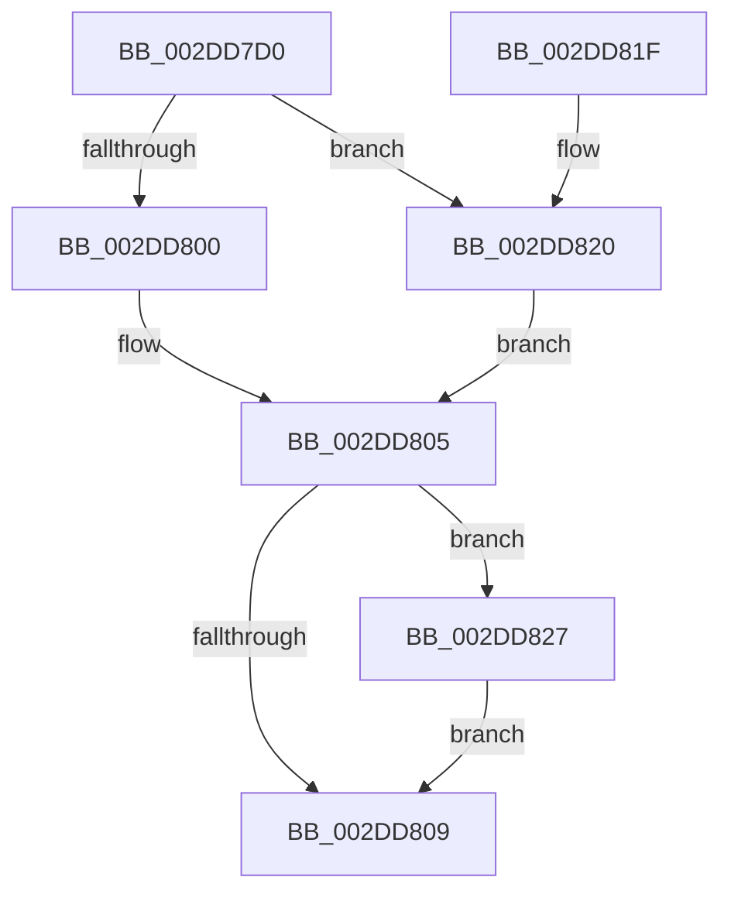

# PopExecuteProcessorCallback

- RVA: `0x002DD7D0`–`0x002DD82C` (길이 `92` bytes)
- VA: `0x00000001402DD7D0`
- 실행 섹션: `.text`
- PDB 이름 있음: `예`; PDB Function 태그: `아니요`
- unwind 정보 RVA: `0x00068790`
- 디코드: `27`개 명령, `92/92` bytes 표시
- 미해석 바이트: `0` (있으면 어셈블리에 `.byte`로 보존)

> 이 문서는 커널 이미지의 기계어와 PDB 기호를 분석해 생성했습니다. 4번과 5번은 함수 원형과 자료형을 바이너리 사용 방식에서 추정한 C 해석이며 원본 소스 복구 결과는 아닙니다.

## 1. Dependencies

- 직접 호출 지점: **3**; 고유 호출 대상: **3**
- 직접 호출자로 확인된 함수: **0**
- RIP 상대 이미지 참조: **1**

### Outgoing calls
- `0x002DD800` → [PopGetIdleTimesCallback](PopGetIdleTimesCallback_function_002DEFD0.md) (function, `0x002DEFD0`)
- `0x002DD80F` → [PopQueueTargetDpc](PopQueueTargetDpc_function_002DD8F0.md) (function, `0x002DD8F0`)
- `0x002DD820` → [guard_dispatch_icall](../6B/guard_dispatch_icall_function_006BAAD0.md) (function, `0x006BAAD0`)

### Direct callers
- 이 함수 시작 RVA로 연결되는 직접 call은 확인되지 않았습니다. 간접 호출은 완전히 역산할 수 없습니다.

### Static image references
- `0x002DD7DD` → RVA `0x002DEFD0` (`PopGetIdleTimesCallback`; read)

## 2. Other-region calls and transfers

- 다른 실행 섹션으로 향하는 call: **0**
- 별도 외부 분기/꼬리 이동을 확인하지 못했습니다.

## 3. Assembly (complete function range)

```asm
002DD7D0  48 89 5C 24 08                  mov qword ptr [rsp + 8], rbx
002DD7D5  57                              push rdi
002DD7D6  48 83 EC 20                     sub rsp, 0x20
002DD7DA  48 8B DA                        mov rbx, rdx
002DD7DD  4C 8D 0D EC 17 00 00            lea r9, [rip + 0x17ec]
002DD7E4  48 8B F9                        mov rdi, rcx
002DD7E7  65 48 8B 0C 25 20 00 00 00      mov rcx, qword ptr gs:[0x20]
002DD7F0  4C 8B 42 10                     mov r8, qword ptr [rdx + 0x10]
002DD7F4  48 8B 52 08                     mov rdx, qword ptr [rdx + 8]
002DD7F8  48 8B 03                        mov rax, qword ptr [rbx]
002DD7FB  49 3B C1                        cmp rax, r9
002DD7FE  75 20                           jne 0x1402dd820
002DD800  E8 CB 17 00 00                  call 0x1402defd0
002DD805  85 C0                           test eax, eax
002DD807  78 1E                           js 0x1402dd827
002DD809  48 8B D3                        mov rdx, rbx
002DD80C  48 8B CF                        mov rcx, rdi
002DD80F  E8 DC 00 00 00                  call 0x1402dd8f0
002DD814  48 8B 5C 24 30                  mov rbx, qword ptr [rsp + 0x30]
002DD819  48 83 C4 20                     add rsp, 0x20
002DD81D  5F                              pop rdi
002DD81E  C3                              ret
002DD81F  CC                              int3
002DD820  E8 AB D2 3D 00                  call 0x1406baad0
002DD825  EB DE                           jmp 0x1402dd805
002DD827  89 43 28                        mov dword ptr [rbx + 0x28], eax
002DD82A  EB DD                           jmp 0x1402dd809
```

## 4. C-style interpretation (structured pseudocode)

```c
__int64 __fastcall PopExecuteProcessorCallback(__int64 a1, __int64 a2)
{
    __int64 result;
    __int64 v_rsp;
    unsigned __int64 v_stack_p8;

    v_stack_p8 = v_rbx;
    v_rsp = (v_rsp) - (32);
    if ((*(unsigned __int64 *)(a2)) != (v_rip + 6124)) goto loc_002DD820;
    result = PopGetIdleTimesCallback(*(unsigned __int64 *)(gs_base + (0 + 32)), *(unsigned __int64 *)(a2 + 8), *(unsigned __int64 *)(a2 + 16), v_rip + 6124);
loc_002DD805:
    if (sign_flag) goto loc_002DD827;
loc_002DD809:
    result = PopQueueTargetDpc(a1, a2, *(unsigned __int64 *)(a2 + 16), v_rip + 6124);
    v_rsp = (v_rsp) + (32);
    return result;
loc_002DD820:
    result = guard_dispatch_icall(a1, a2, *(unsigned __int64 *)(a2 + 16), v_rip + 6124);
    goto loc_002DD805;
loc_002DD827:
    *(unsigned int *)(v_stack_p8 + 40) = (unsigned int)(result);
    goto loc_002DD809;
}
```

## 5. (Beta) C Style

```c
int64_t PopExecuteProcessorCallback(int64_t Arg1, void *Arg2)
{
    uint8_t *arg2 = (uint8_t *)Arg2;

    int64_t result;
    int64_t local_rsp;
    uint64_t v_stack_p8;

    v_stack_p8 = local_rbx;
    local_rsp = (local_rsp) - (32);
    if ((*(uint64_t *)(arg2)) != (v_rip + 6124)) goto loc_002DD820;
    result = PopGetIdleTimesCallback(*(uint64_t *)(gs_base + (0 + 0x20)), *(uint64_t *)(arg2 + 0x8), *(uint64_t *)(arg2 + 0x10), v_rip + 6124);
loc_002DD805:
    if (sign_flag) goto loc_002DD827;
loc_002DD809:
    result = PopQueueTargetDpc(Arg1, Arg2, *(uint64_t *)(arg2 + 0x10), v_rip + 6124);
    local_rsp = (local_rsp) + (32);
    return result;
loc_002DD820:
    result = guard_dispatch_icall(Arg1, Arg2, *(uint64_t *)(arg2 + 0x10), v_rip + 6124);
    goto loc_002DD805;
loc_002DD827:
    *(uint32_t *)(v_stack_p8 + 0x28) = (uint32_t)(result);
    goto loc_002DD809;
}
```

### 관측된 메모리 오프셋

구조체 형식이 확인되지 않은 접근은 인자 기준의 오프셋으로만 기록했습니다.

| 기준 인자 | 오프셋 표현 | 폭 (bit) | 접근 |
|---|---:|---:|---|
| `Arg2` | `+ 0x0` | `64` | `R` |
| `Arg2` | `+ 0x8` | `64` | `R` |
| `Arg2` | `+ 0x10` | `64` | `R` |
| `Arg2` | `+ 0x28` | `32` | `W` |

## 6. Execution-region graph

[열기: 2D/3D 그래프와 함수 탐색 컨트롤 패널](../../../control-panel.html?section=text&rva=0x002DD7D0&view=graph)

- 2D 그래프는 위에서 아래로 흐르고, 3D 그래프는 빈 공간을 드래그해 회전합니다. Shift+드래그는 이동, 휠은 확대·축소, 함수 노드 선택은 대상 보고서 이동입니다.

### Static fallback


