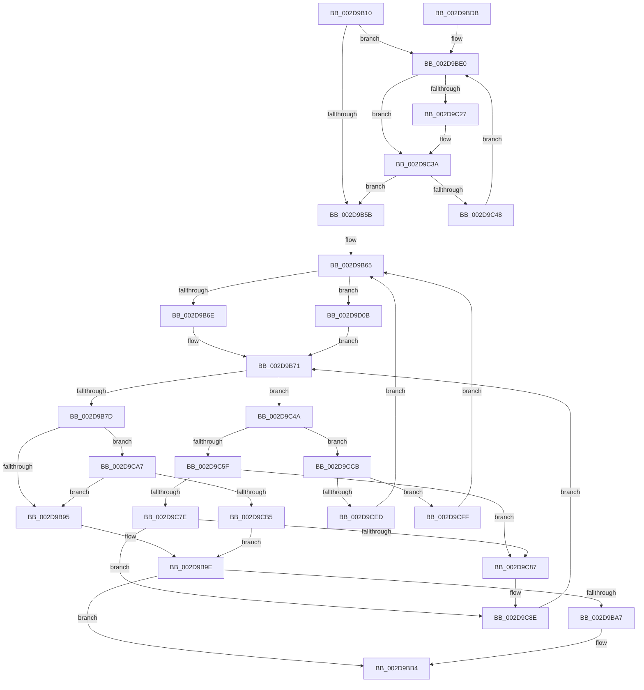

# PopFxActivateComponentDependencies

- RVA: `0x002D9B10`–`0x002D9D1D` (길이 `525` bytes)
- VA: `0x00000001402D9B10`
- 실행 섹션: `.text`
- PDB 이름 있음: `예`; PDB Function 태그: `아니요`
- unwind 정보 RVA: `0x00070454`
- 디코드: `124`개 명령, `525/525` bytes 표시
- 미해석 바이트: `0` (있으면 어셈블리에 `.byte`로 보존)

> 이 문서는 커널 이미지의 기계어와 PDB 기호를 분석해 생성했습니다. 4번과 5번은 함수 원형과 자료형을 바이너리 사용 방식에서 추정한 C 해석이며 원본 소스 복구 결과는 아닙니다.

## 1. Dependencies

- 직접 호출 지점: **9**; 고유 호출 대상: **7**
- 직접 호출자로 확인된 함수: **1**
- RIP 상대 이미지 참조: **3**

### Outgoing calls
- `0x002D9B3D` → [KeAcquireSpinLockRaiseToDpc](../20/KeAcquireSpinLockRaiseToDpc_function_00208470.md) (function, `0x00208470`)
- `0x002D9BAF` → [KiLowerIrqlProcessIrqlFlags](../4F/KiLowerIrqlProcessIrqlFlags_function_004F5698.md) (function, `0x004F5698`)
- `0x002D9C0E` → [PopFxActivateComponent](PopFxActivateComponent_function_002D9DBC.md) (function, `0x002D9DBC`)
- `0x002D9C52` → [KeAcquireSpinLockAtDpcLevel](../20/KeAcquireSpinLockAtDpcLevel_function_00208430.md) (function, `0x00208430`)
- `0x002D9C63` → [KxReleaseSpinLock](../20/KxReleaseSpinLock_function_00206670.md) (function, `0x00206670`)
- `0x002D9C9D` → [ExFreePoolWithTag](../../poolcode/B8/ExFreePoolWithTag_function_00B82870.md) (function, `0x00B82870`)
- `0x002D9CC1` → [KiReleaseSpinLockInstrumented](../39/KiReleaseSpinLockInstrumented_function_00392EF0.md) (function, `0x00392EF0`)
- `0x002D9CDD` → [PopFxActivateComponent](PopFxActivateComponent_function_002D9DBC.md) (function, `0x002D9DBC`)
- `0x002D9D0F` → [KxReleaseSpinLock](../20/KxReleaseSpinLock_function_00206670.md) (function, `0x00206670`)

### Direct callers
- [PopFxActivateComponentWorker](PopFxActivateComponentWorker_function_002D9F60.md) at `0x002D9F94`

### Static image references
- `0x002D9B88` → RVA `0x00FC6B06` (`ALMOSTRO`; read)
- `0x002D9B9E` → RVA `0x00FC6D20` (`ALMOSTRO`; read)
- `0x002D9CA7` → RVA `0x00F0DE58` (`.data`; read)

## 2. Other-region calls and transfers

- 다른 실행 섹션으로 향하는 call: **1**
  - `0x002D9C9D` → [ExFreePoolWithTag](../../poolcode/B8/ExFreePoolWithTag_function_00B82870.md) (`.text` → `POOLCODE`)
- 별도 외부 분기/꼬리 이동을 확인하지 못했습니다.

## 3. Assembly (complete function range)

```asm
002D9B10  48 89 5C 24 08                  mov qword ptr [rsp + 8], rbx
002D9B15  48 89 6C 24 10                  mov qword ptr [rsp + 0x10], rbp
002D9B1A  48 89 74 24 18                  mov qword ptr [rsp + 0x18], rsi
002D9B1F  48 89 7C 24 20                  mov qword ptr [rsp + 0x20], rdi
002D9B24  41 54                           push r12
002D9B26  41 56                           push r14
002D9B28  41 57                           push r15
002D9B2A  48 83 EC 20                     sub rsp, 0x20
002D9B2E  4C 8B 71 50                     mov r14, qword ptr [rcx + 0x50]
002D9B32  48 8B D9                        mov rbx, rcx
002D9B35  48 83 E9 80                     sub rcx, -0x80
002D9B39  44 0F B6 FA                     movzx r15d, dl
002D9B3D  E8 2E E9 F2 FF                  call 0x140208470
002D9B42  8B 8B AC 00 00 00               mov ecx, dword ptr [rbx + 0xac]
002D9B48  33 F6                           xor esi, esi
002D9B4A  0F B6 E8                        movzx ebp, al
002D9B4D  89 8B B8 00 00 00               mov dword ptr [rbx + 0xb8], ecx
002D9B53  85 C9                           test ecx, ecx
002D9B55  0F 85 85 00 00 00               jne 0x1402d9be0
002D9B5B  45 33 F6                        xor r14d, r14d
002D9B5E  48 8D B3 C8 01 00 00            lea rsi, [rbx + 0x1c8]
002D9B65  4D 85 F6                        test r14, r14
002D9B68  0F 85 9D 01 00 00               jne 0x1402d9d0b
002D9B6E  4C 8B FE                        mov r15, rsi
002D9B71  49 8B 3F                        mov rdi, qword ptr [r15]
002D9B74  48 3B FE                        cmp rdi, rsi
002D9B77  0F 85 CD 00 00 00               jne 0x1402d9c4a
002D9B7D  83 BB B8 00 00 00 00            cmp dword ptr [rbx + 0xb8], 0
002D9B84  40 0F 94 C7                     sete dil
002D9B88  F6 05 77 CF CE 00 01            test byte ptr [rip + 0xcecf77], 1
002D9B8F  0F 85 12 01 00 00               jne 0x1402d9ca7
002D9B95  F0 48 83 A3 80 00 00 00 00      lock and qword ptr [rbx + 0x80], 0
002D9B9E  83 3D 7B D1 CE 00 00            cmp dword ptr [rip + 0xced17b], 0
002D9BA5  74 0D                           je 0x1402d9bb4
002D9BA7  44 0F 20 C1                     mov rcx, cr8
002D9BAB  40 0F B6 D5                     movzx edx, bpl
002D9BAF  E8 E4 BA 21 00                  call 0x1404f5698
002D9BB4  44 0F 22 C5                     mov cr8, rbp
002D9BB8  48 8B 5C 24 40                  mov rbx, qword ptr [rsp + 0x40]
002D9BBD  40 0F B6 C7                     movzx eax, dil
002D9BC1  48 8B 7C 24 58                  mov rdi, qword ptr [rsp + 0x58]
002D9BC6  48 8B 6C 24 48                  mov rbp, qword ptr [rsp + 0x48]
002D9BCB  48 8B 74 24 50                  mov rsi, qword ptr [rsp + 0x50]
002D9BD0  48 83 C4 20                     add rsp, 0x20
002D9BD4  41 5F                           pop r15
002D9BD6  41 5E                           pop r14
002D9BD8  41 5C                           pop r12
002D9BDA  C3                              ret
002D9BDB  CC                              int3
002D9BDC  0F 1F 40 00                     nop dword ptr [rax]
002D9BE0  48 8B 83 B0 00 00 00            mov rax, qword ptr [rbx + 0xb0]
002D9BE7  4C 8D 24 F5 00 00 00 00         lea r12, [rsi*8]
002D9BEF  45 0F B6 CF                     movzx r9d, r15b
002D9BF3  41 B8 0A 00 00 00               mov r8d, 0xa
002D9BF9  41 8B 0C 04                     mov ecx, dword ptr [r12 + rax]
002D9BFD  49 8B 86 68 03 00 00            mov rax, qword ptr [r14 + 0x368]
002D9C04  48 8B 3C C8                     mov rdi, qword ptr [rax + rcx*8]
002D9C08  49 8B CE                        mov rcx, r14
002D9C0B  48 8B D7                        mov rdx, rdi
002D9C0E  E8 A9 01 00 00                  call 0x1402d9dbc
002D9C13  48 8B 83 B0 00 00 00            mov rax, qword ptr [rbx + 0xb0]
002D9C1A  41 C6 44 04 04 01               mov byte ptr [r12 + rax + 4], 1
002D9C20  8B 47 58                        mov eax, dword ptr [rdi + 0x58]
002D9C23  85 C0                           test eax, eax
002D9C25  79 13                           jns 0x1402d9c3a
002D9C27  48 8B 83 B0 00 00 00            mov rax, qword ptr [rbx + 0xb0]
002D9C2E  41 C6 44 04 04 00               mov byte ptr [r12 + rax + 4], 0
002D9C34  FF 8B B8 00 00 00               dec dword ptr [rbx + 0xb8]
002D9C3A  FF C6                           inc esi
002D9C3C  3B B3 AC 00 00 00               cmp esi, dword ptr [rbx + 0xac]
002D9C42  0F 83 13 FF FF FF               jae 0x1402d9b5b
002D9C48  EB 96                           jmp 0x1402d9be0
002D9C4A  4C 8D 77 C8                     lea r14, [rdi - 0x38]
002D9C4E  49 8D 4E 08                     lea rcx, [r14 + 8]
002D9C52  E8 D9 E7 F2 FF                  call 0x140208430
002D9C57  41 8B 46 10                     mov eax, dword ptr [r14 + 0x10]
002D9C5B  A8 04                           test al, 4
002D9C5D  75 6C                           jne 0x1402d9ccb
002D9C5F  49 8D 4E 08                     lea rcx, [r14 + 8]
002D9C63  E8 08 CA F2 FF                  call 0x140206670
002D9C68  41 83 66 10 F7                  and dword ptr [r14 + 0x10], 0xfffffff7
002D9C6D  49 C7 46 30 00 00 00 00         mov qword ptr [r14 + 0x30], 0
002D9C75  48 8B 0F                        mov rcx, qword ptr [rdi]
002D9C78  48 39 79 08                     cmp qword ptr [rcx + 8], rdi
002D9C7C  75 09                           jne 0x1402d9c87
002D9C7E  48 8B 47 08                     mov rax, qword ptr [rdi + 8]
002D9C82  48 39 38                        cmp qword ptr [rax], rdi
002D9C85  74 07                           je 0x1402d9c8e
002D9C87  B9 03 00 00 00                  mov ecx, 3
002D9C8C  CD 29                           int 0x29
002D9C8E  48 89 08                        mov qword ptr [rax], rcx
002D9C91  BA 50 46 58 4D                  mov edx, 0x4d584650
002D9C96  48 89 41 08                     mov qword ptr [rcx + 8], rax
002D9C9A  49 8B CE                        mov rcx, r14
002D9C9D  E8 CE 8B 8A 00                  call 0x140b82870
002D9CA2  E9 CA FE FF FF                  jmp 0x1402d9b71
002D9CA7  8B 05 AB 41 C3 00               mov eax, dword ptr [rip + 0xc341ab]
002D9CAD  85 C0                           test eax, eax
002D9CAF  0F 85 E0 FE FF FF               jne 0x1402d9b95
002D9CB5  48 8B 54 24 38                  mov rdx, qword ptr [rsp + 0x38]
002D9CBA  48 8D 8B 80 00 00 00            lea rcx, [rbx + 0x80]
002D9CC1  E8 2A 92 0B 00                  call 0x140392ef0
002D9CC6  E9 D3 FE FF FF                  jmp 0x1402d9b9e
002D9CCB  49 8B 7E 18                     mov rdi, qword ptr [r14 + 0x18]
002D9CCF  45 33 C9                        xor r9d, r9d
002D9CD2  48 8B D7                        mov rdx, rdi
002D9CD5  48 8B 4F 50                     mov rcx, qword ptr [rdi + 0x50]
002D9CD9  45 8D 41 0A                     lea r8d, [r9 + 0xa]
002D9CDD  E8 DA 00 00 00                  call 0x1402d9dbc
002D9CE2  8B 47 58                        mov eax, dword ptr [rdi + 0x58]
002D9CE5  41 8B 4E 10                     mov ecx, dword ptr [r14 + 0x10]
002D9CE9  85 C0                           test eax, eax
002D9CEB  78 12                           js 0x1402d9cff
002D9CED  83 C9 01                        or ecx, 1
002D9CF0  41 89 4E 10                     mov dword ptr [r14 + 0x10], ecx
002D9CF4  FF 83 B8 00 00 00               inc dword ptr [rbx + 0xb8]
002D9CFA  E9 66 FE FF FF                  jmp 0x1402d9b65
002D9CFF  83 C9 02                        or ecx, 2
002D9D02  41 89 4E 10                     mov dword ptr [r14 + 0x10], ecx
002D9D06  E9 5A FE FF FF                  jmp 0x1402d9b65
002D9D0B  49 8D 4E 08                     lea rcx, [r14 + 8]
002D9D0F  E8 5C C9 F2 FF                  call 0x140206670
002D9D14  4D 8D 7E 38                     lea r15, [r14 + 0x38]
002D9D18  E9 54 FE FF FF                  jmp 0x1402d9b71
```

## 4. C-style interpretation (structured pseudocode)

```c
__int64 __fastcall PopFxActivateComponentDependencies(__int64 a1, unsigned __int8 a2)
{
    __int64 result;
    __int64 v_r14;
    __int64 v_rdi;
    __int64 v_rsi;
    __int64 v_rsp;
    unsigned __int64 v_stack_p10;
    unsigned __int64 v_stack_p18;
    unsigned __int64 v_stack_p20;
    unsigned __int64 v_stack_p38;
    unsigned __int64 v_stack_p8;

    v_stack_p8 = v_rbx;
    v_stack_p10 = v_rbp;
    v_stack_p18 = v_rsi;
    v_stack_p20 = v_rdi;
    v_rsp = (v_rsp) - (32);
    a1 = (a1) - (-128);
    result = KeAcquireSpinLockRaiseToDpc(a1, a2, a3, a4);
    v_rsi = 0;
    *(unsigned int *)(a1 + 184) = (unsigned int)((unsigned int)(*(unsigned int *)(a1 + 172)));
    if ((unsigned int)((unsigned int)(*(unsigned int *)(a1 + 172))) != 0) goto loc_002D9BE0;
loc_002D9B5B:
    v_r14 = 0;
loc_002D9B65:
    if (0 != 0) goto loc_002D9D0B;
loc_002D9B71:
    if ((*(unsigned __int64 *)(a1 + 456)) != (a1 + 456)) goto loc_002D9C4A;
    v_rdi = ((*(unsigned int *)(a1 + 184)) == 0) ? 1 : 0;
    if (((*(unsigned __int8 *)(v_rip + 13553527)) & (1)) != 0) goto loc_002D9CA7;
loc_002D9B95:
loc_002D9B9E:
    if ((*(unsigned int *)(v_rip + 13554043)) != 0) {
        a1 = v_cr8;
        a2 = (unsigned __int8)((unsigned __int8)(result));
        result = KiLowerIrqlProcessIrqlFlags(a1, a2, a3, a4);
    }
    v_rsp = (v_rsp) + (32);
    return (unsigned __int8)(v_rdi);
loc_002D9BE0:
    result = PopFxActivateComponent(0, *(unsigned __int64 *)(*(unsigned __int64 *)(v_r14 + 872) + (unsigned int)(*(unsigned int *)(v_stack_p18 * 8 + *(unsigned __int64 *)(v_stack_p8 + 176) * 1)) * 8), 10, (unsigned __int8)(a1 + 456));
    *(unsigned __int8 *)(v_stack_p18 * 8 + *(unsigned __int64 *)(v_stack_p8 + 176) * 1 + 4) = 1;
    result = (unsigned int)(*(unsigned int *)(*(unsigned __int64 *)(*(unsigned __int64 *)(v_r14 + 872) + (unsigned int)(*(unsigned int *)(v_stack_p18 * 8 + *(unsigned __int64 *)(v_stack_p8 + 176) * 1)) * 8) + 88));
    if (sign_flag) {
        result = *(unsigned __int64 *)(v_stack_p8 + 176);
        *(unsigned __int8 *)(v_stack_p18 * 8 + result * 1 + 4) = 0;
    }
    v_rsi = (unsigned int)((v_stack_p18) + 1);
    if (((unsigned int)(v_rsi)) >= (*(unsigned int *)(v_stack_p8 + 172))) goto loc_002D9B5B;
    goto loc_002D9BE0;
loc_002D9C4A:
    result = KeAcquireSpinLockAtDpcLevel(*(unsigned __int64 *)(*(unsigned __int64 *)(v_r14 + 872) + (unsigned int)(*(unsigned int *)(v_stack_p18 * 8 + *(unsigned __int64 *)(v_stack_p8 + 176) * 1)) * 8) - 56 + 8, *(unsigned __int64 *)(*(unsigned __int64 *)(v_r14 + 872) + (unsigned int)(*(unsigned int *)(v_stack_p18 * 8 + *(unsigned __int64 *)(v_stack_p8 + 176) * 1)) * 8), 10, (unsigned __int8)(a1 + 456));
    if ((((unsigned __int8)((unsigned int)(*(unsigned int *)(*(unsigned __int64 *)(*(unsigned __int64 *)(v_r14 + 872) + (unsigned int)(*(unsigned int *)(v_stack_p18 * 8 + *(unsigned __int64 *)(v_stack_p8 + 176) * 1)) * 8) - 56 + 16)))) & (4)) != 0) goto loc_002D9CCB;
    result = KxReleaseSpinLock(*(unsigned __int64 *)(*(unsigned __int64 *)(v_r14 + 872) + (unsigned int)(*(unsigned int *)(v_stack_p18 * 8 + *(unsigned __int64 *)(v_stack_p8 + 176) * 1)) * 8) - 56 + 8, *(unsigned __int64 *)(*(unsigned __int64 *)(v_r14 + 872) + (unsigned int)(*(unsigned int *)(v_stack_p18 * 8 + *(unsigned __int64 *)(v_stack_p8 + 176) * 1)) * 8), 10, (unsigned __int8)(a1 + 456));
    *(unsigned __int64 *)(*(unsigned __int64 *)(*(unsigned __int64 *)(v_r14 + 872) + (unsigned int)(*(unsigned int *)(v_stack_p18 * 8 + *(unsigned __int64 *)(v_stack_p8 + 176) * 1)) * 8) - 56 + 48) = 0;
    if ((*(unsigned __int64 *)(*(unsigned __int64 *)(*(unsigned __int64 *)(*(unsigned __int64 *)(v_r14 + 872) + (unsigned int)(*(unsigned int *)(v_stack_p18 * 8 + *(unsigned __int64 *)(v_stack_p8 + 176) * 1)) * 8)) + 8)) != (*(unsigned __int64 *)(*(unsigned __int64 *)(v_r14 + 872) + (unsigned int)(*(unsigned int *)(v_stack_p18 * 8 + *(unsigned __int64 *)(v_stack_p8 + 176) * 1)) * 8))) goto loc_002D9C87;
    if ((*(unsigned __int64 *)(*(unsigned __int64 *)(*(unsigned __int64 *)(*(unsigned __int64 *)(v_r14 + 872) + (unsigned int)(*(unsigned int *)(v_stack_p18 * 8 + *(unsigned __int64 *)(v_stack_p8 + 176) * 1)) * 8) + 8))) != (*(unsigned __int64 *)(*(unsigned __int64 *)(v_r14 + 872) + (unsigned int)(*(unsigned int *)(v_stack_p18 * 8 + *(unsigned __int64 *)(v_stack_p8 + 176) * 1)) * 8))) {
        a1 = 3;
    }
    *(unsigned __int64 *)(*(unsigned __int64 *)(*(unsigned __int64 *)(*(unsigned __int64 *)(v_r14 + 872) + (unsigned int)(*(unsigned int *)(v_stack_p18 * 8 + *(unsigned __int64 *)(v_stack_p8 + 176) * 1)) * 8) + 8)) = a1;
    *(unsigned __int64 *)(a1 + 8) = *(unsigned __int64 *)(*(unsigned __int64 *)(*(unsigned __int64 *)(v_r14 + 872) + (unsigned int)(*(unsigned int *)(v_stack_p18 * 8 + *(unsigned __int64 *)(v_stack_p8 + 176) * 1)) * 8) + 8);
    result = ExFreePoolWithTag(*(unsigned __int64 *)(*(unsigned __int64 *)(v_r14 + 872) + (unsigned int)(*(unsigned int *)(v_stack_p18 * 8 + *(unsigned __int64 *)(v_stack_p8 + 176) * 1)) * 8) - 56, (unsigned int)(0x4D584650ULL), 10, (unsigned __int8)(a1 + 456));
    goto loc_002D9B71;
loc_002D9CA7:
    if ((unsigned int)((unsigned int)(*(unsigned int *)(v_rip + 12796331))) != 0) goto loc_002D9B95;
    result = KiReleaseSpinLockInstrumented(v_stack_p8 + 128, v_stack_p38, 10, (unsigned __int8)(a1 + 456));
    goto loc_002D9B9E;
loc_002D9CCB:
    a4 = 0;
    result = PopFxActivateComponent(*(unsigned __int64 *)(*(unsigned __int64 *)(*(unsigned __int64 *)(*(unsigned __int64 *)(v_r14 + 872) + (unsigned int)(*(unsigned int *)(v_stack_p18 * 8 + *(unsigned __int64 *)(v_stack_p8 + 176) * 1)) * 8) - 56 + 24) + 80), *(unsigned __int64 *)(*(unsigned __int64 *)(*(unsigned __int64 *)(v_r14 + 872) + (unsigned int)(*(unsigned int *)(v_stack_p18 * 8 + *(unsigned __int64 *)(v_stack_p8 + 176) * 1)) * 8) - 56 + 24), a4 + 10, a4);
    if (sign_flag) goto loc_002D9CFF;
    a1 = (unsigned int)(((unsigned int)(*(unsigned int *)(*(unsigned __int64 *)(*(unsigned __int64 *)(v_r14 + 872) + (unsigned int)(*(unsigned int *)(v_stack_p18 * 8 + *(unsigned __int64 *)(v_stack_p8 + 176) * 1)) * 8) - 56 + 16))) | (1));
    *(unsigned int *)(*(unsigned __int64 *)(*(unsigned __int64 *)(v_r14 + 872) + (unsigned int)(*(unsigned int *)(v_stack_p18 * 8 + *(unsigned __int64 *)(v_stack_p8 + 176) * 1)) * 8) - 56 + 16) = (unsigned int)(a1);
    goto loc_002D9B65;
loc_002D9CFF:
    a1 = (unsigned int)((a1) | (2));
    *(unsigned int *)(*(unsigned __int64 *)(*(unsigned __int64 *)(v_r14 + 872) + (unsigned int)(*(unsigned int *)(v_stack_p18 * 8 + *(unsigned __int64 *)(v_stack_p8 + 176) * 1)) * 8) - 56 + 16) = (unsigned int)(a1);
    goto loc_002D9B65;
loc_002D9D0B:
    result = KxReleaseSpinLock(*(unsigned __int64 *)(*(unsigned __int64 *)(v_r14 + 872) + (unsigned int)(*(unsigned int *)(v_stack_p18 * 8 + *(unsigned __int64 *)(v_stack_p8 + 176) * 1)) * 8) - 56 + 8, *(unsigned __int64 *)(*(unsigned __int64 *)(*(unsigned __int64 *)(v_r14 + 872) + (unsigned int)(*(unsigned int *)(v_stack_p18 * 8 + *(unsigned __int64 *)(v_stack_p8 + 176) * 1)) * 8) - 56 + 24), a4 + 10, a4);
    goto loc_002D9B71;
}
```

## 5. (Beta) C Style

```c
int64_t PopFxActivateComponentDependencies(void *Arg1, uint8_t Arg2)
{
    uint8_t *arg1 = (uint8_t *)Arg1;

    int64_t result;
    int64_t local_r14;
    int64_t local_rdi;
    int64_t local_rsi;
    int64_t local_rsp;
    uint64_t v_stack_p10;
    uint64_t v_stack_p18;
    uint64_t v_stack_p20;
    uint64_t v_stack_p38;
    uint64_t v_stack_p8;

    v_stack_p8 = local_rbx;
    v_stack_p10 = local_rbp;
    v_stack_p18 = local_rsi;
    v_stack_p20 = local_rdi;
    local_rsp = (local_rsp) - (32);
    Arg1 = (Arg1) - (-128);
    result = KeAcquireSpinLockRaiseToDpc(Arg1, Arg2, a3, a4);
    local_rsi = 0;
    *(uint32_t *)(arg1 + 0xB8) = (uint32_t)((uint32_t)(*(uint32_t *)(arg1 + 0xAC)));
    if ((uint32_t)((uint32_t)(*(uint32_t *)(arg1 + 0xAC))) != 0) goto loc_002D9BE0;
loc_002D9B5B:
    local_r14 = 0;
loc_002D9B65:
    if (0 != 0) goto loc_002D9D0B;
loc_002D9B71:
    if ((*(uint64_t *)(arg1 + 0x1C8)) != (Arg1 + 456)) goto loc_002D9C4A;
    local_rdi = ((*(uint32_t *)(arg1 + 0xB8)) == 0) ? 1 : 0;
    if (((*(uint8_t *)(v_rip + 0xCECF77)) & (1)) != 0) goto loc_002D9CA7;
loc_002D9B95:
loc_002D9B9E:
    if ((*(uint32_t *)(v_rip + 0xCED17B)) != 0) {
        Arg1 = v_cr8;
        Arg2 = (uint8_t)((uint8_t)(result));
        result = KiLowerIrqlProcessIrqlFlags(Arg1, Arg2, a3, a4);
    }
    local_rsp = (local_rsp) + (32);
    return (uint8_t)(local_rdi);
loc_002D9BE0:
    result = PopFxActivateComponent(0, *(uint64_t *)(*(uint64_t *)(local_r14 + 0x368) + (uint32_t)(*(uint32_t *)(v_stack_p18 * 8 + *(uint64_t *)(v_stack_p8 + 0xB0) * 1)) * 8), 10, (uint8_t)(Arg1 + 456));
    *(uint8_t *)(v_stack_p18 * 8 + *(uint64_t *)(v_stack_p8 + 0xB0) * 1 + 0x4) = 1;
    result = (uint32_t)(*(uint32_t *)(*(uint64_t *)(*(uint64_t *)(local_r14 + 0x368) + (uint32_t)(*(uint32_t *)(v_stack_p18 * 8 + *(uint64_t *)(v_stack_p8 + 0xB0) * 1)) * 8) + 0x58));
    if (sign_flag) {
        result = *(uint64_t *)(v_stack_p8 + 0xB0);
        *(uint8_t *)(v_stack_p18 * 8 + result * 1 + 0x4) = 0;
    }
    local_rsi = (uint32_t)((v_stack_p18) + 1);
    if (((uint32_t)(local_rsi)) >= (*(uint32_t *)(v_stack_p8 + 0xAC))) goto loc_002D9B5B;
    goto loc_002D9BE0;
loc_002D9C4A:
    result = KeAcquireSpinLockAtDpcLevel(*(uint64_t *)(*(uint64_t *)(local_r14 + 0x368) + (uint32_t)(*(uint32_t *)(v_stack_p18 * 8 + *(uint64_t *)(v_stack_p8 + 0xB0) * 1)) * 8) - 56 + 8, *(uint64_t *)(*(uint64_t *)(local_r14 + 0x368) + (uint32_t)(*(uint32_t *)(v_stack_p18 * 8 + *(uint64_t *)(v_stack_p8 + 0xB0) * 1)) * 8), 10, (uint8_t)(Arg1 + 456));
    if ((((uint8_t)((uint32_t)(*(uint32_t *)(*(uint64_t *)(*(uint64_t *)(local_r14 + 0x368) + (uint32_t)(*(uint32_t *)(v_stack_p18 * 8 + *(uint64_t *)(v_stack_p8 + 0xB0) * 1)) * 8) - 0x38 + 0x10)))) & (4)) != 0) goto loc_002D9CCB;
    result = KxReleaseSpinLock(*(uint64_t *)(*(uint64_t *)(local_r14 + 0x368) + (uint32_t)(*(uint32_t *)(v_stack_p18 * 8 + *(uint64_t *)(v_stack_p8 + 0xB0) * 1)) * 8) - 56 + 8, *(uint64_t *)(*(uint64_t *)(local_r14 + 0x368) + (uint32_t)(*(uint32_t *)(v_stack_p18 * 8 + *(uint64_t *)(v_stack_p8 + 0xB0) * 1)) * 8), 10, (uint8_t)(Arg1 + 456));
    *(uint64_t *)(*(uint64_t *)(*(uint64_t *)(local_r14 + 0x368) + (uint32_t)(*(uint32_t *)(v_stack_p18 * 8 + *(uint64_t *)(v_stack_p8 + 0xB0) * 1)) * 8) - 0x38 + 0x30) = 0;
    if ((*(uint64_t *)(*(uint64_t *)(*(uint64_t *)(*(uint64_t *)(local_r14 + 0x368) + (uint32_t)(*(uint32_t *)(v_stack_p18 * 8 + *(uint64_t *)(v_stack_p8 + 0xB0) * 1)) * 8)) + 0x8)) != (*(uint64_t *)(*(uint64_t *)(local_r14 + 0x368) + (uint32_t)(*(uint32_t *)(v_stack_p18 * 8 + *(uint64_t *)(v_stack_p8 + 0xB0) * 1)) * 8))) goto loc_002D9C87;
    if ((*(uint64_t *)(*(uint64_t *)(*(uint64_t *)(*(uint64_t *)(local_r14 + 0x368) + (uint32_t)(*(uint32_t *)(v_stack_p18 * 8 + *(uint64_t *)(v_stack_p8 + 0xB0) * 1)) * 8) + 0x8))) != (*(uint64_t *)(*(uint64_t *)(local_r14 + 0x368) + (uint32_t)(*(uint32_t *)(v_stack_p18 * 8 + *(uint64_t *)(v_stack_p8 + 0xB0) * 1)) * 8))) {
        Arg1 = 3;
    }
    *(void **)(*(uint64_t *)(*(uint64_t *)(*(uint64_t *)(local_r14 + 0x368) + (uint32_t)(*(uint32_t *)(v_stack_p18 * 8 + *(uint64_t *)(v_stack_p8 + 0xB0) * 1)) * 8) + 0x8)) = Arg1;
    *(uint64_t *)(arg1 + 0x8) = *(uint64_t *)(*(uint64_t *)(*(uint64_t *)(local_r14 + 0x368) + (uint32_t)(*(uint32_t *)(v_stack_p18 * 8 + *(uint64_t *)(v_stack_p8 + 0xB0) * 1)) * 8) + 0x8);
    result = ExFreePoolWithTag(*(uint64_t *)(*(uint64_t *)(local_r14 + 0x368) + (uint32_t)(*(uint32_t *)(v_stack_p18 * 8 + *(uint64_t *)(v_stack_p8 + 0xB0) * 1)) * 8) - 56, (uint32_t)(0x4D584650ULL), 10, (uint8_t)(Arg1 + 456));
    goto loc_002D9B71;
loc_002D9CA7:
    if ((uint32_t)((uint32_t)(*(uint32_t *)(v_rip + 0xC341AB))) != 0) goto loc_002D9B95;
    result = KiReleaseSpinLockInstrumented(v_stack_p8 + 128, v_stack_p38, 10, (uint8_t)(Arg1 + 456));
    goto loc_002D9B9E;
loc_002D9CCB:
    a4 = 0;
    result = PopFxActivateComponent(*(uint64_t *)(*(uint64_t *)(*(uint64_t *)(*(uint64_t *)(local_r14 + 0x368) + (uint32_t)(*(uint32_t *)(v_stack_p18 * 8 + *(uint64_t *)(v_stack_p8 + 0xB0) * 1)) * 8) - 0x38 + 0x18) + 0x50), *(uint64_t *)(*(uint64_t *)(*(uint64_t *)(local_r14 + 0x368) + (uint32_t)(*(uint32_t *)(v_stack_p18 * 8 + *(uint64_t *)(v_stack_p8 + 0xB0) * 1)) * 8) - 0x38 + 0x18), a4 + 10, a4);
    if (sign_flag) goto loc_002D9CFF;
    Arg1 = (uint32_t)(((uint32_t)(*(uint32_t *)(*(uint64_t *)(*(uint64_t *)(local_r14 + 0x368) + (uint32_t)(*(uint32_t *)(v_stack_p18 * 8 + *(uint64_t *)(v_stack_p8 + 0xB0) * 1)) * 8) - 0x38 + 0x10))) | (1));
    *(uint32_t *)(*(uint64_t *)(*(uint64_t *)(local_r14 + 0x368) + (uint32_t)(*(uint32_t *)(v_stack_p18 * 8 + *(uint64_t *)(v_stack_p8 + 0xB0) * 1)) * 8) - 0x38 + 0x10) = (uint32_t)(Arg1);
    goto loc_002D9B65;
loc_002D9CFF:
    Arg1 = (uint32_t)((Arg1) | (2));
    *(uint32_t *)(*(uint64_t *)(*(uint64_t *)(local_r14 + 0x368) + (uint32_t)(*(uint32_t *)(v_stack_p18 * 8 + *(uint64_t *)(v_stack_p8 + 0xB0) * 1)) * 8) - 0x38 + 0x10) = (uint32_t)(Arg1);
    goto loc_002D9B65;
loc_002D9D0B:
    result = KxReleaseSpinLock(*(uint64_t *)(*(uint64_t *)(local_r14 + 0x368) + (uint32_t)(*(uint32_t *)(v_stack_p18 * 8 + *(uint64_t *)(v_stack_p8 + 0xB0) * 1)) * 8) - 56 + 8, *(uint64_t *)(*(uint64_t *)(*(uint64_t *)(local_r14 + 0x368) + (uint32_t)(*(uint32_t *)(v_stack_p18 * 8 + *(uint64_t *)(v_stack_p8 + 0xB0) * 1)) * 8) - 0x38 + 0x18), a4 + 10, a4);
    goto loc_002D9B71;
}
```

### 관측된 메모리 오프셋

구조체 형식이 확인되지 않은 접근은 인자 기준의 오프셋으로만 기록했습니다.

| 기준 인자 | 오프셋 표현 | 폭 (bit) | 접근 |
|---|---:|---:|---|
| `Arg1` | `+ 0x50` | `64` | `R` |
| `Arg1` | `+ 0x80` | `64` | `R` |
| `Arg1` | `+ 0x80` | `64` | `R/W` |
| `Arg1` | `+ 0xAC` | `32` | `R` |
| `Arg1` | `+ 0xB0` | `64` | `R` |
| `Arg1` | `+ 0xB8` | `32` | `R` |
| `Arg1` | `+ 0xB8` | `32` | `R/W` |
| `Arg1` | `+ 0xB8` | `32` | `W` |
| `Arg1` | `+ 0x1C8` | `64` | `R` |

## 6. Execution-region graph

[열기: 2D/3D 그래프와 함수 탐색 컨트롤 패널](../../../control-panel.html?section=text&rva=0x002D9B10&view=graph)

- 2D 그래프는 위에서 아래로 흐르고, 3D 그래프는 빈 공간을 드래그해 회전합니다. Shift+드래그는 이동, 휠은 확대·축소, 함수 노드 선택은 대상 보고서 이동입니다.

### Static fallback


