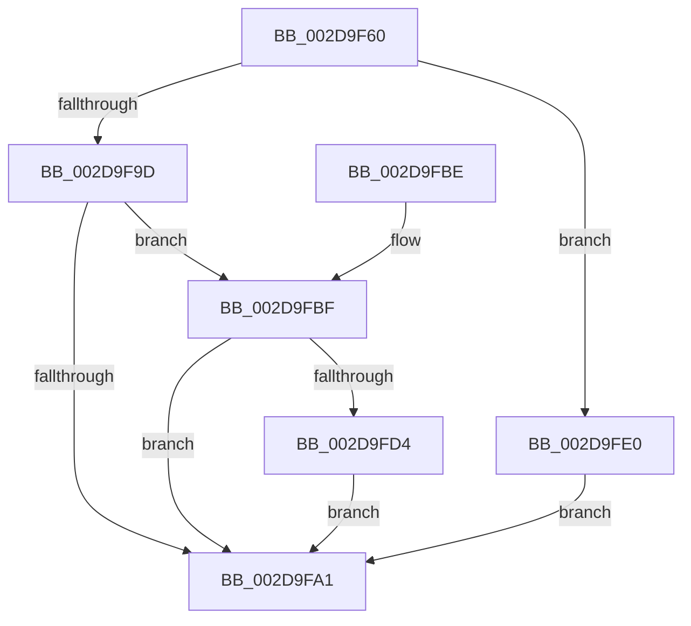

# PopFxActivateComponentWorker

- RVA: `0x002D9F60`–`0x002D9FF0` (길이 `144` bytes)
- VA: `0x00000001402D9F60`
- 실행 섹션: `.text`
- PDB 이름 있음: `예`; PDB Function 태그: `아니요`
- unwind 정보 RVA: `0x00070494`
- 디코드: `44`개 명령, `144/144` bytes 표시
- 미해석 바이트: `0` (있으면 어셈블리에 `.byte`로 보존)

> 이 문서는 커널 이미지의 기계어와 PDB 기호를 분석해 생성했습니다. 4번과 5번은 함수 원형과 자료형을 바이너리 사용 방식에서 추정한 C 해석이며 원본 소스 복구 결과는 아닙니다.

## 1. Dependencies

- 직접 호출 지점: **7**; 고유 호출 대상: **7**
- 직접 호출자로 확인된 함수: **2**
- RIP 상대 이미지 참조: **0**

### Outgoing calls
- `0x002D9F80` → [PopFxDeviceCriticalRegionEnter](../4F/PopFxDeviceCriticalRegionEnter_function_004F09A0.md) (function, `0x004F09A0`)
- `0x002D9F8A` → [PopFxReferenceDevice](../2B/PopFxReferenceDevice_function_002BFD9C.md) (function, `0x002BFD9C`)
- `0x002D9F94` → [PopFxActivateComponentDependencies](PopFxActivateComponentDependencies_function_002D9B10.md) (function, `0x002D9B10`)
- `0x002D9FA4` → [PopFxDeviceCriticalRegionLeave](../4F/PopFxDeviceCriticalRegionLeave_function_004F1330.md) (function, `0x004F1330`)
- `0x002D9FCB` → [PopPluginComponentActive](../24/PopPluginComponentActive_function_0024B800.md) (function, `0x0024B800`)
- `0x002D9FD9` → [PopFxProcessWork](../2B/PopFxProcessWork_function_002BD3E0.md) (function, `0x002BD3E0`)
- `0x002D9FE9` → [PopFxCompleteComponentActivation](../2B/PopFxCompleteComponentActivation_function_002BDDE4.md) (function, `0x002BDDE4`)

### Direct callers
- [PopFxActivateComponent](PopFxActivateComponent_function_002D9DBC.md) at `0x002D9EAC`
- [PopFxIdleWorkerTail](../43/PopFxIdleWorkerTail_function_0043CDA0.md) at `0x0043CF39`

### Static image references
- 디코드된 RIP-relative 메모리 참조가 없습니다.

## 2. Other-region calls and transfers

- 다른 실행 섹션으로 향하는 call: **0**
- 별도 외부 분기/꼬리 이동을 확인하지 못했습니다.

## 3. Assembly (complete function range)

```asm
002D9F60  48 89 5C 24 08                  mov qword ptr [rsp + 8], rbx
002D9F65  48 89 6C 24 10                  mov qword ptr [rsp + 0x10], rbp
002D9F6A  48 89 74 24 18                  mov qword ptr [rsp + 0x18], rsi
002D9F6F  57                              push rdi
002D9F70  48 83 EC 20                     sub rsp, 0x20
002D9F74  49 8B E9                        mov rbp, r9
002D9F77  41 8A D8                        mov bl, r8b
002D9F7A  48 8B F2                        mov rsi, rdx
002D9F7D  48 8B F9                        mov rdi, rcx
002D9F80  E8 1B 6A 21 00                  call 0x1404f09a0
002D9F85  BA 08 00 00 00                  mov edx, 8
002D9F8A  E8 0D 5E FE FF                  call 0x1402bfd9c
002D9F8F  8A D3                           mov dl, bl
002D9F91  48 8B CE                        mov rcx, rsi
002D9F94  E8 77 FB FF FF                  call 0x1402d9b10
002D9F99  84 DB                           test bl, bl
002D9F9B  75 43                           jne 0x1402d9fe0
002D9F9D  84 C0                           test al, al
002D9F9F  75 1E                           jne 0x1402d9fbf
002D9FA1  48 8B CF                        mov rcx, rdi
002D9FA4  E8 87 73 21 00                  call 0x1404f1330
002D9FA9  48 8B 5C 24 30                  mov rbx, qword ptr [rsp + 0x30]
002D9FAE  48 8B 6C 24 38                  mov rbp, qword ptr [rsp + 0x38]
002D9FB3  48 8B 74 24 40                  mov rsi, qword ptr [rsp + 0x40]
002D9FB8  48 83 C4 20                     add rsp, 0x20
002D9FBC  5F                              pop rdi
002D9FBD  C3                              ret
002D9FBE  CC                              int3
002D9FBF  8B 56 10                        mov edx, dword ptr [rsi + 0x10]
002D9FC2  4C 8B CD                        mov r9, rbp
002D9FC5  41 B0 01                        mov r8b, 1
002D9FC8  48 8B CF                        mov rcx, rdi
002D9FCB  E8 30 18 F7 FF                  call 0x14024b800
002D9FD0  3C 01                           cmp al, 1
002D9FD2  75 CD                           jne 0x1402d9fa1
002D9FD4  48 8B D5                        mov rdx, rbp
002D9FD7  33 C9                           xor ecx, ecx
002D9FD9  E8 02 34 FE FF                  call 0x1402bd3e0
002D9FDE  EB C1                           jmp 0x1402d9fa1
002D9FE0  45 33 C0                        xor r8d, r8d
002D9FE3  48 8B D6                        mov rdx, rsi
002D9FE6  48 8B CF                        mov rcx, rdi
002D9FE9  E8 F6 3D FE FF                  call 0x1402bdde4
002D9FEE  EB B1                           jmp 0x1402d9fa1
```

## 4. C-style interpretation (structured pseudocode)

```c
__int64 __fastcall PopFxActivateComponentWorker(__int64 a1, __int64 a2, unsigned __int8 a3, __int64 a4)
{
    __int64 result;
    __int64 v_rsp;
    unsigned __int64 v_stack_p10;
    unsigned __int64 v_stack_p18;
    unsigned __int64 v_stack_p8;

    v_stack_p8 = v_rbx;
    v_stack_p10 = v_rbp;
    v_stack_p18 = v_rsi;
    v_rsp = (v_rsp) - (32);
    result = PopFxDeviceCriticalRegionEnter(a1, a2, a3, a4);
    result = PopFxReferenceDevice(a1, 8, a3, a4);
    result = PopFxActivateComponentDependencies(a2, a3, a3, a4);
    if (a3 != 0) goto loc_002D9FE0;
    if ((unsigned __int8)(result) != 0) goto loc_002D9FBF;
loc_002D9FA1:
    result = PopFxDeviceCriticalRegionLeave(a1, a3, a3, a4);
    v_rsp = (v_rsp) + (32);
    return result;
loc_002D9FBF:
    result = PopPluginComponentActive(a1, (unsigned int)(*(unsigned int *)(v_stack_p18 + 16)), 1, v_stack_p10);
    if (((unsigned __int8)(result)) != 1) goto loc_002D9FA1;
    a1 = 0;
    result = PopFxProcessWork(a1, v_stack_p10, 1, v_stack_p10);
    goto loc_002D9FA1;
loc_002D9FE0:
    a3 = 0;
    result = PopFxCompleteComponentActivation(0, v_stack_p18, a3, v_stack_p10);
    goto loc_002D9FA1;
}
```

## 5. (Beta) C Style

```c
int64_t PopFxActivateComponentWorker(int64_t Arg1, void *Arg2, uint8_t Arg3, int64_t Arg4)
{
    uint8_t *arg2 = (uint8_t *)Arg2;

    int64_t result;
    int64_t local_rsp;
    uint64_t v_stack_p10;
    uint64_t v_stack_p18;
    uint64_t v_stack_p8;

    v_stack_p8 = local_rbx;
    v_stack_p10 = local_rbp;
    v_stack_p18 = local_rsi;
    local_rsp = (local_rsp) - (32);
    result = PopFxDeviceCriticalRegionEnter(Arg1, Arg2, Arg3, Arg4);
    result = PopFxReferenceDevice(Arg1, 8, Arg3, Arg4);
    result = PopFxActivateComponentDependencies(Arg2, Arg3, Arg3, Arg4);
    if (Arg3 != 0) goto loc_002D9FE0;
    if ((uint8_t)(result) != 0) goto loc_002D9FBF;
loc_002D9FA1:
    result = PopFxDeviceCriticalRegionLeave(Arg1, Arg3, Arg3, Arg4);
    local_rsp = (local_rsp) + (32);
    return result;
loc_002D9FBF:
    result = PopPluginComponentActive(Arg1, (uint32_t)(*(uint32_t *)(v_stack_p18 + 0x10)), 1, v_stack_p10);
    if (((uint8_t)(result)) != 1) goto loc_002D9FA1;
    Arg1 = 0;
    result = PopFxProcessWork(Arg1, v_stack_p10, 1, v_stack_p10);
    goto loc_002D9FA1;
loc_002D9FE0:
    Arg3 = 0;
    result = PopFxCompleteComponentActivation(0, v_stack_p18, Arg3, v_stack_p10);
    goto loc_002D9FA1;
}
```

### 관측된 메모리 오프셋

구조체 형식이 확인되지 않은 접근은 인자 기준의 오프셋으로만 기록했습니다.

| 기준 인자 | 오프셋 표현 | 폭 (bit) | 접근 |
|---|---:|---:|---|
| `Arg2` | `+ 0x10` | `32` | `R` |

## 6. Execution-region graph

[열기: 2D/3D 그래프와 함수 탐색 컨트롤 패널](../../../control-panel.html?section=text&rva=0x002D9F60&view=graph)

- 2D 그래프는 위에서 아래로 흐르고, 3D 그래프는 빈 공간을 드래그해 회전합니다. Shift+드래그는 이동, 휠은 확대·축소, 함수 노드 선택은 대상 보고서 이동입니다.

### Static fallback


