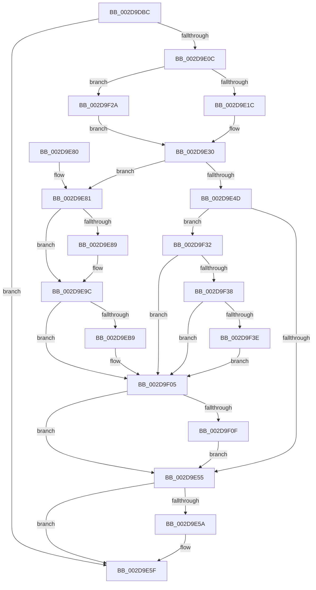

# PopFxActivateComponent

- RVA: `0x002D9DBC`–`0x002D9F59` (길이 `413` bytes)
- VA: `0x00000001402D9DBC`
- 실행 섹션: `.text`
- PDB 이름 있음: `예`; PDB Function 태그: `아니요`
- unwind 정보 RVA: `0x00070474`
- 디코드: `111`개 명령, `413/413` bytes 표시
- 미해석 바이트: `0` (있으면 어셈블리에 `.byte`로 보존)

> 이 문서는 커널 이미지의 기계어와 PDB 기호를 분석해 생성했습니다. 4번과 5번은 함수 원형과 자료형을 바이너리 사용 방식에서 추정한 C 해석이며 원본 소스 복구 결과는 아닙니다.

## 1. Dependencies

- 직접 호출 지점: **9**; 고유 호출 대상: **9**
- 직접 호출자로 확인된 함수: **8**
- RIP 상대 이미지 참조: **0**

### Outgoing calls
- `0x002D9E5A` → [KeLeaveGuardedRegion](../2E/KeLeaveGuardedRegion_function_002E2C40.md) (function, `0x002E2C40`)
- `0x002D9E97` → [KiSetSystemPriorityThread](KiSetSystemPriorityThread_function_002D9FF8.md) (function, `0x002D9FF8`)
- `0x002D9EAC` → [PopFxActivateComponentWorker](PopFxActivateComponentWorker_function_002D9F60.md) (function, `0x002D9F60`)
- `0x002D9ED1` → [KiAcquireThreadLockRaiseToDpc](../39/KiAcquireThreadLockRaiseToDpc_function_00396280.md) (function, `0x00396280`)
- `0x002D9EE6` → [KiClearPriorityFloor](../39/KiClearPriorityFloor_function_00396314.md) (function, `0x00396314`)
- `0x002D9F00` → [KiProcessDeferredReadyList](../25/KiProcessDeferredReadyList_function_00250800.md) (function, `0x00250800`)
- `0x002D9F20` → [KeWaitForSingleObject](../20/KeWaitForSingleObject_function_0020E6B0.md) (function, `0x0020E6B0`)
- `0x002D9F48` → [KeAcquireSpinLockRaiseToDpc](../20/KeAcquireSpinLockRaiseToDpc_function_00208470.md) (function, `0x00208470`)
- `0x002D9F52` → [KeReleaseSpinLock](../39/KeReleaseSpinLock_function_00392BA0.md) (function, `0x00392BA0`)

### Direct callers
- [PopFxNotifyPreDIrpIssue](../26/PopFxNotifyPreDIrpIssue_function_0026FD40.md) at `0x0026FE4E`
- [PopFxActivateComponentDependencies](PopFxActivateComponentDependencies_function_002D9B10.md) at `0x002D9C0E`
- [PopFxActivateComponentDependencies](PopFxActivateComponentDependencies_function_002D9B10.md) at `0x002D9CDD`
- [PoFxActivateComponent](PoFxActivateComponent_function_002D9D30.md) at `0x002D9D69`
- [PoFxAddComponentRelation](../5D/PoFxAddComponentRelation_function_005D15E0.md) at `0x005D1770`
- [PoFxAddComponentRelation](../5D/PoFxAddComponentRelation_function_005D15E0.md) at `0x005D1782`
- [PoFxAddDeviceRelation](../5D/PoFxAddDeviceRelation_function_005D1850.md) at `0x005D1991`
- [PoFxRemoveComponentRelation](../5D/PoFxRemoveComponentRelation_function_005D1C90.md) at `0x005D1D9E`
- [PopFxRegisterDevice](../../page/75/PopFxRegisterDevice_function_00759B80.md) at `0x00759C64`
- [PopFxRegisterDeviceWorker](../../page/75/PopFxRegisterDeviceWorker_function_00759E20.md) at `0x0075A501`

### Static image references
- 디코드된 RIP-relative 메모리 참조가 없습니다.

## 2. Other-region calls and transfers

- 다른 실행 섹션으로 향하는 call: **0**
- 별도 외부 분기/꼬리 이동을 확인하지 못했습니다.

## 3. Assembly (complete function range)

```asm
002D9DBC  48 89 5C 24 10                  mov qword ptr [rsp + 0x10], rbx
002D9DC1  48 89 74 24 18                  mov qword ptr [rsp + 0x18], rsi
002D9DC6  48 89 7C 24 20                  mov qword ptr [rsp + 0x20], rdi
002D9DCB  55                              push rbp
002D9DCC  41 54                           push r12
002D9DCE  41 55                           push r13
002D9DD0  41 56                           push r14
002D9DD2  41 57                           push r15
002D9DD4  48 8B EC                        mov rbp, rsp
002D9DD7  48 81 EC 80 00 00 00            sub rsp, 0x80
002D9DDE  33 C0                           xor eax, eax
002D9DE0  0F 57 C0                        xorps xmm0, xmm0
002D9DE3  48 89 45 F0                     mov qword ptr [rbp - 0x10], rax
002D9DE7  45 8A E1                        mov r12b, r9b
002D9DEA  89 45 F8                        mov dword ptr [rbp - 8], eax
002D9DED  41 8B F8                        mov edi, r8d
002D9DF0  8B 81 60 03 00 00               mov eax, dword ptr [rcx + 0x360]
002D9DF6  48 8B F2                        mov rsi, rdx
002D9DF9  48 8B D9                        mov rbx, rcx
002D9DFC  0F 11 45 C0                     movups xmmword ptr [rbp - 0x40], xmm0
002D9E00  0F 11 45 D0                     movups xmmword ptr [rbp - 0x30], xmm0
002D9E04  0F 11 45 E0                     movups xmmword ptr [rbp - 0x20], xmm0
002D9E08  A8 01                           test al, 1
002D9E0A  75 53                           jne 0x1402d9e5f
002D9E0C  41 8B C0                        mov eax, r8d
002D9E0F  45 33 ED                        xor r13d, r13d
002D9E12  24 06                           and al, 6
002D9E14  3C 04                           cmp al, 4
002D9E16  0F 85 0E 01 00 00               jne 0x1402d9f2a
002D9E1C  65 48 8B 04 25 88 01 00 00      mov rax, qword ptr gs:[0x188]
002D9E25  41 B6 01                        mov r14b, 1
002D9E28  66 FF 88 E6 01 00 00            dec word ptr [rax + 0x1e6]
002D9E2F  90                              nop
002D9E30  40 F6 C7 02                     test dil, 2
002D9E34  4C 8D 7D C0                     lea r15, [rbp - 0x40]
002D9E38  B8 01 00 00 00                  mov eax, 1
002D9E3D  4D 0F 45 FD                     cmovne r15, r13
002D9E41  F0 0F C1 42 58                  lock xadd dword ptr [rdx + 0x58], eax
002D9E46  FF C0                           inc eax
002D9E48  83 F8 01                        cmp eax, 1
002D9E4B  74 34                           je 0x1402d9e81
002D9E4D  85 C0                           test eax, eax
002D9E4F  0F 89 DD 00 00 00               jns 0x1402d9f32
002D9E55  45 84 F6                        test r14b, r14b
002D9E58  74 05                           je 0x1402d9e5f
002D9E5A  E8 E1 8D 00 00                  call 0x1402e2c40
002D9E5F  4C 8D 9C 24 80 00 00 00         lea r11, [rsp + 0x80]
002D9E67  49 8B 5B 38                     mov rbx, qword ptr [r11 + 0x38]
002D9E6B  49 8B 73 40                     mov rsi, qword ptr [r11 + 0x40]
002D9E6F  49 8B 7B 48                     mov rdi, qword ptr [r11 + 0x48]
002D9E73  49 8B E3                        mov rsp, r11
002D9E76  41 5F                           pop r15
002D9E78  41 5E                           pop r14
002D9E7A  41 5D                           pop r13
002D9E7C  41 5C                           pop r12
002D9E7E  5D                              pop rbp
002D9E7F  C3                              ret
002D9E80  CC                              int3
002D9E81  44 0F 20 C0                     mov rax, cr8
002D9E85  3C 02                           cmp al, 2
002D9E87  73 13                           jae 0x1402d9e9c
002D9E89  65 48 8B 0C 25 88 01 00 00      mov rcx, qword ptr gs:[0x188]
002D9E92  BA 10 00 00 00                  mov edx, 0x10
002D9E97  E8 5C 01 00 00                  call 0x1402d9ff8
002D9E9C  F0 FF 46 58                     lock inc dword ptr [rsi + 0x58]
002D9EA0  4D 8B CF                        mov r9, r15
002D9EA3  45 8A C4                        mov r8b, r12b
002D9EA6  48 8B D6                        mov rdx, rsi
002D9EA9  48 8B CB                        mov rcx, rbx
002D9EAC  E8 AF 00 00 00                  call 0x1402d9f60
002D9EB1  44 0F 20 C0                     mov rax, cr8
002D9EB5  3C 02                           cmp al, 2
002D9EB7  73 4C                           jae 0x1402d9f05
002D9EB9  65 48 8B 1C 25 88 01 00 00      mov rbx, qword ptr gs:[0x188]
002D9EC2  48 8D 55 30                     lea rdx, [rbp + 0x30]
002D9EC6  48 8B CB                        mov rcx, rbx
002D9EC9  44 88 6D 30                     mov byte ptr [rbp + 0x30], r13b
002D9ECD  4C 89 6D B0                     mov qword ptr [rbp - 0x50], r13
002D9ED1  E8 AA C3 0B 00                  call 0x140396280
002D9ED6  41 B1 01                        mov r9b, 1
002D9ED9  48 8D 55 B0                     lea rdx, [rbp - 0x50]
002D9EDD  41 B8 10 00 00 00               mov r8d, 0x10
002D9EE3  48 8B CB                        mov rcx, rbx
002D9EE6  E8 29 C4 0B 00                  call 0x140396314
002D9EEB  4C 89 6B 40                     mov qword ptr [rbx + 0x40], r13
002D9EEF  48 8D 55 B0                     lea rdx, [rbp - 0x50]
002D9EF3  65 48 8B 0C 25 20 00 00 00      mov rcx, qword ptr gs:[0x20]
002D9EFC  44 8A 45 30                     mov r8b, byte ptr [rbp + 0x30]
002D9F00  E8 FB 68 F7 FF                  call 0x140250800
002D9F05  40 F6 C7 01                     test dil, 1
002D9F09  0F 84 46 FF FF FF               je 0x1402d9e55
002D9F0F  48 8D 4E 68                     lea rcx, [rsi + 0x68]
002D9F13  4C 89 6C 24 20                  mov qword ptr [rsp + 0x20], r13
002D9F18  45 33 C9                        xor r9d, r9d
002D9F1B  45 33 C0                        xor r8d, r8d
002D9F1E  33 D2                           xor edx, edx
002D9F20  E8 8B 47 F3 FF                  call 0x14020e6b0
002D9F25  E9 2B FF FF FF                  jmp 0x1402d9e55
002D9F2A  45 8A F5                        mov r14b, r13b
002D9F2D  E9 FE FE FF FF                  jmp 0x1402d9e30
002D9F32  0F BA E0 1E                     bt eax, 0x1e
002D9F36  73 CD                           jae 0x1402d9f05
002D9F38  40 F6 C7 08                     test dil, 8
002D9F3C  75 C7                           jne 0x1402d9f05
002D9F3E  48 8D 9A 80 00 00 00            lea rbx, [rdx + 0x80]
002D9F45  48 8B CB                        mov rcx, rbx
002D9F48  E8 23 E5 F2 FF                  call 0x140208470
002D9F4D  8A D0                           mov dl, al
002D9F4F  48 8B CB                        mov rcx, rbx
002D9F52  E8 49 8C 0B 00                  call 0x140392ba0
002D9F57  EB AC                           jmp 0x1402d9f05
```

## 4. C-style interpretation (structured pseudocode)

```c
__int64 __fastcall PopFxActivateComponent(__int64 a1, __int64 a2, int a3, unsigned __int8 a4)
{
    __int64 result;
    __int64 v_r13;
    __int64 v_r15;
    __int64 v_rbx;
    __int64 v_rsp;
    unsigned __int64 v_stack_m28;
    unsigned int v_stack_m30;
    unsigned __int64 v_stack_m38;
    unsigned __int64 v_stack_m48;
    unsigned __int64 v_stack_m58;
    unsigned __int64 v_stack_m60;
    unsigned __int64 v_stack_m68;
    unsigned __int64 v_stack_m78;
    unsigned __int64 v_stack_p10;
    unsigned __int64 v_stack_p18;
    unsigned __int64 v_stack_p20;
    unsigned __int64 v_stack_p8;

    v_stack_p10 = v_rbx;
    v_stack_p18 = v_rsi;
    v_stack_p20 = v_rdi;
    v_rsp = (v_rsp) - (128);
    result = 0;
    v_stack_m38 = 0;
    v_stack_m30 = 0;
    v_stack_m68 = v_xmm0;
    v_stack_m58 = v_xmm0;
    v_stack_m48 = v_xmm0;
    if ((((unsigned __int8)((unsigned int)(*(unsigned int *)(a1 + 864)))) & (1)) != 0) goto loc_002D9E5F;
    v_r13 = 0;
    result = (unsigned __int8)(((unsigned int)(a3)) & (6));
    if (((unsigned __int8)(result)) != 4) goto loc_002D9F2A;
loc_002D9E30:
    v_r15 = v_stack_m68;
    if ((((unsigned __int8)((unsigned int)(a3))) & (2)) != 0) { v_r15 = 0; }
    result = (unsigned int)((1) + 1);
    if (((unsigned int)(result)) == 1) goto loc_002D9E81;
    if (!sign_flag) goto loc_002D9F32;
loc_002D9E55:
    if (1 != 0) {
        result = KeLeaveGuardedRegion(a1, a2, a3, a4);
    }
    return result;
loc_002D9E81:
    result = v_cr8;
    if (((unsigned __int8)(v_cr8)) < 2) {
        a1 = *(unsigned __int64 *)(gs_base + (0 + 392));
        a2 = 16;
        result = KiSetSystemPriorityThread(a1, a2, a3, a4);
    }
    result = PopFxActivateComponentWorker(*(unsigned __int64 *)(v_stack_m28 + 56), *(unsigned __int64 *)(v_stack_m28 + 64), a4, v_r15);
    result = v_cr8;
    v_rbx = *(unsigned __int64 *)(v_stack_m28 + 56);
    if (((unsigned __int8)(v_cr8)) < 2) {
        v_rbx = *(unsigned __int64 *)(gs_base + (0 + 392));
        a2 = v_stack_p8;
        a1 = v_rbx;
        v_stack_p8 = 0;
        v_stack_m78 = 0;
        result = KiAcquireThreadLockRaiseToDpc(a1, a2, a4, v_r15);
        a4 = 1;
        a2 = v_stack_m78;
        a3 = 16;
        a1 = v_rbx;
        result = KiClearPriorityFloor(a1, a2, a3, a4);
        *(unsigned __int64 *)(v_rbx + 64) = 0;
        a2 = v_stack_m78;
        a1 = *(unsigned __int64 *)(gs_base + (0 + 32));
        a3 = v_stack_p8;
        result = KiProcessDeferredReadyList(a1, a2, a3, a4);
    }
    if ((((unsigned __int8)(*(unsigned __int64 *)(v_stack_m28 + 72))) & (1)) == 0) goto loc_002D9E55;
    v_stack_m60 = 0;
    a4 = 0;
    a3 = 0;
    a2 = 0;
    result = KeWaitForSingleObject(*(unsigned __int64 *)(v_stack_m28 + 64) + 104, a2, a3, a4);
    goto loc_002D9E55;
loc_002D9F2A:
    goto loc_002D9E30;
loc_002D9F32:
    if (condition_is_above_or_equal) goto loc_002D9F05;
    if ((((unsigned __int8)(*(unsigned __int64 *)(v_stack_m28 + 72))) & (8)) != 0) goto loc_002D9F05;
    result = KeAcquireSpinLockRaiseToDpc(a2 + 128, a2, a3, a4);
    result = KeReleaseSpinLock(a2 + 128, (unsigned __int8)(result), a3, a4);
    goto loc_002D9F05;
}
```

## 5. (Beta) C Style

```c
int64_t PopFxActivateComponent(void *Arg1, void *Arg2, int32_t Arg3, uint8_t Arg4)
{
    uint8_t *arg1 = (uint8_t *)Arg1;
    uint8_t *arg2 = (uint8_t *)Arg2;

    int64_t result;
    int64_t local_r13;
    int64_t local_r15;
    int64_t local_rbx;
    int64_t local_rsp;
    uint64_t v_stack_m28;
    uint32_t v_stack_m30;
    uint64_t v_stack_m38;
    uint64_t v_stack_m48;
    uint64_t v_stack_m58;
    uint64_t v_stack_m60;
    uint64_t v_stack_m68;
    uint64_t v_stack_m78;
    uint64_t v_stack_p10;
    uint64_t v_stack_p18;
    uint64_t v_stack_p20;
    uint64_t v_stack_p8;

    v_stack_p10 = local_rbx;
    v_stack_p18 = local_rsi;
    v_stack_p20 = local_rdi;
    local_rsp = (local_rsp) - (128);
    result = 0;
    v_stack_m38 = 0;
    v_stack_m30 = 0;
    v_stack_m68 = v_xmm0;
    v_stack_m58 = v_xmm0;
    v_stack_m48 = v_xmm0;
    if ((((uint8_t)((uint32_t)(*(uint32_t *)(arg1 + 0x360)))) & (1)) != 0) goto loc_002D9E5F;
    local_r13 = 0;
    result = (uint8_t)(((uint32_t)(Arg3)) & (6));
    if (((uint8_t)(result)) != 4) goto loc_002D9F2A;
loc_002D9E30:
    local_r15 = v_stack_m68;
    if ((((uint8_t)((uint32_t)(Arg3))) & (2)) != 0) { local_r15 = 0; }
    result = (uint32_t)((1) + 1);
    if (((uint32_t)(result)) == 1) goto loc_002D9E81;
    if (!sign_flag) goto loc_002D9F32;
loc_002D9E55:
    if (1 != 0) {
        result = KeLeaveGuardedRegion(Arg1, Arg2, Arg3, Arg4);
    }
    return result;
loc_002D9E81:
    result = v_cr8;
    if (((uint8_t)(v_cr8)) < 2) {
        Arg1 = *(uint64_t *)(gs_base + (0 + 0x188));
        Arg2 = 16;
        result = KiSetSystemPriorityThread(Arg1, Arg2, Arg3, Arg4);
    }
    result = PopFxActivateComponentWorker(*(uint64_t *)(v_stack_m28 + 0x38), *(uint64_t *)(v_stack_m28 + 0x40), Arg4, local_r15);
    result = v_cr8;
    local_rbx = *(uint64_t *)(v_stack_m28 + 0x38);
    if (((uint8_t)(v_cr8)) < 2) {
        local_rbx = *(uint64_t *)(gs_base + (0 + 0x188));
        Arg2 = v_stack_p8;
        Arg1 = local_rbx;
        v_stack_p8 = 0;
        v_stack_m78 = 0;
        result = KiAcquireThreadLockRaiseToDpc(Arg1, Arg2, Arg4, local_r15);
        Arg4 = 1;
        Arg2 = v_stack_m78;
        Arg3 = 16;
        Arg1 = local_rbx;
        result = KiClearPriorityFloor(Arg1, Arg2, Arg3, Arg4);
        *(uint64_t *)(local_rbx + 0x40) = 0;
        Arg2 = v_stack_m78;
        Arg1 = *(uint64_t *)(gs_base + (0 + 0x20));
        Arg3 = v_stack_p8;
        result = KiProcessDeferredReadyList(Arg1, Arg2, Arg3, Arg4);
    }
    if ((((uint8_t)(*(uint64_t *)(v_stack_m28 + 0x48))) & (1)) == 0) goto loc_002D9E55;
    v_stack_m60 = 0;
    Arg4 = 0;
    Arg3 = 0;
    Arg2 = 0;
    result = KeWaitForSingleObject(*(uint64_t *)(v_stack_m28 + 0x40) + 104, Arg2, Arg3, Arg4);
    goto loc_002D9E55;
loc_002D9F2A:
    goto loc_002D9E30;
loc_002D9F32:
    if (condition_is_above_or_equal) goto loc_002D9F05;
    if ((((uint8_t)(*(uint64_t *)(v_stack_m28 + 0x48))) & (8)) != 0) goto loc_002D9F05;
    result = KeAcquireSpinLockRaiseToDpc(Arg2 + 128, Arg2, Arg3, Arg4);
    result = KeReleaseSpinLock(Arg2 + 128, (uint8_t)(result), Arg3, Arg4);
    goto loc_002D9F05;
}
```

### 관측된 메모리 오프셋

구조체 형식이 확인되지 않은 접근은 인자 기준의 오프셋으로만 기록했습니다.

| 기준 인자 | 오프셋 표현 | 폭 (bit) | 접근 |
|---|---:|---:|---|
| `Arg1` | `+ 0x360` | `32` | `R` |
| `Arg2` | `+ 0x58` | `32` | `R/W` |
| `Arg2` | `+ 0x68` | `64` | `R` |
| `Arg2` | `+ 0x80` | `64` | `R` |

## 6. Execution-region graph

[열기: 2D/3D 그래프와 함수 탐색 컨트롤 패널](../../../control-panel.html?section=text&rva=0x002D9DBC&view=graph)

- 2D 그래프는 위에서 아래로 흐르고, 3D 그래프는 빈 공간을 드래그해 회전합니다. Shift+드래그는 이동, 휠은 확대·축소, 함수 노드 선택은 대상 보고서 이동입니다.

### Static fallback


