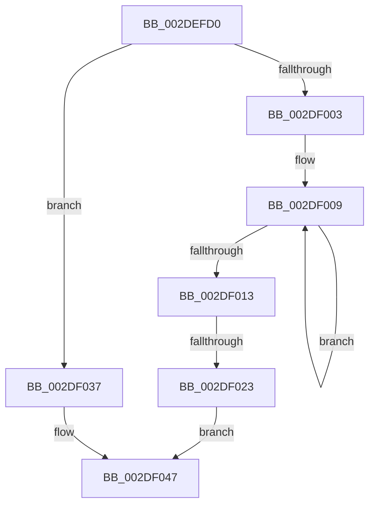

# PopGetIdleTimesCallback

- RVA: `0x002DEFD0`–`0x002DF06B` (길이 `155` bytes)
- VA: `0x00000001402DEFD0`
- 실행 섹션: `.text`
- PDB 이름 있음: `예`; PDB Function 태그: `아니요`
- unwind 정보 RVA: `0x000709D4`
- 디코드: `40`개 명령, `155/155` bytes 표시
- 미해석 바이트: `0` (있으면 어셈블리에 `.byte`로 보존)

> 이 문서는 커널 이미지의 기계어와 PDB 기호를 분석해 생성했습니다. 4번과 5번은 함수 원형과 자료형을 바이너리 사용 방식에서 추정한 C 해석이며 원본 소스 복구 결과는 아닙니다.

## 1. Dependencies

- 직접 호출 지점: **0**; 고유 호출 대상: **0**
- 직접 호출자로 확인된 함수: **2**
- RIP 상대 이미지 참조: **0**

### Outgoing calls
- 직접 디코드된 call 명령이 없습니다.

### Direct callers
- [PopExecuteProcessorCallback](PopExecuteProcessorCallback_function_002DD7D0.md) at `0x002DD800`
- [PoGetIdleTimes](PoGetIdleTimes_function_002DF570.md) at `0x002DF6A4`

### Static image references
- 디코드된 RIP-relative 메모리 참조가 없습니다.

## 2. Other-region calls and transfers

- 다른 실행 섹션으로 향하는 call: **0**
- call이 아닌 외부 분기/꼬리 이동: **1**
  - `0x002DF01D` → [sub_002DF292 + 0x14](Unknown_function_002DF292.md) (`tail-transfer`)

## 3. Assembly (complete function range)

```asm
002DEFD0  40 53                           push rbx
002DEFD2  56                              push rsi
002DEFD3  57                              push rdi
002DEFD4  41 54                           push r12
002DEFD6  41 55                           push r13
002DEFD8  41 56                           push r14
002DEFDA  41 57                           push r15
002DEFDC  48 81 EC 80 00 00 00            sub rsp, 0x80
002DEFE3  65 48 8B 04 25 20 00 00 00      mov rax, qword ptr gs:[0x20]
002DEFEC  48 8D B9 60 88 00 00            lea rdi, [rcx + 0x8860]
002DEFF3  33 F6                           xor esi, esi
002DEFF5  4D 8B F0                        mov r14, r8
002DEFF8  4C 8B FA                        mov r15, rdx
002DEFFB  48 8B D9                        mov rbx, rcx
002DEFFE  48 3B C1                        cmp rax, rcx
002DF001  74 34                           je 0x1402df037
002DF003  0F 0D 0F                        prefetchw byte ptr [rdi]
002DF006  48 8B 07                        mov rax, qword ptr [rdi]
002DF009  48 8B C8                        mov rcx, rax
002DF00C  F0 48 0F B1 0F                  lock cmpxchg qword ptr [rdi], rcx
002DF011  75 F6                           jne 0x1402df009
002DF013  48 89 44 24 30                  mov qword ptr [rsp + 0x30], rax
002DF018  4C 8B E8                        mov r13, rax
002DF01B  A8 01                           test al, 1
002DF01D  0F 84 83 02 00 00               je 0x1402df2a6
002DF023  48 8B 83 68 88 00 00            mov rax, qword ptr [rbx + 0x8868]
002DF02A  41 BC 01 00 00 00               mov r12d, 1
002DF030  48 89 44 24 58                  mov qword ptr [rsp + 0x58], rax
002DF035  EB 10                           jmp 0x1402df047
002DF037  44 8B E6                        mov r12d, esi
002DF03A  48 89 74 24 30                  mov qword ptr [rsp + 0x30], rsi
002DF03F  4C 8B EE                        mov r13, rsi
002DF042  48 89 74 24 58                  mov qword ptr [rsp + 0x58], rsi
002DF047  48 8B 83 48 88 00 00            mov rax, qword ptr [rbx + 0x8848]
002DF04E  33 C9                           xor ecx, ecx
002DF050  48 89 44 24 48                  mov qword ptr [rsp + 0x48], rax
002DF055  48 8B 83 40 88 00 00            mov rax, qword ptr [rbx + 0x8840]
002DF05C  48 89 44 24 50                  mov qword ptr [rsp + 0x50], rax
002DF061  48 89 74 24 38                  mov qword ptr [rsp + 0x38], rsi
002DF066  48 89 74 24 40                  mov qword ptr [rsp + 0x40], rsi
```

## 4. C-style interpretation (structured pseudocode)

```c
__int64 __fastcall PopGetIdleTimesCallback(__int64 a1, __int64 a2, __int64 a3)
{
    __int64 v_rsi;
    __int64 v_rsp;
    unsigned __int64 v_stack_m60;
    unsigned __int64 v_stack_m68;
    unsigned __int64 v_stack_m70;
    unsigned __int64 v_stack_m78;
    unsigned __int64 v_stack_m80;
    unsigned __int64 v_stack_m88;

    v_rsp = (v_rsp) - (128);
    v_rsi = 0;
    if ((*(unsigned __int64 *)(gs_base + (0 + 32))) == a1) goto loc_002DF037;
loc_002DF009:
    if ((*(unsigned __int64 *)(gs_base + (0 + 32))) != a1) goto loc_002DF009;
    v_stack_m88 = *(unsigned __int64 *)(a1 + 34912);
    v_stack_m60 = *(unsigned __int64 *)(a1 + 34920);
    goto loc_002DF047;
loc_002DF037:
    v_stack_m88 = 0;
    v_stack_m60 = 0;
loc_002DF047:
    a1 = 0;
    v_stack_m70 = *(unsigned __int64 *)(a1 + 34888);
    v_stack_m68 = *(unsigned __int64 *)(a1 + 34880);
    v_stack_m80 = 0;
    v_stack_m78 = 0;
    return *(unsigned __int64 *)(a1 + 34880);
}
```

## 5. (Beta) C Style

```c
int64_t PopGetIdleTimesCallback(void *Arg1, int64_t Arg2, int64_t Arg3)
{
    uint8_t *arg1 = (uint8_t *)Arg1;

    int64_t local_rsi;
    int64_t local_rsp;
    uint64_t v_stack_m60;
    uint64_t v_stack_m68;
    uint64_t v_stack_m70;
    uint64_t v_stack_m78;
    uint64_t v_stack_m80;
    uint64_t v_stack_m88;

    local_rsp = (local_rsp) - (128);
    local_rsi = 0;
    if ((*(uint64_t *)(gs_base + (0 + 0x20))) == Arg1) goto loc_002DF037;
loc_002DF009:
    if ((*(uint64_t *)(gs_base + (0 + 0x20))) != Arg1) goto loc_002DF009;
    v_stack_m88 = *(uint64_t *)(arg1 + 0x8860);
    v_stack_m60 = *(uint64_t *)(arg1 + 0x8868);
    goto loc_002DF047;
loc_002DF037:
    v_stack_m88 = 0;
    v_stack_m60 = 0;
loc_002DF047:
    Arg1 = 0;
    v_stack_m70 = *(uint64_t *)(arg1 + 0x8848);
    v_stack_m68 = *(uint64_t *)(arg1 + 0x8840);
    v_stack_m80 = 0;
    v_stack_m78 = 0;
    return *(uint64_t *)(arg1 + 0x8840);
}
```

### 관측된 메모리 오프셋

구조체 형식이 확인되지 않은 접근은 인자 기준의 오프셋으로만 기록했습니다.

| 기준 인자 | 오프셋 표현 | 폭 (bit) | 접근 |
|---|---:|---:|---|
| `Arg1` | `+ 0x0` | `8` | `R` |
| `Arg1` | `+ 0x0` | `64` | `R` |
| `Arg1` | `+ 0x8840` | `64` | `R` |
| `Arg1` | `+ 0x8848` | `64` | `R` |
| `Arg1` | `+ 0x8860` | `64` | `R` |
| `Arg1` | `+ 0x8868` | `64` | `R` |

## 6. Execution-region graph

[열기: 2D/3D 그래프와 함수 탐색 컨트롤 패널](../../../control-panel.html?section=text&rva=0x002DEFD0&view=graph)

- 2D 그래프는 위에서 아래로 흐르고, 3D 그래프는 빈 공간을 드래그해 회전합니다. Shift+드래그는 이동, 휠은 확대·축소, 함수 노드 선택은 대상 보고서 이동입니다.

### Static fallback


