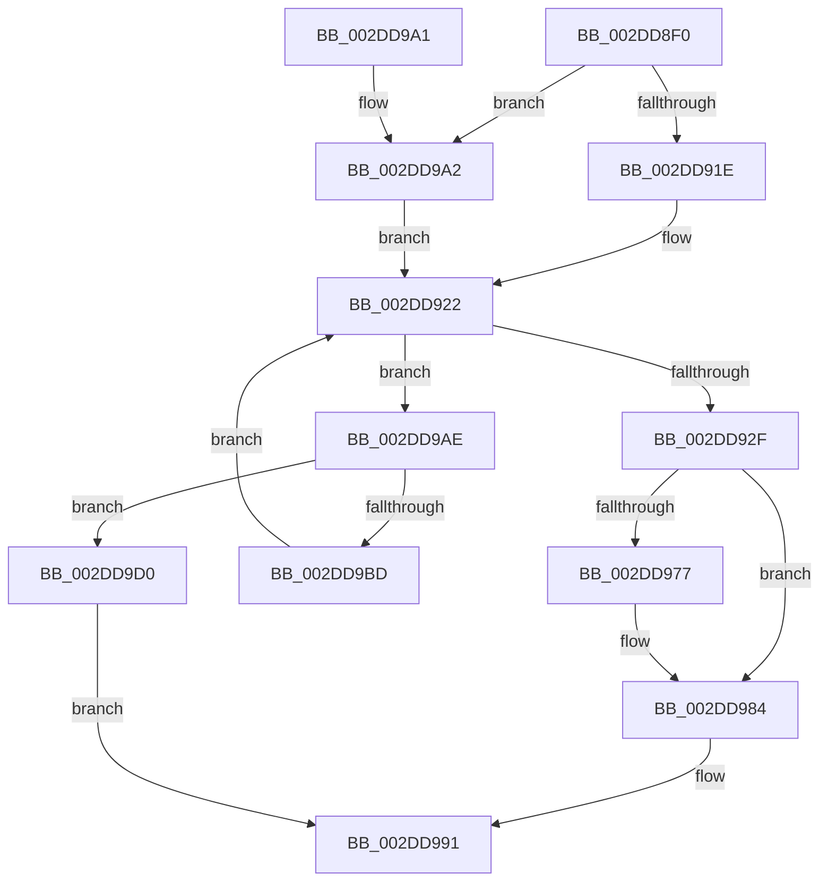

# PopQueueTargetDpc

- RVA: `0x002DD8F0`–`0x002DD9E0` (길이 `240` bytes)
- VA: `0x00000001402DD8F0`
- 실행 섹션: `.text`
- PDB 이름 있음: `예`; PDB Function 태그: `아니요`
- unwind 정보 RVA: `0x00070844`
- 디코드: `67`개 명령, `240/240` bytes 표시
- 미해석 바이트: `0` (있으면 어셈블리에 `.byte`로 보존)

> 이 문서는 커널 이미지의 기계어와 PDB 기호를 분석해 생성했습니다. 4번과 5번은 함수 원형과 자료형을 바이너리 사용 방식에서 추정한 C 해석이며 원본 소스 복구 결과는 아닙니다.

## 1. Dependencies

- 직접 호출 지점: **2**; 고유 호출 대상: **2**
- 직접 호출자로 확인된 함수: **4**
- RIP 상대 이미지 참조: **2**

### Outgoing calls
- `0x002DD98C` → [KeInsertQueueDpc](../20/KeInsertQueueDpc_function_00207C50.md) (function, `0x00207C50`)
- `0x002DD9D9` → [KeSetEvent](../33/KeSetEvent_function_0033F310.md) (function, `0x0033F310`)

### Direct callers
- [PopExecuteProcessorCallback](PopExecuteProcessorCallback_function_002DD7D0.md) at `0x002DD80F`
- [PopExecuteOnTargetProcessors](PopExecuteOnTargetProcessors_function_002DD834.md) at `0x002DD8B9`
- [PoGetIdleTimes](PoGetIdleTimes_function_002DF570.md) at `0x002DF84F`
- [PpmCapturePerformanceDistribution](../48/PpmCapturePerformanceDistribution_function_00489C88.md) at `0x00489E74`

### Static image references
- `0x002DD946` → RVA `0x00F231B8` (`.data`; read)
- `0x002DD950` → RVA `0x002DD7D0` (`PopExecuteProcessorCallback`; read)

## 2. Other-region calls and transfers

- 다른 실행 섹션으로 향하는 call: **0**
- 별도 외부 분기/꼬리 이동을 확인하지 못했습니다.

## 3. Assembly (complete function range)

```asm
002DD8F0  48 89 5C 24 08                  mov qword ptr [rsp + 8], rbx
002DD8F5  48 89 74 24 18                  mov qword ptr [rsp + 0x18], rsi
002DD8FA  57                              push rdi
002DD8FB  48 83 EC 20                     sub rsp, 0x20
002DD8FF  4C 8B 4A 20                     mov r9, qword ptr [rdx + 0x20]
002DD903  33 F6                           xor esi, esi
002DD905  48 8B DA                        mov rbx, rdx
002DD908  4C 8B D1                        mov r10, rcx
002DD90B  49 8B 01                        mov rax, qword ptr [r9]
002DD90E  4D 8D 41 10                     lea r8, [r9 + 0x10]
002DD912  8D 56 01                        lea edx, [rsi + 1]
002DD915  48 85 C0                        test rax, rax
002DD918  0F 84 84 00 00 00               je 0x1402dd9a2
002DD91E  44 0F B7 18                     movzx r11d, word ptr [rax]
002DD922  49 8B 79 08                     mov rdi, qword ptr [r9 + 8]
002DD926  41 0F B7 08                     movzx ecx, word ptr [r8]
002DD92A  48 85 FF                        test rdi, rdi
002DD92D  74 7F                           je 0x1402dd9ae
002DD92F  48 0F BC D7                     bsf rdx, rdi
002DD933  C1 E1 06                        shl ecx, 6
002DD936  0F B6 C2                        movzx eax, dl
002DD939  48 0F B3 C7                     btr rdi, rax
002DD93D  0F B6 C2                        movzx eax, dl
002DD940  49 89 79 08                     mov qword ptr [r9 + 8], rdi
002DD944  03 C8                           add ecx, eax
002DD946  48 8B 05 6B 58 C4 00            mov rax, qword ptr [rip + 0xc4586b]
002DD94D  8B 14 88                        mov edx, dword ptr [rax + rcx*4]
002DD950  48 8D 05 79 FE FF FF            lea rax, [rip - 0x187]
002DD957  49 89 42 18                     mov qword ptr [r10 + 0x18], rax
002DD95B  41 C7 02 13 03 00 00            mov dword ptr [r10], 0x313
002DD962  49 89 5A 20                     mov qword ptr [r10 + 0x20], rbx
002DD966  49 89 72 38                     mov qword ptr [r10 + 0x38], rsi
002DD96A  49 89 72 10                     mov qword ptr [r10 + 0x10], rsi
002DD96E  49 8B 42 38                     mov rax, qword ptr [r10 + 0x38]
002DD972  48 85 C0                        test rax, rax
002DD975  75 0D                           jne 0x1402dd984
002DD977  B8 00 08 00 00                  mov eax, 0x800
002DD97C  66 03 D0                        add dx, ax
002DD97F  66 41 89 52 02                  mov word ptr [r10 + 2], dx
002DD984  45 33 C0                        xor r8d, r8d
002DD987  33 D2                           xor edx, edx
002DD989  49 8B CA                        mov rcx, r10
002DD98C  E8 BF A2 F2 FF                  call 0x140207c50
002DD991  48 8B 5C 24 30                  mov rbx, qword ptr [rsp + 0x30]
002DD996  48 8B 74 24 40                  mov rsi, qword ptr [rsp + 0x40]
002DD99B  48 83 C4 20                     add rsp, 0x20
002DD99F  5F                              pop rdi
002DD9A0  C3                              ret
002DD9A1  CC                              int3
002DD9A2  45 0F B7 18                     movzx r11d, word ptr [r8]
002DD9A6  44 03 DA                        add r11d, edx
002DD9A9  E9 74 FF FF FF                  jmp 0x1402dd922
002DD9AE  66 03 CA                        add cx, dx
002DD9B1  0F B7 C1                        movzx eax, cx
002DD9B4  66 41 89 00                     mov word ptr [r8], ax
002DD9B8  41 3B C3                        cmp eax, r11d
002DD9BB  73 13                           jae 0x1402dd9d0
002DD9BD  8B C8                           mov ecx, eax
002DD9BF  49 8B 01                        mov rax, qword ptr [r9]
002DD9C2  48 8B 44 C8 08                  mov rax, qword ptr [rax + rcx*8 + 8]
002DD9C7  49 89 41 08                     mov qword ptr [r9 + 8], rax
002DD9CB  E9 52 FF FF FF                  jmp 0x1402dd922
002DD9D0  48 8B 4B 18                     mov rcx, qword ptr [rbx + 0x18]
002DD9D4  45 33 C0                        xor r8d, r8d
002DD9D7  33 D2                           xor edx, edx
002DD9D9  E8 32 19 06 00                  call 0x14033f310
002DD9DE  EB B1                           jmp 0x1402dd991
```

## 4. C-style interpretation (structured pseudocode)

```c
__int64 __fastcall PopQueueTargetDpc(__int64 a1, __int64 a2)
{
    __int64 result;
    __int64 v_r11;
    __int64 v_rsi;
    __int64 v_rsp;
    unsigned __int64 v_stack_p18;
    unsigned __int64 v_stack_p8;

    v_stack_p8 = v_rbx;
    v_stack_p18 = v_rsi;
    v_rsp = (v_rsp) - (32);
    v_rsi = 0;
    if (*(unsigned __int64 *)(*(unsigned __int64 *)(a2 + 32)) == 0) goto loc_002DD9A2;
loc_002DD922:
    if (*(unsigned __int64 *)(*(unsigned __int64 *)(a2 + 32) + 8) == 0) goto loc_002DD9AE;
    a1 = (unsigned int)((*(unsigned __int16 *)(*(unsigned __int64 *)(a2 + 32) + 16)) << (6));
    *(unsigned __int64 *)(*(unsigned __int64 *)(a2 + 32) + 8) = *(unsigned __int64 *)(*(unsigned __int64 *)(a2 + 32) + 8);
    a1 = (unsigned int)((a1) + ((unsigned int)((unsigned __int8)(v_rsi + 1))));
    *(unsigned __int64 *)(a1 + 24) = v_rip - 391;
    *(unsigned int *)(a1) = 787;
    *(unsigned __int64 *)(a1 + 32) = a2;
    *(unsigned __int64 *)(a1 + 56) = 0;
    *(unsigned __int64 *)(a1 + 16) = 0;
    result = *(unsigned __int64 *)(a1 + 56);
    if (*(unsigned __int64 *)(a1 + 56) == 0) {
        result = 0x800ULL;
        a2 = (unsigned __int16)(((unsigned int)(*(unsigned int *)(*(unsigned __int64 *)(v_rip + 12867691) + a1 * 4))) + ((unsigned __int16)(result)));
        *(unsigned __int16 *)(a1 + 2) = (unsigned __int16)(a2);
    }
    a3 = 0;
    a2 = 0;
    result = KeInsertQueueDpc(a1, a2, a3, *(unsigned __int64 *)(a2 + 32));
loc_002DD991:
    v_rsp = (v_rsp) + (32);
    return result;
loc_002DD9A2:
    v_r11 = (unsigned int)((*(unsigned __int16 *)(a3)) + (0));
    goto loc_002DD922;
loc_002DD9AE:
    a1 = (unsigned __int16)((a1) + (0));
    *(unsigned __int16 *)(a3) = (unsigned __int16)((unsigned __int16)(a1));
    if (((unsigned int)((unsigned __int16)(a1))) >= ((unsigned int)(v_r11))) goto loc_002DD9D0;
    *(unsigned __int64 *)(*(unsigned __int64 *)(a2 + 32) + 8) = *(unsigned __int64 *)(*(unsigned __int64 *)(*(unsigned __int64 *)(a2 + 32)) + (unsigned int)((unsigned int)((unsigned __int16)(a1))) * 8 + 8);
    goto loc_002DD922;
loc_002DD9D0:
    a3 = 0;
    a2 = 0;
    result = KeSetEvent(*(unsigned __int64 *)(v_stack_p8 + 24), a2, a3, *(unsigned __int64 *)(a2 + 32));
    goto loc_002DD991;
}
```

## 5. (Beta) C Style

```c
int64_t PopQueueTargetDpc(void *Arg1, void *Arg2)
{
    uint8_t *arg1 = (uint8_t *)Arg1;
    uint8_t *arg2 = (uint8_t *)Arg2;

    int64_t result;
    int64_t local_r11;
    int64_t local_rsi;
    int64_t local_rsp;
    uint64_t v_stack_p18;
    uint64_t v_stack_p8;

    v_stack_p8 = local_rbx;
    v_stack_p18 = local_rsi;
    local_rsp = (local_rsp) - (32);
    local_rsi = 0;
    if (*(uint64_t *)(*(uint64_t *)(arg2 + 0x20)) == 0) goto loc_002DD9A2;
loc_002DD922:
    if (*(uint64_t *)(*(uint64_t *)(arg2 + 0x20) + 0x8) == 0) goto loc_002DD9AE;
    Arg1 = (uint32_t)((*(uint16_t *)(*(uint64_t *)(arg2 + 0x20) + 0x10)) << (6));
    *(uint64_t *)(*(uint64_t *)(arg2 + 0x20) + 0x8) = *(uint64_t *)(*(uint64_t *)(arg2 + 0x20) + 0x8);
    Arg1 = (uint32_t)((Arg1) + ((uint32_t)((uint8_t)(local_rsi + 1))));
    *(uint64_t *)(arg1 + 0x18) = v_rip - 391;
    *(uint32_t *)(arg1) = 787;
    *(void **)(arg1 + 0x20) = Arg2;
    *(uint64_t *)(arg1 + 0x38) = 0;
    *(uint64_t *)(arg1 + 0x10) = 0;
    result = *(uint64_t *)(arg1 + 0x38);
    if (*(uint64_t *)(arg1 + 0x38) == 0) {
        result = 0x800ULL;
        Arg2 = (uint16_t)(((uint32_t)(*(uint32_t *)(*(uint64_t *)(v_rip + 0xC4586B) + arg1 * 4))) + ((uint16_t)(result)));
        *(uint16_t *)(arg1 + 0x2) = (uint16_t)(Arg2);
    }
    a3 = 0;
    Arg2 = 0;
    result = KeInsertQueueDpc(Arg1, Arg2, a3, *(uint64_t *)(arg2 + 0x20));
loc_002DD991:
    local_rsp = (local_rsp) + (32);
    return result;
loc_002DD9A2:
    local_r11 = (uint32_t)((*(uint16_t *)(a3)) + (0));
    goto loc_002DD922;
loc_002DD9AE:
    Arg1 = (uint16_t)((Arg1) + (0));
    *(uint16_t *)(a3) = (uint16_t)((uint16_t)(Arg1));
    if (((uint32_t)((uint16_t)(Arg1))) >= ((uint32_t)(local_r11))) goto loc_002DD9D0;
    *(uint64_t *)(*(uint64_t *)(arg2 + 0x20) + 0x8) = *(uint64_t *)(*(uint64_t *)(*(uint64_t *)(arg2 + 0x20)) + (uint32_t)((uint32_t)((uint16_t)(arg1))) * 8 + 0x8);
    goto loc_002DD922;
loc_002DD9D0:
    a3 = 0;
    Arg2 = 0;
    result = KeSetEvent(*(uint64_t *)(v_stack_p8 + 0x18), Arg2, a3, *(uint64_t *)(arg2 + 0x20));
    goto loc_002DD991;
}
```

### 관측된 메모리 오프셋

구조체 형식이 확인되지 않은 접근은 인자 기준의 오프셋으로만 기록했습니다.

| 기준 인자 | 오프셋 표현 | 폭 (bit) | 접근 |
|---|---:|---:|---|
| `Arg1` | `+ 0x0` | `32` | `W` |
| `Arg1` | `+ 0x2` | `16` | `W` |
| `Arg1` | `+ 0x10` | `64` | `W` |
| `Arg1` | `+ 0x18` | `64` | `W` |
| `Arg1` | `+ 0x20` | `64` | `W` |
| `Arg1` | `+ 0x38` | `64` | `R` |
| `Arg1` | `+ 0x38` | `64` | `W` |
| `Arg2` | `+ 0x18` | `64` | `R` |
| `Arg2` | `+ 0x20` | `64` | `R` |

## 6. Execution-region graph

[열기: 2D/3D 그래프와 함수 탐색 컨트롤 패널](../../../control-panel.html?section=text&rva=0x002DD8F0&view=graph)

- 2D 그래프는 위에서 아래로 흐르고, 3D 그래프는 빈 공간을 드래그해 회전합니다. Shift+드래그는 이동, 휠은 확대·축소, 함수 노드 선택은 대상 보고서 이동입니다.

### Static fallback


