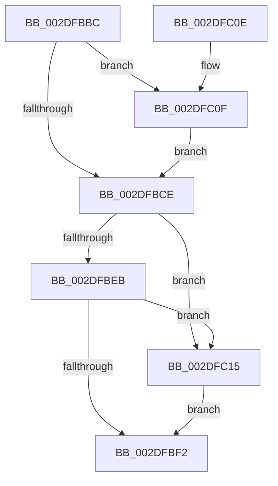

# PopReleaseRwLock

- RVA: `0x002DFBBC`–`0x002DFC1F` (길이 `99` bytes)
- VA: `0x00000001402DFBBC`
- 실행 섹션: `.text`
- PDB 이름 있음: `예`; PDB Function 태그: `아니요`
- unwind 정보 RVA: `0x00070B1C`
- 디코드: `30`개 명령, `99/99` bytes 표시
- 미해석 바이트: `0` (있으면 어셈블리에 `.byte`로 보존)

> 이 문서는 커널 이미지의 기계어와 PDB 기호를 분석해 생성했습니다. 4번과 5번은 함수 원형과 자료형을 바이너리 사용 방식에서 추정한 C 해석이며 원본 소스 복구 결과는 아닙니다.

## 1. Dependencies

- 직접 호출 지점: **3**; 고유 호출 대상: **3**
- 직접 호출자로 확인된 함수: **242**
- RIP 상대 이미지 참조: **0**

### Outgoing calls
- `0x002DFBF5` → [KeAbPostRelease](../2E/KeAbPostRelease_function_002E1600.md) (function, `0x002E1600`)
- `0x002DFC03` → [KeLeaveCriticalRegionThread](../25/KeLeaveCriticalRegionThread_function_0025EFF0.md) (function, `0x0025EFF0`)
- `0x002DFC18` → [ExfReleasePushLock](../26/ExfReleasePushLock_function_002638D0.md) (function, `0x002638D0`)

### Direct callers
- [PpmIdleUpdateSystemLatencyLimit](PpmIdleUpdateSystemLatencyLimit_function_002D9204.md) at `0x002D9437`
- [PopCoolingTelemetryWorker](../42/PopCoolingTelemetryWorker_function_0042FC3C.md) at `0x0042FC86`
- [PopCoolingTelemetryWorker](../42/PopCoolingTelemetryWorker_function_0042FC3C.md) at `0x0042FCF9`
- [PopPowerLimitTelemetryWorker](../42/PopPowerLimitTelemetryWorker_function_0042FD20.md) at `0x0042FDA4`
- [PopPowerLimitTelemetryWorker](../42/PopPowerLimitTelemetryWorker_function_0042FD20.md) at `0x0042FDB8`
- [PopGetTransitionsToOnCount](../42/PopGetTransitionsToOnCount_function_0042FDE0.md) at `0x0042FDFF`
- [PopThermalCsEntry](../42/PopThermalCsEntry_function_0042FE14.md) at `0x0042FE43`
- [PopCoolingSxTransition](../42/PopCoolingSxTransition_function_0042FEA8.md) at `0x0042FF49`
- [PopCoolingSxTransition](../42/PopCoolingSxTransition_function_0042FEA8.md) at `0x0042FF57`
- [PopThermalPollingPowerSettingCallback](../43/PopThermalPollingPowerSettingCallback_function_00430720.md) at `0x00430749`
- [PopWriteBsdPoInfo](../43/PopWriteBsdPoInfo_function_00430768.md) at `0x00430806`
- [PopThermalCoolingPowerSettingCallback](../43/PopThermalCoolingPowerSettingCallback_function_00430950.md) at `0x004309C0`
- [PopPushPowerStateTransitionRecordWithCallback](../43/PopPushPowerStateTransitionRecordWithCallback_function_00430A04.md) at `0x00430AED`
- [PopThermalUpdateTimerPolicy](../43/PopThermalUpdateTimerPolicy_function_00430BEC.md) at `0x00430C5F`
- [PopThermalUpdateTimerPolicy](../43/PopThermalUpdateTimerPolicy_function_00430BEC.md) at `0x00430C73`
- [PpmQueryPlatformStateResidency](../43/PpmQueryPlatformStateResidency_function_0043AEF4.md) at `0x0043AF9A`
- [PoIssueCoalescingNotification](../44/PoIssueCoalescingNotification_function_0044D670.md) at `0x0044D708`
- [PopThermalTraceRundownEvents](../4A/PopThermalTraceRundownEvents_function_004AF1A8.md) at `0x004AF1E7`
- [PopFanSxEntry](../4B/PopFanSxEntry_function_004BEF04.md) at `0x004BEF39`
- [PopFanSxEntry](../4B/PopFanSxEntry_function_004BEF04.md) at `0x004BEF70`
- [PopIdlePhaseWatchdogCallback](../4C/PopIdlePhaseWatchdogCallback_function_004CB090.md) at `0x004CB14D`
- [PopFanSxExit](../4D/PopFanSxExit_function_004DAA14.md) at `0x004DAA6F`
- [PopFanSxExit](../4D/PopFanSxExit_function_004DAA14.md) at `0x004DAA83`
- [PopThermalSxEntry](../4E/PopThermalSxEntry_function_004E3D20.md) at `0x004E3D65`
- [PopThermalSxEntry](../4E/PopThermalSxEntry_function_004E3D20.md) at `0x004E3DDA`
- [PopThermalSxEntry](../4E/PopThermalSxEntry_function_004E3D20.md) at `0x004E3DEE`
- [PopThermalSxEntry](../4E/PopThermalSxEntry_function_004E3D20.md) at `0x004E3E1B`
- [PopPropogateCoolingChange](../4E/PopPropogateCoolingChange_function_004E8FA0.md) at `0x004E9029`
- [PopPropogateCoolingChange](../4E/PopPropogateCoolingChange_function_004E8FA0.md) at `0x004E907A`
- [PpmUpdateIdleDomains](../5D/PpmUpdateIdleDomains_function_005D0B60.md) at `0x005D0BC6`
- [PopPowerLimitSxTransition](../5D/PopPowerLimitSxTransition_function_005D0E64.md) at `0x005D0F29`
- [PopPowerLimitSxTransition](../5D/PopPowerLimitSxTransition_function_005D0E64.md) at `0x005D0F41`
- [PopPropogateCoolingChangeV2](../5D/PopPropogateCoolingChangeV2_function_005D1058.md) at `0x005D10DD`
- [PopPropogateCoolingChangeV2](../5D/PopPropogateCoolingChangeV2_function_005D1058.md) at `0x005D114D`
- [PopPropogateCoolingChangeV2](../5D/PopPropogateCoolingChangeV2_function_005D1058.md) at `0x005D11B0`
- [PopThermalCsExit](../5D/PopThermalCsExit_function_005D54C8.md) at `0x005D5522`
- [PopThermalSxExit](../5D/PopThermalSxExit_function_005D55F8.md) at `0x005D5693`
- [PopThermalSxExit](../5D/PopThermalSxExit_function_005D55F8.md) at `0x005D572B`
- [PopThermalSxExit](../5D/PopThermalSxExit_function_005D55F8.md) at `0x005D573F`
- [PopThermalSxExit](../5D/PopThermalSxExit_function_005D55F8.md) at `0x005D578F`
- [PopThermalTelemetryWorker](../5D/PopThermalTelemetryWorker_function_005D57F0.md) at `0x005D5878`
- [PopThermalTelemetryWorker](../5D/PopThermalTelemetryWorker_function_005D57F0.md) at `0x005D588C`
- [PopThermalUpdateTelemetryClientCount](../5D/PopThermalUpdateTelemetryClientCount_function_005D58C4.md) at `0x005D5939`
- [PopAdaptiveStandbyActivatorCallback](../5D/PopAdaptiveStandbyActivatorCallback_function_005DC590.md) at `0x005DC748`
- [sub_006F9E40](../6F/Unknown_function_006F9E40.md) at `0x006F9EA6`
- [sub_006F9E40](../6F/Unknown_function_006F9E40.md) at `0x006F9F7D`
- [PopPowerAggregatorNotifyAcDcStateChange](../../page/6F/PopPowerAggregatorNotifyAcDcStateChange_function_006FE41C.md) at `0x006FE447`
- [PopPowerAggregatorNotifyDisplayPoweredOn](../../page/70/PopPowerAggregatorNotifyDisplayPoweredOn_function_007003C4.md) at `0x007003F7`
- [PopClearSystemShutdownMarker](../../page/70/PopClearSystemShutdownMarker_function_007030BC.md) at `0x007030EB`
- [PoClearTransitionMarker](../../page/75/PoClearTransitionMarker_function_00753C88.md) at `0x00753DF7`
- [PopClearUserShutdownMarkerWorker](../../page/75/PopClearUserShutdownMarkerWorker_function_00754030.md) at `0x00754064`
- [PopRecordLongPowerButtonPressDetected](../../page/75/PopRecordLongPowerButtonPressDetected_function_007543BC.md) at `0x0075444F`
- [PopRecordPhysicalPowerButton](../../page/75/PopRecordPhysicalPowerButton_function_00754464.md) at `0x007545D8`
- [PopRecordSleepCheckpointSource](../../page/75/PopRecordSleepCheckpointSource_function_007545F4.md) at `0x0075462F`
- [PopSetCleanShutdownMarker](../../page/75/PopSetCleanShutdownMarker_function_00754644.md) at `0x0075466C`
- [PopSetUserShutdownMarkerWorker](../../page/75/PopSetUserShutdownMarkerWorker_function_00754680.md) at `0x007546B4`
- [PopPowerRequestDebounceTimerWorker](../../page/75/PopPowerRequestDebounceTimerWorker_function_00754A40.md) at `0x00754AD8`
- [PopPowerRequestExecutionRequiredTimeoutWorker](../../page/75/PopPowerRequestExecutionRequiredTimeoutWorker_function_00754AF0.md) at `0x00754B13`
- [PopPowerRequestNotificationsBegin](../../page/75/PopPowerRequestNotificationsBegin_function_00754B24.md) at `0x00754B98`
- [PopPowerRequestNotifyMobileHotspotChanged](../../page/75/PopPowerRequestNotifyMobileHotspotChanged_function_00754BBC.md) at `0x00754BF1`
- [PopPowerRequestOverrideInitialize](../../page/75/PopPowerRequestOverrideInitialize_function_00754C04.md) at `0x00754C45`
- [PpmEnableCoordinatedIdleStates](../../page/75/PpmEnableCoordinatedIdleStates_function_00754CD0.md) at `0x00754CED`
- [PpmIdleAllocateVetoReasons](../../page/75/PpmIdleAllocateVetoReasons_function_00754D08.md) at `0x00754F0C`
- [PpmIdleRegisterDefaultStates](../../page/75/PpmIdleRegisterDefaultStates_function_00755110.md) at `0x00755266`
- [PpmInstallCoordinatedIdleStates](../../page/75/PpmInstallCoordinatedIdleStates_function_007552A0.md) at `0x00755885`
- [PpmRegisterVetoList](../../page/75/PpmRegisterVetoList_function_007558B0.md) at `0x00755940`
- [PoQueryPowerLimitAttributes](../../page/75/PoQueryPowerLimitAttributes_function_00755A70.md) at `0x00755ADB`
- [PoQueryPowerLimitValue](../../page/75/PoQueryPowerLimitValue_function_00755B10.md) at `0x00755BBF`
- [PoQueryPowerLimitValue](../../page/75/PoQueryPowerLimitValue_function_00755B10.md) at `0x00755BFC`
- [PoSetPowerLimitValue](../../page/75/PoSetPowerLimitValue_function_00755C30.md) at `0x00755DEA`
- [PopAssociatePowerLimitRequest](../../page/75/PopAssociatePowerLimitRequest_function_00755EC8.md) at `0x00755F24`
- [PopAssociatePowerLimitRequest](../../page/75/PopAssociatePowerLimitRequest_function_00755EC8.md) at `0x0075604A`
- [PopAssociatePowerLimitRequest](../../page/75/PopAssociatePowerLimitRequest_function_00755EC8.md) at `0x00756108`
- [PopAssociatePowerLimitRequest](../../page/75/PopAssociatePowerLimitRequest_function_00755EC8.md) at `0x00756112`
- [PopDisablePowerLimitExtension](../../page/75/PopDisablePowerLimitExtension_function_00756148.md) at `0x0075617F`
- [PopDisablePowerLimitExtension](../../page/75/PopDisablePowerLimitExtension_function_00756148.md) at `0x007561C1`
- [PopDisablePowerLimitExtension](../../page/75/PopDisablePowerLimitExtension_function_00756148.md) at `0x007561FA`
- [PopEvaluatePowerLimitChange](../../page/75/PopEvaluatePowerLimitChange_function_00756224.md) at `0x0075641C`
- [PopFreePowerLimitRequest](../../page/75/PopFreePowerLimitRequest_function_00756494.md) at `0x007564DF`
- [PopFreePowerLimitRequest](../../page/75/PopFreePowerLimitRequest_function_00756494.md) at `0x00756547`
- [PopFreePowerLimitRequest](../../page/75/PopFreePowerLimitRequest_function_00756494.md) at `0x007565CF`
- [PopFreePowerLimitRequest](../../page/75/PopFreePowerLimitRequest_function_00756494.md) at `0x007565D7`
- [PopFreePowerLimitRequest](../../page/75/PopFreePowerLimitRequest_function_00756494.md) at `0x00756619`
- [PopFreePowerLimitRequest](../../page/75/PopFreePowerLimitRequest_function_00756494.md) at `0x00756647`
- [PopFreePowerLimitRequest](../../page/75/PopFreePowerLimitRequest_function_00756494.md) at `0x007566A8`
- [PopOrphanPowerLimitExtension](../../page/75/PopOrphanPowerLimitExtension_function_007566D8.md) at `0x00756783`
- [PopOrphanPowerLimitExtension](../../page/75/PopOrphanPowerLimitExtension_function_007566D8.md) at `0x0075678F`
- [PopPowerLimitPnpNotification](../../page/75/PopPowerLimitPnpNotification_function_007567C0.md) at `0x007568C3`
- [PoSetThermalActiveCooling](../../page/75/PoSetThermalActiveCooling_function_00756D40.md) at `0x00756DC6`
- [PopAssociateThermalRequest](../../page/75/PopAssociateThermalRequest_function_00756E78.md) at `0x00756ED9`
- [PopAssociateThermalRequest](../../page/75/PopAssociateThermalRequest_function_00756E78.md) at `0x0075704D`
- [PopAssociateThermalRequest](../../page/75/PopAssociateThermalRequest_function_00756E78.md) at `0x007570A4`
- [PopAssociateThermalRequest](../../page/75/PopAssociateThermalRequest_function_00756E78.md) at `0x007570AC`
- [PopCoolingExtensionPnpNotification](../../page/75/PopCoolingExtensionPnpNotification_function_00757110.md) at `0x007571FA`
- [PopDisableCoolingExtension](../../page/75/PopDisableCoolingExtension_function_00757208.md) at `0x0075723F`
- [PopDisableCoolingExtension](../../page/75/PopDisableCoolingExtension_function_00757208.md) at `0x007572AD`
- [PopDisableCoolingExtension](../../page/75/PopDisableCoolingExtension_function_00757208.md) at `0x007572E3`
- [PopHandleCancelQueryRemove](../../page/75/PopHandleCancelQueryRemove_function_0075730C.md) at `0x00757401`
- [PopHandleCancelQueryRemove](../../page/75/PopHandleCancelQueryRemove_function_0075730C.md) at `0x00757429`
- [PopOrphanCoolingExtension](../../page/75/PopOrphanCoolingExtension_function_00757474.md) at `0x00757593`
- [PopOrphanCoolingExtension](../../page/75/PopOrphanCoolingExtension_function_00757474.md) at `0x0075759F`
- [PopUnregisterCoolingNotification](../../page/75/PopUnregisterCoolingNotification_function_00757854.md) at `0x0075787C`
- [PopWin32kActivatorCallback](../../page/75/PopWin32kActivatorCallback_function_00758520.md) at `0x00758557`
- [PoRegisterCoalescingCallback](../../page/75/PoRegisterCoalescingCallback_function_0075BF00.md) at `0x0075BFC3`
- [PoUnregisterCoalescingCallback](../../page/75/PoUnregisterCoalescingCallback_function_0075C000.md) at `0x0075C093`
- [PoRegisterForEffectivePowerModeNotifications](../../page/75/PoRegisterForEffectivePowerModeNotifications_function_0075C210.md) at `0x0075C2ED`
- [PoUnregisterFromEffectivePowerModeNotifications](../../page/75/PoUnregisterFromEffectivePowerModeNotifications_function_0075C340.md) at `0x0075C37A`
- [PopWnfEffectivePowerModeCallback](../../page/75/PopWnfEffectivePowerModeCallback_function_0075C3B0.md) at `0x0075C45D`
- [PdcPoLidReliabilityUpdateCallback](../../page/75/PdcPoLidReliabilityUpdateCallback_function_0075F110.md) at `0x0075F17B`
- [PopThermalStateTransitionWorker](../../page/75/PopThermalStateTransitionWorker_function_0075F820.md) at `0x0075F8C2`
- [PopThermalStateTransitionWorker](../../page/75/PopThermalStateTransitionWorker_function_0075F820.md) at `0x0075F8E1`
- [PopThermalStateTransitionWorker](../../page/75/PopThermalStateTransitionWorker_function_0075F820.md) at `0x0075F963`
- [PopThermalZoneRemove](../../page/75/PopThermalZoneRemove_function_0075FAD0.md) at `0x0075FBA9`
- [NtInitiatePowerAction](../../page/75/NtInitiatePowerAction_function_0075FCB0.md) at `0x0075FE80`
- [PopPowerAggregatorActiveToScreenOffStateHandler](../../page/76/PopPowerAggregatorActiveToScreenOffStateHandler_function_007642F0.md) at `0x00764334`
- [PopPowerAggregatorDozeTimerWorker](../../page/76/PopPowerAggregatorDozeTimerWorker_function_00764490.md) at `0x007645C9`
- [PopPowerAggregatorEngageModernStandby](../../page/76/PopPowerAggregatorEngageModernStandby_function_00764784.md) at `0x007647F2`
- [PopPowerAggregatorForceSessionSwitch](../../page/76/PopPowerAggregatorForceSessionSwitch_function_007648D0.md) at `0x00764954`
- [PopPowerAggregatorGetCurrentTargetState](../../page/76/PopPowerAggregatorGetCurrentTargetState_function_00764968.md) at `0x007649A6`
- [PopPowerAggregatorHandleModernStandbyIntent](../../page/76/PopPowerAggregatorHandleModernStandbyIntent_function_007649F0.md) at `0x00764A88`
- [PopPowerAggregatorNotifyPdcPhaseState](../../page/76/PopPowerAggregatorNotifyPdcPhaseState_function_00764C54.md) at `0x00764D1C`
- [PopPowerAggregatorNotifyResiliencyReached](../../page/76/PopPowerAggregatorNotifyResiliencyReached_function_00764D74.md) at `0x00764D9B`
- [PopPowerAggregatorNotifySystemWake](../../page/76/PopPowerAggregatorNotifySystemWake_function_00764DAC.md) at `0x00764DCD`
- [PopPowerAggregatorPowerSettingCallback](../../page/76/PopPowerAggregatorPowerSettingCallback_function_00764DE0.md) at `0x00764E42`
- [PopPowerAggregatorScreenOffEnterStateHandler](../../page/76/PopPowerAggregatorScreenOffEnterStateHandler_function_00764E90.md) at `0x00764F62`
- [PopPowerAggregatorSessionSwitchWorker](../../page/76/PopPowerAggregatorSessionSwitchWorker_function_00764FB0.md) at `0x00764FFC`
- [PopPowerAggregatorSnapDiagnosticContext](../../page/76/PopPowerAggregatorSnapDiagnosticContext_function_00765064.md) at `0x007650BD`
- [PopPowerAggregatorSystemTransitionEnterStateHandler](../../page/76/PopPowerAggregatorSystemTransitionEnterStateHandler_function_007650E0.md) at `0x0076512C`
- [PopPowerAggregatorSystemTransitionExitStateHandler](../../page/76/PopPowerAggregatorSystemTransitionExitStateHandler_function_00765180.md) at `0x007651BE`
- [PopPowerAggregatorTriggerAdaptiveAction](../../page/76/PopPowerAggregatorTriggerAdaptiveAction_function_00765240.md) at `0x007652E0`
- [PopEvaluateInputSuppressionAction](../../page/76/PopEvaluateInputSuppressionAction_function_00765454.md) at `0x0076564F`
- [PopEvaluatePowerButtonSuppressionState](../../page/76/PopEvaluatePowerButtonSuppressionState_function_00765954.md) at `0x007659A5`
- [PopEvaluatePowerButtonSuppressionState](../../page/76/PopEvaluatePowerButtonSuppressionState_function_00765954.md) at `0x00765A07`
- [PopEvaluatePowerButtonSuppressionState](../../page/76/PopEvaluatePowerButtonSuppressionState_function_00765954.md) at `0x00765A3D`
- [PopPowerButtonSuppressionUpdateDisableReason](../../page/76/PopPowerButtonSuppressionUpdateDisableReason_function_00765AD8.md) at `0x00765B30`
- [PopNotifyPolicyDevice](../../page/76/PopNotifyPolicyDevice_function_00765FF0.md) at `0x00766088`
- [PopPolicyDeviceTargetChange](../../page/76/PopPolicyDeviceTargetChange_function_00766490.md) at `0x00766535`
- [PopBatteryAdd](../../page/76/PopBatteryAdd_function_00766580.md) at `0x0076664F`
- [PopBatteryEtwCallback](../../page/76/PopBatteryEtwCallback_function_00766800.md) at `0x00766823`
- [PopBatteryRemove](../../page/76/PopBatteryRemove_function_00766D40.md) at `0x00766DC9`
- [PopBatteryUpdateTestExempt](../../page/76/PopBatteryUpdateTestExempt_function_00766F54.md) at `0x00767255`
- [PopPowerAdapterAdd](../../page/76/PopPowerAdapterAdd_function_00767430.md) at `0x00767625`
- [PopPowerAdapterAdd](../../page/76/PopPowerAdapterAdd_function_00767430.md) at `0x00767834`
- [PopPowerAdapterRemove](../../page/76/PopPowerAdapterRemove_function_00768180.md) at `0x00768292`
- [PopUsbErrorWNFNotificationCallback](../../page/76/PopUsbErrorWNFNotificationCallback_function_00768470.md) at `0x007684EC`
- [PdcPoNetworkResiliency](../../page/76/PdcPoNetworkResiliency_function_007693A0.md) at `0x007693EC`
- [PdcPoRecordButton](../../page/76/PdcPoRecordButton_function_00769450.md) at `0x00769487`
- [PopEsInStandbyAcDcCallback](../../page/76/PopEsInStandbyAcDcCallback_function_00769830.md) at `0x00769856`
- [PopEsPowerSettingPolicyCallback](../../page/76/PopEsPowerSettingPolicyCallback_function_00769870.md) at `0x007698D4`
- [PopEsWnfSubscriptionGpAndMdmCallback](../../page/76/PopEsWnfSubscriptionGpAndMdmCallback_function_00769AF0.md) at `0x00769B11`
- [PopEtEnergyTrackerCleanup](../../page/76/PopEtEnergyTrackerCleanup_function_00769CB4.md) at `0x00769D0B`
- [PopEtEnergyTrackerClose](../../page/76/PopEtEnergyTrackerClose_function_00769EA0.md) at `0x00769EC7`
- [PopEtEnergyTrackerCreate](../../page/76/PopEtEnergyTrackerCreate_function_00769EE0.md) at `0x0076A0F0`
- [PopEtEnergyTrackerCreate](../../page/76/PopEtEnergyTrackerCreate_function_00769EE0.md) at `0x0076A140`
- [PopModernStandbyNotificationCallback](../../page/76/PopModernStandbyNotificationCallback_function_0076AE00.md) at `0x0076AFA4`
- [PopAdaptiveStandbyActionWorker](../../page/76/PopAdaptiveStandbyActionWorker_function_0076C9B0.md) at `0x0076CA9C`
- [PopAdaptiveStandbyActionWorker](../../page/76/PopAdaptiveStandbyActionWorker_function_0076C9B0.md) at `0x0076CABE`
- [PopAdaptiveStandbyHandlePowerMessage](../../page/76/PopAdaptiveStandbyHandlePowerMessage_function_0076DB70.md) at `0x0076DD8A`
- [PopAdaptiveStandbyInitialize](../../page/76/PopAdaptiveStandbyInitialize_function_0076DDF8.md) at `0x0076E0EC`
- [PopAdaptiveStandbyInitializeActivator](../../page/76/PopAdaptiveStandbyInitializeActivator_function_0076E174.md) at `0x0076E24B`
- [PopAdaptiveStandbyNotifyShellPhaseState](../../page/76/PopAdaptiveStandbyNotifyShellPhaseState_function_0076E2CC.md) at `0x0076E39E`
- [PopAdaptiveStandbyPolicyTimerWorker](../../page/76/PopAdaptiveStandbyPolicyTimerWorker_function_0076E410.md) at `0x0076E4C1`
- [PopAdaptiveStandbyPowerSettingCallback](../../page/76/PopAdaptiveStandbyPowerSettingCallback_function_0076E530.md) at `0x0076E651`
- [PopAdaptiveStandbyWnfCallback](../../page/76/PopAdaptiveStandbyWnfCallback_function_0076F910.md) at `0x0076FE5A`
- [PpmRegisterProfiles](../../page/77/PpmRegisterProfiles_function_007709F0.md) at `0x00770B98`
- [PopDirectedDripsUmDirectedFxAddTestDevice](../../page/77/PopDirectedDripsUmDirectedFxAddTestDevice_function_007715D4.md) at `0x00771698`
- [PopDirectedDripsUmDirectedFxRemoveTestDevice](../../page/77/PopDirectedDripsUmDirectedFxRemoveTestDevice_function_007716D4.md) at `0x0077174B`
- [PopDirectedDripsUmDirectedFxSetMode](../../page/77/PopDirectedDripsUmDirectedFxSetMode_function_00771768.md) at `0x007717A0`
- [CmCompleteRegistryInitialization](../../page/7D/CmCompleteRegistryInitialization_function_007DF1EC.md) at `0x007DF360`
- [PoEnergyContextCleanup](../../page/90/PoEnergyContextCleanup_function_00907A38.md) at `0x00907B39`
- [PopUpdateSystemIdleContext](../../page/91/PopUpdateSystemIdleContext_function_00911BB4.md) at `0x00911D62`
- [PopNotifyCsStateExited](../../page/91/PopNotifyCsStateExited_function_00911F60.md) at `0x00911F94`
- [PopPowerAggregatorWorker](../../page/91/PopPowerAggregatorWorker_function_00911FB0.md) at `0x00912024`
- [PopPowerRequestDelete](../../page/91/PopPowerRequestDelete_function_00913030.md) at `0x009130B4`
- [PopTriggerMonitorPowerEvent](../../page/91/PopTriggerMonitorPowerEvent_function_0091446C.md) at `0x0091455F`
- [PopTriggerMonitorPowerEvent](../../page/91/PopTriggerMonitorPowerEvent_function_0091446C.md) at `0x009145B0`
- [PopPowerAggregatorHandleIntent](../../page/91/PopPowerAggregatorHandleIntent_function_00914670.md) at `0x009146B4`
- [PopResetIdlePhaseWatchdogDiagnosticContext](../../page/91/PopResetIdlePhaseWatchdogDiagnosticContext_function_009149B4.md) at `0x009149DE`
- [PpmInfoApplySettingUpdate](../../page/91/PpmInfoApplySettingUpdate_function_009160A8.md) at `0x00916146`
- [PpmInfoReleaseLocks](../../page/91/PpmInfoReleaseLocks_function_00916154.md) at `0x00916177`
- [PopEtProcessEnumSnapshotCallback](../../page/91/PopEtProcessEnumSnapshotCallback_function_0091CCA0.md) at `0x0091CD79`
- [PopWin32kActivatorWorker](../../page/95/PopWin32kActivatorWorker_function_009540C0.md) at `0x0095415F`
- [PopWin32kActivatorWorker](../../page/95/PopWin32kActivatorWorker_function_009540C0.md) at `0x0095418E`
- [PopWin32kActivatorWorker](../../page/95/PopWin32kActivatorWorker_function_009540C0.md) at `0x009541C1`
- [NtPowerInformation](../../page/95/NtPowerInformation_function_00955D80.md) at `0x00956E81`
- [PopPowerAggregatorModernStandbyExitStateHandler](../../page/98/PopPowerAggregatorModernStandbyExitStateHandler_function_00989D90.md) at `0x00989DB5`
- [PopPowerAggregatorDisengageModernStandby](../../page/98/PopPowerAggregatorDisengageModernStandby_function_00989DD8.md) at `0x00989DFC`
- [PopPowerAggregatorScreenOffExitStateHandler](../../page/98/PopPowerAggregatorScreenOffExitStateHandler_function_00989EC0.md) at `0x00989EF1`
- [PopPowerAggregatorEnterScreenOff](../../page/98/PopPowerAggregatorEnterScreenOff_function_00989F38.md) at `0x00989FAC`
- [PopArmIdlePhaseWatchdog](../../page/98/PopArmIdlePhaseWatchdog_function_0098A10C.md) at `0x0098A17D`
- [PopSnapSystemIdleContext](../../page/98/PopSnapSystemIdleContext_function_0098A260.md) at `0x0098A32B`
- [PopPowerAggregatorScreenOffActiveToActiveStateHandler](../../page/98/PopPowerAggregatorScreenOffActiveToActiveStateHandler_function_0098A360.md) at `0x0098A389`
- [PopEtEnergyTrackerQuery](../../page/98/PopEtEnergyTrackerQuery_function_0098B668.md) at `0x0098C690`
- [PoSetProcessEnergyTrackingState](../../page/98/PoSetProcessEnergyTrackingState_function_0098C904.md) at `0x0098C99F`
- [PoEnergyContextUpdateComponentPower](../../page/98/PoEnergyContextUpdateComponentPower_function_0098CA08.md) at `0x0098CB14`
- [PopEtProcessSnapshotUpdate](../../page/98/PopEtProcessSnapshotUpdate_function_0098D430.md) at `0x0098D4BC`
- [PopEtInternerUnlock](../../page/98/PopEtInternerUnlock_function_0098DE80.md) at `0x0098DE8F`
- [PopEtGetNextEnergyTracker](../../page/98/PopEtGetNextEnergyTracker_function_0098E384.md) at `0x0098E3E1`
- [PpmWmiGetAllData](../../page/9E/PpmWmiGetAllData_function_009E1470.md) at `0x009E172B`
- [PoThermalCounterSetCallback](../../page/A0/PoThermalCounterSetCallback_function_00A0E350.md) at `0x00A0E3B1`
- [PopThermalReadCounters](../../page/A0/PopThermalReadCounters_function_00A0E5B8.md) at `0x00A0E620`
- [PopThermalReadCounters](../../page/A0/PopThermalReadCounters_function_00A0E5B8.md) at `0x00A0E675`
- [PopProcessorInformation](../../page/A1/PopProcessorInformation_function_00A11CA0.md) at `0x00A11DFA`
- [PopPowerRequestSpecialRequestSet](../../page/A2/PopPowerRequestSpecialRequestSet_function_00A21B4C.md) at `0x00A21C1F`
- [PopPowerRequestSpecialRequestClear](../../page/A2/PopPowerRequestSpecialRequestClear_function_00A21C6C.md) at `0x00A21D0C`
- [PopUpdateConsoleDisplayState](../../page/A3/PopUpdateConsoleDisplayState_function_00A31298.md) at `0x00A313CB`
- [PopRecordDisplayState](../../page/A3/PopRecordDisplayState_function_00A31A08.md) at `0x00A31A42`
- [PopSystemIdleWorker](../../page/A3/PopSystemIdleWorker_function_00A31A60.md) at `0x00A31AFB`
- [PopSystemIdleWorker](../../page/A3/PopSystemIdleWorker_function_00A31A60.md) at `0x00A31B38`
- [PopUpdatePdcSystemIdleState](../../page/A3/PopUpdatePdcSystemIdleState_function_00A320B4.md) at `0x00A320DE`
- [PopCurrentPowerState](../../page/A3/PopCurrentPowerState_function_00A356D8.md) at `0x00A35709`
- [PopDiagTraceControlCallback](../../page/A3/PopDiagTraceControlCallback_function_00A38CB0.md) at `0x00A38D49`
- [PopDiagTraceControlCallback](../../page/A3/PopDiagTraceControlCallback_function_00A38CB0.md) at `0x00A38E3E`
- [PopDiagTraceControlCallback](../../page/A3/PopDiagTraceControlCallback_function_00A38CB0.md) at `0x00A38E5B`
- [PopRundownThermalRequests](../../page/A3/PopRundownThermalRequests_function_00A396B0.md) at `0x00A396FA`
- [PopRundownThermalRequests](../../page/A3/PopRundownThermalRequests_function_00A396B0.md) at `0x00A3974E`
- [PopRundownPowerLimitRequests](../../page/A3/PopRundownPowerLimitRequests_function_00A398C4.md) at `0x00A39941`
- [PopRundownPowerLimitRequests](../../page/A3/PopRundownPowerLimitRequests_function_00A398C4.md) at `0x00A39955`
- [PpmInstallPlatformIdleStates](../../page/A4/PpmInstallPlatformIdleStates_function_00A46A80.md) at `0x00A46ACF`
- [PopWnfAudioCallback](../../page/A4/PopWnfAudioCallback_function_00A4A0E0.md) at `0x00A4A1BD`
- [PopEsInStandbyLowPowerEpochCallback](../../page/A4/PopEsInStandbyLowPowerEpochCallback_function_00A4A230.md) at `0x00A4A24C`
- [PopEsWnfSubscriptionOverrideCallback](../../page/A4/PopEsWnfSubscriptionOverrideCallback_function_00A4A3C0.md) at `0x00A4A45D`
- [PopThermalWorker](../../page/A4/PopThermalWorker_function_00A4E200.md) at `0x00A4E3A4`
- [PpmEventTraceControlCallback](../../page/A5/PpmEventTraceControlCallback_function_00A51F60.md) at `0x00A5229A`
- [PpmEventTraceControlCallback](../../page/A5/PpmEventTraceControlCallback_function_00A51F60.md) at `0x00A52335`
- [PpmApplyProfile](../../page/A5/PpmApplyProfile_function_00A52B08.md) at `0x00A52B80`
- [PpmCompareAndApplyPolicySettings](../../page/A5/PpmCompareAndApplyPolicySettings_function_00A52CEC.md) at `0x00A52EB4`
- [PopPowerRequestHandleRequestUpdate](../../page/A6/PopPowerRequestHandleRequestUpdate_function_00A652D8.md) at `0x00A653A7`
- [PopPowerRequestHandleRequestUpdate](../../page/A6/PopPowerRequestHandleRequestUpdate_function_00A652D8.md) at `0x00A65420`
- [PopReleasePowerRequestPushLock](../../page/A7/PopReleasePowerRequestPushLock_function_00A712DC.md) at `0x00A712E7`
- [PopBatteryDeviceState](../../page/A7/PopBatteryDeviceState_function_00A7905C.md) at `0x00A7920A`
- [PopBatteryDeviceState](../../page/A7/PopBatteryDeviceState_function_00A7905C.md) at `0x00A79216`
- [PpmUpdateIdleStates](../../page/A7/PpmUpdateIdleStates_function_00A7E370.md) at `0x00A7E3FF`
- [PopNotifyWin32kRequestStatus](../../page/A8/PopNotifyWin32kRequestStatus_function_00A80220.md) at `0x00A80272`
- [PopBsdFlushWorker](../../page/A8/PopBsdFlushWorker_function_00A82590.md) at `0x00A825B1`
- [PopBsdUpdateWorker](../../page/A8/PopBsdUpdateWorker_function_00A825D0.md) at `0x00A82607`
- [PopBsdFlush](../../page/A8/PopBsdFlush_function_00A82624.md) at `0x00A82642`
- [PopBootBatteryStatusWorker](../../page/A8/PopBootBatteryStatusWorker_function_00A86FA0.md) at `0x00A86FD8`
- [PopPowerInformationInternal](../../page/A8/PopPowerInformationInternal_function_00A8B7C0.md) at `0x00A8C2B4`
- [PopPowerInformationInternal](../../page/A8/PopPowerInformationInternal_function_00A8B7C0.md) at `0x00A8CB0A`
- [PopTransitionCheckpoint](../../page/A8/PopTransitionCheckpoint_function_00A8F3E8.md) at `0x00A8F4B5`
- [PopFanReadFanNoiseInfo](../../page/A9/PopFanReadFanNoiseInfo_function_00A91138.md) at `0x00A911A5`
- [PopFanReadFanNoiseInfo](../../page/A9/PopFanReadFanNoiseInfo_function_00A91138.md) at `0x00A911B6`
- [PopGetPowerRequestListInfo](../../page/A9/PopGetPowerRequestListInfo_function_00A92948.md) at `0x00A929DC`
- [PopFanWorker](../../page/A9/PopFanWorker_function_00A9B050.md) at `0x00A9B263`
- [PopTransitionTelemetryOsState](../../page/A9/PopTransitionTelemetryOsState_function_00A9DD40.md) at `0x00A9DF31`
- [PopTransitionTelemetryOsState](../../page/A9/PopTransitionTelemetryOsState_function_00A9DD40.md) at `0x00A9DF58`
- [PopTransitionTelemetryOsState](../../page/A9/PopTransitionTelemetryOsState_function_00A9DD40.md) at `0x00A9DFFC`
- [PopMeasureEnergyChange](../../page/A9/PopMeasureEnergyChange_function_00A9E230.md) at `0x00A9E25F`
- [PoSetThermalPassiveCooling](../../page/AA/PoSetThermalPassiveCooling_function_00AA1540.md) at `0x00AA158D`
- [PopSetConnectedStandbyMarker](../../page/AA/PopSetConnectedStandbyMarker_function_00AA2BA0.md) at `0x00AA2C12`
- [PopRecordSleepCheckpoint](../../page/AA/PopRecordSleepCheckpoint_function_00AA3EEC.md) at `0x00AA3F17`
- [PopSetSleepMarker](../../page/AA/PopSetSleepMarker_function_00AA86FC.md) at `0x00AA8768`
- [PoQueryProcessEnergyTrackingState](../../page/AA/PoQueryProcessEnergyTrackingState_function_00AAC8D0.md) at `0x00AAC966`
- [PopPowerAggregatorNotifyPdcSleepTransition](../../page/AB/PopPowerAggregatorNotifyPdcSleepTransition_function_00AB11E0.md) at `0x00AB1287`
- [PopThermalZoneUpdateCoolingPolicy](../../page/AB/PopThermalZoneUpdateCoolingPolicy_function_00AB1584.md) at `0x00AB15CA`
- [PopThermalZoneUpdateCoolingPolicy](../../page/AB/PopThermalZoneUpdateCoolingPolicy_function_00AB1584.md) at `0x00AB15DE`
- [PopGetEnergyCounter](../../page/AB/PopGetEnergyCounter_function_00AB1BA4.md) at `0x00AB1BCB`
- [PopClearConnectedStandbyMarker](../../page/AB/PopClearConnectedStandbyMarker_function_00AB38D8.md) at `0x00AB3947`
- [PopThermalProcessUsermodeEvent](../../page/AB/PopThermalProcessUsermodeEvent_function_00AB7D58.md) at `0x00AB7E4F`
- [PopRecordAcDcState](../../page/AB/PopRecordAcDcState_function_00AB96DC.md) at `0x00AB9714`
- [PopPowerAggregatorNotifySuspendResume](../../page/AB/PopPowerAggregatorNotifySuspendResume_function_00AB9728.md) at `0x00AB979E`
- [PopClearTransitionCheckpoints](../../page/AB/PopClearTransitionCheckpoints_function_00ABC3FC.md) at `0x00ABC455`
- [PopSleepstudyScenarioStopWorker](../../page/AC/PopSleepstudyScenarioStopWorker_function_00AC0100.md) at `0x00AC0159`
- [PopPowerAggregatorDisplayPoweringOnStateHandler](../../page/AC/PopPowerAggregatorDisplayPoweringOnStateHandler_function_00AC1BA0.md) at `0x00AC1BD0`
- [PopEsPowerSettingBatteryThresholdCallback](../../page/AC/PopEsPowerSettingBatteryThresholdCallback_function_00AC2800.md) at `0x00AC2849`
- [PopSleepstudyStartNextSession](../../page/AC/PopSleepstudyStartNextSession_function_00AC4720.md) at `0x00AC47F7`
- [PopSleepstudyStartNextSession](../../page/AC/PopSleepstudyStartNextSession_function_00AC4720.md) at `0x00AC4C8F`
- [PopPowerRequestExecutionRequiredSettingCallback](../../page/AC/PopPowerRequestExecutionRequiredSettingCallback_function_00AC4EB0.md) at `0x00AC4F2D`
- [PopClearSleepMarker](../../page/AC/PopClearSleepMarker_function_00AC5498.md) at `0x00AC54C8`
- [PopEsExitSleep](../../page/AC/PopEsExitSleep_function_00AC5AF0.md) at `0x00AC5B0C`
- [PopEsStartTelemetry](../../page/AC/PopEsStartTelemetry_function_00AC5B20.md) at `0x00AC5B6C`
- [PopRecordBatteryPercentage](../../page/AC/PopRecordBatteryPercentage_function_00AC5EB4.md) at `0x00AC5EEC`
- [PopQueryRemainingSystemIdleTime](../../page/AC/PopQueryRemainingSystemIdleTime_function_00AC60B0.md) at `0x00AC614A`
- [PopPowerRequestRevokeRequestsForSleep](../../page/AC/PopPowerRequestRevokeRequestsForSleep_function_00AC68AC.md) at `0x00AC68CF`
- [PopEsWorker](../../page/AC/PopEsWorker_function_00AC6EE0.md) at `0x00AC6F9C`
- [PopEsWorker](../../page/AC/PopEsWorker_function_00AC6EE0.md) at `0x00AC6FBD`
- [PopRecordLidStateWorker](../../page/AC/PopRecordLidStateWorker_function_00ACD4D0.md) at `0x00ACD53B`
- [PopIsDetailedSleepReliabilityDiagEnabled](../../page/AC/PopIsDetailedSleepReliabilityDiagEnabled_function_00ACEEA4.md) at `0x00ACEEC3`
- [PopDirectedDripsUmMarkTestDevices](../../page/AC/PopDirectedDripsUmMarkTestDevices_function_00ACF828.md) at `0x00ACF92F`
- [PopPowerRequestNotifyTtmSessionInitialized](../../page/AD/PopPowerRequestNotifyTtmSessionInitialized_function_00AD1608.md) at `0x00AD1672`
- [PopEsEnterSleepShutdown](../../page/AD/PopEsEnterSleepShutdown_function_00AD168C.md) at `0x00AD16BB`
- [PopEsEnterSleepShutdown](../../page/AD/PopEsEnterSleepShutdown_function_00AD168C.md) at `0x00AD16E5`
- [PopFanUpdateRunningState](../../page/AD/PopFanUpdateRunningState_function_00AD2440.md) at `0x00AD24C7`
- [PopPowerRequestNotifyTtmSessionUninitialized](../../page/AD/PopPowerRequestNotifyTtmSessionUninitialized_function_00AD2B30.md) at `0x00AD2B51`
- [PopSendSuspendResumeNotifications](../../page/AD/PopSendSuspendResumeNotifications_function_00AD425C.md) at `0x00AD42D2`
- [PopSendSuspendResumeNotifications](../../page/AD/PopSendSuspendResumeNotifications_function_00AD425C.md) at `0x00AD431F`
- [PopSleepstudySnapModernStandbySessionData](../../page/AD/PopSleepstudySnapModernStandbySessionData_function_00AD529C.md) at `0x00AD530D`
- [PopFanUpdateCsState](../../page/AD/PopFanUpdateCsState_function_00AD5958.md) at `0x00AD59C2`
- [PopSleepstudyCaptureResiliencyStatistics](../../page/AD/PopSleepstudyCaptureResiliencyStatistics_function_00AD6B74.md) at `0x00AD6BEC`
- [PopSleepstudyCaptureSessionStatistics](../../page/AD/PopSleepstudyCaptureSessionStatistics_function_00AD7554.md) at `0x00AD7721`
- [PopPowerRequestNotifyUserSessionAttributed](../../page/AD/PopPowerRequestNotifyUserSessionAttributed_function_00ADF48C.md) at `0x00ADF50E`
- [PopDeactiveThermalRequest](../../page/AD/PopDeactiveThermalRequest_function_00ADF634.md) at `0x00ADF6DE`
- [PopDeactiveThermalRequest](../../page/AD/PopDeactiveThermalRequest_function_00ADF634.md) at `0x00ADF77D`
- [PopDeactiveThermalRequest](../../page/AD/PopDeactiveThermalRequest_function_00ADF634.md) at `0x00ADF789`
- [PopDeactiveThermalRequest](../../page/AD/PopDeactiveThermalRequest_function_00ADF634.md) at `0x00ADF7C5`
- [PopDeactiveThermalRequest](../../page/AD/PopDeactiveThermalRequest_function_00ADF634.md) at `0x00ADF7F2`
- [PopBatteryApplyCompositeState](../../page/AE/PopBatteryApplyCompositeState_function_00AE0CD0.md) at `0x00AE10C5`
- [PopBatteryApplyCompositeState](../../page/AE/PopBatteryApplyCompositeState_function_00AE0CD0.md) at `0x00AE1401`
- [PopBatteryWorker](../../page/AE/PopBatteryWorker_function_00AE1650.md) at `0x00AE22E6`
- [PopBatteryWorker](../../page/AE/PopBatteryWorker_function_00AE1650.md) at `0x00AE2CE2`
- [PopBatteryWorker](../../page/AE/PopBatteryWorker_function_00AE1650.md) at `0x00AE2CEE`
- [PopCurrentSystemPowerSourceState](../../page/AE/PopCurrentSystemPowerSourceState_function_00AE2D3C.md) at `0x00AE2D8C`
- [PopEvaluateWeakChargerState](../../page/AE/PopEvaluateWeakChargerState_function_00AE2DA0.md) at `0x00AE2FE1`
- [sub_00B39700](../../page/B3/Unknown_function_00B39700.md) at `0x00B39749`
- [PopQueryLastStateTransitionInfo](../../pagelk/B7/PopQueryLastStateTransitionInfo_function_00B707A8.md) at `0x00B7080F`
- [PopUnlockAfterSleepWorker](../../pagelk/B7/PopUnlockAfterSleepWorker_function_00B782A0.md) at `0x00B78303`
- [PopUnlockAfterSleepWorker](../../pagelk/B7/PopUnlockAfterSleepWorker_function_00B782A0.md) at `0x00B783A2`
- [PopIsStateTransitionBlockingThread](../../pagelk/B7/PopIsStateTransitionBlockingThread_function_00B79380.md) at `0x00B793A6`
- [PoDelistPowerStateTransitionBlocker](../../pagelk/B7/PoDelistPowerStateTransitionBlocker_function_00B795D4.md) at `0x00B79642`
- [PopAcquireTransitionLockAfterSleep](../../pagelk/B7/PopAcquireTransitionLockAfterSleep_function_00B7C61C.md) at `0x00B7C644`
- [PopAcquireTransitionLockAfterSleep](../../pagelk/B7/PopAcquireTransitionLockAfterSleep_function_00B7C61C.md) at `0x00B7C66D`
- [PopDiagInitialize](../../init/C3/PopDiagInitialize_function_00C3F2C0.md) at `0x00C3F409`
- [PopDiagInitialize](../../init/C3/PopDiagInitialize_function_00C3F2C0.md) at `0x00C3F41D`
- [PopInitializeSystemIdleDetection](../../init/C4/PopInitializeSystemIdleDetection_function_00C408EC.md) at `0x00C409BC`
- [PopFanReportBootStartDevices](../../init/C4/PopFanReportBootStartDevices_function_00C4289C.md) at `0x00C428D6`
- [PopEsInit](../../init/C4/PopEsInit_function_00C42F24.md) at `0x00C43004`
- [PopModernStandbyNotificationInit](../../init/C4/PopModernStandbyNotificationInit_function_00C43948.md) at `0x00C43A73`

### Static image references
- 디코드된 RIP-relative 메모리 참조가 없습니다.

## 2. Other-region calls and transfers

- 다른 실행 섹션으로 향하는 call: **0**
- 별도 외부 분기/꼬리 이동을 확인하지 못했습니다.

## 3. Assembly (complete function range)

```asm
002DFBBC  40 53                           push rbx
002DFBBE  48 83 EC 20                     sub rsp, 0x20
002DFBC2  45 33 C0                        xor r8d, r8d
002DFBC5  48 8B D9                        mov rbx, rcx
002DFBC8  4C 39 41 08                     cmp qword ptr [rcx + 8], r8
002DFBCC  75 41                           jne 0x1402dfc0f
002DFBCE  0F 0D 09                        prefetchw byte ptr [rcx]
002DFBD1  48 8B 01                        mov rax, qword ptr [rcx]
002DFBD4  48 8B D0                        mov rdx, rax
002DFBD7  48 83 E2 F0                     and rdx, 0xfffffffffffffff0
002DFBDB  48 83 FA 10                     cmp rdx, 0x10
002DFBDF  48 8D 48 F0                     lea rcx, [rax - 0x10]
002DFBE3  49 0F 46 C8                     cmovbe rcx, r8
002DFBE7  A8 02                           test al, 2
002DFBE9  75 2A                           jne 0x1402dfc15
002DFBEB  F0 48 0F B1 0B                  lock cmpxchg qword ptr [rbx], rcx
002DFBF0  75 23                           jne 0x1402dfc15
002DFBF2  48 8B CB                        mov rcx, rbx
002DFBF5  E8 06 1A 00 00                  call 0x1402e1600
002DFBFA  65 48 8B 0C 25 88 01 00 00      mov rcx, qword ptr gs:[0x188]
002DFC03  E8 E8 F3 F7 FF                  call 0x14025eff0
002DFC08  48 83 C4 20                     add rsp, 0x20
002DFC0C  5B                              pop rbx
002DFC0D  C3                              ret
002DFC0E  CC                              int3
002DFC0F  4C 89 41 08                     mov qword ptr [rcx + 8], r8
002DFC13  EB B9                           jmp 0x1402dfbce
002DFC15  48 8B CB                        mov rcx, rbx
002DFC18  E8 B3 3C F8 FF                  call 0x1402638d0
002DFC1D  EB D3                           jmp 0x1402dfbf2
```

## 4. C-style interpretation (structured pseudocode)

```c
__int64 __fastcall PopReleaseRwLock(__int64 a1, __int64 a2, int a3)
{
    __int64 result;
    __int64 v_rsp;

    v_rsp = (v_rsp) - (32);
    a3 = 0;
    if ((*(unsigned __int64 *)(a1 + 8)) != 0) goto loc_002DFC0F;
loc_002DFBCE:
    a2 = (*(unsigned __int64 *)(a1)) & (-16);
    a1 = *(unsigned __int64 *)(a1) - 16;
    if (a2 <= 16) { a1 = 0; }
    if ((((unsigned __int8)(*(unsigned __int64 *)(a1))) & (2)) != 0) goto loc_002DFC15;
    if ((((unsigned __int8)(*(unsigned __int64 *)(a1))) & (2)) != 0) goto loc_002DFC15;
loc_002DFBF2:
    result = KeAbPostRelease(a1, a2, a3, a4);
    result = KeLeaveCriticalRegionThread(*(unsigned __int64 *)(gs_base + (0 + 392)), a2, a3, a4);
    v_rsp = (v_rsp) + (32);
    return result;
loc_002DFC0F:
    *(unsigned __int64 *)(*(unsigned __int64 *)(gs_base + (0 + 392)) + 8) = 0;
    goto loc_002DFBCE;
loc_002DFC15:
    result = ExfReleasePushLock(a1, a2, a3, a4);
    goto loc_002DFBF2;
}
```

## 5. (Beta) C Style

```c
int64_t PopReleaseRwLock(void *Arg1, int64_t Arg2, int32_t Arg3)
{
    uint8_t *arg1 = (uint8_t *)Arg1;

    int64_t result;
    int64_t local_rsp;

    local_rsp = (local_rsp) - (32);
    Arg3 = 0;
    if ((*(uint64_t *)(arg1 + 0x8)) != 0) goto loc_002DFC0F;
loc_002DFBCE:
    Arg2 = (*(uint64_t *)(arg1)) & (-16);
    Arg1 = *(uint64_t *)(arg1) - 16;
    if (Arg2 <= 16) { Arg1 = 0; }
    if ((((uint8_t)(*(uint64_t *)(arg1))) & (2)) != 0) goto loc_002DFC15;
    if ((((uint8_t)(*(uint64_t *)(arg1))) & (2)) != 0) goto loc_002DFC15;
loc_002DFBF2:
    result = KeAbPostRelease(Arg1, Arg2, Arg3, a4);
    result = KeLeaveCriticalRegionThread(*(uint64_t *)(gs_base + (0 + 0x188)), Arg2, Arg3, a4);
    local_rsp = (local_rsp) + (32);
    return result;
loc_002DFC0F:
    *(uint64_t *)(*(uint64_t *)(gs_base + (0 + 0x188)) + 0x8) = 0;
    goto loc_002DFBCE;
loc_002DFC15:
    result = ExfReleasePushLock(Arg1, Arg2, Arg3, a4);
    goto loc_002DFBF2;
}
```

### 관측된 메모리 오프셋

구조체 형식이 확인되지 않은 접근은 인자 기준의 오프셋으로만 기록했습니다.

| 기준 인자 | 오프셋 표현 | 폭 (bit) | 접근 |
|---|---:|---:|---|
| `Arg1` | `+ 0x0` | `8` | `R` |
| `Arg1` | `+ 0x0` | `64` | `R` |
| `Arg1` | `+ 0x8` | `64` | `R` |
| `Arg1` | `+ 0x8` | `64` | `W` |

## 6. Execution-region graph

[열기: 2D/3D 그래프와 함수 탐색 컨트롤 패널](../../../control-panel.html?section=text&rva=0x002DFBBC&view=graph)

- 2D 그래프는 위에서 아래로 흐르고, 3D 그래프는 빈 공간을 드래그해 회전합니다. Shift+드래그는 이동, 휠은 확대·축소, 함수 노드 선택은 대상 보고서 이동입니다.

### Static fallback


