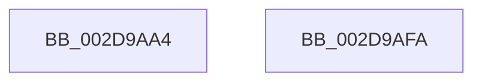

# PpmAcquireLock

- RVA: `0x002D9AA4`–`0x002D9AFB` (길이 `87` bytes)
- VA: `0x00000001402D9AA4`
- 실행 섹션: `.text`
- PDB 이름 있음: `예`; PDB Function 태그: `아니요`
- unwind 정보 RVA: `0x00064C80`
- 디코드: `21`개 명령, `87/87` bytes 표시
- 미해석 바이트: `0` (있으면 어셈블리에 `.byte`로 보존)

> 이 문서는 커널 이미지의 기계어와 PDB 기호를 분석해 생성했습니다. 4번과 5번은 함수 원형과 자료형을 바이너리 사용 방식에서 추정한 C 해석이며 원본 소스 복구 결과는 아닙니다.

## 1. Dependencies

- 직접 호출 지점: **2**; 고유 호출 대상: **2**
- 직접 호출자로 확인된 함수: **52**
- RIP 상대 이미지 참조: **0**

### Outgoing calls
- `0x002D9ACC` → [KiSetSystemPriorityThread](KiSetSystemPriorityThread_function_002D9FF8.md) (function, `0x002D9FF8`)
- `0x002D9AE3` → [KeWaitForSingleObject](../20/KeWaitForSingleObject_function_0020E6B0.md) (function, `0x0020E6B0`)

### Direct callers
- [PpmIdleUpdateSystemLatencyLimit](PpmIdleUpdateSystemLatencyLimit_function_002D9204.md) at `0x002D9299`
- [PpmMediaBufferingWorker](PpmMediaBufferingWorker_function_002DA680.md) at `0x002DA6C6`
- [PpmPerfLatencySensitivityHintWorker](../3B/PpmPerfLatencySensitivityHintWorker_function_003BE910.md) at `0x003BE91B`
- [PpmCheckDelayedPeriodicStart](../3B/PpmCheckDelayedPeriodicStart_function_003BE940.md) at `0x003BE950`
- [PpmRegisterPerfCap](../42/PpmRegisterPerfCap_function_0042B0D0.md) at `0x0042B0F6`
- [PopDeepSleepEvaluateCallback](../46/PopDeepSleepEvaluateCallback_function_00469F10.md) at `0x00469FA4`
- [PoNotifyVSyncChange](../46/PoNotifyVSyncChange_function_00469FD0.md) at `0x00469FDF`
- [PpmCheckPausePpmEngineForSx](../49/PpmCheckPausePpmEngineForSx_function_00499104.md) at `0x0049910F`
- [PpmCheckResumePpmEngineFromSx](../49/PpmCheckResumePpmEngineFromSx_function_00499148.md) at `0x00499153`
- [PpmParkSetLpiCap](../4D/PpmParkSetLpiCap_function_004D9358.md) at `0x004D93A3`
- [PpmSetExitLatencySamplingPercentage](../4D/PpmSetExitLatencySamplingPercentage_function_004DA9B0.md) at `0x004DA9C4`
- [PpmPerfGetVmPerfConfig](../4D/PpmPerfGetVmPerfConfig_function_004DE504.md) at `0x004DE529`
- [PpmClearExitLatencySamplingPercentage](../4E/PpmClearExitLatencySamplingPercentage_function_004E1538.md) at `0x004E1543`
- [PpmPerfClearBootOverrides](../4F/PpmPerfClearBootOverrides_function_004FCF44.md) at `0x004FCF67`
- [PpmPerfGetVmCppcConfig](../5D/PpmPerfGetVmCppcConfig_function_005D41A8.md) at `0x005D41D6`
- [PpmPerfGetVmPerfPriorityConfig](../5D/PpmPerfGetVmPerfPriorityConfig_function_005D4454.md) at `0x005D4474`
- [PpmHeteroHgsUpdateWorker](../5D/PpmHeteroHgsUpdateWorker_function_005D8F70.md) at `0x005D8F7B`
- [PopIntSteerSetMode](../5D/PopIntSteerSetMode_function_005DD3B0.md) at `0x005DD3E4`
- [PpmPerfGetVmPerfPrioritySupport](../../page/75/PpmPerfGetVmPerfPrioritySupport_function_0075AD28.md) at `0x0075AD38`
- [PpmPerfReApplyStates](../../page/75/PpmPerfReApplyStates_function_0075ADA4.md) at `0x0075ADAF`
- [PpmPerfTelemetryWorker](../../page/75/PpmPerfTelemetryWorker_function_0075AED0.md) at `0x0075AF04`
- [PpmRegisterPerfStates](../../page/75/PpmRegisterPerfStates_function_0075B084.md) at `0x0075B176`
- [PpmRegisterPerfStates](../../page/75/PpmRegisterPerfStates_function_0075B084.md) at `0x0075BC5F`
- [PpmUpdatePerfStates](../../page/75/PpmUpdatePerfStates_function_0075BD90.md) at `0x0075BDA4`
- [PpmUpdatePerfStates](../../page/75/PpmUpdatePerfStates_function_0075BD90.md) at `0x0075BE5B`
- [PpmPerfProcCapFloorSettingCallback](../../page/76/PpmPerfProcCapFloorSettingCallback_function_007641B0.md) at `0x00764211`
- [PpmParkApplyForcedMask](../../page/76/PpmParkApplyForcedMask_function_0076A904.md) at `0x0076A97E`
- [PpmParkClearForcedMask](../../page/76/PpmParkClearForcedMask_function_0076AB20.md) at `0x0076AB43`
- [PpmDisableProfile](../../page/77/PpmDisableProfile_function_00770858.md) at `0x0077087B`
- [PpmEnableProfile](../../page/77/PpmEnableProfile_function_00770938.md) at `0x007709B8`
- [PpmRegisterProfiles](../../page/77/PpmRegisterProfiles_function_007709F0.md) at `0x00770B51`
- [PpmPerfRegisterHvPerfStateCounters](../../page/77/PpmPerfRegisterHvPerfStateCounters_function_00770C40.md) at `0x00770C7F`
- [PpmSetProfilePolicySetting](../../page/91/PpmSetProfilePolicySetting_function_00915A44.md) at `0x00915B2B`
- [PopCheckResiliencyScenarios](../../page/A3/PopCheckResiliencyScenarios_function_00A31718.md) at `0x00A31859`
- [PopWnfFullscreenVideoCallback](../../page/A4/PopWnfFullscreenVideoCallback_function_00A49EB0.md) at `0x00A49F50`
- [PpmEventTraceControlCallback](../../page/A5/PpmEventTraceControlCallback_function_00A51F60.md) at `0x00A51FD5`
- [PpmProfileAcDcUpdate](../../page/A5/PpmProfileAcDcUpdate_function_00A5280C.md) at `0x00A5282F`
- [PpmApplyProfile](../../page/A5/PpmApplyProfile_function_00A52B08.md) at `0x00A52B42`
- [PpmApplyProfile](../../page/A5/PpmApplyProfile_function_00A52B08.md) at `0x00A52CD7`
- [PpmReapplyPerfPolicy](../../page/A5/PpmReapplyPerfPolicy_function_00A53148.md) at `0x00A532EB`
- [PpmPerfGetFrequencyBandStats](../../page/A5/PpmPerfGetFrequencyBandStats_function_00A542B0.md) at `0x00A542CC`
- [PpmIdleGetConcurrencyStats](../../page/A7/PpmIdleGetConcurrencyStats_function_00A798E4.md) at `0x00A7992B`
- [PpmIdleGetPackageIdleIntervalStats](../../page/A7/PpmIdleGetPackageIdleIntervalStats_function_00A7EE4C.md) at `0x00A7EE7C`
- [PpmCheckInitProcessors](../../page/A8/PpmCheckInitProcessors_function_00A84AE8.md) at `0x00A84B71`
- [PpmHvEnableQosEnlightenment](../../page/A8/PpmHvEnableQosEnlightenment_function_00A84D00.md) at `0x00A84D4B`
- [PopPowerInformationInternal](../../page/A8/PopPowerInformationInternal_function_00A8B7C0.md) at `0x00A8C099`
- [PopPowerRequestCallbackPerfBoostRequired](../../page/A9/PopPowerRequestCallbackPerfBoostRequired_function_00A96F70.md) at `0x00A96F8A`
- [PopPowerRequestCallbackPerfBoostRequired](../../page/A9/PopPowerRequestCallbackPerfBoostRequired_function_00A96F70.md) at `0x00A96FF6`
- [PdcPoPpmResetProfile](../../page/AB/PdcPoPpmResetProfile_function_00ABA420.md) at `0x00ABA449`
- [PopEnforceResiliencyScenarios](../../page/AC/PopEnforceResiliencyScenarios_function_00AC3D90.md) at `0x00AC3DA8`
- [PpmSetSimulatedLoad](../../page/AC/PpmSetSimulatedLoad_function_00ACD710.md) at `0x00ACD72B`
- [PpmClearSimulatedLoad](../../page/AC/PpmClearSimulatedLoad_function_00ACE938.md) at `0x00ACE94E`
- [PpmPerfGetBrandedFrequency](../../page/AD/PpmPerfGetBrandedFrequency_function_00AD4900.md) at `0x00AD4929`
- [PpmPerfGetVmPerfControlSupport](../../page/AD/PpmPerfGetVmPerfControlSupport_function_00ADB2BC.md) at `0x00ADB2CC`
- [PpmInitPolicyConfiguration](../../init/C4/PpmInitPolicyConfiguration_function_00C40708.md) at `0x00C407A5`
- [PoInitSystem](../../init/C7/PoInitSystem_function_00C72358.md) at `0x00C72E0E`
- [PoInitSystem](../../init/C7/PoInitSystem_function_00C72358.md) at `0x00C72E63`

### Static image references
- 디코드된 RIP-relative 메모리 참조가 없습니다.

## 2. Other-region calls and transfers

- 다른 실행 섹션으로 향하는 call: **0**
- 별도 외부 분기/꼬리 이동을 확인하지 못했습니다.

## 3. Assembly (complete function range)

```asm
002D9AA4  40 53                           push rbx
002D9AA6  48 83 EC 30                     sub rsp, 0x30
002D9AAA  65 48 8B 04 25 88 01 00 00      mov rax, qword ptr gs:[0x188]
002D9AB3  48 8B D9                        mov rbx, rcx
002D9AB6  BA 16 00 00 00                  mov edx, 0x16
002D9ABB  66 FF 88 E4 01 00 00            dec word ptr [rax + 0x1e4]
002D9AC2  90                              nop
002D9AC3  65 48 8B 0C 25 88 01 00 00      mov rcx, qword ptr gs:[0x188]
002D9ACC  E8 27 05 00 00                  call 0x1402d9ff8
002D9AD1  48 83 64 24 20 00               and qword ptr [rsp + 0x20], 0
002D9AD7  48 8D 4B 08                     lea rcx, [rbx + 8]
002D9ADB  45 33 C9                        xor r9d, r9d
002D9ADE  45 33 C0                        xor r8d, r8d
002D9AE1  33 D2                           xor edx, edx
002D9AE3  E8 C8 4B F3 FF                  call 0x14020e6b0
002D9AE8  65 48 8B 04 25 88 01 00 00      mov rax, qword ptr gs:[0x188]
002D9AF1  48 89 03                        mov qword ptr [rbx], rax
002D9AF4  48 83 C4 30                     add rsp, 0x30
002D9AF8  5B                              pop rbx
002D9AF9  C3                              ret
002D9AFA  CC                              int3
```

## 4. C-style interpretation (structured pseudocode)

```c
__int64 __fastcall PpmAcquireLock(__int64 a1, __int64 a2, int a3, int a4)
{
    __int64 result;
    __int64 v_rsp;
    unsigned __int64 v_stack_m18;

    v_rsp = (v_rsp) - (48);
    result = KiSetSystemPriorityThread(*(unsigned __int64 *)(gs_base + (0 + 392)), 22, a3, a4);
    a4 = 0;
    a3 = 0;
    a2 = 0;
    result = KeWaitForSingleObject(a1 + 8, a2, a3, a4);
    *(unsigned __int64 *)(a1) = *(unsigned __int64 *)(gs_base + (0 + 392));
    v_rsp = (v_rsp) + (48);
    return *(unsigned __int64 *)(gs_base + (0 + 392));
}
```

## 5. (Beta) C Style

```c
int64_t PpmAcquireLock(void *Arg1, int64_t Arg2, int32_t Arg3, int32_t Arg4)
{
    uint8_t *arg1 = (uint8_t *)Arg1;

    int64_t result;
    int64_t local_rsp;
    uint64_t v_stack_m18;

    local_rsp = (local_rsp) - (48);
    result = KiSetSystemPriorityThread(*(uint64_t *)(gs_base + (0 + 0x188)), 22, Arg3, Arg4);
    Arg4 = 0;
    Arg3 = 0;
    Arg2 = 0;
    result = KeWaitForSingleObject(Arg1 + 8, Arg2, Arg3, Arg4);
    *(uint64_t *)(arg1) = *(uint64_t *)(gs_base + (0 + 0x188));
    local_rsp = (local_rsp) + (48);
    return *(uint64_t *)(gs_base + (0 + 0x188));
}
```

### 관측된 메모리 오프셋

구조체 형식이 확인되지 않은 접근은 인자 기준의 오프셋으로만 기록했습니다.

| 기준 인자 | 오프셋 표현 | 폭 (bit) | 접근 |
|---|---:|---:|---|
| `Arg1` | `+ 0x0` | `64` | `W` |
| `Arg1` | `+ 0x8` | `64` | `R` |

## 6. Execution-region graph

[열기: 2D/3D 그래프와 함수 탐색 컨트롤 패널](../../../control-panel.html?section=text&rva=0x002D9AA4&view=graph)

- 2D 그래프는 위에서 아래로 흐르고, 3D 그래프는 빈 공간을 드래그해 회전합니다. Shift+드래그는 이동, 휠은 확대·축소, 함수 노드 선택은 대상 보고서 이동입니다.

### Static fallback


