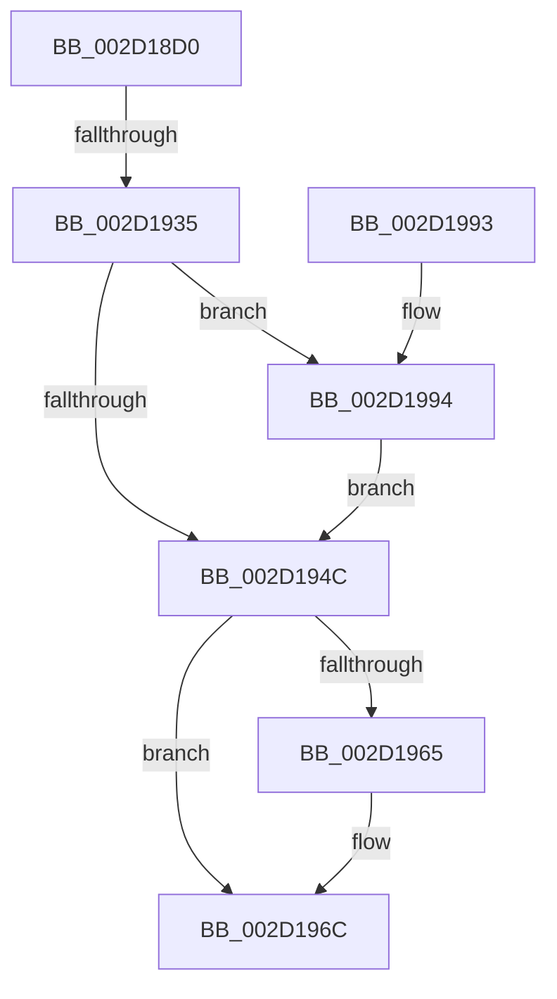

# PpmBeginActiveTimeAccumulation

- RVA: `0x002D18D0`–`0x002D19A7` (길이 `215` bytes)
- VA: `0x00000001402D18D0`
- 실행 섹션: `.text`
- PDB 이름 있음: `예`; PDB Function 태그: `예`
- unwind 정보 RVA: `0x0006F828`
- 디코드: `56`개 명령, `215/215` bytes 표시
- 미해석 바이트: `0` (있으면 어셈블리에 `.byte`로 보존)

> 이 문서는 커널 이미지의 기계어와 PDB 기호를 분석해 생성했습니다. 4번과 5번은 함수 원형과 자료형을 바이너리 사용 방식에서 추정한 C 해석이며 원본 소스 복구 결과는 아닙니다.

## 1. Dependencies

- 직접 호출 지점: **1**; 고유 호출 대상: **1**
- 직접 호출자로 확인된 함수: **1**
- RIP 상대 이미지 참조: **1**

### Outgoing calls
- `0x002D1973` → [_security_check_cookie](../6A/_security_check_cookie_function_006AC640.md) (function, `0x006AC640`)

### Direct callers
- [PpmIdleExecuteTransition](PpmIdleExecuteTransition_function_002D0A1C.md) at `0x002D0BC7`

### Static image references
- `0x002D18EC` → RVA `0x00E0A740` (`.data`; read)

## 2. Other-region calls and transfers

- 다른 실행 섹션으로 향하는 call: **0**
- call이 아닌 외부 분기/꼬리 이동: **1**
  - `0x002D192F` → [sub_006DD630](../6D/Unknown_function_006DD630.md) (`tail-transfer`)

## 3. Assembly (complete function range)

```asm
002D18D0  48 89 5C 24 18                  mov qword ptr [rsp + 0x18], rbx
002D18D5  55                              push rbp
002D18D6  56                              push rsi
002D18D7  57                              push rdi
002D18D8  41 54                           push r12
002D18DA  41 55                           push r13
002D18DC  41 56                           push r14
002D18DE  41 57                           push r15
002D18E0  48 8D 6C 24 D9                  lea rbp, [rsp - 0x27]
002D18E5  48 81 EC 00 01 00 00            sub rsp, 0x100
002D18EC  48 8B 05 4D 8E B3 00            mov rax, qword ptr [rip + 0xb38e4d]
002D18F3  48 33 C4                        xor rax, rsp
002D18F6  48 89 45 17                     mov qword ptr [rbp + 0x17], rax
002D18FA  33 DB                           xor ebx, ebx
002D18FC  48 89 54 24 58                  mov qword ptr [rsp + 0x58], rdx
002D1901  48 89 5C 24 50                  mov qword ptr [rsp + 0x50], rbx
002D1906  8B F3                           mov esi, ebx
002D1908  48 89 5C 24 48                  mov qword ptr [rsp + 0x48], rbx
002D190D  4C 8B CA                        mov r9, rdx
002D1910  48 8B F9                        mov rdi, rcx
002D1913  F0 48 FF 81 60 88 00 00         lock inc qword ptr [rcx + 0x8860]
002D191B  48 89 99 68 88 00 00            mov qword ptr [rcx + 0x8868], rbx
002D1922  4C 8D A9 90 88 00 00            lea r13, [rcx + 0x8890]
002D1929  38 99 19 89 00 00               cmp byte ptr [rcx + 0x8919], bl
002D192F  0F 85 FB BC 40 00               jne 0x1406dd630
002D1935  0F 31                           rdtsc
002D1937  48 C1 E2 20                     shl rdx, 0x20
002D193B  48 0B C2                        or rax, rdx
002D193E  48 0F BA A7 A0 8F 00 00 27      bt qword ptr [rdi + 0x8fa0], 0x27
002D1947  4C 8B C0                        mov r8, rax
002D194A  72 48                           jb 0x1402d1994
002D194C  4C 89 8F B8 88 00 00            mov qword ptr [rdi + 0x88b8], r9
002D1953  4C 89 87 98 88 00 00            mov qword ptr [rdi + 0x8898], r8
002D195A  48 0F BA A7 A0 8F 00 00 27      bt qword ptr [rdi + 0x8fa0], 0x27
002D1963  73 07                           jae 0x1402d196c
002D1965  48 89 9F 08 89 00 00            mov qword ptr [rdi + 0x8908], rbx
002D196C  48 8B 4D 17                     mov rcx, qword ptr [rbp + 0x17]
002D1970  48 33 CC                        xor rcx, rsp
002D1973  E8 C8 AC 3D 00                  call 0x1406ac640
002D1978  48 8B 9C 24 50 01 00 00         mov rbx, qword ptr [rsp + 0x150]
002D1980  48 81 C4 00 01 00 00            add rsp, 0x100
002D1987  41 5F                           pop r15
002D1989  41 5E                           pop r14
002D198B  41 5D                           pop r13
002D198D  41 5C                           pop r12
002D198F  5F                              pop rdi
002D1990  5E                              pop rsi
002D1991  5D                              pop rbp
002D1992  C3                              ret
002D1993  CC                              int3
002D1994  B9 B2 0D 00 00                  mov ecx, 0xdb2
002D1999  0F 32                           rdmsr
002D199B  48 C1 E2 20                     shl rdx, 0x20
002D199F  48 0B C2                        or rax, rdx
002D19A2  48 8B D8                        mov rbx, rax
002D19A5  EB A5                           jmp 0x1402d194c
```

## 4. C-style interpretation (structured pseudocode)

```c
__int64 __fastcall PpmBeginActiveTimeAccumulation(__int64 a1, __int64 a2)
{
    __int64 result;
    __int64 v_rbx;
    __int64 v_rsp;
    unsigned __int64 v_stack_m48;
    unsigned __int64 v_stack_m5F;
    unsigned __int64 v_stack_mE0;
    unsigned __int64 v_stack_mE8;
    unsigned __int64 v_stack_mF0;
    unsigned __int64 v_stack_p18;

    v_stack_p18 = v_rbx;
    v_rsp = (v_rsp) - (256);
    result = (*(unsigned __int64 *)(v_rip + 11767373)) ^ (v_rsp);
    v_stack_m48 = result;
    v_rbx = 0;
    v_stack_mE0 = a2;
    v_stack_mE8 = 0;
    v_stack_mF0 = 0;
    *(unsigned __int64 *)(a1 + 34920) = 0;
    a2 = (a2) << (32);
    result = (result) | (a2);
    if (condition_is_below) goto loc_002D1994;
loc_002D194C:
    *(unsigned __int64 *)(a1 + 35000) = a2;
    *(unsigned __int64 *)(a1 + 34968) = result;
    if (!(condition_is_above_or_equal)) {
        *(unsigned __int64 *)(a1 + 35080) = 0;
    }
    a1 = (v_stack_m48) ^ (v_rsp);
    result = _security_check_cookie(a1, a2, result, a2);
    v_rsp = (v_rsp) + (256);
    return result;
loc_002D1994:
    a2 = (a2) << (32);
    result = (result) | (a2);
    goto loc_002D194C;
}
```

## 5. (Beta) C Style

```c
int64_t PpmBeginActiveTimeAccumulation(void *Arg1, int64_t Arg2)
{
    uint8_t *arg1 = (uint8_t *)Arg1;

    int64_t result;
    int64_t local_rbx;
    int64_t local_rsp;
    uint64_t v_stack_m48;
    uint64_t v_stack_m5F;
    uint64_t v_stack_mE0;
    uint64_t v_stack_mE8;
    uint64_t v_stack_mF0;
    uint64_t v_stack_p18;

    v_stack_p18 = local_rbx;
    local_rsp = (local_rsp) - (256);
    result = (*(uint64_t *)(v_rip + 0xB38E4D)) ^ (local_rsp);
    v_stack_m48 = result;
    local_rbx = 0;
    v_stack_mE0 = Arg2;
    v_stack_mE8 = 0;
    v_stack_mF0 = 0;
    *(uint64_t *)(arg1 + 0x8868) = 0;
    Arg2 = (Arg2) << (32);
    result = (result) | (Arg2);
    if (condition_is_below) goto loc_002D1994;
loc_002D194C:
    *(uint64_t *)(arg1 + 0x88B8) = Arg2;
    *(uint64_t *)(arg1 + 0x8898) = result;
    if (!(condition_is_above_or_equal)) {
        *(uint64_t *)(arg1 + 0x8908) = 0;
    }
    Arg1 = (v_stack_m48) ^ (local_rsp);
    result = _security_check_cookie(Arg1, Arg2, result, Arg2);
    local_rsp = (local_rsp) + (256);
    return result;
loc_002D1994:
    Arg2 = (Arg2) << (32);
    result = (result) | (Arg2);
    goto loc_002D194C;
}
```

### 관측된 메모리 오프셋

구조체 형식이 확인되지 않은 접근은 인자 기준의 오프셋으로만 기록했습니다.

| 기준 인자 | 오프셋 표현 | 폭 (bit) | 접근 |
|---|---:|---:|---|
| `Arg1` | `+ 0x8860` | `64` | `R/W` |
| `Arg1` | `+ 0x8868` | `64` | `W` |
| `Arg1` | `+ 0x8890` | `64` | `R` |
| `Arg1` | `+ 0x8898` | `64` | `W` |
| `Arg1` | `+ 0x88B8` | `64` | `W` |
| `Arg1` | `+ 0x8908` | `64` | `W` |
| `Arg1` | `+ 0x8919` | `8` | `R` |
| `Arg1` | `+ 0x8FA0` | `64` | `R` |

## 6. Execution-region graph

[열기: 2D/3D 그래프와 함수 탐색 컨트롤 패널](../../../control-panel.html?section=text&rva=0x002D18D0&view=graph)

- 2D 그래프는 위에서 아래로 흐르고, 3D 그래프는 빈 공간을 드래그해 회전합니다. Shift+드래그는 이동, 휠은 확대·축소, 함수 노드 선택은 대상 보고서 이동입니다.

### Static fallback


