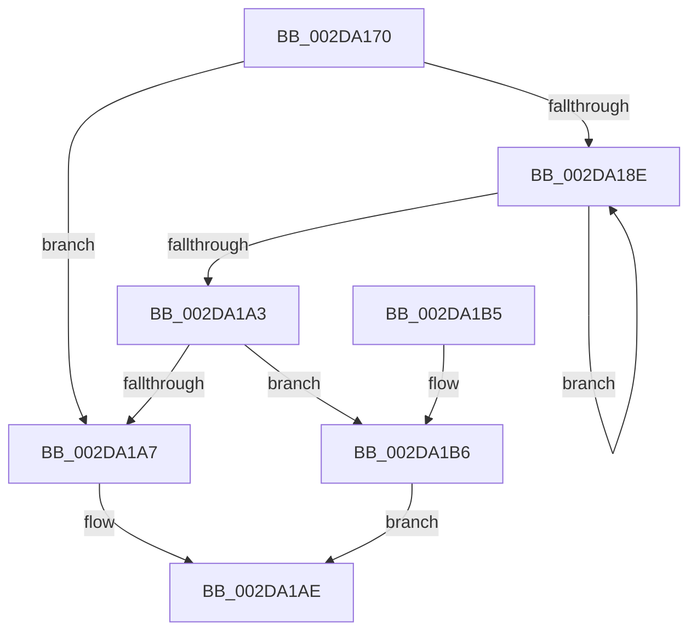

# PpmCheckAcquireProcessorPerformance

- RVA: `0x002DA170`–`0x002DA1C6` (길이 `86` bytes)
- VA: `0x00000001402DA170`
- 실행 섹션: `.text`
- PDB 이름 있음: `예`; PDB Function 태그: `아니요`
- unwind 정보 RVA: `0x000704D0`
- 디코드: `24`개 명령, `86/86` bytes 표시
- 미해석 바이트: `0` (있으면 어셈블리에 `.byte`로 보존)

> 이 문서는 커널 이미지의 기계어와 PDB 기호를 분석해 생성했습니다. 4번과 5번은 함수 원형과 자료형을 바이너리 사용 방식에서 추정한 C 해석이며 원본 소스 복구 결과는 아닙니다.

## 1. Dependencies

- 직접 호출 지점: **1**; 고유 호출 대상: **1**
- 직접 호출자로 확인된 함수: **1**
- RIP 상대 이미지 참조: **3**

### Outgoing calls
- `0x002DA1BD` → [PpmPerfControlExecuteAction](PpmPerfControlExecuteAction_function_002DA31C.md) (function, `0x002DA31C`)

### Direct callers
- [PpmCheckRun](PpmCheckRun_function_002DA0C0.md) at `0x002DA11F`

### Static image references
- `0x002DA174` → RVA `0x00FC6BA8` (`ALMOSTRO`; read)
- `0x002DA1A7` → RVA `0x00F0B3F0` (`.data`; read/write)
- `0x002DA1B6` → RVA `0x00F0E270` (`.data`; read)

## 2. Other-region calls and transfers

- 다른 실행 섹션으로 향하는 call: **0**
- 별도 외부 분기/꼬리 이동을 확인하지 못했습니다.

## 3. Assembly (complete function range)

```asm
002DA170  48 83 EC 28                     sub rsp, 0x28
002DA174  48 8B 15 2D CA CE 00            mov rdx, qword ptr [rip + 0xceca2d]
002DA17B  4C 8D 05 26 CA CE 00            lea r8, [rip + 0xceca26]
002DA182  32 C0                           xor al, al
002DA184  B9 01 00 00 00                  mov ecx, 1
002DA189  49 3B D0                        cmp rdx, r8
002DA18C  74 19                           je 0x1402da1a7
002DA18E  80 BA BE 04 00 00 00            cmp byte ptr [rdx + 0x4be], 0
002DA195  48 8B 12                        mov rdx, qword ptr [rdx]
002DA198  0F B6 C0                        movzx eax, al
002DA19B  0F 45 C1                        cmovne eax, ecx
002DA19E  49 3B D0                        cmp rdx, r8
002DA1A1  75 EB                           jne 0x1402da18e
002DA1A3  84 C0                           test al, al
002DA1A5  75 0F                           jne 0x1402da1b6
002DA1A7  83 05 42 12 C3 00 02            add dword ptr [rip + 0xc31242], 2
002DA1AE  8A C1                           mov al, cl
002DA1B0  48 83 C4 28                     add rsp, 0x28
002DA1B4  C3                              ret
002DA1B5  CC                              int3
002DA1B6  48 8B 0D B3 40 C3 00            mov rcx, qword ptr [rip + 0xc340b3]
002DA1BD  E8 5A 01 00 00                  call 0x1402da31c
002DA1C2  8A C8                           mov cl, al
002DA1C4  EB E8                           jmp 0x1402da1ae
```

## 4. C-style interpretation (structured pseudocode)

```c
__int64 __fastcall PpmCheckAcquireProcessorPerformance(void)
{
    __int64 result;
    __int64 v_rsp;

    v_rsp = (v_rsp) - (40);
    result = 0;
    if ((*(unsigned __int64 *)(v_rip + 13552173)) == (v_rip + 13552166)) goto loc_002DA1A7;
loc_002DA18E:
    result = 0;
    if ((*(unsigned __int8 *)(*(unsigned __int64 *)(v_rip + 13552173) + 1214)) != 0) { result = 1; }
    if ((*(unsigned __int64 *)(*(unsigned __int64 *)(v_rip + 13552173))) != (v_rip + 13552166)) goto loc_002DA18E;
    if ((unsigned __int8)(result) != 0) goto loc_002DA1B6;
loc_002DA1A7:
loc_002DA1AE:
    v_rsp = (v_rsp) + (40);
    return 1;
loc_002DA1B6:
    result = PpmPerfControlExecuteAction(*(unsigned __int64 *)(v_rip + 12796083), *(unsigned __int64 *)(*(unsigned __int64 *)(v_rip + 13552173)), v_rip + 13552166, a4);
    goto loc_002DA1AE;
}
```

## 5. (Beta) C Style

```c
void PpmCheckAcquireProcessorPerformance(void)
{
    int64_t result;
    int64_t local_rsp;

    local_rsp = (local_rsp) - (40);
    result = 0;
    if ((*(uint64_t *)(v_rip + 0xCECA2D)) == (v_rip + 13552166)) goto loc_002DA1A7;
loc_002DA18E:
    result = 0;
    if ((*(uint8_t *)(*(uint64_t *)(v_rip + 0xCECA2D) + 0x4BE)) != 0) { result = 1; }
    if ((*(uint64_t *)(*(uint64_t *)(v_rip + 0xCECA2D))) != (v_rip + 13552166)) goto loc_002DA18E;
    if ((uint8_t)(result) != 0) goto loc_002DA1B6;
loc_002DA1A7:
loc_002DA1AE:
    local_rsp = (local_rsp) + (40);
    return 1;
loc_002DA1B6:
    result = PpmPerfControlExecuteAction(*(uint64_t *)(v_rip + 0xC340B3), *(uint64_t *)(*(uint64_t *)(v_rip + 0xCECA2D)), v_rip + 13552166, a4);
    goto loc_002DA1AE;
}
```

## 6. Execution-region graph

[열기: 2D/3D 그래프와 함수 탐색 컨트롤 패널](../../../control-panel.html?section=text&rva=0x002DA170&view=graph)

- 2D 그래프는 위에서 아래로 흐르고, 3D 그래프는 빈 공간을 드래그해 회전합니다. Shift+드래그는 이동, 휠은 확대·축소, 함수 노드 선택은 대상 보고서 이동입니다.

### Static fallback


