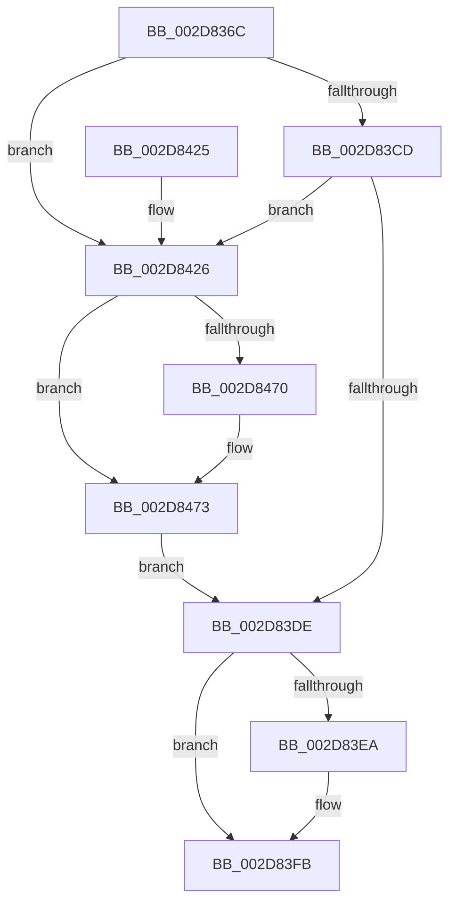

# PpmCheckContinueExecution

- RVA: `0x002D836C`–`0x002D8480` (길이 `276` bytes)
- VA: `0x00000001402D836C`
- 실행 섹션: `.text`
- PDB 이름 있음: `예`; PDB Function 태그: `아니요`
- unwind 정보 RVA: `0x00070178`
- 디코드: `62`개 명령, `276/276` bytes 표시
- 미해석 바이트: `0` (있으면 어셈블리에 `.byte`로 보존)

> 이 문서는 커널 이미지의 기계어와 PDB 기호를 분석해 생성했습니다. 4번과 5번은 함수 원형과 자료형을 바이너리 사용 방식에서 추정한 C 해석이며 원본 소스 복구 결과는 아닙니다.

## 1. Dependencies

- 직접 호출 지점: **8**; 고유 호출 대상: **7**
- 직접 호출자로 확인된 함수: **2**
- RIP 상대 이미지 참조: **6**

### Outgoing calls
- `0x002D8394` → [memset](../6C/memset_function_006C6C40.md) (function, `0x006C6C40`)
- `0x002D8399` → [KeQuerySystemAllowedCpuSetAffinity](KeQuerySystemAllowedCpuSetAffinity_function_002D85F4.md) (function, `0x002D85F4`)
- `0x002D8407` → [KeInsertQueueDpc](../20/KeInsertQueueDpc_function_00207C50.md) (function, `0x00207C50`)
- `0x002D8417` → [_security_check_cookie](../6A/_security_check_cookie_function_006AC640.md) (function, `0x006AC640`)
- `0x002D8440` → [memset](../6C/memset_function_006C6C40.md) (function, `0x006C6C40`)
- `0x002D844A` → [PoCopyDeepIdleMask](../3C/PoCopyDeepIdleMask_function_003C04C8.md) (function, `0x003C04C8`)
- `0x002D8462` → [KiSubtractAffinityEx](KiSubtractAffinityEx_function_002D61E8.md) (function, `0x002D61E8`)
- `0x002D8473` → [KeFindFirstSetRightAffinityEx](../47/KeFindFirstSetRightAffinityEx_function_004701E0.md) (function, `0x004701E0`)

### Direct callers
- [PpmPerfAction](PpmPerfAction_function_002D7E70.md) at `0x002D7ED6`
- [PpmPerfControlActionCallback](../4B/PpmPerfControlActionCallback_function_004BAB80.md) at `0x004BAB84`

### Static image references
- `0x002D8375` → RVA `0x00E0A740` (`.data`; read)
- `0x002D83A7` → RVA `0x00F07100` (`.data`; read)
- `0x002D83B2` → RVA `0x00F231B0` (`.data`; read)
- `0x002D83DE` → RVA `0x00F0B2B8` (`.data`; read)
- `0x002D83F3` → RVA `0x00F0B282` (`.data`; write)
- `0x002D83FE` → RVA `0x00F0B280` (`.data`; read)

## 2. Other-region calls and transfers

- 다른 실행 섹션으로 향하는 call: **0**
- 별도 외부 분기/꼬리 이동을 확인하지 못했습니다.

## 3. Assembly (complete function range)

```asm
002D836C  40 53                           push rbx
002D836E  48 81 EC 50 01 00 00            sub rsp, 0x150
002D8375  48 8B 05 C4 23 B3 00            mov rax, qword ptr [rip + 0xb323c4]
002D837C  48 33 C4                        xor rax, rsp
002D837F  48 89 84 24 40 01 00 00         mov qword ptr [rsp + 0x140], rax
002D8387  33 D2                           xor edx, edx
002D8389  48 8D 4C 24 38                  lea rcx, [rsp + 0x38]
002D838E  41 B8 00 01 00 00               mov r8d, 0x100
002D8394  E8 A7 E8 3E 00                  call 0x1406c6c40
002D8399  E8 56 02 00 00                  call 0x1402d85f4
002D839E  65 48 8B 04 25 20 00 00 00      mov rax, qword ptr gs:[0x20]
002D83A7  48 8D 1D 52 ED C2 00            lea rbx, [rip + 0xc2ed52]
002D83AE  44 8B 40 24                     mov r8d, dword ptr [rax + 0x24]
002D83B2  48 8B 05 F7 AD C4 00            mov rax, qword ptr [rip + 0xc4adf7]
002D83B9  42 8B 0C 80                     mov ecx, dword ptr [rax + r8*4]
002D83BD  8B D1                           mov edx, ecx
002D83BF  0F B7 05 3A ED C2 00            movzx eax, word ptr [rip + 0xc2ed3a]
002D83C6  C1 EA 06                        shr edx, 6
002D83C9  3B D0                           cmp edx, eax
002D83CB  73 59                           jae 0x1402d8426
002D83CD  48 8B 54 D3 08                  mov rdx, qword ptr [rbx + rdx*8 + 8]
002D83D2  83 E1 3F                        and ecx, 0x3f
002D83D5  48 D3 EA                        shr rdx, cl
002D83D8  0F BA E2 00                     bt edx, 0
002D83DC  73 48                           jae 0x1402d8426
002D83DE  48 8B 05 D3 2E C3 00            mov rax, qword ptr [rip + 0xc32ed3]
002D83E5  48 85 C0                        test rax, rax
002D83E8  75 11                           jne 0x1402d83fb
002D83EA  B8 00 08 00 00                  mov eax, 0x800
002D83EF  66 44 03 C0                     add r8w, ax
002D83F3  66 44 89 05 87 2E C3 00         mov word ptr [rip + 0xc32e87], r8w
002D83FB  45 33 C0                        xor r8d, r8d
002D83FE  48 8D 0D 7B 2E C3 00            lea rcx, [rip + 0xc32e7b]
002D8405  33 D2                           xor edx, edx
002D8407  E8 44 F8 F2 FF                  call 0x140207c50
002D840C  48 8B 8C 24 40 01 00 00         mov rcx, qword ptr [rsp + 0x140]
002D8414  48 33 CC                        xor rcx, rsp
002D8417  E8 24 42 3D 00                  call 0x1406ac640
002D841C  48 81 C4 50 01 00 00            add rsp, 0x150
002D8423  5B                              pop rbx
002D8424  C3                              ret
002D8425  CC                              int3
002D8426  83 64 24 34 00                  and dword ptr [rsp + 0x34], 0
002D842B  48 8D 4C 24 38                  lea rcx, [rsp + 0x38]
002D8430  33 D2                           xor edx, edx
002D8432  C7 44 24 30 01 00 20 00         mov dword ptr [rsp + 0x30], 0x200001
002D843A  41 B8 00 01 00 00               mov r8d, 0x100
002D8440  E8 FB E7 3E 00                  call 0x1406c6c40
002D8445  48 8D 4C 24 30                  lea rcx, [rsp + 0x30]
002D844A  E8 79 80 0E 00                  call 0x1403c04c8
002D844F  44 0F B7 4C 24 32               movzx r9d, word ptr [rsp + 0x32]
002D8455  4C 8D 44 24 30                  lea r8, [rsp + 0x30]
002D845A  48 8D 54 24 30                  lea rdx, [rsp + 0x30]
002D845F  48 8B CB                        mov rcx, rbx
002D8462  E8 81 DD FF FF                  call 0x1402d61e8
002D8467  48 8D 4C 24 30                  lea rcx, [rsp + 0x30]
002D846C  85 C0                           test eax, eax
002D846E  75 03                           jne 0x1402d8473
002D8470  48 8B CB                        mov rcx, rbx
002D8473  E8 68 7D 19 00                  call 0x1404701e0
002D8478  44 8B C0                        mov r8d, eax
002D847B  E9 5E FF FF FF                  jmp 0x1402d83de
```

## 4. C-style interpretation (structured pseudocode)

```c
__int64 __fastcall PpmCheckContinueExecution(__int64 a1, int a2)
{
    __int64 result;
    __int64 v_rsp;
    unsigned __int64 v_stack_m120;
    unsigned __int64 v_stack_m18;
    unsigned int v_stack_p30;
    unsigned __int16 v_stack_p32;
    unsigned int v_stack_p34;
    unsigned __int64 v_stack_p38;

    v_rsp = (v_rsp) - (336);
    result = (*(unsigned __int64 *)(v_rip + 11740100)) ^ (v_rsp);
    v_stack_m18 = result;
    a2 = 0;
    result = memset(v_stack_m120, a2, 256, a4);
    result = KeQuerySystemAllowedCpuSetAffinity(v_stack_m120, a2, 256, a4);
    a2 = (unsigned int)(((unsigned int)((unsigned int)((unsigned int)(*(unsigned int *)(*(unsigned __int64 *)(v_rip + 12889591) + (unsigned int)(*(unsigned int *)(*(unsigned __int64 *)(gs_base + (0 + 32)) + 36)) * 4))))) >> (6));
    if (a2 >= ((unsigned int)(*(unsigned __int16 *)(v_rip + 12774714)))) goto loc_002D8426;
    a1 = (unsigned int)(((unsigned int)(*(unsigned int *)(*(unsigned __int64 *)(v_rip + 12889591) + (unsigned int)(*(unsigned int *)(*(unsigned __int64 *)(gs_base + (0 + 32)) + 36)) * 4))) & (63));
    a2 = (*(unsigned __int64 *)(v_rip + 12774738 + a2 * 8 + 8)) >> ((unsigned __int8)(a1));
    if (condition_is_above_or_equal) goto loc_002D8426;
loc_002D83DE:
    result = *(unsigned __int64 *)(v_rip + 12791507);
    if (*(unsigned __int64 *)(v_rip + 12791507) == 0) {
        result = 0x800ULL;
        a3 = (unsigned __int16)(((unsigned int)(*(unsigned int *)(*(unsigned __int64 *)(gs_base + (0 + 32)) + 36))) + ((unsigned __int16)(result)));
        *(unsigned __int16 *)(v_rip + 12791431) = (unsigned __int16)(a3);
    }
    a3 = 0;
    a2 = 0;
    result = KeInsertQueueDpc(v_rip + 12791419, a2, a3, a4);
    a1 = (v_stack_m18) ^ (v_rsp);
    result = _security_check_cookie(a1, a2, a3, a4);
    v_rsp = (v_rsp) + (336);
    return result;
loc_002D8426:
    a2 = 0;
    v_stack_p30 = 0x200001ULL;
    result = memset(v_stack_p38, a2, 256, a4);
    result = PoCopyDeepIdleMask(v_stack_p30, a2, 256, a4);
    result = KiSubtractAffinityEx(v_rip + 12774738, v_stack_p30, v_stack_p30, v_stack_p32);
    if ((unsigned int)(result) == 0) {
        a1 = v_rip + 12774738;
    }
    result = KeFindFirstSetRightAffinityEx(a1, v_stack_p30, v_stack_p30, v_stack_p32);
    goto loc_002D83DE;
}
```

## 5. (Beta) C Style

```c
int64_t PpmCheckContinueExecution(int64_t Arg1, int32_t Arg2)
{
    int64_t result;
    int64_t local_rsp;
    uint64_t v_stack_m120;
    uint64_t v_stack_m18;
    uint32_t v_stack_p30;
    uint16_t v_stack_p32;
    uint32_t v_stack_p34;
    uint64_t v_stack_p38;

    local_rsp = (local_rsp) - (336);
    result = (*(uint64_t *)(v_rip + 0xB323C4)) ^ (local_rsp);
    v_stack_m18 = result;
    Arg2 = 0;
    result = memset(v_stack_m120, Arg2, 256, a4);
    result = KeQuerySystemAllowedCpuSetAffinity(v_stack_m120, Arg2, 256, a4);
    Arg2 = (uint32_t)(((uint32_t)((uint32_t)((uint32_t)(*(uint32_t *)(*(uint64_t *)(v_rip + 0xC4ADF7) + (uint32_t)(*(uint32_t *)(*(uint64_t *)(gs_base + (0 + 0x20)) + 0x24)) * 4))))) >> (6));
    if (Arg2 >= ((uint32_t)(*(uint16_t *)(v_rip + 0xC2ED3A)))) goto loc_002D8426;
    Arg1 = (uint32_t)(((uint32_t)(*(uint32_t *)(*(uint64_t *)(v_rip + 0xC4ADF7) + (uint32_t)(*(uint32_t *)(*(uint64_t *)(gs_base + (0 + 0x20)) + 0x24)) * 4))) & (63));
    Arg2 = (*(uint64_t *)(v_rip + 0xC2ED52 + Arg2 * 8 + 0x8)) >> ((uint8_t)(Arg1));
    if (condition_is_above_or_equal) goto loc_002D8426;
loc_002D83DE:
    result = *(uint64_t *)(v_rip + 0xC32ED3);
    if (*(uint64_t *)(v_rip + 0xC32ED3) == 0) {
        result = 0x800ULL;
        a3 = (uint16_t)(((uint32_t)(*(uint32_t *)(*(uint64_t *)(gs_base + (0 + 0x20)) + 0x24))) + ((uint16_t)(result)));
        *(uint16_t *)(v_rip + 0xC32E87) = (uint16_t)(a3);
    }
    a3 = 0;
    Arg2 = 0;
    result = KeInsertQueueDpc(v_rip + 12791419, Arg2, a3, a4);
    Arg1 = (v_stack_m18) ^ (local_rsp);
    result = _security_check_cookie(Arg1, Arg2, a3, a4);
    local_rsp = (local_rsp) + (336);
    return result;
loc_002D8426:
    Arg2 = 0;
    v_stack_p30 = 0x200001ULL;
    result = memset(v_stack_p38, Arg2, 256, a4);
    result = PoCopyDeepIdleMask(v_stack_p30, Arg2, 256, a4);
    result = KiSubtractAffinityEx(v_rip + 12774738, v_stack_p30, v_stack_p30, v_stack_p32);
    if ((uint32_t)(result) == 0) {
        Arg1 = v_rip + 12774738;
    }
    result = KeFindFirstSetRightAffinityEx(Arg1, v_stack_p30, v_stack_p30, v_stack_p32);
    goto loc_002D83DE;
}
```

## 6. Execution-region graph

[열기: 2D/3D 그래프와 함수 탐색 컨트롤 패널](../../../control-panel.html?section=text&rva=0x002D836C&view=graph)

- 2D 그래프는 위에서 아래로 흐르고, 3D 그래프는 빈 공간을 드래그해 회전합니다. Shift+드래그는 이동, 휠은 확대·축소, 함수 노드 선택은 대상 보고서 이동입니다.

### Static fallback


