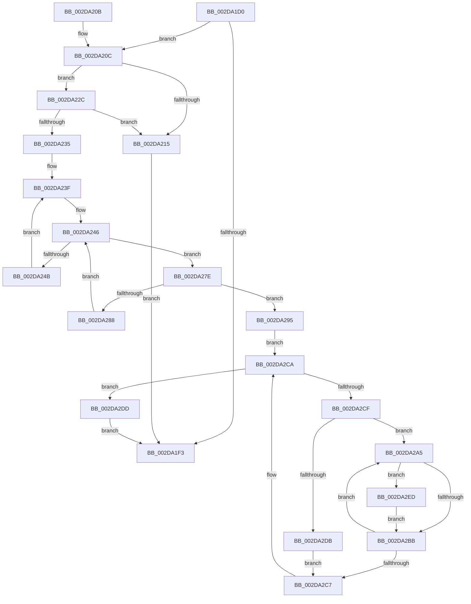

# PpmCheckMakeupSkippedChecks

- RVA: `0x002DA1D0`–`0x002DA2F7` (길이 `295` bytes)
- VA: `0x00000001402DA1D0`
- 실행 섹션: `.text`
- PDB 이름 있음: `예`; PDB Function 태그: `아니요`
- unwind 정보 RVA: `0x000704DC`
- 디코드: `76`개 명령, `295/295` bytes 표시
- 미해석 바이트: `0` (있으면 어셈블리에 `.byte`로 보존)

> 이 문서는 커널 이미지의 기계어와 PDB 기호를 분석해 생성했습니다. 4번과 5번은 함수 원형과 자료형을 바이너리 사용 방식에서 추정한 C 해석이며 원본 소스 복구 결과는 아닙니다.

## 1. Dependencies

- 직접 호출 지점: **7**; 고유 호출 대상: **6**
- 직접 호출자로 확인된 함수: **1**
- RIP 상대 이미지 참조: **8**

### Outgoing calls
- `0x002DA20C` → [PpmParkMaximumCoresParked](../48/PpmParkMaximumCoresParked_function_0048C750.md) (function, `0x0048C750`)
- `0x002DA215` → [PpmEventTraceMakeupPerfCheck](../49/PpmEventTraceMakeupPerfCheck_function_0049F748.md) (function, `0x0049F748`)
- `0x002DA22C` → [PpmPerfMinimumPerfReached](../48/PpmPerfMinimumPerfReached_function_00484450.md) (function, `0x00484450`)
- `0x002DA26B` → [KeGetPrcb](KeGetPrcb_function_002D85D0.md) (function, `0x002D85D0`)
- `0x002DA277` → [PpmPerfCompleteMakeup](../4A/PpmPerfCompleteMakeup_function_004A3374.md) (function, `0x004A3374`)
- `0x002DA2DD` → [PpmParkCompleteMakeup](../4F/PpmParkCompleteMakeup_function_004FBB44.md) (function, `0x004FBB44`)
- `0x002DA2F0` → [PpmPerfCompleteMakeup](../4A/PpmPerfCompleteMakeup_function_004A3374.md) (function, `0x004A3374`)

### Direct callers
- [PpmCheckRun](PpmCheckRun_function_002DA0C0.md) at `0x002DA118`

### Static image references
- `0x002DA1EB` → RVA `0x00F0B27C` (`.data`; read)
- `0x002DA21A` → RVA `0x00F0B27C` (`.data`; read/write)
- `0x002DA220` → RVA `0x00F0B3F0` (`.data`; write)
- `0x002DA235` → RVA `0x00E0B5A8` (`.data`; read)
- `0x002DA23F` → RVA `0x00E0B5A0` (`.data`; read)
- `0x002DA261` → RVA `0x00F231B8` (`.data`; read)
- `0x002DA295` → RVA `0x00FC6BA8` (`ALMOSTRO`; read)
- `0x002DA2E2` → RVA `0x00F0B27C` (`.data`; write)

## 2. Other-region calls and transfers

- 다른 실행 섹션으로 향하는 call: **0**
- 별도 외부 분기/꼬리 이동을 확인하지 못했습니다.

## 3. Assembly (complete function range)

```asm
002DA1D0  48 89 5C 24 10                  mov qword ptr [rsp + 0x10], rbx
002DA1D5  48 89 6C 24 18                  mov qword ptr [rsp + 0x18], rbp
002DA1DA  48 89 74 24 20                  mov qword ptr [rsp + 0x20], rsi
002DA1DF  57                              push rdi
002DA1E0  48 83 EC 20                     sub rsp, 0x20
002DA1E4  33 F6                           xor esi, esi
002DA1E6  BD 01 00 00 00                  mov ebp, 1
002DA1EB  39 35 8B 10 C3 00               cmp dword ptr [rip + 0xc3108b], esi
002DA1F1  77 19                           ja 0x1402da20c
002DA1F3  48 8B 5C 24 38                  mov rbx, qword ptr [rsp + 0x38]
002DA1F8  40 8A C5                        mov al, bpl
002DA1FB  48 8B 6C 24 40                  mov rbp, qword ptr [rsp + 0x40]
002DA200  48 8B 74 24 48                  mov rsi, qword ptr [rsp + 0x48]
002DA205  48 83 C4 20                     add rsp, 0x20
002DA209  5F                              pop rdi
002DA20A  C3                              ret
002DA20B  CC                              int3
002DA20C  E8 3F 25 1B 00                  call 0x14048c750
002DA211  84 C0                           test al, al
002DA213  75 17                           jne 0x1402da22c
002DA215  E8 2E 55 1C 00                  call 0x14049f748
002DA21A  FF 0D 5C 10 C3 00               dec dword ptr [rip + 0xc3105c]
002DA220  C7 05 C6 11 C3 00 04 00 00 00   mov dword ptr [rip + 0xc311c6], 4
002DA22A  EB C7                           jmp 0x1402da1f3
002DA22C  E8 1F A2 1A 00                  call 0x140484450
002DA231  84 C0                           test al, al
002DA233  74 E0                           je 0x1402da215
002DA235  48 8B 3D 6C 13 B3 00            mov rdi, qword ptr [rip + 0xb3136c]
002DA23C  0F B7 DE                        movzx ebx, si
002DA23F  0F B7 0D 5A 13 B3 00            movzx ecx, word ptr [rip + 0xb3135a]
002DA246  48 85 FF                        test rdi, rdi
002DA249  74 33                           je 0x1402da27e
002DA24B  48 0F BC D7                     bsf rdx, rdi
002DA24F  0F B7 CB                        movzx ecx, bx
002DA252  0F B6 C2                        movzx eax, dl
002DA255  48 0F B3 C7                     btr rdi, rax
002DA259  C1 E1 06                        shl ecx, 6
002DA25C  0F B6 C2                        movzx eax, dl
002DA25F  03 C8                           add ecx, eax
002DA261  48 8B 05 50 8F C4 00            mov rax, qword ptr [rip + 0xc48f50]
002DA268  8B 0C 88                        mov ecx, dword ptr [rax + rcx*4]
002DA26B  E8 60 E3 FF FF                  call 0x1402d85d0
002DA270  48 8D 88 B0 89 00 00            lea rcx, [rax + 0x89b0]
002DA277  E8 F8 90 1C 00                  call 0x1404a3374
002DA27C  EB C1                           jmp 0x1402da23f
002DA27E  66 03 DD                        add bx, bp
002DA281  0F B7 DB                        movzx ebx, bx
002DA284  3B D9                           cmp ebx, ecx
002DA286  73 0D                           jae 0x1402da295
002DA288  48 8D 3D 19 13 B3 00            lea rdi, [rip + 0xb31319]
002DA28F  48 8B 3C DF                     mov rdi, qword ptr [rdi + rbx*8]
002DA293  EB B1                           jmp 0x1402da246
002DA295  4C 8B 05 0C C9 CE 00            mov r8, qword ptr [rip + 0xcec90c]
002DA29C  4C 8D 15 05 C9 CE 00            lea r10, [rip + 0xcec905]
002DA2A3  EB 25                           jmp 0x1402da2ca
002DA2A5  41 8B C1                        mov eax, r9d
002DA2A8  48 69 C8 A8 04 00 00            imul rcx, rax, 0x4a8
002DA2AF  49 03 88 38 01 00 00            add rcx, qword ptr [r8 + 0x138]
002DA2B6  39 69 10                        cmp dword ptr [rcx + 0x10], ebp
002DA2B9  74 32                           je 0x1402da2ed
002DA2BB  44 03 CD                        add r9d, ebp
002DA2BE  45 3B 88 28 01 00 00            cmp r9d, dword ptr [r8 + 0x128]
002DA2C5  72 DE                           jb 0x1402da2a5
002DA2C7  4D 8B 00                        mov r8, qword ptr [r8]
002DA2CA  4D 3B C2                        cmp r8, r10
002DA2CD  74 0E                           je 0x1402da2dd
002DA2CF  44 8B CE                        mov r9d, esi
002DA2D2  41 39 B0 28 01 00 00            cmp dword ptr [r8 + 0x128], esi
002DA2D9  77 CA                           ja 0x1402da2a5
002DA2DB  EB EA                           jmp 0x1402da2c7
002DA2DD  E8 62 18 22 00                  call 0x1404fbb44
002DA2E2  89 35 94 0F C3 00               mov dword ptr [rip + 0xc30f94], esi
002DA2E8  E9 06 FF FF FF                  jmp 0x1402da1f3
002DA2ED  48 8B 09                        mov rcx, qword ptr [rcx]
002DA2F0  E8 7F 90 1C 00                  call 0x1404a3374
002DA2F5  EB C4                           jmp 0x1402da2bb
```

## 4. C-style interpretation (structured pseudocode)

```c
__int64 __fastcall PpmCheckMakeupSkippedChecks(__int64 a1, __int64 a2, __int64 a3, int a4)
{
    __int64 result;
    __int64 v_rbx;
    __int64 v_rsi;
    __int64 v_rsp;
    unsigned __int64 v_stack_p10;
    unsigned __int64 v_stack_p18;
    unsigned __int64 v_stack_p20;

    v_stack_p10 = v_rbx;
    v_stack_p18 = v_rbp;
    v_stack_p20 = v_rsi;
    v_rsp = (v_rsp) - (32);
    v_rsi = 0;
    if ((*(unsigned int *)(v_rip + 12783755)) > 0) goto loc_002DA20C;
loc_002DA1F3:
    v_rsp = (v_rsp) + (32);
    return 1;
loc_002DA20C:
    result = PpmParkMaximumCoresParked(a1, a2, a3, a4);
    if ((unsigned __int8)(result) != 0) goto loc_002DA22C;
loc_002DA215:
    result = PpmEventTraceMakeupPerfCheck(a1, a2, a3, a4);
    *(unsigned int *)(v_rip + 12784070) = 4;
    goto loc_002DA1F3;
loc_002DA22C:
    result = PpmPerfMinimumPerfReached(a1, a2, a3, a4);
    if ((unsigned __int8)(result) == 0) goto loc_002DA215;
loc_002DA23F:
loc_002DA246:
    if (*(unsigned __int64 *)(v_rip + 11735916) == 0) goto loc_002DA27E;
    a1 = (unsigned int)(((unsigned __int16)((unsigned __int16)(v_stack_p20))) << (6));
    a1 = (unsigned int)((a1) + ((unsigned int)((unsigned __int8)(a2))));
    result = KeGetPrcb((unsigned int)(*(unsigned int *)(*(unsigned __int64 *)(v_rip + 12881744) + a1 * 4)), a2, a3, a4);
    result = PpmPerfCompleteMakeup(result + 35248, a2, a3, a4);
    goto loc_002DA23F;
loc_002DA27E:
    v_rbx = (unsigned __int16)(((unsigned __int16)(v_stack_p20)) + ((unsigned __int16)(v_stack_p18)));
    if (((unsigned int)((unsigned __int16)(v_rbx))) >= ((unsigned int)(result + 35248))) goto loc_002DA295;
    goto loc_002DA246;
loc_002DA295:
    goto loc_002DA2CA;
loc_002DA2A5:
    a1 = (result + 35248) * ((unsigned int)(a4));
    a1 = (a1) + (*(unsigned __int64 *)(*(unsigned __int64 *)(v_rip + 13551884) + 312));
    if ((*(unsigned int *)(a1 + 16)) == ((unsigned int)(v_stack_p18))) goto loc_002DA2ED;
loc_002DA2BB:
    a4 = (unsigned int)((a4) + ((unsigned int)(v_stack_p18)));
    if (a4 < (*(unsigned int *)(*(unsigned __int64 *)(v_rip + 13551884) + 296))) goto loc_002DA2A5;
loc_002DA2C7:
loc_002DA2CA:
    if ((*(unsigned __int64 *)(*(unsigned __int64 *)(v_rip + 13551884))) == (v_rip + 13551877)) goto loc_002DA2DD;
    if ((*(unsigned int *)(*(unsigned __int64 *)(*(unsigned __int64 *)(v_rip + 13551884)) + 296)) > ((unsigned int)(v_stack_p20))) goto loc_002DA2A5;
    goto loc_002DA2C7;
loc_002DA2DD:
    result = PpmParkCompleteMakeup(a1, a2, *(unsigned __int64 *)(*(unsigned __int64 *)(v_rip + 13551884)), (unsigned int)((unsigned int)(v_stack_p20)));
    *(unsigned int *)(v_rip + 12783508) = (unsigned int)(v_stack_p20);
    goto loc_002DA1F3;
loc_002DA2ED:
    result = PpmPerfCompleteMakeup(*(unsigned __int64 *)(a1), a2, *(unsigned __int64 *)(*(unsigned __int64 *)(v_rip + 13551884)), (unsigned int)((unsigned int)(v_stack_p20)));
    goto loc_002DA2BB;
}
```

## 5. (Beta) C Style

```c
int64_t PpmCheckMakeupSkippedChecks(int64_t Arg1, int64_t Arg2, int64_t Arg3, int32_t Arg4)
{
    int64_t result;
    int64_t local_rbx;
    int64_t local_rsi;
    int64_t local_rsp;
    uint64_t v_stack_p10;
    uint64_t v_stack_p18;
    uint64_t v_stack_p20;

    v_stack_p10 = local_rbx;
    v_stack_p18 = local_rbp;
    v_stack_p20 = local_rsi;
    local_rsp = (local_rsp) - (32);
    local_rsi = 0;
    if ((*(uint32_t *)(v_rip + 0xC3108B)) > 0) goto loc_002DA20C;
loc_002DA1F3:
    local_rsp = (local_rsp) + (32);
    return 1;
loc_002DA20C:
    result = PpmParkMaximumCoresParked(Arg1, Arg2, Arg3, Arg4);
    if ((uint8_t)(result) != 0) goto loc_002DA22C;
loc_002DA215:
    result = PpmEventTraceMakeupPerfCheck(Arg1, Arg2, Arg3, Arg4);
    *(uint32_t *)(v_rip + 0xC311C6) = 4;
    goto loc_002DA1F3;
loc_002DA22C:
    result = PpmPerfMinimumPerfReached(Arg1, Arg2, Arg3, Arg4);
    if ((uint8_t)(result) == 0) goto loc_002DA215;
loc_002DA23F:
loc_002DA246:
    if (*(uint64_t *)(v_rip + 0xB3136C) == 0) goto loc_002DA27E;
    Arg1 = (uint32_t)(((uint16_t)((uint16_t)(v_stack_p20))) << (6));
    Arg1 = (uint32_t)((Arg1) + ((uint32_t)((uint8_t)(Arg2))));
    result = KeGetPrcb((uint32_t)(*(uint32_t *)(*(uint64_t *)(v_rip + 0xC48F50) + Arg1 * 4)), Arg2, Arg3, Arg4);
    result = PpmPerfCompleteMakeup(result + 35248, Arg2, Arg3, Arg4);
    goto loc_002DA23F;
loc_002DA27E:
    local_rbx = (uint16_t)(((uint16_t)(v_stack_p20)) + ((uint16_t)(v_stack_p18)));
    if (((uint32_t)((uint16_t)(local_rbx))) >= ((uint32_t)(result + 35248))) goto loc_002DA295;
    goto loc_002DA246;
loc_002DA295:
    goto loc_002DA2CA;
loc_002DA2A5:
    Arg1 = (result + 35248) * ((uint32_t)(Arg4));
    Arg1 = (Arg1) + (*(uint64_t *)(*(uint64_t *)(v_rip + 0xCEC90C) + 0x138));
    if ((*(uint32_t *)(Arg1 + 0x10)) == ((uint32_t)(v_stack_p18))) goto loc_002DA2ED;
loc_002DA2BB:
    Arg4 = (uint32_t)((Arg4) + ((uint32_t)(v_stack_p18)));
    if (Arg4 < (*(uint32_t *)(*(uint64_t *)(v_rip + 0xCEC90C) + 0x128))) goto loc_002DA2A5;
loc_002DA2C7:
loc_002DA2CA:
    if ((*(uint64_t *)(*(uint64_t *)(v_rip + 0xCEC90C))) == (v_rip + 13551877)) goto loc_002DA2DD;
    if ((*(uint32_t *)(*(uint64_t *)(*(uint64_t *)(v_rip + 0xCEC90C)) + 0x128)) > ((uint32_t)(v_stack_p20))) goto loc_002DA2A5;
    goto loc_002DA2C7;
loc_002DA2DD:
    result = PpmParkCompleteMakeup(Arg1, Arg2, *(uint64_t *)(*(uint64_t *)(v_rip + 0xCEC90C)), (uint32_t)((uint32_t)(v_stack_p20)));
    *(uint32_t *)(v_rip + 0xC30F94) = (uint32_t)(v_stack_p20);
    goto loc_002DA1F3;
loc_002DA2ED:
    result = PpmPerfCompleteMakeup(*(uint64_t *)(Arg1), Arg2, *(uint64_t *)(*(uint64_t *)(v_rip + 0xCEC90C)), (uint32_t)((uint32_t)(v_stack_p20)));
    goto loc_002DA2BB;
}
```

## 6. Execution-region graph

[열기: 2D/3D 그래프와 함수 탐색 컨트롤 패널](../../../control-panel.html?section=text&rva=0x002DA1D0&view=graph)

- 2D 그래프는 위에서 아래로 흐르고, 3D 그래프는 빈 공간을 드래그해 회전합니다. Shift+드래그는 이동, 휠은 확대·축소, 함수 노드 선택은 대상 보고서 이동입니다.

### Static fallback


