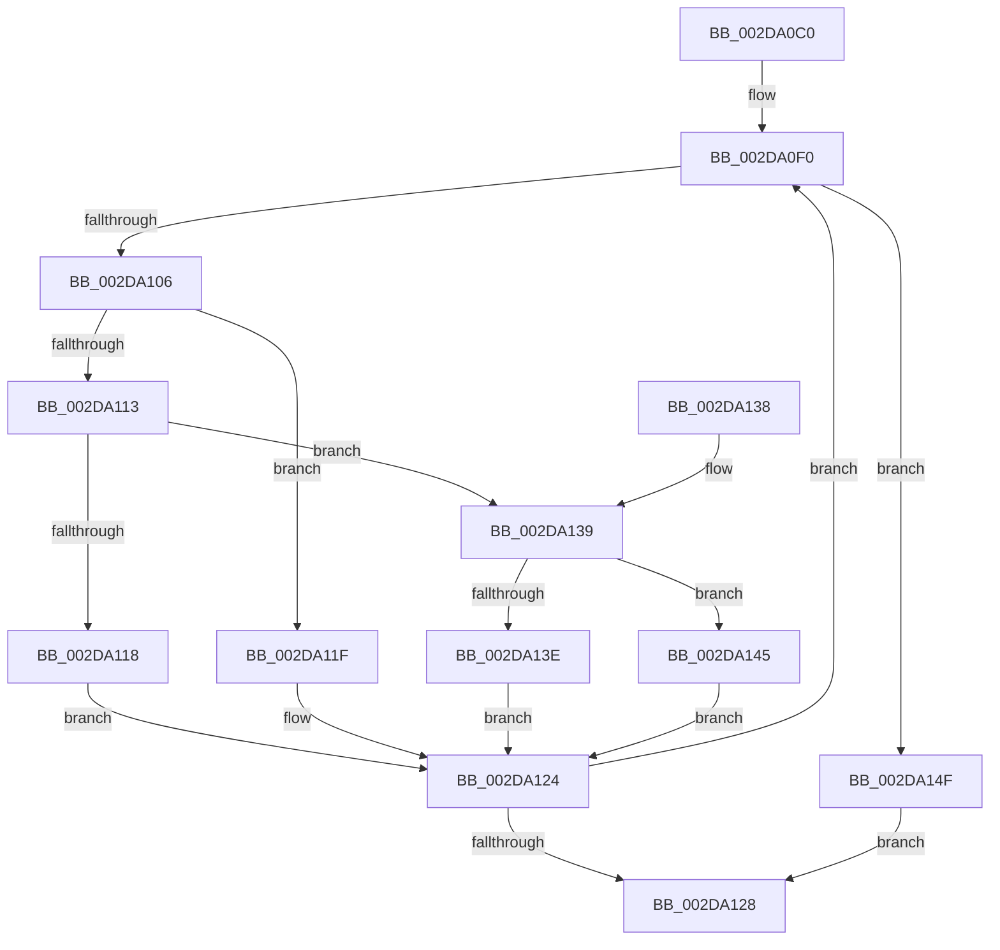

# PpmCheckRun

- RVA: `0x002DA0C0`–`0x002DA162` (길이 `162` bytes)
- VA: `0x00000001402DA0C0`
- 실행 섹션: `.text`
- PDB 이름 있음: `예`; PDB Function 태그: `아니요`
- unwind 정보 RVA: `0x000704BC`
- 디코드: `42`개 명령, `162/162` bytes 표시
- 미해석 바이트: `0` (있으면 어셈블리에 `.byte`로 보존)

> 이 문서는 커널 이미지의 기계어와 PDB 기호를 분석해 생성했습니다. 4번과 5번은 함수 원형과 자료형을 바이너리 사용 방식에서 추정한 C 해석이며 원본 소스 복구 결과는 아닙니다.

## 1. Dependencies

- 직접 호출 지점: **6**; 고유 호출 대상: **6**
- 직접 호출자로 확인된 함수: **1**
- RIP 상대 이미지 참조: **7**

### Outgoing calls
- `0x002DA118` → [PpmCheckMakeupSkippedChecks](PpmCheckMakeupSkippedChecks_function_002DA1D0.md) (function, `0x002DA1D0`)
- `0x002DA11F` → [PpmCheckAcquireProcessorPerformance](PpmCheckAcquireProcessorPerformance_function_002DA170.md) (function, `0x002DA170`)
- `0x002DA13E` → [PpmPerfReadFeedback](PpmPerfReadFeedback_function_002DA300.md) (function, `0x002DA300`)
- `0x002DA148` → [guard_dispatch_icall](../6B/guard_dispatch_icall_function_006BAAD0.md) (function, `0x006BAAD0`)
- `0x002DA156` → [PpmReleaseLock](PpmReleaseLock_function_002DA428.md) (function, `0x002DA428`)
- `0x002DA15B` → [PpmEventTracePerfCheckStop](PpmEventTracePerfCheckStop_function_002DA34C.md) (function, `0x002DA34C`)

### Direct callers
- [PpmCheckStart](../3B/PpmCheckStart_function_003BEE14.md) at `0x003BEEAA`

### Static image references
- `0x002DA0CF` → RVA `0x002DA170` (`PpmCheckAcquireProcessorPerformance`; read)
- `0x002DA0D6` → RVA `0x002DA1D0` (`PpmCheckMakeupSkippedChecks`; read)
- `0x002DA0DD` → RVA `0x002DA300` (`PpmPerfReadFeedback`; read)
- `0x002DA0F0` → RVA `0x00F0B3F0` (`.data`; read)
- `0x002DA0F6` → RVA `0x00F0B3F8` (`.data`; read)
- `0x002DA108` → RVA `0x00F0B3F0` (`.data`; write)
- `0x002DA14F` → RVA `0x00F0CC00` (`.data`; read)

## 2. Other-region calls and transfers

- 다른 실행 섹션으로 향하는 call: **0**
- 별도 외부 분기/꼬리 이동을 확인하지 못했습니다.

## 3. Assembly (complete function range)

```asm
002DA0C0  48 89 5C 24 08                  mov qword ptr [rsp + 8], rbx
002DA0C5  48 89 74 24 10                  mov qword ptr [rsp + 0x10], rsi
002DA0CA  57                              push rdi
002DA0CB  48 83 EC 20                     sub rsp, 0x20
002DA0CF  48 8D 1D 9A 00 00 00            lea rbx, [rip + 0x9a]
002DA0D6  48 8D 3D F3 00 00 00            lea rdi, [rip + 0xf3]
002DA0DD  48 8D 35 1C 02 00 00            lea rsi, [rip + 0x21c]
002DA0E4  0F 1F 40 00                     nop dword ptr [rax]
002DA0E8  0F 1F 84 00 00 00 00 00         nop dword ptr [rax + rax]
002DA0F0  8B 05 FA 12 C3 00               mov eax, dword ptr [rip + 0xc312fa]
002DA0F6  48 8B 0D FB 12 C3 00            mov rcx, qword ptr [rip + 0xc312fb]
002DA0FD  4C 8B 04 C1                     mov r8, qword ptr [rcx + rax*8]
002DA101  4D 85 C0                        test r8, r8
002DA104  74 49                           je 0x1402da14f
002DA106  FF C0                           inc eax
002DA108  89 05 E2 12 C3 00               mov dword ptr [rip + 0xc312e2], eax
002DA10E  4C 3B C3                        cmp r8, rbx
002DA111  74 0C                           je 0x1402da11f
002DA113  4C 3B C7                        cmp r8, rdi
002DA116  75 21                           jne 0x1402da139
002DA118  E8 B3 00 00 00                  call 0x1402da1d0
002DA11D  EB 05                           jmp 0x1402da124
002DA11F  E8 4C 00 00 00                  call 0x1402da170
002DA124  84 C0                           test al, al
002DA126  75 C8                           jne 0x1402da0f0
002DA128  48 8B 5C 24 30                  mov rbx, qword ptr [rsp + 0x30]
002DA12D  48 8B 74 24 38                  mov rsi, qword ptr [rsp + 0x38]
002DA132  48 83 C4 20                     add rsp, 0x20
002DA136  5F                              pop rdi
002DA137  C3                              ret
002DA138  CC                              int3
002DA139  4C 3B C6                        cmp r8, rsi
002DA13C  75 07                           jne 0x1402da145
002DA13E  E8 BD 01 00 00                  call 0x1402da300
002DA143  EB DF                           jmp 0x1402da124
002DA145  49 8B C0                        mov rax, r8
002DA148  E8 83 09 3E 00                  call 0x1406baad0
002DA14D  EB D5                           jmp 0x1402da124
002DA14F  48 8D 0D AA 2A C3 00            lea rcx, [rip + 0xc32aaa]
002DA156  E8 CD 02 00 00                  call 0x1402da428
002DA15B  E8 EC 01 00 00                  call 0x1402da34c
002DA160  EB C6                           jmp 0x1402da128
```

## 4. C-style interpretation (structured pseudocode)

```c
__int64 __fastcall PpmCheckRun(void)
{
    __int64 result;
    __int64 v_rsp;
    unsigned __int64 v_stack_p10;
    unsigned __int64 v_stack_p8;

    v_stack_p8 = v_rbx;
    v_stack_p10 = v_rsi;
    v_rsp = (v_rsp) - (32);
loc_002DA0F0:
    if (*(unsigned __int64 *)(*(unsigned __int64 *)(v_rip + 12784379) + (unsigned int)(*(unsigned int *)(v_rip + 12784378)) * 8) == 0) goto loc_002DA14F;
    result = (unsigned int)(((unsigned int)(*(unsigned int *)(v_rip + 12784378))) + 1);
    *(unsigned int *)(v_rip + 12784354) = (unsigned int)(result);
    if ((*(unsigned __int64 *)(*(unsigned __int64 *)(v_rip + 12784379) + (unsigned int)(*(unsigned int *)(v_rip + 12784378)) * 8)) == (v_rip + 154)) goto loc_002DA11F;
    if ((*(unsigned __int64 *)(*(unsigned __int64 *)(v_rip + 12784379) + (unsigned int)(*(unsigned int *)(v_rip + 12784378)) * 8)) != (v_rip + 243)) goto loc_002DA139;
    result = PpmCheckMakeupSkippedChecks(*(unsigned __int64 *)(v_rip + 12784379), a2, *(unsigned __int64 *)(*(unsigned __int64 *)(v_rip + 12784379) + (unsigned int)(*(unsigned int *)(v_rip + 12784378)) * 8), a4);
    goto loc_002DA124;
loc_002DA11F:
    result = PpmCheckAcquireProcessorPerformance(*(unsigned __int64 *)(v_rip + 12784379), a2, *(unsigned __int64 *)(*(unsigned __int64 *)(v_rip + 12784379) + (unsigned int)(*(unsigned int *)(v_rip + 12784378)) * 8), a4);
loc_002DA124:
    if ((unsigned __int8)(result) != 0) goto loc_002DA0F0;
loc_002DA128:
    v_rsp = (v_rsp) + (32);
    return result;
loc_002DA139:
    if ((*(unsigned __int64 *)(*(unsigned __int64 *)(v_rip + 12784379) + (unsigned int)(*(unsigned int *)(v_rip + 12784378)) * 8)) != v_stack_p10) goto loc_002DA145;
    result = PpmPerfReadFeedback(*(unsigned __int64 *)(v_rip + 12784379), a2, *(unsigned __int64 *)(*(unsigned __int64 *)(v_rip + 12784379) + (unsigned int)(*(unsigned int *)(v_rip + 12784378)) * 8), a4);
    goto loc_002DA124;
loc_002DA145:
    result = guard_dispatch_icall(*(unsigned __int64 *)(v_rip + 12784379), a2, *(unsigned __int64 *)(*(unsigned __int64 *)(v_rip + 12784379) + (unsigned int)(*(unsigned int *)(v_rip + 12784378)) * 8), a4);
    goto loc_002DA124;
loc_002DA14F:
    result = PpmReleaseLock(v_rip + 12790442, a2, *(unsigned __int64 *)(*(unsigned __int64 *)(v_rip + 12784379) + (unsigned int)(*(unsigned int *)(v_rip + 12784378)) * 8), a4);
    result = PpmEventTracePerfCheckStop(v_rip + 12790442, a2, *(unsigned __int64 *)(*(unsigned __int64 *)(v_rip + 12784379) + (unsigned int)(*(unsigned int *)(v_rip + 12784378)) * 8), a4);
    goto loc_002DA128;
}
```

## 5. (Beta) C Style

```c
void PpmCheckRun(void)
{
    int64_t result;
    int64_t local_rsp;
    uint64_t v_stack_p10;
    uint64_t v_stack_p8;

    v_stack_p8 = local_rbx;
    v_stack_p10 = local_rsi;
    local_rsp = (local_rsp) - (32);
loc_002DA0F0:
    if (*(uint64_t *)(*(uint64_t *)(v_rip + 0xC312FB) + (uint32_t)(*(uint32_t *)(v_rip + 0xC312FA)) * 8) == 0) goto loc_002DA14F;
    result = (uint32_t)(((uint32_t)(*(uint32_t *)(v_rip + 0xC312FA))) + 1);
    *(uint32_t *)(v_rip + 0xC312E2) = (uint32_t)(result);
    if ((*(uint64_t *)(*(uint64_t *)(v_rip + 0xC312FB) + (uint32_t)(*(uint32_t *)(v_rip + 0xC312FA)) * 8)) == (v_rip + 154)) goto loc_002DA11F;
    if ((*(uint64_t *)(*(uint64_t *)(v_rip + 0xC312FB) + (uint32_t)(*(uint32_t *)(v_rip + 0xC312FA)) * 8)) != (v_rip + 243)) goto loc_002DA139;
    result = PpmCheckMakeupSkippedChecks(*(uint64_t *)(v_rip + 0xC312FB), a2, *(uint64_t *)(*(uint64_t *)(v_rip + 0xC312FB) + (uint32_t)(*(uint32_t *)(v_rip + 0xC312FA)) * 8), a4);
    goto loc_002DA124;
loc_002DA11F:
    result = PpmCheckAcquireProcessorPerformance(*(uint64_t *)(v_rip + 0xC312FB), a2, *(uint64_t *)(*(uint64_t *)(v_rip + 0xC312FB) + (uint32_t)(*(uint32_t *)(v_rip + 0xC312FA)) * 8), a4);
loc_002DA124:
    if ((uint8_t)(result) != 0) goto loc_002DA0F0;
loc_002DA128:
    local_rsp = (local_rsp) + (32);
    return result;
loc_002DA139:
    if ((*(uint64_t *)(*(uint64_t *)(v_rip + 0xC312FB) + (uint32_t)(*(uint32_t *)(v_rip + 0xC312FA)) * 8)) != v_stack_p10) goto loc_002DA145;
    result = PpmPerfReadFeedback(*(uint64_t *)(v_rip + 0xC312FB), a2, *(uint64_t *)(*(uint64_t *)(v_rip + 0xC312FB) + (uint32_t)(*(uint32_t *)(v_rip + 0xC312FA)) * 8), a4);
    goto loc_002DA124;
loc_002DA145:
    result = guard_dispatch_icall(*(uint64_t *)(v_rip + 0xC312FB), a2, *(uint64_t *)(*(uint64_t *)(v_rip + 0xC312FB) + (uint32_t)(*(uint32_t *)(v_rip + 0xC312FA)) * 8), a4);
    goto loc_002DA124;
loc_002DA14F:
    result = PpmReleaseLock(v_rip + 12790442, a2, *(uint64_t *)(*(uint64_t *)(v_rip + 0xC312FB) + (uint32_t)(*(uint32_t *)(v_rip + 0xC312FA)) * 8), a4);
    result = PpmEventTracePerfCheckStop(v_rip + 12790442, a2, *(uint64_t *)(*(uint64_t *)(v_rip + 0xC312FB) + (uint32_t)(*(uint32_t *)(v_rip + 0xC312FA)) * 8), a4);
    goto loc_002DA128;
}
```

## 6. Execution-region graph

[열기: 2D/3D 그래프와 함수 탐색 컨트롤 패널](../../../control-panel.html?section=text&rva=0x002DA0C0&view=graph)

- 2D 그래프는 위에서 아래로 흐르고, 3D 그래프는 빈 공간을 드래그해 회전합니다. Shift+드래그는 이동, 휠은 확대·축소, 함수 노드 선택은 대상 보고서 이동입니다.

### Static fallback


