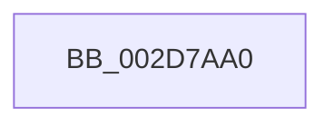

# PpmCheckSnapAllDeliveredPerformance

- RVA: `0x002D7AA0`–`0x002D7AC0` (길이 `32` bytes)
- VA: `0x00000001402D7AA0`
- 실행 섹션: `.text`
- PDB 이름 있음: `예`; PDB Function 태그: `예`
- unwind 정보 RVA: `0x00070004`
- 디코드: `8`개 명령, `32/32` bytes 표시
- 미해석 바이트: `0` (있으면 어셈블리에 `.byte`로 보존)

> 이 문서는 커널 이미지의 기계어와 PDB 기호를 분석해 생성했습니다. 4번과 5번은 함수 원형과 자료형을 바이너리 사용 방식에서 추정한 C 해석이며 원본 소스 복구 결과는 아닙니다.

## 1. Dependencies

- 직접 호출 지점: **0**; 고유 호출 대상: **0**
- 직접 호출자로 확인된 함수: **1**
- RIP 상대 이미지 참조: **1**

### Outgoing calls
- 직접 디코드된 call 명령이 없습니다.

### Direct callers
- [PpmCheckUpdateDeliveredPerformanceIfTracingEnabled](../49/PpmCheckUpdateDeliveredPerformanceIfTracingEnabled_function_0049FAB0.md) at `0x0049FADC`

### Static image references
- `0x002D7AB2` → RVA `0x00E0A740` (`.data`; read)

## 2. Other-region calls and transfers

- 다른 실행 섹션으로 향하는 call: **0**
- 별도 외부 분기/꼬리 이동을 확인하지 못했습니다.

## 3. Assembly (complete function range)

```asm
002D7AA0  4C 8B DC                        mov r11, rsp
002D7AA3  55                              push rbp
002D7AA4  41 54                           push r12
002D7AA6  48 8D 6C 24 88                  lea rbp, [rsp - 0x78]
002D7AAB  48 81 EC 78 01 00 00            sub rsp, 0x178
002D7AB2  48 8B 05 87 2C B3 00            mov rax, qword ptr [rip + 0xb32c87]
002D7AB9  48 33 C4                        xor rax, rsp
002D7ABC  48 89 45 50                     mov qword ptr [rbp + 0x50], rax
```

## 4. C-style interpretation (structured pseudocode)

```c
__int64 __fastcall PpmCheckSnapAllDeliveredPerformance(void)
{
    __int64 result;
    __int64 v_rsp;
    unsigned __int64 v_stack_m38;
    unsigned __int64 v_stack_m88;

    v_rsp = (v_rsp) - (376);
    result = (*(unsigned __int64 *)(v_rip + 11742343)) ^ (v_rsp);
    v_stack_m38 = result;
    return result;
}
```

## 5. (Beta) C Style

```c
void PpmCheckSnapAllDeliveredPerformance(void)
{
    int64_t result;
    int64_t local_rsp;
    uint64_t v_stack_m38;
    uint64_t v_stack_m88;

    local_rsp = (local_rsp) - (376);
    result = (*(uint64_t *)(v_rip + 0xB32C87)) ^ (local_rsp);
    v_stack_m38 = result;
    return result;
}
```

## 6. Execution-region graph

[열기: 2D/3D 그래프와 함수 탐색 컨트롤 패널](../../../control-panel.html?section=text&rva=0x002D7AA0&view=graph)

- 2D 그래프는 위에서 아래로 흐르고, 3D 그래프는 빈 공간을 드래그해 회전합니다. Shift+드래그는 이동, 휠은 확대·축소, 함수 노드 선택은 대상 보고서 이동입니다.

### Static fallback


