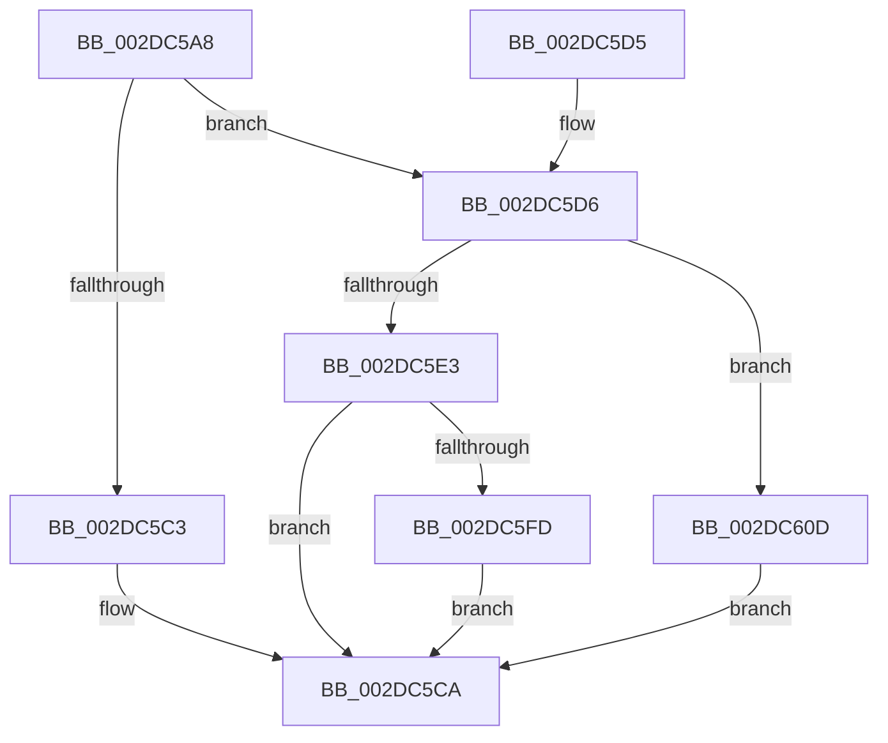

# PpmContinueTimeAccumulation

- RVA: `0x002DC5A8`–`0x002DC60F` (길이 `103` bytes)
- VA: `0x00000001402DC5A8`
- 실행 섹션: `.text`
- PDB 이름 있음: `예`; PDB Function 태그: `아니요`
- unwind 정보 RVA: `0x00070760`
- 디코드: `32`개 명령, `103/103` bytes 표시
- 미해석 바이트: `0` (있으면 어셈블리에 `.byte`로 보존)

> 이 문서는 커널 이미지의 기계어와 PDB 기호를 분석해 생성했습니다. 4번과 5번은 함수 원형과 자료형을 바이너리 사용 방식에서 추정한 C 해석이며 원본 소스 복구 결과는 아닙니다.

## 1. Dependencies

- 직접 호출 지점: **4**; 고유 호출 대상: **3**
- 직접 호출자로 확인된 함수: **1**
- RIP 상대 이미지 참조: **0**

### Outgoing calls
- `0x002DC5C3` → [PpmContinueActiveTimeAccumulation](PpmContinueActiveTimeAccumulation_function_002DDB54.md) (function, `0x002DDB54`)
- `0x002DC5D6` → [PpmGetIdleGenerationCounter](../44/PpmGetIdleGenerationCounter_function_00446890.md) (function, `0x00446890`)
- `0x002DC5F4` → [PpmUpdatePerformanceFeedback](PpmUpdatePerformanceFeedback_function_002DE580.md) (function, `0x002DE580`)
- `0x002DC600` → [PpmGetIdleGenerationCounter](../44/PpmGetIdleGenerationCounter_function_00446890.md) (function, `0x00446890`)

### Direct callers
- [PpmPerfApplyProcessorState](PpmPerfApplyProcessorState_function_002DA4BC.md) at `0x002DA56F`

### Static image references
- 디코드된 RIP-relative 메모리 참조가 없습니다.

## 2. Other-region calls and transfers

- 다른 실행 섹션으로 향하는 call: **0**
- 별도 외부 분기/꼬리 이동을 확인하지 못했습니다.

## 3. Assembly (complete function range)

```asm
002DC5A8  48 89 5C 24 08                  mov qword ptr [rsp + 8], rbx
002DC5AD  57                              push rdi
002DC5AE  48 83 EC 30                     sub rsp, 0x30
002DC5B2  65 48 8B 04 25 20 00 00 00      mov rax, qword ptr gs:[0x20]
002DC5BB  48 8B D9                        mov rbx, rcx
002DC5BE  48 3B C1                        cmp rax, rcx
002DC5C1  75 13                           jne 0x1402dc5d6
002DC5C3  E8 8C 15 00 00                  call 0x1402ddb54
002DC5C8  B0 01                           mov al, 1
002DC5CA  48 8B 5C 24 40                  mov rbx, qword ptr [rsp + 0x40]
002DC5CF  48 83 C4 30                     add rsp, 0x30
002DC5D3  5F                              pop rdi
002DC5D4  C3                              ret
002DC5D5  CC                              int3
002DC5D6  E8 B5 A2 16 00                  call 0x140446890
002DC5DB  48 8B F8                        mov rdi, rax
002DC5DE  48 85 C0                        test rax, rax
002DC5E1  74 2A                           je 0x1402dc60d
002DC5E3  48 83 64 24 20 00               and qword ptr [rsp + 0x20], 0
002DC5E9  45 33 C9                        xor r9d, r9d
002DC5EC  41 B0 01                        mov r8b, 1
002DC5EF  33 D2                           xor edx, edx
002DC5F1  48 8B CB                        mov rcx, rbx
002DC5F4  E8 87 1F 00 00                  call 0x1402de580
002DC5F9  84 C0                           test al, al
002DC5FB  74 CD                           je 0x1402dc5ca
002DC5FD  48 8B CB                        mov rcx, rbx
002DC600  E8 8B A2 16 00                  call 0x140446890
002DC605  48 3B F8                        cmp rdi, rax
002DC608  0F 94 C0                        sete al
002DC60B  EB BD                           jmp 0x1402dc5ca
002DC60D  EB BB                           jmp 0x1402dc5ca
```

## 4. C-style interpretation (structured pseudocode)

```c
__int64 __fastcall PpmContinueTimeAccumulation(__int64 a1, int a2, __int64 a3, int a4)
{
    __int64 result;
    __int64 v_rsp;
    unsigned __int64 v_stack_p20;
    unsigned __int64 v_stack_p8;

    v_stack_p8 = v_rbx;
    v_rsp = (v_rsp) - (48);
    if ((*(unsigned __int64 *)(gs_base + (0 + 32))) != a1) goto loc_002DC5D6;
    result = PpmContinueActiveTimeAccumulation(a1, a2, a3, a4);
loc_002DC5CA:
    v_rsp = (v_rsp) + (48);
    return 1;
loc_002DC5D6:
    result = PpmGetIdleGenerationCounter(a1, a2, a3, a4);
    if (result == 0) goto loc_002DC60D;
    a4 = 0;
    a2 = 0;
    result = PpmUpdatePerformanceFeedback(v_stack_p8, a2, 1, a4);
    if ((unsigned __int8)(result) == 0) goto loc_002DC5CA;
    result = PpmGetIdleGenerationCounter(v_stack_p8, a2, 1, a4);
    result = (result == result) ? 1 : 0;
    goto loc_002DC5CA;
loc_002DC60D:
    goto loc_002DC5CA;
}
```

## 5. (Beta) C Style

```c
int64_t PpmContinueTimeAccumulation(int64_t Arg1, int32_t Arg2, int64_t Arg3, int32_t Arg4)
{
    int64_t result;
    int64_t local_rsp;
    uint64_t v_stack_p20;
    uint64_t v_stack_p8;

    v_stack_p8 = local_rbx;
    local_rsp = (local_rsp) - (48);
    if ((*(uint64_t *)(gs_base + (0 + 0x20))) != Arg1) goto loc_002DC5D6;
    result = PpmContinueActiveTimeAccumulation(Arg1, Arg2, Arg3, Arg4);
loc_002DC5CA:
    local_rsp = (local_rsp) + (48);
    return 1;
loc_002DC5D6:
    result = PpmGetIdleGenerationCounter(Arg1, Arg2, Arg3, Arg4);
    if (result == 0) goto loc_002DC60D;
    Arg4 = 0;
    Arg2 = 0;
    result = PpmUpdatePerformanceFeedback(v_stack_p8, Arg2, 1, Arg4);
    if ((uint8_t)(result) == 0) goto loc_002DC5CA;
    result = PpmGetIdleGenerationCounter(v_stack_p8, Arg2, 1, Arg4);
    result = (result == result) ? 1 : 0;
    goto loc_002DC5CA;
loc_002DC60D:
    goto loc_002DC5CA;
}
```

## 6. Execution-region graph

[열기: 2D/3D 그래프와 함수 탐색 컨트롤 패널](../../../control-panel.html?section=text&rva=0x002DC5A8&view=graph)

- 2D 그래프는 위에서 아래로 흐르고, 3D 그래프는 빈 공간을 드래그해 회전합니다. Shift+드래그는 이동, 휠은 확대·축소, 함수 노드 선택은 대상 보고서 이동입니다.

### Static fallback


