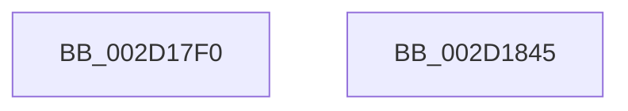

# PpmEndActiveTimeAccumulation

- RVA: `0x002D17F0`–`0x002D1846` (길이 `86` bytes)
- VA: `0x00000001402D17F0`
- 실행 섹션: `.text`
- PDB 이름 있음: `예`; PDB Function 태그: `아니요`
- unwind 정보 RVA: `0x0006E5F8`
- 디코드: `24`개 명령, `86/86` bytes 표시
- 미해석 바이트: `0` (있으면 어셈블리에 `.byte`로 보존)

> 이 문서는 커널 이미지의 기계어와 PDB 기호를 분석해 생성했습니다. 4번과 5번은 함수 원형과 자료형을 바이너리 사용 방식에서 추정한 C 해석이며 원본 소스 복구 결과는 아닙니다.

## 1. Dependencies

- 직접 호출 지점: **3**; 고유 호출 대상: **3**
- 직접 호출자로 확인된 함수: **1**
- RIP 상대 이미지 참조: **0**

### Outgoing calls
- `0x002D1803` → [PpmUpdateTimeAccumulation](PpmUpdateTimeAccumulation_function_002DD9F0.md) (function, `0x002DD9F0`)
- `0x002D1819` → [PpmUpdatePerformanceFeedback](PpmUpdatePerformanceFeedback_function_002DE580.md) (function, `0x002DE580`)
- `0x002D1826` → [PpmGetPmcCounters](../45/PpmGetPmcCounters_function_0045F2DC.md) (function, `0x0045F2DC`)

### Direct callers
- [PpmIdleExecuteTransition](PpmIdleExecuteTransition_function_002D0A1C.md) at `0x002D0B85`

### Static image references
- 디코드된 RIP-relative 메모리 참조가 없습니다.

## 2. Other-region calls and transfers

- 다른 실행 섹션으로 향하는 call: **0**
- 별도 외부 분기/꼬리 이동을 확인하지 못했습니다.

## 3. Assembly (complete function range)

```asm
002D17F0  48 89 5C 24 08                  mov qword ptr [rsp + 8], rbx
002D17F5  57                              push rdi
002D17F6  48 83 EC 30                     sub rsp, 0x30
002D17FA  41 B0 01                        mov r8b, 1
002D17FD  48 8B DA                        mov rbx, rdx
002D1800  48 8B F9                        mov rdi, rcx
002D1803  E8 E8 C1 00 00                  call 0x1402dd9f0
002D1808  48 83 64 24 20 00               and qword ptr [rsp + 0x20], 0
002D180E  41 B1 01                        mov r9b, 1
002D1811  45 33 C0                        xor r8d, r8d
002D1814  33 D2                           xor edx, edx
002D1816  48 8B CF                        mov rcx, rdi
002D1819  E8 62 CD 00 00                  call 0x1402de580
002D181E  45 33 C0                        xor r8d, r8d
002D1821  33 D2                           xor edx, edx
002D1823  48 8B CF                        mov rcx, rdi
002D1826  E8 B1 DA 18 00                  call 0x14045f2dc
002D182B  48 89 9F 68 88 00 00            mov qword ptr [rdi + 0x8868], rbx
002D1832  F0 48 FF 87 60 88 00 00         lock inc qword ptr [rdi + 0x8860]
002D183A  48 8B 5C 24 40                  mov rbx, qword ptr [rsp + 0x40]
002D183F  48 83 C4 30                     add rsp, 0x30
002D1843  5F                              pop rdi
002D1844  C3                              ret
002D1845  CC                              int3
```

## 4. C-style interpretation (structured pseudocode)

```c
__int64 __fastcall PpmEndActiveTimeAccumulation(__int64 a1, __int64 a2)
{
    __int64 result;
    __int64 v_rsp;
    unsigned __int64 v_stack_m18;
    unsigned __int64 v_stack_p8;

    v_stack_p8 = v_rbx;
    v_rsp = (v_rsp) - (48);
    result = PpmUpdateTimeAccumulation(a1, a2, 1, a4);
    a3 = 0;
    a2 = 0;
    result = PpmUpdatePerformanceFeedback(a1, a2, a3, 1);
    a3 = 0;
    a2 = 0;
    result = PpmGetPmcCounters(a1, a2, a3, 1);
    *(unsigned __int64 *)(a1 + 34920) = 0;
    v_rsp = (v_rsp) + (48);
    return result;
}
```

## 5. (Beta) C Style

```c
int64_t PpmEndActiveTimeAccumulation(void *Arg1, int64_t Arg2)
{
    uint8_t *arg1 = (uint8_t *)Arg1;

    int64_t result;
    int64_t local_rsp;
    uint64_t v_stack_m18;
    uint64_t v_stack_p8;

    v_stack_p8 = local_rbx;
    local_rsp = (local_rsp) - (48);
    result = PpmUpdateTimeAccumulation(Arg1, Arg2, 1, a4);
    a3 = 0;
    Arg2 = 0;
    result = PpmUpdatePerformanceFeedback(Arg1, Arg2, a3, 1);
    a3 = 0;
    Arg2 = 0;
    result = PpmGetPmcCounters(Arg1, Arg2, a3, 1);
    *(uint64_t *)(arg1 + 0x8868) = 0;
    local_rsp = (local_rsp) + (48);
    return result;
}
```

### 관측된 메모리 오프셋

구조체 형식이 확인되지 않은 접근은 인자 기준의 오프셋으로만 기록했습니다.

| 기준 인자 | 오프셋 표현 | 폭 (bit) | 접근 |
|---|---:|---:|---|
| `Arg1` | `+ 0x8860` | `64` | `R/W` |
| `Arg1` | `+ 0x8868` | `64` | `W` |

## 6. Execution-region graph

[열기: 2D/3D 그래프와 함수 탐색 컨트롤 패널](../../../control-panel.html?section=text&rva=0x002D17F0&view=graph)

- 2D 그래프는 위에서 아래로 흐르고, 3D 그래프는 빈 공간을 드래그해 회전합니다. Shift+드래그는 이동, 휠은 확대·축소, 함수 노드 선택은 대상 보고서 이동입니다.

### Static fallback


