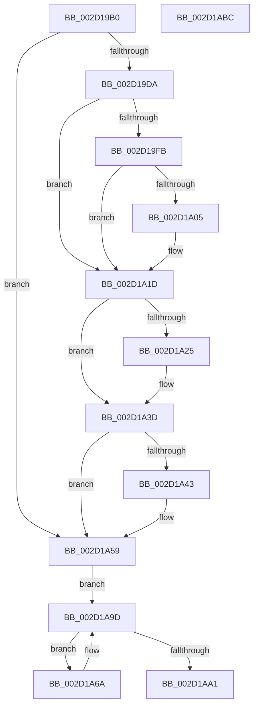

# PpmEnterCoordinatedIdle

- RVA: `0x002D19B0`–`0x002D1ABD` (길이 `269` bytes)
- VA: `0x00000001402D19B0`
- 실행 섹션: `.text`
- PDB 이름 있음: `예`; PDB Function 태그: `아니요`
- unwind 정보 RVA: `0x0005E6B4`
- 디코드: `67`개 명령, `269/269` bytes 표시
- 미해석 바이트: `0` (있으면 어셈블리에 `.byte`로 보존)

> 이 문서는 커널 이미지의 기계어와 PDB 기호를 분석해 생성했습니다. 4번과 5번은 함수 원형과 자료형을 바이너리 사용 방식에서 추정한 C 해석이며 원본 소스 복구 결과는 아닙니다.

## 1. Dependencies

- 직접 호출 지점: **4**; 고유 호출 대상: **4**
- 직접 호출자로 확인된 함수: **1**
- RIP 상대 이미지 참조: **3**

### Outgoing calls
- `0x002D19EA` → [PpmEventEnterPlatformIdleState](../5D/PpmEventEnterPlatformIdleState_function_005DA864.md) (function, `0x005DA864`)
- `0x002D1A4A` → [KdPowerTransitionEx](../4D/KdPowerTransitionEx_function_004D9150.md) (function, `0x004D9150`)
- `0x002D1A54` → [KdCallPowerHandlers](../5B/KdCallPowerHandlers_function_005B083C.md) (function, `0x005B083C`)
- `0x002D1A63` → [PpmEventCoordinatedIdleTransition](../4B/PpmEventCoordinatedIdleTransition_function_004BB304.md) (function, `0x004BB304`)

### Direct callers
- [PpmIdleExecuteTransition](PpmIdleExecuteTransition_function_002D0A1C.md) at `0x002D0D2E`

### Static image references
- `0x002D19E3` → RVA `0x00FC6AD0` (`ALMOSTRO`; read)
- `0x002D19EF` → RVA `0x00E27E80` (`.data`; read)
- `0x002D19FB` → RVA `0x00E27EC0` (`.data`; read)

## 2. Other-region calls and transfers

- 다른 실행 섹션으로 향하는 call: **0**
- 별도 외부 분기/꼬리 이동을 확인하지 못했습니다.

## 3. Assembly (complete function range)

```asm
002D19B0  48 8B C4                        mov rax, rsp
002D19B3  48 89 58 08                     mov qword ptr [rax + 8], rbx
002D19B7  48 89 68 10                     mov qword ptr [rax + 0x10], rbp
002D19BB  48 89 70 18                     mov qword ptr [rax + 0x18], rsi
002D19BF  48 89 78 20                     mov qword ptr [rax + 0x20], rdi
002D19C3  41 56                           push r14
002D19C5  48 83 EC 20                     sub rsp, 0x20
002D19C9  41 8B D8                        mov ebx, r8d
002D19CC  4D 8B F1                        mov r14, r9
002D19CF  48 8B EA                        mov rbp, rdx
002D19D2  8B F9                           mov edi, ecx
002D19D4  41 83 F8 FF                     cmp r8d, -1
002D19D8  74 7F                           je 0x1402d1a59
002D19DA  48 69 F3 C0 01 00 00            imul rsi, rbx, 0x1c0
002D19E1  8B CB                           mov ecx, ebx
002D19E3  48 03 35 E6 50 CF 00            add rsi, qword ptr [rip + 0xcf50e6]
002D19EA  E8 75 8E 30 00                  call 0x1405da864
002D19EF  48 8B 05 8A 64 B5 00            mov rax, qword ptr [rip + 0xb5648a]
002D19F6  48 85 C0                        test rax, rax
002D19F9  75 22                           jne 0x1402d1a1d
002D19FB  8B 05 BF 64 B5 00               mov eax, dword ptr [rip + 0xb564bf]
002D1A01  3B D8                           cmp ebx, eax
002D1A03  75 18                           jne 0x1402d1a1d
002D1A05  48 A1 08 00 00 00 80 F7 FF FF   movabs rax, qword ptr [0xfffff78000000008]
002D1A0F  48 8B C8                        mov rcx, rax
002D1A12  33 C0                           xor eax, eax
002D1A14  F0 48 0F B1 0D 63 64 B5 00      lock cmpxchg qword ptr [rip + 0xb56463], rcx
002D1A1D  8B 4C 24 50                     mov ecx, dword ptr [rsp + 0x50]
002D1A21  85 C9                           test ecx, ecx
002D1A23  74 18                           je 0x1402d1a3d
002D1A25  48 8B 05 A4 50 CF 00            mov rax, qword ptr [rip + 0xcf50a4]
002D1A2C  89 48 38                        mov dword ptr [rax + 0x38], ecx
002D1A2F  48 8B 05 9A 50 CF 00            mov rax, qword ptr [rip + 0xcf509a]
002D1A36  48 8B 48 30                     mov rcx, qword ptr [rax + 0x30]
002D1A3A  FF 41 08                        inc dword ptr [rcx + 8]
002D1A3D  80 7E 78 00                     cmp byte ptr [rsi + 0x78], 0
002D1A41  74 16                           je 0x1402d1a59
002D1A43  B2 01                           mov dl, 1
002D1A45  B9 04 00 00 80                  mov ecx, 0x80000004
002D1A4A  E8 01 77 20 00                  call 0x1404d9150
002D1A4F  B9 04 00 00 00                  mov ecx, 4
002D1A54  E8 E3 ED 2D 00                  call 0x1405b083c
002D1A59  45 33 C9                        xor r9d, r9d
002D1A5C  4C 8B C5                        mov r8, rbp
002D1A5F  8B D7                           mov edx, edi
002D1A61  B1 01                           mov cl, 1
002D1A63  E8 9C 98 1E 00                  call 0x1404bb304
002D1A68  EB 33                           jmp 0x1402d1a9d
002D1A6A  FF CF                           dec edi
002D1A6C  8B 4C BD 00                     mov ecx, dword ptr [rbp + rdi*4]
002D1A70  48 69 D1 C0 01 00 00            imul rdx, rcx, 0x1c0
002D1A77  48 8B 0D 52 50 CF 00            mov rcx, qword ptr [rip + 0xcf5052]
002D1A7E  4C 89 B4 0A A8 01 00 00         mov qword ptr [rdx + rcx + 0x1a8], r14
002D1A86  8B 84 0A A0 01 00 00            mov eax, dword ptr [rdx + rcx + 0x1a0]
002D1A8D  25 FF FF FF FC                  and eax, 0xfcffffff
002D1A92  0F BA E8 1A                     bts eax, 0x1a
002D1A96  89 84 0A A0 01 00 00            mov dword ptr [rdx + rcx + 0x1a0], eax
002D1A9D  85 FF                           test edi, edi
002D1A9F  75 C9                           jne 0x1402d1a6a
002D1AA1  48 8B 5C 24 30                  mov rbx, qword ptr [rsp + 0x30]
002D1AA6  48 8B 6C 24 38                  mov rbp, qword ptr [rsp + 0x38]
002D1AAB  48 8B 74 24 40                  mov rsi, qword ptr [rsp + 0x40]
002D1AB0  48 8B 7C 24 48                  mov rdi, qword ptr [rsp + 0x48]
002D1AB5  48 83 C4 20                     add rsp, 0x20
002D1AB9  41 5E                           pop r14
002D1ABB  C3                              ret
002D1ABC  CC                              int3
```

## 4. C-style interpretation (structured pseudocode)

```c
__int64 __fastcall PpmEnterCoordinatedIdle(int a1, __int64 a2, int a3, __int64 a4, unsigned int a5)
{
    __int64 result;
    __int64 v_rdi;
    __int64 v_rsi;
    __int64 v_rsp;
    unsigned __int64 v_stack_p10;
    unsigned __int64 v_stack_p18;
    unsigned __int64 v_stack_p20;
    unsigned __int64 v_stack_p8;

    *(unsigned __int64 *)(v_rsp + 8) = v_rbx;
    *(unsigned __int64 *)(v_rsp + 16) = v_rbp;
    *(unsigned __int64 *)(v_rsp + 24) = v_rsi;
    *(unsigned __int64 *)(v_rsp + 32) = v_rdi;
    v_rsp = (v_rsp) - (32);
    if (a3 == -1) goto loc_002D1A59;
    v_rsi = (v_rsi) * ((unsigned int)(a3));
    v_rsi = (v_rsi) + (*(unsigned __int64 *)(v_rip + 13586662));
    result = PpmEventEnterPlatformIdleState((unsigned int)((unsigned int)((unsigned int)(a3))), a2, a3, a4);
    if (*(unsigned __int64 *)(v_rip + 11887754) != 0) goto loc_002D1A1D;
    result = (unsigned int)(*(unsigned int *)(v_rip + 11887807));
    if (((unsigned int)((unsigned int)(a3))) == ((unsigned int)((unsigned int)(*(unsigned int *)(v_rip + 11887807))))) {
        a1 = (unsigned int)(*(unsigned int *)(v_rip + 11887807));
        result = 0;
    }
    if ((unsigned int)((unsigned int)(a5)) != 0) {
        result = *(unsigned __int64 *)(v_rip + 13586596);
        *(unsigned int *)(result + 56) = (unsigned int)((unsigned int)(a5));
        result = *(unsigned __int64 *)(v_rip + 13586586);
        a1 = *(unsigned __int64 *)(result + 48);
    }
    if ((*(unsigned __int8 *)(v_rsi + 120)) != 0) {
        a2 = 1;
        a1 = 0x80000004ULL;
        result = KdPowerTransitionEx(a1, a2, a3, a4);
        a1 = 4;
        result = KdCallPowerHandlers(a1, a2, a3, a4);
    }
    a4 = 0;
    result = PpmEventCoordinatedIdleTransition(1, (unsigned int)((unsigned int)((unsigned int)(a1))), a2, a4);
    goto loc_002D1A9D;
loc_002D1A6A:
    v_rdi = (unsigned int)(((unsigned int)(a1)) - 1);
    a2 = ((unsigned int)((unsigned int)((unsigned int)(a1)))) * ((unsigned int)(*(unsigned int *)(a2 + v_rdi * 4)));
    *(unsigned __int64 *)(a2 + *(unsigned __int64 *)(v_rip + 13586514) * 1 + 424) = 0;
    result = (unsigned int)(((unsigned int)(*(unsigned int *)(a2 + *(unsigned __int64 *)(v_rip + 13586514) * 1 + 416))) & (0xFCFFFFFFULL));
    *(unsigned int *)(a2 + *(unsigned __int64 *)(v_rip + 13586514) * 1 + 416) = (unsigned int)(result);
loc_002D1A9D:
    if ((unsigned int)(v_rdi) != 0) goto loc_002D1A6A;
    v_rsp = (v_rsp) + (32);
    return result;
}
```

## 5. (Beta) C Style

```c
int64_t PpmEnterCoordinatedIdle(int32_t Arg1, void *Arg2, int32_t Arg3, int64_t Arg4, uint32_t Arg5)
{
    uint8_t *arg2 = (uint8_t *)Arg2;

    int64_t result;
    int64_t local_rdi;
    int64_t local_rsi;
    int64_t local_rsp;
    uint64_t v_stack_p10;
    uint64_t v_stack_p18;
    uint64_t v_stack_p20;
    uint64_t v_stack_p8;

    *(uint64_t *)(local_rsp + 0x8) = local_rbx;
    *(uint64_t *)(local_rsp + 0x10) = local_rbp;
    *(uint64_t *)(local_rsp + 0x18) = local_rsi;
    *(uint64_t *)(local_rsp + 0x20) = local_rdi;
    local_rsp = (local_rsp) - (32);
    if (Arg3 == -1) goto loc_002D1A59;
    local_rsi = (local_rsi) * ((uint32_t)(Arg3));
    local_rsi = (local_rsi) + (*(uint64_t *)(v_rip + 0xCF50E6));
    result = PpmEventEnterPlatformIdleState((uint32_t)((uint32_t)((uint32_t)(Arg3))), Arg2, Arg3, Arg4);
    if (*(uint64_t *)(v_rip + 0xB5648A) != 0) goto loc_002D1A1D;
    result = (uint32_t)(*(uint32_t *)(v_rip + 0xB564BF));
    if (((uint32_t)((uint32_t)(Arg3))) == ((uint32_t)((uint32_t)(*(uint32_t *)(v_rip + 0xB564BF))))) {
        Arg1 = (uint32_t)(*(uint32_t *)(v_rip + 0xB564BF));
        result = 0;
    }
    if ((uint32_t)((uint32_t)(Arg5)) != 0) {
        result = *(uint64_t *)(v_rip + 0xCF50A4);
        *(uint32_t *)(result + 0x38) = (uint32_t)((uint32_t)(Arg5));
        result = *(uint64_t *)(v_rip + 0xCF509A);
        Arg1 = *(uint64_t *)(result + 0x30);
    }
    if ((*(uint8_t *)(local_rsi + 0x78)) != 0) {
        Arg2 = 1;
        Arg1 = 0x80000004ULL;
        result = KdPowerTransitionEx(Arg1, Arg2, Arg3, Arg4);
        Arg1 = 4;
        result = KdCallPowerHandlers(Arg1, Arg2, Arg3, Arg4);
    }
    Arg4 = 0;
    result = PpmEventCoordinatedIdleTransition(1, (uint32_t)((uint32_t)((uint32_t)(Arg1))), Arg2, Arg4);
    goto loc_002D1A9D;
loc_002D1A6A:
    local_rdi = (uint32_t)(((uint32_t)(Arg1)) - 1);
    Arg2 = ((uint32_t)((uint32_t)((uint32_t)(Arg1)))) * ((uint32_t)(*(uint32_t *)(arg2 + local_rdi * 4)));
    *(uint64_t *)(arg2 + *(uint64_t *)(v_rip + 0xCF5052) * 1 + 0x1A8) = 0;
    result = (uint32_t)(((uint32_t)(*(uint32_t *)(arg2 + *(uint64_t *)(v_rip + 0xCF5052) * 1 + 0x1A0))) & (0xFCFFFFFFULL));
    *(uint32_t *)(arg2 + *(uint64_t *)(v_rip + 0xCF5052) * 1 + 0x1A0) = (uint32_t)(result);
loc_002D1A9D:
    if ((uint32_t)(local_rdi) != 0) goto loc_002D1A6A;
    local_rsp = (local_rsp) + (32);
    return result;
}
```

### 관측된 메모리 오프셋

구조체 형식이 확인되지 않은 접근은 인자 기준의 오프셋으로만 기록했습니다.

| 기준 인자 | 오프셋 표현 | 폭 (bit) | 접근 |
|---|---:|---:|---|
| `Arg2` | `+ 0x0 + rdi*4` | `32` | `R` |

## 6. Execution-region graph

[열기: 2D/3D 그래프와 함수 탐색 컨트롤 패널](../../../control-panel.html?section=text&rva=0x002D19B0&view=graph)

- 2D 그래프는 위에서 아래로 흐르고, 3D 그래프는 빈 공간을 드래그해 회전합니다. Shift+드래그는 이동, 휠은 확대·축소, 함수 노드 선택은 대상 보고서 이동입니다.

### Static fallback


