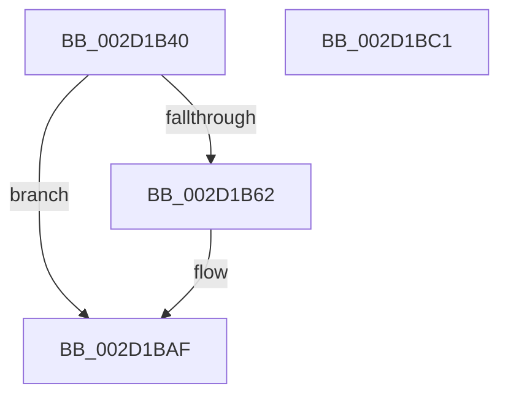

# PpmEventEnterIdleState

- RVA: `0x002D1B40`–`0x002D1BC2` (길이 `130` bytes)
- VA: `0x00000001402D1B40`
- 실행 섹션: `.text`
- PDB 이름 있음: `예`; PDB Function 태그: `아니요`
- unwind 정보 RVA: `0x00065FB8`
- 디코드: `28`개 명령, `130/130` bytes 표시
- 미해석 바이트: `0` (있으면 어셈블리에 `.byte`로 보존)

> 이 문서는 커널 이미지의 기계어와 PDB 기호를 분석해 생성했습니다. 4번과 5번은 함수 원형과 자료형을 바이너리 사용 방식에서 추정한 C 해석이며 원본 소스 복구 결과는 아닙니다.

## 1. Dependencies

- 직접 호출 지점: **2**; 고유 호출 대상: **2**
- 직접 호출자로 확인된 함수: **1**
- RIP 상대 이미지 참조: **2**

### Outgoing calls
- `0x002D1BAA` → [EtwTraceKernelEvent](../23/EtwTraceKernelEvent_function_00235350.md) (function, `0x00235350`)
- `0x002D1BB7` → [_security_check_cookie](../6A/_security_check_cookie_function_006AC640.md) (function, `0x006AC640`)

### Direct callers
- [PpmIdleExecuteTransition](PpmIdleExecuteTransition_function_002D0A1C.md) at `0x002D0D56`

### Static image references
- `0x002D1B47` → RVA `0x00E0A740` (`.data`; read)
- `0x002D1B56` → RVA `0x00FC6B08` (`ALMOSTRO`; read)

## 2. Other-region calls and transfers

- 다른 실행 섹션으로 향하는 call: **0**
- 별도 외부 분기/꼬리 이동을 확인하지 못했습니다.

## 3. Assembly (complete function range)

```asm
002D1B40  4C 8B DC                        mov r11, rsp
002D1B43  48 83 EC 68                     sub rsp, 0x68
002D1B47  48 8B 05 F2 8B B3 00            mov rax, qword ptr [rip + 0xb38bf2]
002D1B4E  48 33 C4                        xor rax, rsp
002D1B51  48 89 44 24 50                  mov qword ptr [rsp + 0x50], rax
002D1B56  F7 05 A8 4F CF 00 00 80 00 00   test dword ptr [rip + 0xcf4fa8], 0x8000
002D1B60  74 4D                           je 0x1402d1baf
002D1B62  89 4C 24 30                     mov dword ptr [rsp + 0x30], ecx
002D1B66  49 8D 43 C8                     lea rax, [r11 - 0x38]
002D1B6A  66 89 54 24 34                  mov word ptr [rsp + 0x34], dx
002D1B6F  49 8D 4B D8                     lea rcx, [r11 - 0x28]
002D1B73  C6 44 24 37 00                  mov byte ptr [rsp + 0x37], 0
002D1B78  BA 01 00 00 00                  mov edx, 1
002D1B7D  49 89 43 D8                     mov qword ptr [r11 - 0x28], rax
002D1B81  83 64 24 4C 00                  and dword ptr [rsp + 0x4c], 0
002D1B86  45 88 43 CE                     mov byte ptr [r11 - 0x32], r8b
002D1B8A  41 B8 00 80 00 40               mov r8d, 0x40008000
002D1B90  4D 89 4B D0                     mov qword ptr [r11 - 0x30], r9
002D1B94  41 B9 39 12 00 00               mov r9d, 0x1239
002D1B9A  C7 44 24 48 10 00 00 00         mov dword ptr [rsp + 0x48], 0x10
002D1BA2  C7 44 24 20 02 06 00 00         mov dword ptr [rsp + 0x20], 0x602
002D1BAA  E8 A1 37 F6 FF                  call 0x140235350
002D1BAF  48 8B 4C 24 50                  mov rcx, qword ptr [rsp + 0x50]
002D1BB4  48 33 CC                        xor rcx, rsp
002D1BB7  E8 84 AA 3D 00                  call 0x1406ac640
002D1BBC  48 83 C4 68                     add rsp, 0x68
002D1BC0  C3                              ret
002D1BC1  CC                              int3
```

## 4. C-style interpretation (structured pseudocode)

```c
__int64 __fastcall PpmEventEnterIdleState(int a1, unsigned __int16 a2, unsigned __int8 a3, __int64 a4)
{
    __int64 result;
    __int64 v_rsp;
    unsigned __int64 v_stack_m18;
    unsigned int v_stack_m1C;
    unsigned int v_stack_m20;
    unsigned __int8 v_stack_m31;
    unsigned __int16 v_stack_m34;
    unsigned int v_stack_m38;
    unsigned int v_stack_m48;

    v_rsp = (v_rsp) - (104);
    result = (*(unsigned __int64 *)(v_rip + 11766770)) ^ (v_rsp);
    v_stack_m18 = result;
    if (((*(unsigned int *)(v_rip + 13586344)) & (0x8000ULL)) != 0) {
        v_stack_m38 = a1;
        result = v_rsp - 56;
        v_stack_m34 = a2;
        a1 = v_rsp - 40;
        v_stack_m31 = 0;
        a2 = 1;
        *(unsigned __int64 *)(v_rsp - 40) = result;
        *(unsigned __int8 *)(v_rsp - 50) = a3;
        a3 = 0x40008000ULL;
        *(unsigned __int64 *)(v_rsp - 48) = a4;
        a4 = 0x1239ULL;
        v_stack_m20 = 16;
        v_stack_m48 = 0x602ULL;
        result = EtwTraceKernelEvent(a1, a2, a3, a4);
    }
    a1 = (v_stack_m18) ^ (v_rsp);
    result = _security_check_cookie(a1, a2, a3, a4);
    v_rsp = (v_rsp) + (104);
    return result;
}
```

## 5. (Beta) C Style

```c
int64_t PpmEventEnterIdleState(int32_t Arg1, uint16_t Arg2, uint8_t Arg3, int64_t Arg4)
{
    int64_t result;
    int64_t local_rsp;
    uint64_t v_stack_m18;
    uint32_t v_stack_m1C;
    uint32_t v_stack_m20;
    uint8_t v_stack_m31;
    uint16_t v_stack_m34;
    uint32_t v_stack_m38;
    uint32_t v_stack_m48;

    local_rsp = (local_rsp) - (104);
    result = (*(uint64_t *)(v_rip + 0xB38BF2)) ^ (local_rsp);
    v_stack_m18 = result;
    if (((*(uint32_t *)(v_rip + 0xCF4FA8)) & (0x8000ULL)) != 0) {
        v_stack_m38 = Arg1;
        result = local_rsp - 56;
        v_stack_m34 = Arg2;
        Arg1 = local_rsp - 40;
        v_stack_m31 = 0;
        Arg2 = 1;
        *(uint64_t *)(local_rsp - 0x28) = result;
        *(uint8_t *)(local_rsp - 0x32) = Arg3;
        Arg3 = 0x40008000ULL;
        *(uint64_t *)(local_rsp - 0x30) = Arg4;
        Arg4 = 0x1239ULL;
        v_stack_m20 = 16;
        v_stack_m48 = 0x602ULL;
        result = EtwTraceKernelEvent(Arg1, Arg2, Arg3, Arg4);
    }
    Arg1 = (v_stack_m18) ^ (local_rsp);
    result = _security_check_cookie(Arg1, Arg2, Arg3, Arg4);
    local_rsp = (local_rsp) + (104);
    return result;
}
```

## 6. Execution-region graph

[열기: 2D/3D 그래프와 함수 탐색 컨트롤 패널](../../../control-panel.html?section=text&rva=0x002D1B40&view=graph)

- 2D 그래프는 위에서 아래로 흐르고, 3D 그래프는 빈 공간을 드래그해 회전합니다. Shift+드래그는 이동, 휠은 확대·축소, 함수 노드 선택은 대상 보고서 이동입니다.

### Static fallback


