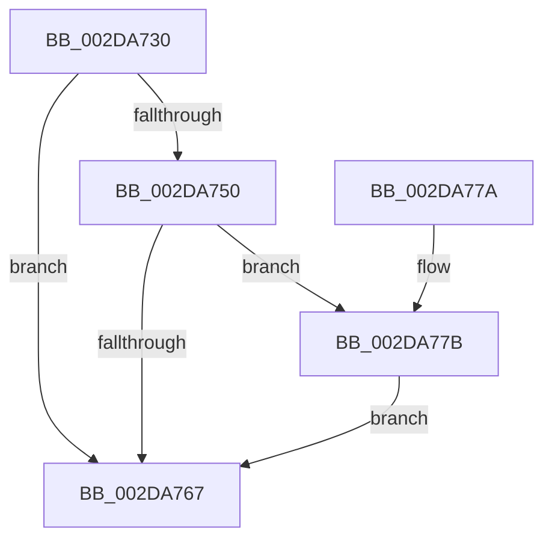

# PpmEventMediaBufferingNotify

- RVA: `0x002DA730`–`0x002DA7D6` (길이 `166` bytes)
- VA: `0x00000001402DA730`
- 실행 섹션: `.text`
- PDB 이름 있음: `예`; PDB Function 태그: `아니요`
- unwind 정보 RVA: `0x00070554`
- 디코드: `39`개 명령, `166/166` bytes 표시
- 미해석 바이트: `0` (있으면 어셈블리에 `.byte`로 보존)

> 이 문서는 커널 이미지의 기계어와 PDB 기호를 분석해 생성했습니다. 4번과 5번은 함수 원형과 자료형을 바이너리 사용 방식에서 추정한 C 해석이며 원본 소스 복구 결과는 아닙니다.

## 1. Dependencies

- 직접 호출 지점: **3**; 고유 호출 대상: **3**
- 직접 호출자로 확인된 함수: **1**
- RIP 상대 이미지 참조: **4**

### Outgoing calls
- `0x002DA75E` → [EtwEventEnabled](../39/EtwEventEnabled_function_00392450.md) (function, `0x00392450`)
- `0x002DA76F` → [_security_check_cookie](../6A/_security_check_cookie_function_006AC640.md) (function, `0x006AC640`)
- `0x002DA7CF` → [EtwWriteEx](../25/EtwWriteEx_function_0025F0D0.md) (function, `0x0025F0D0`)

### Direct callers
- [PpmMediaBufferingWorker](PpmMediaBufferingWorker_function_002DA680.md) at `0x002DA6BA`

### Static image references
- `0x002DA736` → RVA `0x00E0A740` (`.data`; read)
- `0x002DA745` → RVA `0x00E67A39` (`.data`; read)
- `0x002DA750` → RVA `0x00F083E8` (`.data`; read)
- `0x002DA757` → RVA `0x00010B68` (`.rdata`; read)

## 2. Other-region calls and transfers

- 다른 실행 섹션으로 향하는 call: **0**
- 별도 외부 분기/꼬리 이동을 확인하지 못했습니다.

## 3. Assembly (complete function range)

```asm
002DA730  40 53                           push rbx
002DA732  48 83 EC 60                     sub rsp, 0x60
002DA736  48 8B 05 03 00 B3 00            mov rax, qword ptr [rip + 0xb30003]
002DA73D  48 33 C4                        xor rax, rsp
002DA740  48 89 44 24 58                  mov qword ptr [rsp + 0x58], rax
002DA745  80 3D ED D2 B8 00 00            cmp byte ptr [rip + 0xb8d2ed], 0
002DA74C  8A D9                           mov bl, cl
002DA74E  74 17                           je 0x1402da767
002DA750  48 8B 0D 91 DC C2 00            mov rcx, qword ptr [rip + 0xc2dc91]
002DA757  48 8D 15 0A 64 D3 FF            lea rdx, [rip - 0x2c9bf6]
002DA75E  E8 ED 7C 0B 00                  call 0x140392450
002DA763  84 C0                           test al, al
002DA765  75 14                           jne 0x1402da77b
002DA767  48 8B 4C 24 58                  mov rcx, qword ptr [rsp + 0x58]
002DA76C  48 33 CC                        xor rcx, rsp
002DA76F  E8 CC 1E 3D 00                  call 0x1406ac640
002DA774  48 83 C4 60                     add rsp, 0x60
002DA778  5B                              pop rbx
002DA779  C3                              ret
002DA77A  CC                              int3
002DA77B  48 8B 0D 66 DC C2 00            mov rcx, qword ptr [rip + 0xc2dc66]
002DA782  48 8D 15 DF 63 D3 FF            lea rdx, [rip - 0x2c9c21]
002DA789  33 C0                           xor eax, eax
002DA78B  C7 44 24 50 04 00 00 00         mov dword ptr [rsp + 0x50], 4
002DA793  84 DB                           test bl, bl
002DA795  0F 95 C0                        setne al
002DA798  83 64 24 54 00                  and dword ptr [rsp + 0x54], 0
002DA79D  89 44 24 40                     mov dword ptr [rsp + 0x40], eax
002DA7A1  45 33 C9                        xor r9d, r9d
002DA7A4  48 8D 44 24 40                  lea rax, [rsp + 0x40]
002DA7A9  45 33 C0                        xor r8d, r8d
002DA7AC  48 89 44 24 48                  mov qword ptr [rsp + 0x48], rax
002DA7B1  48 8D 44 24 48                  lea rax, [rsp + 0x48]
002DA7B6  48 89 44 24 38                  mov qword ptr [rsp + 0x38], rax
002DA7BB  C7 44 24 30 01 00 00 00         mov dword ptr [rsp + 0x30], 1
002DA7C3  48 83 64 24 28 00               and qword ptr [rsp + 0x28], 0
002DA7C9  48 83 64 24 20 00               and qword ptr [rsp + 0x20], 0
002DA7CF  E8 FC 48 F8 FF                  call 0x14025f0d0
002DA7D4  EB 91                           jmp 0x1402da767
```

## 4. C-style interpretation (structured pseudocode)

```c
__int64 __fastcall PpmEventMediaBufferingNotify(unsigned __int8 a1, __int64 a2, int a3, int a4)
{
    __int64 result;
    __int64 v_rsp;
    unsigned __int64 v_stack_m10;
    unsigned __int64 v_stack_p20;
    unsigned __int64 v_stack_p28;
    unsigned int v_stack_p30;
    unsigned __int64 v_stack_p38;
    unsigned int v_stack_p40;
    unsigned __int64 v_stack_p48;
    unsigned int v_stack_p50;
    unsigned int v_stack_p54;

    v_rsp = (v_rsp) - (96);
    result = (*(unsigned __int64 *)(v_rip + 11730947)) ^ (v_rsp);
    v_stack_m10 = result;
    if ((*(unsigned __int8 *)(v_rip + 12112621)) == 0) goto loc_002DA767;
    result = EtwEventEnabled(*(unsigned __int64 *)(v_rip + 12770449), v_rip - 2923510, a3, a4);
    if ((unsigned __int8)(result) != 0) goto loc_002DA77B;
loc_002DA767:
    a1 = (v_stack_m10) ^ (v_rsp);
    result = _security_check_cookie(a1, v_rip - 2923510, a3, a4);
    v_rsp = (v_rsp) + (96);
    return result;
loc_002DA77B:
    result = 0;
    v_stack_p50 = 4;
    result = (a1 != 0) ? 1 : 0;
    v_stack_p40 = (unsigned int)(result);
    a4 = 0;
    a3 = 0;
    v_stack_p48 = v_stack_p40;
    v_stack_p38 = v_stack_p48;
    v_stack_p30 = 1;
    result = EtwWriteEx(*(unsigned __int64 *)(v_rip + 12770406), v_rip - 2923553, a3, a4);
    goto loc_002DA767;
}
```

## 5. (Beta) C Style

```c
int64_t PpmEventMediaBufferingNotify(uint8_t Arg1, int64_t Arg2, int32_t Arg3, int32_t Arg4)
{
    int64_t result;
    int64_t local_rsp;
    uint64_t v_stack_m10;
    uint64_t v_stack_p20;
    uint64_t v_stack_p28;
    uint32_t v_stack_p30;
    uint64_t v_stack_p38;
    uint32_t v_stack_p40;
    uint64_t v_stack_p48;
    uint32_t v_stack_p50;
    uint32_t v_stack_p54;

    local_rsp = (local_rsp) - (96);
    result = (*(uint64_t *)(v_rip + 0xB30003)) ^ (local_rsp);
    v_stack_m10 = result;
    if ((*(uint8_t *)(v_rip + 0xB8D2ED)) == 0) goto loc_002DA767;
    result = EtwEventEnabled(*(uint64_t *)(v_rip + 0xC2DC91), v_rip - 2923510, Arg3, Arg4);
    if ((uint8_t)(result) != 0) goto loc_002DA77B;
loc_002DA767:
    Arg1 = (v_stack_m10) ^ (local_rsp);
    result = _security_check_cookie(Arg1, v_rip - 2923510, Arg3, Arg4);
    local_rsp = (local_rsp) + (96);
    return result;
loc_002DA77B:
    result = 0;
    v_stack_p50 = 4;
    result = (Arg1 != 0) ? 1 : 0;
    v_stack_p40 = (uint32_t)(result);
    Arg4 = 0;
    Arg3 = 0;
    v_stack_p48 = v_stack_p40;
    v_stack_p38 = v_stack_p48;
    v_stack_p30 = 1;
    result = EtwWriteEx(*(uint64_t *)(v_rip + 0xC2DC66), v_rip - 2923553, Arg3, Arg4);
    goto loc_002DA767;
}
```

## 6. Execution-region graph

[열기: 2D/3D 그래프와 함수 탐색 컨트롤 패널](../../../control-panel.html?section=text&rva=0x002DA730&view=graph)

- 2D 그래프는 위에서 아래로 흐르고, 3D 그래프는 빈 공간을 드래그해 회전합니다. Shift+드래그는 이동, 휠은 확대·축소, 함수 노드 선택은 대상 보고서 이동입니다.

### Static fallback


