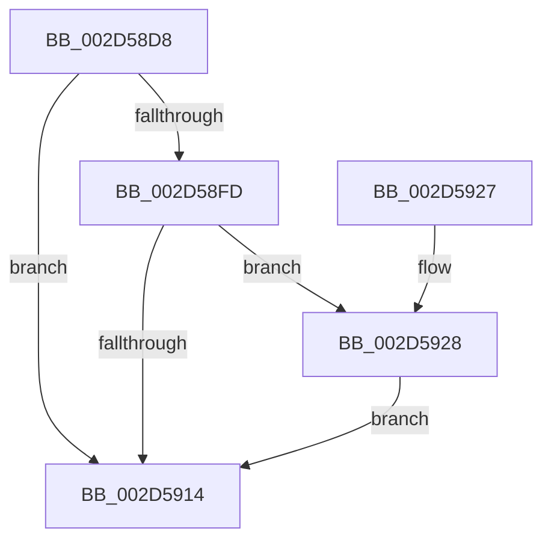

# PpmEventSoftParkRankListChanged

- RVA: `0x002D58D8`–`0x002D5991` (길이 `185` bytes)
- VA: `0x00000001402D58D8`
- 실행 섹션: `.text`
- PDB 이름 있음: `예`; PDB Function 태그: `아니요`
- unwind 정보 RVA: `0x0006FCE4`
- 디코드: `40`개 명령, `185/185` bytes 표시
- 미해석 바이트: `0` (있으면 어셈블리에 `.byte`로 보존)

> 이 문서는 커널 이미지의 기계어와 PDB 기호를 분석해 생성했습니다. 4번과 5번은 함수 원형과 자료형을 바이너리 사용 방식에서 추정한 C 해석이며 원본 소스 복구 결과는 아닙니다.

## 1. Dependencies

- 직접 호출 지점: **3**; 고유 호출 대상: **3**
- 직접 호출자로 확인된 함수: **3**
- RIP 상대 이미지 참조: **6**

### Outgoing calls
- `0x002D590B` → [EtwEventEnabled](../39/EtwEventEnabled_function_00392450.md) (function, `0x00392450`)
- `0x002D591C` → [_security_check_cookie](../6A/_security_check_cookie_function_006AC640.md) (function, `0x006AC640`)
- `0x002D598A` → [EtwWriteEx](../25/EtwWriteEx_function_0025F0D0.md) (function, `0x0025F0D0`)

### Direct callers
- [PpmParkReportParkedCores](PpmParkReportParkedCores_function_002D5CB0.md) at `0x002D61B9`
- [PpmParkApplyPolicy](../4B/PpmParkApplyPolicy_function_004B613C.md) at `0x004B6812`
- [PpmParkApplyPolicyEx](../4F/PpmParkApplyPolicyEx_function_004F3090.md) at `0x004F38DF`

### Static image references
- `0x002D58DE` → RVA `0x00E0A740` (`.data`; read)
- `0x002D58ED` → RVA `0x00E67A39` (`.data`; read)
- `0x002D58F4` → RVA `0x00F083C8` (`.data`; read)
- `0x002D58FD` → RVA `0x00F083E8` (`.data`; read)
- `0x002D5904` → RVA `0x00010F88` (`.rdata`; read)
- `0x002D592D` → RVA `0x00FC6AE8` (`ALMOSTRO`; read)

## 2. Other-region calls and transfers

- 다른 실행 섹션으로 향하는 call: **0**
- 별도 외부 분기/꼬리 이동을 확인하지 못했습니다.

## 3. Assembly (complete function range)

```asm
002D58D8  40 53                           push rbx
002D58DA  48 83 EC 70                     sub rsp, 0x70
002D58DE  48 8B 05 5B 4E B3 00            mov rax, qword ptr [rip + 0xb34e5b]
002D58E5  48 33 C4                        xor rax, rsp
002D58E8  48 89 44 24 60                  mov qword ptr [rsp + 0x60], rax
002D58ED  80 3D 45 21 B9 00 00            cmp byte ptr [rip + 0xb92145], 0
002D58F4  48 8B 1D CD 2A C3 00            mov rbx, qword ptr [rip + 0xc32acd]
002D58FB  74 17                           je 0x1402d5914
002D58FD  48 8B 0D E4 2A C3 00            mov rcx, qword ptr [rip + 0xc32ae4]
002D5904  48 8D 15 7D B6 D3 FF            lea rdx, [rip - 0x2c4983]
002D590B  E8 40 CB 0B 00                  call 0x140392450
002D5910  84 C0                           test al, al
002D5912  75 14                           jne 0x1402d5928
002D5914  48 8B 4C 24 60                  mov rcx, qword ptr [rsp + 0x60]
002D5919  48 33 CC                        xor rcx, rsp
002D591C  E8 1F 6D 3D 00                  call 0x1406ac640
002D5921  48 83 C4 70                     add rsp, 0x70
002D5925  5B                              pop rbx
002D5926  C3                              ret
002D5927  CC                              int3
002D5928  83 64 24 4C 00                  and dword ptr [rsp + 0x4c], 0
002D592D  48 8D 05 B4 11 CF 00            lea rax, [rip + 0xcf11b4]
002D5934  83 64 24 5C 00                  and dword ptr [rsp + 0x5c], 0
002D5939  48 8D 15 48 B6 D3 FF            lea rdx, [rip - 0x2c49b8]
002D5940  48 8B 0D A1 2A C3 00            mov rcx, qword ptr [rip + 0xc32aa1]
002D5947  45 33 C9                        xor r9d, r9d
002D594A  48 89 44 24 40                  mov qword ptr [rsp + 0x40], rax
002D594F  45 33 C0                        xor r8d, r8d
002D5952  8B 05 90 11 CF 00               mov eax, dword ptr [rip + 0xcf1190]
002D5958  C1 E0 02                        shl eax, 2
002D595B  89 44 24 58                     mov dword ptr [rsp + 0x58], eax
002D595F  48 8D 44 24 40                  lea rax, [rsp + 0x40]
002D5964  48 89 44 24 38                  mov qword ptr [rsp + 0x38], rax
002D5969  C7 44 24 30 02 00 00 00         mov dword ptr [rsp + 0x30], 2
002D5971  48 83 64 24 28 00               and qword ptr [rsp + 0x28], 0
002D5977  48 83 64 24 20 00               and qword ptr [rsp + 0x20], 0
002D597D  C7 44 24 48 04 00 00 00         mov dword ptr [rsp + 0x48], 4
002D5985  48 89 5C 24 50                  mov qword ptr [rsp + 0x50], rbx
002D598A  E8 41 97 F8 FF                  call 0x14025f0d0
002D598F  EB 83                           jmp 0x1402d5914
```

## 4. C-style interpretation (structured pseudocode)

```c
__int64 __fastcall PpmEventSoftParkRankListChanged(__int64 a1, __int64 a2, int a3, int a4)
{
    __int64 result;
    __int64 v_rsp;
    unsigned __int64 v_stack_m18;
    unsigned __int64 v_stack_p20;
    unsigned __int64 v_stack_p28;
    unsigned int v_stack_p30;
    unsigned __int64 v_stack_p38;
    unsigned __int64 v_stack_p40;
    unsigned int v_stack_p48;
    unsigned int v_stack_p4C;
    unsigned __int64 v_stack_p50;
    unsigned int v_stack_p58;
    unsigned int v_stack_p5C;

    v_rsp = (v_rsp) - (112);
    result = (*(unsigned __int64 *)(v_rip + 11751003)) ^ (v_rsp);
    v_stack_m18 = result;
    if ((*(unsigned __int8 *)(v_rip + 12132677)) == 0) goto loc_002D5914;
    result = EtwEventEnabled(*(unsigned __int64 *)(v_rip + 12790500), v_rip - 2902403, a3, a4);
    if ((unsigned __int8)(result) != 0) goto loc_002D5928;
loc_002D5914:
    a1 = (v_stack_m18) ^ (v_rsp);
    result = _security_check_cookie(a1, v_rip - 2902403, a3, a4);
    v_rsp = (v_rsp) + (112);
    return result;
loc_002D5928:
    a4 = 0;
    v_stack_p40 = v_rip + 13570484;
    a3 = 0;
    result = (unsigned int)(((unsigned int)(*(unsigned int *)(v_rip + 13570448))) << (2));
    v_stack_p58 = (unsigned int)(result);
    v_stack_p38 = v_stack_p40;
    v_stack_p30 = 2;
    v_stack_p48 = 4;
    v_stack_p50 = *(unsigned __int64 *)(v_rip + 12790477);
    result = EtwWriteEx(*(unsigned __int64 *)(v_rip + 12790433), v_rip - 2902456, a3, a4);
    goto loc_002D5914;
}
```

## 5. (Beta) C Style

```c
int64_t PpmEventSoftParkRankListChanged(int64_t Arg1, int64_t Arg2, int32_t Arg3, int32_t Arg4)
{
    int64_t result;
    int64_t local_rsp;
    uint64_t v_stack_m18;
    uint64_t v_stack_p20;
    uint64_t v_stack_p28;
    uint32_t v_stack_p30;
    uint64_t v_stack_p38;
    uint64_t v_stack_p40;
    uint32_t v_stack_p48;
    uint32_t v_stack_p4C;
    uint64_t v_stack_p50;
    uint32_t v_stack_p58;
    uint32_t v_stack_p5C;

    local_rsp = (local_rsp) - (112);
    result = (*(uint64_t *)(v_rip + 0xB34E5B)) ^ (local_rsp);
    v_stack_m18 = result;
    if ((*(uint8_t *)(v_rip + 0xB92145)) == 0) goto loc_002D5914;
    result = EtwEventEnabled(*(uint64_t *)(v_rip + 0xC32AE4), v_rip - 2902403, Arg3, Arg4);
    if ((uint8_t)(result) != 0) goto loc_002D5928;
loc_002D5914:
    Arg1 = (v_stack_m18) ^ (local_rsp);
    result = _security_check_cookie(Arg1, v_rip - 2902403, Arg3, Arg4);
    local_rsp = (local_rsp) + (112);
    return result;
loc_002D5928:
    Arg4 = 0;
    v_stack_p40 = v_rip + 13570484;
    Arg3 = 0;
    result = (uint32_t)(((uint32_t)(*(uint32_t *)(v_rip + 0xCF1190))) << (2));
    v_stack_p58 = (uint32_t)(result);
    v_stack_p38 = v_stack_p40;
    v_stack_p30 = 2;
    v_stack_p48 = 4;
    v_stack_p50 = *(uint64_t *)(v_rip + 0xC32ACD);
    result = EtwWriteEx(*(uint64_t *)(v_rip + 0xC32AA1), v_rip - 2902456, Arg3, Arg4);
    goto loc_002D5914;
}
```

## 6. Execution-region graph

[열기: 2D/3D 그래프와 함수 탐색 컨트롤 패널](../../../control-panel.html?section=text&rva=0x002D58D8&view=graph)

- 2D 그래프는 위에서 아래로 흐르고, 3D 그래프는 빈 공간을 드래그해 회전합니다. Shift+드래그는 이동, 휠은 확대·축소, 함수 노드 선택은 대상 보고서 이동입니다.

### Static fallback


