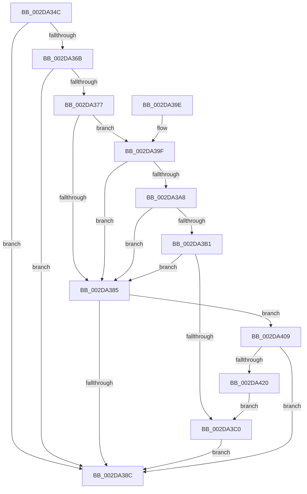

# PpmEventTracePerfCheckStop

- RVA: `0x002DA34C`–`0x002DA422` (길이 `214` bytes)
- VA: `0x00000001402DA34C`
- 실행 섹션: `.text`
- PDB 이름 있음: `예`; PDB Function 태그: `아니요`
- unwind 정보 RVA: `0x00070500`
- 디코드: `54`개 명령, `214/214` bytes 표시
- 미해석 바이트: `0` (있으면 어셈블리에 `.byte`로 보존)

> 이 문서는 커널 이미지의 기계어와 PDB 기호를 분석해 생성했습니다. 4번과 5번은 함수 원형과 자료형을 바이너리 사용 방식에서 추정한 C 해석이며 원본 소스 복구 결과는 아닙니다.

## 1. Dependencies

- 직접 호출 지점: **3**; 고유 호출 대상: **3**
- 직접 호출자로 확인된 함수: **1**
- RIP 상대 이미지 참조: **5**

### Outgoing calls
- `0x002DA394` → [_security_check_cookie](../6A/_security_check_cookie_function_006AC640.md) (function, `0x006AC640`)
- `0x002DA402` → [EtwWriteEx](../25/EtwWriteEx_function_0025F0D0.md) (function, `0x0025F0D0`)
- `0x002DA413` → [EtwpLevelKeywordEnabled](../2F/EtwpLevelKeywordEnabled_function_002FD110.md) (function, `0x002FD110`)

### Direct callers
- [PpmCheckRun](PpmCheckRun_function_002DA0C0.md) at `0x002DA15B`

### Static image references
- `0x002DA350` → RVA `0x00E0A740` (`.data`; read)
- `0x002DA362` → RVA `0x00E67A39` (`.data`; read)
- `0x002DA36B` → RVA `0x00F083E8` (`.data`; read)
- `0x002DA3C7` → RVA `0x00F0B260` (`.data`; read)
- `0x002DA3D3` → RVA `0x00010B48` (`.rdata`; read)

## 2. Other-region calls and transfers

- 다른 실행 섹션으로 향하는 call: **0**
- 별도 외부 분기/꼬리 이동을 확인하지 못했습니다.

## 3. Assembly (complete function range)

```asm
002DA34C  48 83 EC 68                     sub rsp, 0x68
002DA350  48 8B 05 E9 03 B3 00            mov rax, qword ptr [rip + 0xb303e9]
002DA357  48 33 C4                        xor rax, rsp
002DA35A  48 89 44 24 58                  mov qword ptr [rsp + 0x58], rax
002DA35F  45 33 C9                        xor r9d, r9d
002DA362  44 38 0D D0 D6 B8 00            cmp byte ptr [rip + 0xb8d6d0], r9b
002DA369  74 21                           je 0x1402da38c
002DA36B  48 8B 15 76 E0 C2 00            mov rdx, qword ptr [rip + 0xc2e076]
002DA372  48 85 D2                        test rdx, rdx
002DA375  74 15                           je 0x1402da38c
002DA377  48 8B 4A 20                     mov rcx, qword ptr [rdx + 0x20]
002DA37B  45 8D 41 02                     lea r8d, [r9 + 2]
002DA37F  44 39 49 60                     cmp dword ptr [rcx + 0x60], r9d
002DA383  75 1A                           jne 0x1402da39f
002DA385  66 44 39 4A 66                  cmp word ptr [rdx + 0x66], r9w
002DA38A  75 7D                           jne 0x1402da409
002DA38C  48 8B 4C 24 58                  mov rcx, qword ptr [rsp + 0x58]
002DA391  48 33 CC                        xor rcx, rsp
002DA394  E8 A7 22 3D 00                  call 0x1406ac640
002DA399  48 83 C4 68                     add rsp, 0x68
002DA39D  C3                              ret
002DA39E  CC                              int3
002DA39F  8A 41 64                        mov al, byte ptr [rcx + 0x64]
002DA3A2  FE C8                           dec al
002DA3A4  3C 03                           cmp al, 3
002DA3A6  76 DD                           jbe 0x1402da385
002DA3A8  8B 41 68                        mov eax, dword ptr [rcx + 0x68]
002DA3AB  44 84 41 70                     test byte ptr [rcx + 0x70], r8b
002DA3AF  74 D4                           je 0x1402da385
002DA3B1  48 8B 49 78                     mov rcx, qword ptr [rcx + 0x78]
002DA3B5  48 8B C1                        mov rax, rcx
002DA3B8  49 23 C0                        and rax, r8
002DA3BB  48 3B C1                        cmp rax, rcx
002DA3BE  75 C5                           jne 0x1402da385
002DA3C0  48 8B 0D 21 E0 C2 00            mov rcx, qword ptr [rip + 0xc2e021]
002DA3C7  48 8D 05 92 0E C3 00            lea rax, [rip + 0xc30e92]
002DA3CE  48 89 44 24 48                  mov qword ptr [rsp + 0x48], rax
002DA3D3  48 8D 15 6E 67 D3 FF            lea rdx, [rip - 0x2c9892]
002DA3DA  48 8D 44 24 48                  lea rax, [rsp + 0x48]
002DA3DF  48 C7 44 24 50 08 00 00 00      mov qword ptr [rsp + 0x50], 8
002DA3E8  48 89 44 24 38                  mov qword ptr [rsp + 0x38], rax
002DA3ED  45 33 C0                        xor r8d, r8d
002DA3F0  C7 44 24 30 01 00 00 00         mov dword ptr [rsp + 0x30], 1
002DA3F8  4C 89 4C 24 28                  mov qword ptr [rsp + 0x28], r9
002DA3FD  4C 89 4C 24 20                  mov qword ptr [rsp + 0x20], r9
002DA402  E8 C9 4C F8 FF                  call 0x14025f0d0
002DA407  EB 83                           jmp 0x1402da38c
002DA409  48 8B 4A 28                     mov rcx, qword ptr [rdx + 0x28]
002DA40D  B2 05                           mov dl, 5
002DA40F  48 83 C1 60                     add rcx, 0x60
002DA413  E8 F8 2C 02 00                  call 0x1402fd110
002DA418  84 C0                           test al, al
002DA41A  0F 84 6C FF FF FF               je 0x1402da38c
002DA420  EB 9E                           jmp 0x1402da3c0
```

## 4. C-style interpretation (structured pseudocode)

```c
__int64 __fastcall PpmEventTracePerfCheckStop(__int64 a1, __int64 a2, __int64 a3, int a4)
{
    __int64 result;
    __int64 v_rsp;
    unsigned __int64 v_stack_m10;
    unsigned __int64 v_stack_p20;
    unsigned __int64 v_stack_p28;
    unsigned int v_stack_p30;
    unsigned __int64 v_stack_p38;
    unsigned __int64 v_stack_p48;
    unsigned __int64 v_stack_p50;

    v_rsp = (v_rsp) - (104);
    result = (*(unsigned __int64 *)(v_rip + 11731945)) ^ (v_rsp);
    v_stack_m10 = result;
    a4 = 0;
    if ((*(unsigned __int8 *)(v_rip + 12113616)) == 0) goto loc_002DA38C;
    if (*(unsigned __int64 *)(v_rip + 12771446) == 0) goto loc_002DA38C;
    if ((*(unsigned int *)(*(unsigned __int64 *)(*(unsigned __int64 *)(v_rip + 12771446) + 32) + 96)) != 0) goto loc_002DA39F;
loc_002DA385:
    if ((*(unsigned __int16 *)(*(unsigned __int64 *)(v_rip + 12771446) + 102)) != 0) goto loc_002DA409;
loc_002DA38C:
    a1 = (v_stack_m10) ^ (v_rsp);
    result = _security_check_cookie(a1, *(unsigned __int64 *)(v_rip + 12771446), a4 + 2, a4);
    v_rsp = (v_rsp) + (104);
    return result;
loc_002DA39F:
    result = (unsigned __int8)((*(unsigned __int8 *)(a1 + 100)) - 1);
    if (((unsigned __int8)(result)) <= 3) goto loc_002DA385;
    if (((*(unsigned __int8 *)(a1 + 112)) & ((unsigned __int8)(a4 + 2))) == 0) goto loc_002DA385;
    result = (*(unsigned __int64 *)(a1 + 120)) & (a4 + 2);
    if (result != (*(unsigned __int64 *)(a1 + 120))) goto loc_002DA385;
loc_002DA3C0:
    v_stack_p48 = v_rip + 12783250;
    v_stack_p50 = 8;
    v_stack_p38 = v_stack_p48;
    a3 = 0;
    v_stack_p30 = 1;
    v_stack_p28 = 0;
    v_stack_p20 = 0;
    result = EtwWriteEx(*(unsigned __int64 *)(v_rip + 12771361), v_rip - 2922642, a3, a4);
    goto loc_002DA38C;
loc_002DA409:
    a1 = (*(unsigned __int64 *)(v_rip - 2922642 + 40)) + (96);
    result = EtwpLevelKeywordEnabled(a1, 5, a3, a4);
    if ((unsigned __int8)(result) == 0) goto loc_002DA38C;
    goto loc_002DA3C0;
}
```

## 5. (Beta) C Style

```c
int64_t PpmEventTracePerfCheckStop(int64_t Arg1, int64_t Arg2, int64_t Arg3, int32_t Arg4)
{
    int64_t result;
    int64_t local_rsp;
    uint64_t v_stack_m10;
    uint64_t v_stack_p20;
    uint64_t v_stack_p28;
    uint32_t v_stack_p30;
    uint64_t v_stack_p38;
    uint64_t v_stack_p48;
    uint64_t v_stack_p50;

    local_rsp = (local_rsp) - (104);
    result = (*(uint64_t *)(v_rip + 0xB303E9)) ^ (local_rsp);
    v_stack_m10 = result;
    Arg4 = 0;
    if ((*(uint8_t *)(v_rip + 0xB8D6D0)) == 0) goto loc_002DA38C;
    if (*(uint64_t *)(v_rip + 0xC2E076) == 0) goto loc_002DA38C;
    if ((*(uint32_t *)(*(uint64_t *)(*(uint64_t *)(v_rip + 0xC2E076) + 0x20) + 0x60)) != 0) goto loc_002DA39F;
loc_002DA385:
    if ((*(uint16_t *)(*(uint64_t *)(v_rip + 0xC2E076) + 0x66)) != 0) goto loc_002DA409;
loc_002DA38C:
    Arg1 = (v_stack_m10) ^ (local_rsp);
    result = _security_check_cookie(Arg1, *(uint64_t *)(v_rip + 0xC2E076), Arg4 + 2, Arg4);
    local_rsp = (local_rsp) + (104);
    return result;
loc_002DA39F:
    result = (uint8_t)((*(uint8_t *)(Arg1 + 0x64)) - 1);
    if (((uint8_t)(result)) <= 3) goto loc_002DA385;
    if (((*(uint8_t *)(Arg1 + 0x70)) & ((uint8_t)(Arg4 + 2))) == 0) goto loc_002DA385;
    result = (*(uint64_t *)(Arg1 + 0x78)) & (Arg4 + 2);
    if (result != (*(uint64_t *)(Arg1 + 0x78))) goto loc_002DA385;
loc_002DA3C0:
    v_stack_p48 = v_rip + 12783250;
    v_stack_p50 = 8;
    v_stack_p38 = v_stack_p48;
    Arg3 = 0;
    v_stack_p30 = 1;
    v_stack_p28 = 0;
    v_stack_p20 = 0;
    result = EtwWriteEx(*(uint64_t *)(v_rip + 0xC2E021), v_rip - 2922642, Arg3, Arg4);
    goto loc_002DA38C;
loc_002DA409:
    Arg1 = (*(uint64_t *)(v_rip - 0x2C9892 + 0x28)) + (96);
    result = EtwpLevelKeywordEnabled(Arg1, 5, Arg3, Arg4);
    if ((uint8_t)(result) == 0) goto loc_002DA38C;
    goto loc_002DA3C0;
}
```

## 6. Execution-region graph

[열기: 2D/3D 그래프와 함수 탐색 컨트롤 패널](../../../control-panel.html?section=text&rva=0x002DA34C&view=graph)

- 2D 그래프는 위에서 아래로 흐르고, 3D 그래프는 빈 공간을 드래그해 회전합니다. Shift+드래그는 이동, 휠은 확대·축소, 함수 노드 선택은 대상 보고서 이동입니다.

### Static fallback


