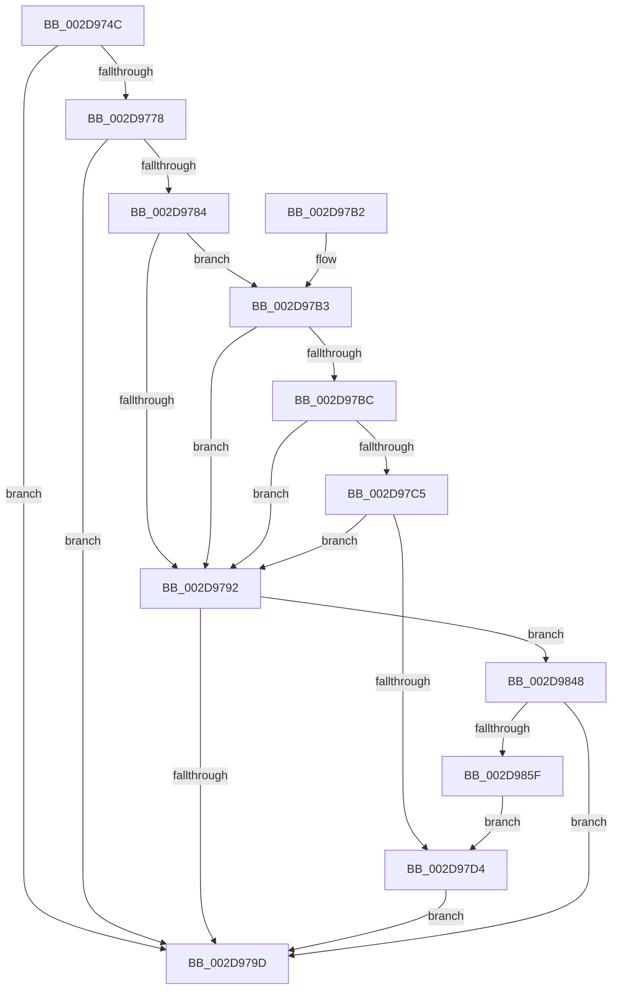

# PpmEventTraceProcessorLatencyLimitChange

- RVA: `0x002D974C`–`0x002D9864` (길이 `280` bytes)
- VA: `0x00000001402D974C`
- 실행 섹션: `.text`
- PDB 이름 있음: `예`; PDB Function 태그: `아니요`
- unwind 정보 RVA: `0x00070418`
- 디코드: `68`개 명령, `280/280` bytes 표시
- 미해석 바이트: `0` (있으면 어셈블리에 `.byte`로 보존)

> 이 문서는 커널 이미지의 기계어와 PDB 기호를 분석해 생성했습니다. 4번과 5번은 함수 원형과 자료형을 바이너리 사용 방식에서 추정한 C 해석이며 원본 소스 복구 결과는 아닙니다.

## 1. Dependencies

- 직접 호출 지점: **3**; 고유 호출 대상: **3**
- 직접 호출자로 확인된 함수: **1**
- RIP 상대 이미지 참조: **4**

### Outgoing calls
- `0x002D97A4` → [_security_check_cookie](../6A/_security_check_cookie_function_006AC640.md) (function, `0x006AC640`)
- `0x002D983E` → [EtwWriteEx](../25/EtwWriteEx_function_0025F0D0.md) (function, `0x0025F0D0`)
- `0x002D9852` → [EtwpLevelKeywordEnabled](../2F/EtwpLevelKeywordEnabled_function_002FD110.md) (function, `0x002FD110`)

### Direct callers
- [sub_002D948B](Unknown_function_002D948B.md) at `0x002D94E5`

### Static image references
- `0x002D975B` → RVA `0x00E0A740` (`.data`; read)
- `0x002D976F` → RVA `0x00E67A39` (`.data`; read)
- `0x002D9778` → RVA `0x00F083E8` (`.data`; read)
- `0x002D97DC` → RVA `0x00010B38` (`.rdata`; read)

## 2. Other-region calls and transfers

- 다른 실행 섹션으로 향하는 call: **0**
- 별도 외부 분기/꼬리 이동을 확인하지 못했습니다.

## 3. Assembly (complete function range)

```asm
002D974C  89 54 24 10                     mov dword ptr [rsp + 0x10], edx
002D9750  55                              push rbp
002D9751  48 8B EC                        mov rbp, rsp
002D9754  48 81 EC 80 00 00 00            sub rsp, 0x80
002D975B  48 8B 05 DE 0F B3 00            mov rax, qword ptr [rip + 0xb30fde]
002D9762  48 33 C4                        xor rax, rsp
002D9765  48 89 45 F8                     mov qword ptr [rbp - 8], rax
002D9769  45 33 D2                        xor r10d, r10d
002D976C  4C 8B C9                        mov r9, rcx
002D976F  44 38 15 C3 E2 B8 00            cmp byte ptr [rip + 0xb8e2c3], r10b
002D9776  74 25                           je 0x1402d979d
002D9778  48 8B 15 69 EC C2 00            mov rdx, qword ptr [rip + 0xc2ec69]
002D977F  48 85 D2                        test rdx, rdx
002D9782  74 19                           je 0x1402d979d
002D9784  48 8B 4A 20                     mov rcx, qword ptr [rdx + 0x20]
002D9788  45 8D 42 02                     lea r8d, [r10 + 2]
002D978C  44 39 51 60                     cmp dword ptr [rcx + 0x60], r10d
002D9790  75 21                           jne 0x1402d97b3
002D9792  66 44 39 52 66                  cmp word ptr [rdx + 0x66], r10w
002D9797  0F 85 AB 00 00 00               jne 0x1402d9848
002D979D  48 8B 4D F8                     mov rcx, qword ptr [rbp - 8]
002D97A1  48 33 CC                        xor rcx, rsp
002D97A4  E8 97 2E 3D 00                  call 0x1406ac640
002D97A9  48 81 C4 80 00 00 00            add rsp, 0x80
002D97B0  5D                              pop rbp
002D97B1  C3                              ret
002D97B2  CC                              int3
002D97B3  8A 41 64                        mov al, byte ptr [rcx + 0x64]
002D97B6  FE C8                           dec al
002D97B8  3C 03                           cmp al, 3
002D97BA  76 D6                           jbe 0x1402d9792
002D97BC  8B 41 68                        mov eax, dword ptr [rcx + 0x68]
002D97BF  44 84 41 70                     test byte ptr [rcx + 0x70], r8b
002D97C3  74 CD                           je 0x1402d9792
002D97C5  48 8B 49 78                     mov rcx, qword ptr [rcx + 0x78]
002D97C9  48 8B C1                        mov rax, rcx
002D97CC  49 23 C0                        and rax, r8
002D97CF  48 3B C1                        cmp rax, rcx
002D97D2  75 BE                           jne 0x1402d9792
002D97D4  41 0F B6 81 D0 00 00 00         movzx eax, byte ptr [r9 + 0xd0]
002D97DC  48 8D 15 55 73 D3 FF            lea rdx, [rip - 0x2c8cab]
002D97E3  48 8B 0D FE EB C2 00            mov rcx, qword ptr [rip + 0xc2ebfe]
002D97EA  66 89 45 C0                     mov word ptr [rbp - 0x40], ax
002D97EE  48 8D 45 C0                     lea rax, [rbp - 0x40]
002D97F2  48 89 45 C8                     mov qword ptr [rbp - 0x38], rax
002D97F6  49 8D 81 D1 00 00 00            lea rax, [r9 + 0xd1]
002D97FD  48 89 45 D8                     mov qword ptr [rbp - 0x28], rax
002D9801  45 33 C9                        xor r9d, r9d
002D9804  48 8D 45 18                     lea rax, [rbp + 0x18]
002D9808  4C 89 45 D0                     mov qword ptr [rbp - 0x30], r8
002D980C  48 89 45 E8                     mov qword ptr [rbp - 0x18], rax
002D9810  45 33 C0                        xor r8d, r8d
002D9813  48 8D 45 C8                     lea rax, [rbp - 0x38]
002D9817  48 C7 45 E0 01 00 00 00         mov qword ptr [rbp - 0x20], 1
002D981F  48 89 44 24 38                  mov qword ptr [rsp + 0x38], rax
002D9824  C7 44 24 30 03 00 00 00         mov dword ptr [rsp + 0x30], 3
002D982C  4C 89 54 24 28                  mov qword ptr [rsp + 0x28], r10
002D9831  4C 89 54 24 20                  mov qword ptr [rsp + 0x20], r10
002D9836  48 C7 45 F0 04 00 00 00         mov qword ptr [rbp - 0x10], 4
002D983E  E8 8D 58 F8 FF                  call 0x14025f0d0
002D9843  E9 55 FF FF FF                  jmp 0x1402d979d
002D9848  48 8B 4A 28                     mov rcx, qword ptr [rdx + 0x28]
002D984C  B2 05                           mov dl, 5
002D984E  48 83 C1 60                     add rcx, 0x60
002D9852  E8 B9 38 02 00                  call 0x1402fd110
002D9857  84 C0                           test al, al
002D9859  0F 84 3E FF FF FF               je 0x1402d979d
002D985F  E9 70 FF FF FF                  jmp 0x1402d97d4
```

## 4. C-style interpretation (structured pseudocode)

```c
__int64 __fastcall PpmEventTraceProcessorLatencyLimitChange(__int64 a1, int a2)
{
    __int64 result;
    __int64 v_r10;
    __int64 v_rsp;
    unsigned __int64 v_stack_m10;
    unsigned __int64 v_stack_m18;
    unsigned __int64 v_stack_m20;
    unsigned __int64 v_stack_m28;
    unsigned __int64 v_stack_m30;
    unsigned __int64 v_stack_m38;
    unsigned __int64 v_stack_m40;
    unsigned __int16 v_stack_m48;
    unsigned int v_stack_p10;
    unsigned __int64 v_stack_p20;
    unsigned __int64 v_stack_p28;
    unsigned int v_stack_p30;
    unsigned __int64 v_stack_p38;

    v_stack_p10 = a2;
    v_rsp = (v_rsp) - (128);
    result = (*(unsigned __int64 *)(v_rip + 11735006)) ^ (v_rsp);
    v_stack_m10 = result;
    v_r10 = 0;
    if ((*(unsigned __int8 *)(v_rip + 12116675)) == 0) goto loc_002D979D;
    if (*(unsigned __int64 *)(v_rip + 12774505) == 0) goto loc_002D979D;
    if ((*(unsigned int *)(*(unsigned __int64 *)(*(unsigned __int64 *)(v_rip + 12774505) + 32) + 96)) != 0) goto loc_002D97B3;
loc_002D9792:
    if ((*(unsigned __int16 *)(*(unsigned __int64 *)(v_rip + 12774505) + 102)) != 0) goto loc_002D9848;
loc_002D979D:
    a1 = (v_stack_m10) ^ (v_rsp);
    result = _security_check_cookie(a1, *(unsigned __int64 *)(v_rip + 12774505), v_r10 + 2, a1);
    v_rsp = (v_rsp) + (128);
    return result;
loc_002D97B3:
    result = (unsigned __int8)((*(unsigned __int8 *)(a1 + 100)) - 1);
    if (((unsigned __int8)(result)) <= 3) goto loc_002D9792;
    if (((*(unsigned __int8 *)(a1 + 112)) & ((unsigned __int8)(v_r10 + 2))) == 0) goto loc_002D9792;
    result = (*(unsigned __int64 *)(a1 + 120)) & (v_r10 + 2);
    if (result != (*(unsigned __int64 *)(a1 + 120))) goto loc_002D9792;
loc_002D97D4:
    v_stack_m48 = (unsigned __int16)(*(unsigned __int8 *)(a1 + 208));
    v_stack_m40 = v_stack_m48;
    v_stack_m30 = a1 + 209;
    a4 = 0;
    v_stack_m38 = v_r10 + 2;
    v_stack_m20 = v_stack_p10;
    a3 = 0;
    v_stack_m28 = 1;
    v_stack_p38 = v_stack_m40;
    v_stack_p30 = 3;
    v_stack_p28 = 0;
    v_stack_p20 = 0;
    v_stack_m18 = 4;
    result = EtwWriteEx(*(unsigned __int64 *)(v_rip + 12774398), v_rip - 2919595, a3, a4);
    goto loc_002D979D;
loc_002D9848:
    a1 = (*(unsigned __int64 *)(v_rip - 2919595 + 40)) + (96);
    result = EtwpLevelKeywordEnabled(a1, 5, a3, a4);
    if ((unsigned __int8)(result) == 0) goto loc_002D979D;
    goto loc_002D97D4;
}
```

## 5. (Beta) C Style

```c
int64_t PpmEventTraceProcessorLatencyLimitChange(int64_t Arg1, int32_t Arg2)
{
    int64_t result;
    int64_t local_r10;
    int64_t local_rsp;
    uint64_t v_stack_m10;
    uint64_t v_stack_m18;
    uint64_t v_stack_m20;
    uint64_t v_stack_m28;
    uint64_t v_stack_m30;
    uint64_t v_stack_m38;
    uint64_t v_stack_m40;
    uint16_t v_stack_m48;
    uint32_t v_stack_p10;
    uint64_t v_stack_p20;
    uint64_t v_stack_p28;
    uint32_t v_stack_p30;
    uint64_t v_stack_p38;

    v_stack_p10 = Arg2;
    local_rsp = (local_rsp) - (128);
    result = (*(uint64_t *)(v_rip + 0xB30FDE)) ^ (local_rsp);
    v_stack_m10 = result;
    local_r10 = 0;
    if ((*(uint8_t *)(v_rip + 0xB8E2C3)) == 0) goto loc_002D979D;
    if (*(uint64_t *)(v_rip + 0xC2EC69) == 0) goto loc_002D979D;
    if ((*(uint32_t *)(*(uint64_t *)(*(uint64_t *)(v_rip + 0xC2EC69) + 0x20) + 0x60)) != 0) goto loc_002D97B3;
loc_002D9792:
    if ((*(uint16_t *)(*(uint64_t *)(v_rip + 0xC2EC69) + 0x66)) != 0) goto loc_002D9848;
loc_002D979D:
    Arg1 = (v_stack_m10) ^ (local_rsp);
    result = _security_check_cookie(Arg1, *(uint64_t *)(v_rip + 0xC2EC69), local_r10 + 2, Arg1);
    local_rsp = (local_rsp) + (128);
    return result;
loc_002D97B3:
    result = (uint8_t)((*(uint8_t *)(Arg1 + 0x64)) - 1);
    if (((uint8_t)(result)) <= 3) goto loc_002D9792;
    if (((*(uint8_t *)(Arg1 + 0x70)) & ((uint8_t)(local_r10 + 2))) == 0) goto loc_002D9792;
    result = (*(uint64_t *)(Arg1 + 0x78)) & (local_r10 + 2);
    if (result != (*(uint64_t *)(Arg1 + 0x78))) goto loc_002D9792;
loc_002D97D4:
    v_stack_m48 = (uint16_t)(*(uint8_t *)(Arg1 + 0xD0));
    v_stack_m40 = v_stack_m48;
    v_stack_m30 = Arg1 + 209;
    a4 = 0;
    v_stack_m38 = local_r10 + 2;
    v_stack_m20 = v_stack_p10;
    a3 = 0;
    v_stack_m28 = 1;
    v_stack_p38 = v_stack_m40;
    v_stack_p30 = 3;
    v_stack_p28 = 0;
    v_stack_p20 = 0;
    v_stack_m18 = 4;
    result = EtwWriteEx(*(uint64_t *)(v_rip + 0xC2EBFE), v_rip - 2919595, a3, a4);
    goto loc_002D979D;
loc_002D9848:
    Arg1 = (*(uint64_t *)(v_rip - 0x2C8CAB + 0x28)) + (96);
    result = EtwpLevelKeywordEnabled(Arg1, 5, a3, a4);
    if ((uint8_t)(result) == 0) goto loc_002D979D;
    goto loc_002D97D4;
}
```

## 6. Execution-region graph

[열기: 2D/3D 그래프와 함수 탐색 컨트롤 패널](../../../control-panel.html?section=text&rva=0x002D974C&view=graph)

- 2D 그래프는 위에서 아래로 흐르고, 3D 그래프는 빈 공간을 드래그해 회전합니다. Shift+드래그는 이동, 휠은 확대·축소, 함수 노드 선택은 대상 보고서 이동입니다.

### Static fallback


