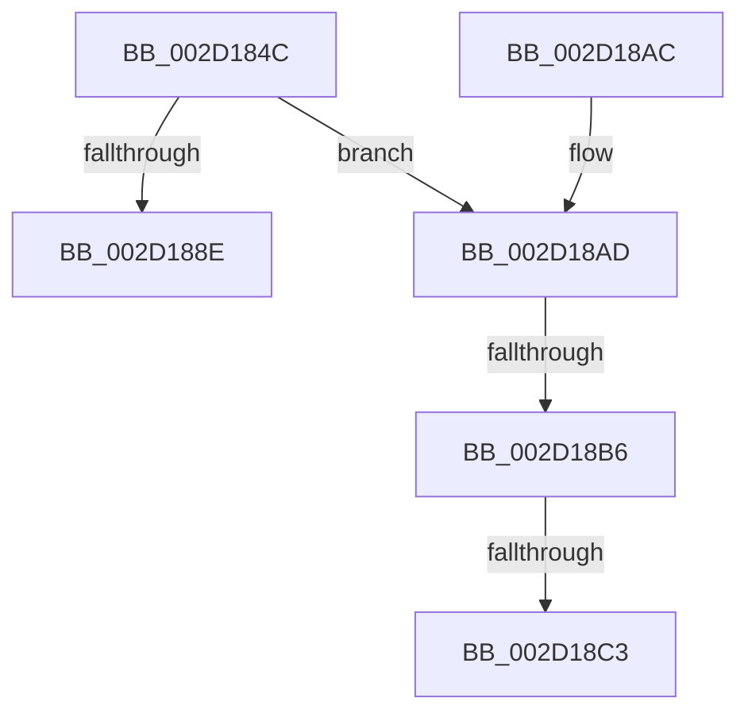

# PpmExitCoordinatedIdle

- RVA: `0x002D184C`–`0x002D18C8` (길이 `124` bytes)
- VA: `0x00000001402D184C`
- 실행 섹션: `.text`
- PDB 이름 있음: `예`; PDB Function 태그: `예`
- unwind 정보 RVA: `0x0006F7FC`
- 디코드: `41`개 명령, `124/124` bytes 표시
- 미해석 바이트: `0` (있으면 어셈블리에 `.byte`로 보존)

> 이 문서는 커널 이미지의 기계어와 PDB 기호를 분석해 생성했습니다. 4번과 5번은 함수 원형과 자료형을 바이너리 사용 방식에서 추정한 C 해석이며 원본 소스 복구 결과는 아닙니다.

## 1. Dependencies

- 직접 호출 지점: **0**; 고유 호출 대상: **0**
- 직접 호출자로 확인된 함수: **1**
- RIP 상대 이미지 참조: **1**

### Outgoing calls
- 직접 디코드된 call 명령이 없습니다.

### Direct callers
- [PpmIdleExecuteTransition](PpmIdleExecuteTransition_function_002D0A1C.md) at `0x002D0C92`

### Static image references
- `0x002D1871` → RVA `0x00FC6AD0` (`ALMOSTRO`; read)

## 2. Other-region calls and transfers

- 다른 실행 섹션으로 향하는 call: **0**
- call이 아닌 외부 분기/꼬리 이동: **3**
  - `0x002D18B0` → [sub_006DD378 + 0x7B](../6D/Unknown_function_006DD378.md) (`tail-transfer`)
  - `0x002D18BD` → [sub_006DD378](../6D/Unknown_function_006DD378.md) (`tail-transfer`)
  - `0x002D18C3` → [sub_006DD378 + 0x73](../6D/Unknown_function_006DD378.md) (`tail-transfer`)

## 3. Assembly (complete function range)

```asm
002D184C  48 8B C4                        mov rax, rsp
002D184F  48 89 58 10                     mov qword ptr [rax + 0x10], rbx
002D1853  44 89 48 20                     mov dword ptr [rax + 0x20], r9d
002D1857  48 89 48 08                     mov qword ptr [rax + 8], rcx
002D185B  55                              push rbp
002D185C  56                              push rsi
002D185D  57                              push rdi
002D185E  41 54                           push r12
002D1860  41 55                           push r13
002D1862  41 56                           push r14
002D1864  41 57                           push r15
002D1866  48 83 EC 40                     sub rsp, 0x40
002D186A  45 33 DB                        xor r11d, r11d
002D186D  41 83 CD FF                     or r13d, 0xffffffff
002D1871  4C 39 1D 58 52 CF 00            cmp qword ptr [rip + 0xcf5258], r11
002D1878  48 8B F2                        mov rsi, rdx
002D187B  45 8A E0                        mov r12b, r8b
002D187E  44 88 58 B8                     mov byte ptr [rax - 0x48], r11b
002D1882  48 8B D1                        mov rdx, rcx
002D1885  44 89 68 BC                     mov dword ptr [rax - 0x44], r13d
002D1889  41 8B EB                        mov ebp, r11d
002D188C  75 1F                           jne 0x1402d18ad
002D188E  48 8B 9C 24 88 00 00 00         mov rbx, qword ptr [rsp + 0x88]
002D1896  41 8B C5                        mov eax, r13d
002D1899  89 6E 04                        mov dword ptr [rsi + 4], ebp
002D189C  48 83 C4 40                     add rsp, 0x40
002D18A0  41 5F                           pop r15
002D18A2  41 5E                           pop r14
002D18A4  41 5D                           pop r13
002D18A6  41 5C                           pop r12
002D18A8  5F                              pop rdi
002D18A9  5E                              pop rsi
002D18AA  5D                              pop rbp
002D18AB  C3                              ret
002D18AC  CC                              int3
002D18AD  45 84 E4                        test r12b, r12b
002D18B0  0F 85 3D BB 40 00               jne 0x1406dd3f3
002D18B6  41 8B D3                        mov edx, r11d
002D18B9  44 39 5E 04                     cmp dword ptr [rsi + 4], r11d
002D18BD  0F 87 B5 BA 40 00               ja 0x1406dd378
002D18C3  E9 23 BB 40 00                  jmp 0x1406dd3eb
```

## 4. C-style interpretation (structured pseudocode)

```c
__int64 __fastcall PpmExitCoordinatedIdle(__int64 a1, __int64 a2, unsigned __int8 a3, int a4)
{
    __int64 v_r11;
    __int64 v_r13;
    __int64 v_rsp;
    unsigned __int64 v_stack_p10;

    *(unsigned __int64 *)(v_rsp + 16) = v_rbx;
    *(unsigned int *)(v_rsp + 32) = a4;
    *(unsigned __int64 *)(v_rsp + 8) = a1;
    v_rsp = (v_rsp) - (64);
    v_r11 = 0;
    v_r13 = (unsigned int)((v_r13) | (0xFFFFFFFFULL));
    *(unsigned __int8 *)(v_rsp - 72) = 0;
    *(unsigned int *)(v_rsp - 68) = (unsigned int)(v_r13);
    if ((*(unsigned __int64 *)(v_rip + 13587032)) != 0) goto loc_002D18AD;
    *(unsigned int *)(a2 + 4) = 0;
    v_rsp = (v_rsp) + (64);
    return (unsigned int)((unsigned int)(v_r13));
loc_002D18AD:
}
```

## 5. (Beta) C Style

```c
int64_t PpmExitCoordinatedIdle(int64_t Arg1, void *Arg2, uint8_t Arg3, int32_t Arg4)
{
    uint8_t *arg2 = (uint8_t *)Arg2;

    int64_t local_r11;
    int64_t local_r13;
    int64_t local_rsp;
    uint64_t v_stack_p10;

    *(uint64_t *)(local_rsp + 0x10) = local_rbx;
    *(uint32_t *)(local_rsp + 0x20) = Arg4;
    *(uint64_t *)(local_rsp + 0x8) = Arg1;
    local_rsp = (local_rsp) - (64);
    local_r11 = 0;
    local_r13 = (uint32_t)((local_r13) | (0xFFFFFFFFULL));
    *(uint8_t *)(local_rsp - 0x48) = 0;
    *(uint32_t *)(local_rsp - 0x44) = (uint32_t)(local_r13);
    if ((*(uint64_t *)(v_rip + 0xCF5258)) != 0) goto loc_002D18AD;
    *(uint32_t *)(arg2 + 0x4) = 0;
    local_rsp = (local_rsp) + (64);
    return (uint32_t)((uint32_t)(local_r13));
loc_002D18AD:
}
```

### 관측된 메모리 오프셋

구조체 형식이 확인되지 않은 접근은 인자 기준의 오프셋으로만 기록했습니다.

| 기준 인자 | 오프셋 표현 | 폭 (bit) | 접근 |
|---|---:|---:|---|
| `Arg2` | `+ 0x4` | `32` | `R` |
| `Arg2` | `+ 0x4` | `32` | `W` |

## 6. Execution-region graph

[열기: 2D/3D 그래프와 함수 탐색 컨트롤 패널](../../../control-panel.html?section=text&rva=0x002D184C&view=graph)

- 2D 그래프는 위에서 아래로 흐르고, 3D 그래프는 빈 공간을 드래그해 회전합니다. Shift+드래그는 이동, 휠은 확대·축소, 함수 노드 선택은 대상 보고서 이동입니다.

### Static fallback


