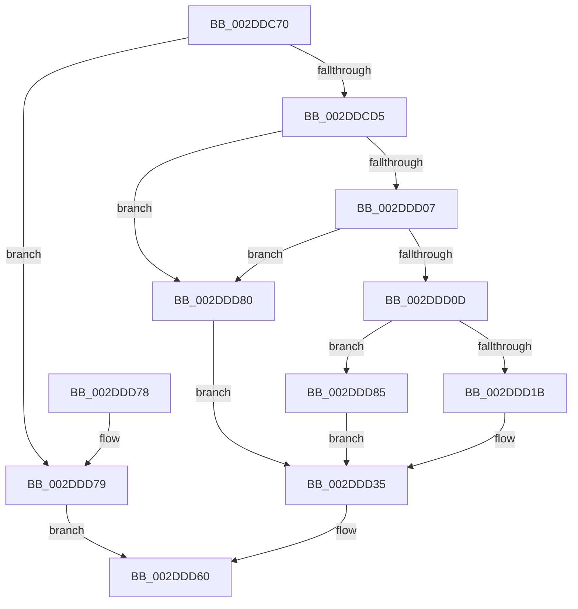

# PpmGetThroughputInfoCallback

- RVA: `0x002DDC70`–`0x002DDDD2` (길이 `354` bytes)
- VA: `0x00000001402DDC70`
- 실행 섹션: `.text`
- PDB 이름 있음: `예`; PDB Function 태그: `아니요`
- unwind 정보 RVA: `0x00070914`
- 디코드: `97`개 명령, `354/354` bytes 표시
- 미해석 바이트: `0` (있으면 어셈블리에 `.byte`로 보존)

> 이 문서는 커널 이미지의 기계어와 PDB 기호를 분석해 생성했습니다. 4번과 5번은 함수 원형과 자료형을 바이너리 사용 방식에서 추정한 C 해석이며 원본 소스 복구 결과는 아닙니다.

## 1. Dependencies

- 직접 호출 지점: **1**; 고유 호출 대상: **1**
- 직접 호출자로 확인된 함수: **1**
- RIP 상대 이미지 참조: **2**

### Outgoing calls
- `0x002DDCC8` → [PpmSnapPerformanceAccumulation](PpmSnapPerformanceAccumulation_function_002DE090.md) (function, `0x002DE090`)

### Direct callers
- [PoGetPerfStateAndParkingInfo](PoGetPerfStateAndParkingInfo_function_002DD484.md) at `0x002DD677`

### Static image references
- `0x002DDCDC` → RVA `0x00FC6FBC` (`ALMOSTRO`; read)
- `0x002DDCE3` → RVA `0x00FC6FB4` (`ALMOSTRO`; read)

## 2. Other-region calls and transfers

- 다른 실행 섹션으로 향하는 call: **0**
- 별도 외부 분기/꼬리 이동을 확인하지 못했습니다.

## 3. Assembly (complete function range)

```asm
002DDC70  4C 8B DC                        mov r11, rsp
002DDC73  49 89 5B 10                     mov qword ptr [r11 + 0x10], rbx
002DDC77  49 89 6B 18                     mov qword ptr [r11 + 0x18], rbp
002DDC7B  49 89 73 20                     mov qword ptr [r11 + 0x20], rsi
002DDC7F  57                              push rdi
002DDC80  48 83 EC 70                     sub rsp, 0x70
002DDC84  33 C0                           xor eax, eax
002DDC86  0F 57 C0                        xorps xmm0, xmm0
002DDC89  0F 11 44 24 30                  movups xmmword ptr [rsp + 0x30], xmm0
002DDC8E  49 8B E8                        mov rbp, r8
002DDC91  48 8B FA                        mov rdi, rdx
002DDC94  0F 11 44 24 40                  movups xmmword ptr [rsp + 0x40], xmm0
002DDC99  48 8B F1                        mov rsi, rcx
002DDC9C  0F 11 44 24 50                  movups xmmword ptr [rsp + 0x50], xmm0
002DDCA1  49 89 43 E8                     mov qword ptr [r11 - 0x18], rax
002DDCA5  65 48 8B 04 25 20 00 00 00      mov rax, qword ptr gs:[0x20]
002DDCAE  48 3B C8                        cmp rcx, rax
002DDCB1  49 8D 43 B8                     lea rax, [r11 - 0x48]
002DDCB5  41 0F 95 C0                     setne r8b
002DDCB9  33 DB                           xor ebx, ebx
002DDCBB  49 89 5B B0                     mov qword ptr [r11 - 0x50], rbx
002DDCBF  45 33 C9                        xor r9d, r9d
002DDCC2  33 D2                           xor edx, edx
002DDCC4  49 89 43 A8                     mov qword ptr [r11 - 0x58], rax
002DDCC8  E8 C3 03 00 00                  call 0x1402de090
002DDCCD  84 C0                           test al, al
002DDCCF  0F 84 A4 00 00 00               je 0x1402ddd79
002DDCD5  83 BE 20 89 00 00 03            cmp dword ptr [rsi + 0x8920], 3
002DDCDC  44 8B 0D D9 92 CE 00            mov r9d, dword ptr [rip + 0xce92d9]
002DDCE3  44 0F 44 0D C9 92 CE 00         cmove r9d, dword ptr [rip + 0xce92c9]
002DDCEB  48 8B 44 24 50                  mov rax, qword ptr [rsp + 0x50]
002DDCF0  41 8B C9                        mov ecx, r9d
002DDCF3  4C 8B 54 24 48                  mov r10, qword ptr [rsp + 0x48]
002DDCF8  48 D3 E8                        shr rax, cl
002DDCFB  48 89 47 08                     mov qword ptr [rdi + 8], rax
002DDCFF  44 8B DD                        mov r11d, ebp
002DDD02  4D 85 D2                        test r10, r10
002DDD05  74 79                           je 0x1402ddd80
002DDD07  49 83 FB 64                     cmp r11, 0x64
002DDD0B  74 73                           je 0x1402ddd80
002DDD0D  41 8B C3                        mov eax, r11d
002DDD10  49 F7 E2                        mul r10
002DDD13  4C 8B C0                        mov r8, rax
002DDD16  48 85 D2                        test rdx, rdx
002DDD19  75 6A                           jne 0x1402ddd85
002DDD1B  48 B8 15 AE 47 E1 7A 14 AE 47   movabs rax, 0x47ae147ae147ae15
002DDD25  49 F7 E0                        mul r8
002DDD28  4C 2B C2                        sub r8, rdx
002DDD2B  49 D1 E8                        shr r8, 1
002DDD2E  4C 03 C2                        add r8, rdx
002DDD31  49 C1 E8 06                     shr r8, 6
002DDD35  48 8B 54 24 58                  mov rdx, qword ptr [rsp + 0x58]
002DDD3A  41 8B C9                        mov ecx, r9d
002DDD3D  48 D3 EA                        shr rdx, cl
002DDD40  48 89 57 10                     mov qword ptr [rdi + 0x10], rdx
002DDD44  48 8B 54 24 30                  mov rdx, qword ptr [rsp + 0x30]
002DDD49  48 D3 EA                        shr rdx, cl
002DDD4C  89 17                           mov dword ptr [rdi], edx
002DDD4E  48 8B 54 24 38                  mov rdx, qword ptr [rsp + 0x38]
002DDD53  49 D3 E8                        shr r8, cl
002DDD56  48 D3 EA                        shr rdx, cl
002DDD59  89 57 04                        mov dword ptr [rdi + 4], edx
002DDD5C  4C 89 47 18                     mov qword ptr [rdi + 0x18], r8
002DDD60  4C 8D 5C 24 70                  lea r11, [rsp + 0x70]
002DDD65  8B C3                           mov eax, ebx
002DDD67  49 8B 5B 18                     mov rbx, qword ptr [r11 + 0x18]
002DDD6B  49 8B 6B 20                     mov rbp, qword ptr [r11 + 0x20]
002DDD6F  49 8B 73 28                     mov rsi, qword ptr [r11 + 0x28]
002DDD73  49 8B E3                        mov rsp, r11
002DDD76  5F                              pop rdi
002DDD77  C3                              ret
002DDD78  CC                              int3
002DDD79  BB 01 00 00 C0                  mov ebx, 0xc0000001
002DDD7E  EB E0                           jmp 0x1402ddd60
002DDD80  4D 8B C2                        mov r8, r10
002DDD83  EB B0                           jmp 0x1402ddd35
002DDD85  48 BE 15 AE 47 E1 7A 14 AE 47   movabs rsi, 0x47ae147ae147ae15
002DDD8F  49 8B CA                        mov rcx, r10
002DDD92  48 8B C6                        mov rax, rsi
002DDD95  4D 8B C2                        mov r8, r10
002DDD98  49 F7 E2                        mul r10
002DDD9B  48 2B CA                        sub rcx, rdx
002DDD9E  48 D1 E9                        shr rcx, 1
002DDDA1  48 03 CA                        add rcx, rdx
002DDDA4  48 C1 E9 06                     shr rcx, 6
002DDDA8  48 6B C1 64                     imul rax, rcx, 0x64
002DDDAC  49 0F AF CB                     imul rcx, r11
002DDDB0  4C 2B C0                        sub r8, rax
002DDDB3  48 8B C6                        mov rax, rsi
002DDDB6  4D 0F AF C3                     imul r8, r11
002DDDBA  49 F7 E0                        mul r8
002DDDBD  4C 2B C2                        sub r8, rdx
002DDDC0  49 D1 E8                        shr r8, 1
002DDDC3  4C 03 C2                        add r8, rdx
002DDDC6  49 C1 E8 06                     shr r8, 6
002DDDCA  4C 03 C1                        add r8, rcx
002DDDCD  E9 63 FF FF FF                  jmp 0x1402ddd35
```

## 4. C-style interpretation (structured pseudocode)

```c
__int64 __fastcall PpmGetThroughputInfoCallback(__int64 a1, __int64 a2, __int64 a3, int a4)
{
    __int64 result;
    __int64 v_rbx;
    __int64 v_rsp;
    unsigned __int64 v_stack_m20;
    unsigned __int64 v_stack_m28;
    unsigned __int64 v_stack_m30;
    unsigned __int64 v_stack_m38;
    unsigned __int64 v_stack_m40;
    unsigned __int64 v_stack_m48;
    unsigned __int64 v_stack_m8;

    *(unsigned __int64 *)(v_rsp + 16) = v_rbx;
    *(unsigned __int64 *)(v_rsp + 24) = v_rbp;
    *(unsigned __int64 *)(v_rsp + 32) = v_rsi;
    v_rsp = (v_rsp) - (112);
    result = 0;
    v_stack_m48 = v_xmm0;
    v_stack_m38 = v_xmm0;
    v_stack_m28 = v_xmm0;
    *(unsigned __int64 *)(v_rsp - 24) = 0;
    a3 = (a1 != (*(unsigned __int64 *)(gs_base + (0 + 32)))) ? 1 : 0;
    v_rbx = 0;
    *(unsigned __int64 *)(v_rsp - 80) = 0;
    a4 = 0;
    a2 = 0;
    *(unsigned __int64 *)(v_rsp - 88) = v_rsp - 72;
    result = PpmSnapPerformanceAccumulation(a1, a2, a3, a4);
    if ((unsigned __int8)(result) == 0) goto loc_002DDD79;
    a4 = (unsigned int)(*(unsigned int *)(v_rip + 13538009));
    if ((*(unsigned int *)(a1 + 35104)) == 3) { a4 = *(unsigned int *)(v_rip + 13537993); }
    result = (v_stack_m28) >> ((unsigned __int8)((unsigned int)(a4)));
    *(unsigned __int64 *)(a2 + 8) = result;
    if (v_stack_m30 == 0) goto loc_002DDD80;
    if (((unsigned int)((unsigned int)(a3))) == 100) goto loc_002DDD80;
    if (0 != 0) goto loc_002DDD85;
    a3 = ((unsigned int)((unsigned int)((unsigned int)((unsigned int)(a3))))) - (0);
    a3 = (a3) >> (1);
    a3 = (a3) + (0);
    a3 = (a3) >> (6);
loc_002DDD35:
    a2 = (v_stack_m20) >> ((unsigned __int8)((unsigned int)(a4)));
    *(unsigned __int64 *)(a2 + 16) = a2;
    a2 = (v_stack_m48) >> ((unsigned __int8)((unsigned int)(a4)));
    *(unsigned int *)(a2) = (unsigned int)(a2);
    a3 = (a3) >> ((unsigned __int8)((unsigned int)(a4)));
    a2 = (v_stack_m40) >> ((unsigned __int8)((unsigned int)(a4)));
    *(unsigned int *)(a2 + 4) = (unsigned int)(a2);
    *(unsigned __int64 *)(a2 + 24) = a3;
loc_002DDD60:
    return 0;
loc_002DDD79:
    goto loc_002DDD60;
loc_002DDD80:
    goto loc_002DDD35;
loc_002DDD85:
    a1 = (v_stack_m30) - (a2);
    a1 = (a1) >> (1);
    a1 = (a1) + (a2);
    a1 = (a1) >> (6);
    result = (*(unsigned __int64 *)(v_stack_m8 + 40)) * (a1);
    a1 = (a1) * (v_stack_m8);
    a3 = (v_stack_m30) - (result);
    a3 = (a3) * (v_stack_m8);
    a3 = (a3) - (a2);
    a3 = (a3) >> (1);
    a3 = (a3) + (a2);
    a3 = (a3) >> (6);
    a3 = (a3) + (a1);
    goto loc_002DDD35;
}
```

## 5. (Beta) C Style

```c
int64_t PpmGetThroughputInfoCallback(void *Arg1, void *Arg2, int64_t Arg3, int32_t Arg4)
{
    uint8_t *arg1 = (uint8_t *)Arg1;
    uint8_t *arg2 = (uint8_t *)Arg2;

    int64_t result;
    int64_t local_rbx;
    int64_t local_rsp;
    uint64_t v_stack_m20;
    uint64_t v_stack_m28;
    uint64_t v_stack_m30;
    uint64_t v_stack_m38;
    uint64_t v_stack_m40;
    uint64_t v_stack_m48;
    uint64_t v_stack_m8;

    *(uint64_t *)(local_rsp + 0x10) = local_rbx;
    *(uint64_t *)(local_rsp + 0x18) = local_rbp;
    *(uint64_t *)(local_rsp + 0x20) = local_rsi;
    local_rsp = (local_rsp) - (112);
    result = 0;
    v_stack_m48 = v_xmm0;
    v_stack_m38 = v_xmm0;
    v_stack_m28 = v_xmm0;
    *(uint64_t *)(local_rsp - 0x18) = 0;
    Arg3 = (Arg1 != (*(uint64_t *)(gs_base + (0 + 0x20)))) ? 1 : 0;
    local_rbx = 0;
    *(uint64_t *)(local_rsp - 0x50) = 0;
    Arg4 = 0;
    Arg2 = 0;
    *(uint64_t *)(local_rsp - 0x58) = local_rsp - 72;
    result = PpmSnapPerformanceAccumulation(Arg1, Arg2, Arg3, Arg4);
    if ((uint8_t)(result) == 0) goto loc_002DDD79;
    Arg4 = (uint32_t)(*(uint32_t *)(v_rip + 0xCE92D9));
    if ((*(uint32_t *)(arg1 + 0x8920)) == 3) { Arg4 = *(uint32_t *)(v_rip + 0xCE92C9); }
    result = (v_stack_m28) >> ((uint8_t)((uint32_t)(Arg4)));
    *(uint64_t *)(arg2 + 0x8) = result;
    if (v_stack_m30 == 0) goto loc_002DDD80;
    if (((uint32_t)((uint32_t)(Arg3))) == 100) goto loc_002DDD80;
    if (0 != 0) goto loc_002DDD85;
    Arg3 = ((uint32_t)((uint32_t)((uint32_t)((uint32_t)(Arg3))))) - (0);
    Arg3 = (Arg3) >> (1);
    Arg3 = (Arg3) + (0);
    Arg3 = (Arg3) >> (6);
loc_002DDD35:
    Arg2 = (v_stack_m20) >> ((uint8_t)((uint32_t)(Arg4)));
    *(void **)(arg2 + 0x10) = Arg2;
    Arg2 = (v_stack_m48) >> ((uint8_t)((uint32_t)(Arg4)));
    *(uint32_t *)(arg2) = (uint32_t)(Arg2);
    Arg3 = (Arg3) >> ((uint8_t)((uint32_t)(Arg4)));
    Arg2 = (v_stack_m40) >> ((uint8_t)((uint32_t)(Arg4)));
    *(uint32_t *)(arg2 + 0x4) = (uint32_t)(Arg2);
    *(uint64_t *)(arg2 + 0x18) = Arg3;
loc_002DDD60:
    return 0;
loc_002DDD79:
    goto loc_002DDD60;
loc_002DDD80:
    goto loc_002DDD35;
loc_002DDD85:
    Arg1 = (v_stack_m30) - (Arg2);
    Arg1 = (Arg1) >> (1);
    Arg1 = (Arg1) + (Arg2);
    Arg1 = (Arg1) >> (6);
    result = (*(uint64_t *)(v_stack_m8 + 0x28)) * (Arg1);
    Arg1 = (Arg1) * (v_stack_m8);
    Arg3 = (v_stack_m30) - (result);
    Arg3 = (Arg3) * (v_stack_m8);
    Arg3 = (Arg3) - (Arg2);
    Arg3 = (Arg3) >> (1);
    Arg3 = (Arg3) + (Arg2);
    Arg3 = (Arg3) >> (6);
    Arg3 = (Arg3) + (Arg1);
    goto loc_002DDD35;
}
```

### 관측된 메모리 오프셋

구조체 형식이 확인되지 않은 접근은 인자 기준의 오프셋으로만 기록했습니다.

| 기준 인자 | 오프셋 표현 | 폭 (bit) | 접근 |
|---|---:|---:|---|
| `Arg1` | `+ 0x8920` | `32` | `R` |
| `Arg2` | `+ 0x0` | `32` | `W` |
| `Arg2` | `+ 0x4` | `32` | `W` |
| `Arg2` | `+ 0x8` | `64` | `W` |
| `Arg2` | `+ 0x10` | `64` | `W` |
| `Arg2` | `+ 0x18` | `64` | `W` |

## 6. Execution-region graph

[열기: 2D/3D 그래프와 함수 탐색 컨트롤 패널](../../../control-panel.html?section=text&rva=0x002DDC70&view=graph)

- 2D 그래프는 위에서 아래로 흐르고, 3D 그래프는 빈 공간을 드래그해 회전합니다. Shift+드래그는 이동, 휠은 확대·축소, 함수 노드 선택은 대상 보고서 이동입니다.

### Static fallback


