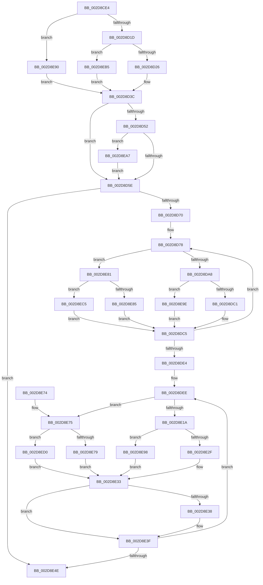

# PpmHeteroRestrictToFavoredClass

- RVA: `0x002D8CE4`–`0x002D8EDB` (길이 `503` bytes)
- VA: `0x00000001402D8CE4`
- 실행 섹션: `.text`
- PDB 이름 있음: `예`; PDB Function 태그: `아니요`
- unwind 정보 RVA: `0x000702AC`
- 디코드: `128`개 명령, `503/503` bytes 표시
- 미해석 바이트: `0` (있으면 어셈블리에 `.byte`로 보존)

> 이 문서는 커널 이미지의 기계어와 PDB 기호를 분석해 생성했습니다. 4번과 5번은 함수 원형과 자료형을 바이너리 사용 방식에서 추정한 C 해석이며 원본 소스 복구 결과는 아닙니다.

## 1. Dependencies

- 직접 호출 지점: **2**; 고유 호출 대상: **1**
- 직접 호출자로 확인된 함수: **1**
- RIP 상대 이미지 참조: **6**

### Outgoing calls
- `0x002D8D93` → [KeGetPrcb](KeGetPrcb_function_002D85D0.md) (function, `0x002D85D0`)
- `0x002D8E09` → [KeGetPrcb](KeGetPrcb_function_002D85D0.md) (function, `0x002D85D0`)

### Direct callers
- [sub_006F3648](../6F/Unknown_function_006F3648.md) at `0x006F38C7`

### Static image references
- `0x002D8D02` → RVA `0x00FC6B40` (`ALMOSTRO`; read)
- `0x002D8D3C` → RVA `0x00FC5038` (`ALMOSTRO`; read)
- `0x002D8D4A` → RVA `0x00FC6A86` (`ALMOSTRO`; read)
- `0x002D8D78` → RVA `0x00F231B8` (`.data`; read)
- `0x002D8DA8` → RVA `0x00E0B804` (`.data`; read)
- `0x002D8DAF` → RVA `0x00FC6BC8` (`ALMOSTRO`; read)

## 2. Other-region calls and transfers

- 다른 실행 섹션으로 향하는 call: **0**
- 별도 외부 분기/꼬리 이동을 확인하지 못했습니다.

## 3. Assembly (complete function range)

```asm
002D8CE4  48 89 5C 24 20                  mov qword ptr [rsp + 0x20], rbx
002D8CE9  4C 89 44 24 18                  mov qword ptr [rsp + 0x18], r8
002D8CEE  66 89 54 24 10                  mov word ptr [rsp + 0x10], dx
002D8CF3  55                              push rbp
002D8CF4  56                              push rsi
002D8CF5  57                              push rdi
002D8CF6  41 54                           push r12
002D8CF8  41 55                           push r13
002D8CFA  41 56                           push r14
002D8CFC  41 57                           push r15
002D8CFE  48 83 EC 30                     sub rsp, 0x30
002D8D02  8B 05 38 DE CE 00               mov eax, dword ptr [rip + 0xcede38]
002D8D08  48 8B E9                        mov rbp, rcx
002D8D0B  33 C9                           xor ecx, ecx
002D8D0D  44 8B E1                        mov r12d, ecx
002D8D10  44 8D 41 01                     lea r8d, [rcx + 1]
002D8D14  83 F8 03                        cmp eax, 3
002D8D17  0F 84 73 01 00 00               je 0x1402d8e90
002D8D1D  83 F8 06                        cmp eax, 6
002D8D20  0F 84 8F 01 00 00               je 0x1402d8eb5
002D8D26  8B 84 24 98 00 00 00            mov eax, dword ptr [rsp + 0x98]
002D8D2D  39 84 24 A0 00 00 00            cmp dword ptr [rsp + 0xa0], eax
002D8D34  44 0F B6 D1                     movzx r10d, cl
002D8D38  45 0F 42 D0                     cmovb r10d, r8d
002D8D3C  39 0D F6 C2 CE 00               cmp dword ptr [rip + 0xcec2f6], ecx
002D8D42  41 0F B6 DA                     movzx ebx, r10b
002D8D46  41 0F 44 D8                     cmove ebx, r8d
002D8D4A  38 0D 36 DD CE 00               cmp byte ptr [rip + 0xcedd36], cl
002D8D50  74 0C                           je 0x1402d8d5e
002D8D52  45 0F B6 E1                     movzx r12d, r9b
002D8D56  84 DB                           test bl, bl
002D8D58  0F 84 49 01 00 00               je 0x1402d8ea7
002D8D5E  40 8A F9                        mov dil, cl
002D8D61  4C 8B F1                        mov r14, rcx
002D8D64  4C 8B ED                        mov r13, rbp
002D8D67  48 85 ED                        test rbp, rbp
002D8D6A  0F 84 DE 00 00 00               je 0x1402d8e4e
002D8D70  44 0F B7 FA                     movzx r15d, dx
002D8D74  41 C1 E7 06                     shl r15d, 6
002D8D78  48 8B 05 39 A4 C4 00            mov rax, qword ptr [rip + 0xc4a439]
002D8D7F  49 0F BC CD                     bsf rcx, r13
002D8D83  44 89 74 24 70                  mov dword ptr [rsp + 0x70], r14d
002D8D88  83 E1 3F                        and ecx, 0x3f
002D8D8B  41 03 CF                        add ecx, r15d
002D8D8E  8B 34 88                        mov esi, dword ptr [rax + rcx*4]
002D8D91  8B CE                           mov ecx, esi
002D8D93  E8 38 F8 FF FF                  call 0x1402d85d0
002D8D98  44 38 35 E7 DC CE 00            cmp byte ptr [rip + 0xcedce7], r14b
002D8D9F  4C 8B C0                        mov r8, rax
002D8DA2  0F 84 D9 00 00 00               je 0x1402d8e81
002D8DA8  0F AF 35 55 2A B3 00            imul esi, dword ptr [rip + 0xb32a55]
002D8DAF  48 8B 05 12 DE CE 00            mov rax, qword ptr [rip + 0xcede12]
002D8DB6  41 03 F4                        add esi, r12d
002D8DB9  84 DB                           test bl, bl
002D8DBB  0F 84 DD 00 00 00               je 0x1402d8e9e
002D8DC1  8A 54 B0 19                     mov dl, byte ptr [rax + rsi*4 + 0x19]
002D8DC5  40 3A FA                        cmp dil, dl
002D8DC8  40 0F B6 CF                     movzx ecx, dil
002D8DCC  0F B6 C2                        movzx eax, dl
002D8DCF  0F 46 C8                        cmovbe ecx, eax
002D8DD2  49 8B 80 C8 00 00 00            mov rax, qword ptr [r8 + 0xc8]
002D8DD9  48 F7 D0                        not rax
002D8DDC  40 8A F9                        mov dil, cl
002D8DDF  4C 23 E8                        and r13, rax
002D8DE2  75 94                           jne 0x1402d8d78
002D8DE4  44 0F B7 7C 24 78               movzx r15d, word ptr [rsp + 0x78]
002D8DEA  41 C1 E7 06                     shl r15d, 6
002D8DEE  48 8B 05 C3 A3 C4 00            mov rax, qword ptr [rip + 0xc4a3c3]
002D8DF5  83 64 24 70 00                  and dword ptr [rsp + 0x70], 0
002D8DFA  48 0F BC CD                     bsf rcx, rbp
002D8DFE  83 E1 3F                        and ecx, 0x3f
002D8E01  41 03 CF                        add ecx, r15d
002D8E04  8B 34 88                        mov esi, dword ptr [rax + rcx*4]
002D8E07  8B CE                           mov ecx, esi
002D8E09  E8 C2 F7 FF FF                  call 0x1402d85d0
002D8E0E  80 3D 71 DC CE 00 00            cmp byte ptr [rip + 0xcedc71], 0
002D8E15  48 8B C8                        mov rcx, rax
002D8E18  74 5B                           je 0x1402d8e75
002D8E1A  0F AF 35 E3 29 B3 00            imul esi, dword ptr [rip + 0xb329e3]
002D8E21  48 8B 15 A0 DD CE 00            mov rdx, qword ptr [rip + 0xcedda0]
002D8E28  41 03 F4                        add esi, r12d
002D8E2B  84 DB                           test bl, bl
002D8E2D  74 69                           je 0x1402d8e98
002D8E2F  8A 44 B2 19                     mov al, byte ptr [rdx + rsi*4 + 0x19]
002D8E33  40 3A C7                        cmp al, dil
002D8E36  75 07                           jne 0x1402d8e3f
002D8E38  4C 0B B1 C8 00 00 00            or r14, qword ptr [rcx + 0xc8]
002D8E3F  48 8B 89 C8 00 00 00            mov rcx, qword ptr [rcx + 0xc8]
002D8E46  48 F7 D1                        not rcx
002D8E49  48 23 E9                        and rbp, rcx
002D8E4C  75 A0                           jne 0x1402d8dee
002D8E4E  48 8B 84 24 80 00 00 00         mov rax, qword ptr [rsp + 0x80]
002D8E56  48 8B 9C 24 88 00 00 00         mov rbx, qword ptr [rsp + 0x88]
002D8E5E  40 88 38                        mov byte ptr [rax], dil
002D8E61  49 8B C6                        mov rax, r14
002D8E64  48 83 C4 30                     add rsp, 0x30
002D8E68  41 5F                           pop r15
002D8E6A  41 5E                           pop r14
002D8E6C  41 5D                           pop r13
002D8E6E  41 5C                           pop r12
002D8E70  5F                              pop rdi
002D8E71  5E                              pop rsi
002D8E72  5D                              pop rbp
002D8E73  C3                              ret
002D8E74  CC                              int3
002D8E75  84 DB                           test bl, bl
002D8E77  74 57                           je 0x1402d8ed0
002D8E79  8A 80 09 8A 00 00               mov al, byte ptr [rax + 0x8a09]
002D8E7F  EB B2                           jmp 0x1402d8e33
002D8E81  84 DB                           test bl, bl
002D8E83  74 40                           je 0x1402d8ec5
002D8E85  8A 90 09 8A 00 00               mov dl, byte ptr [rax + 0x8a09]
002D8E8B  E9 35 FF FF FF                  jmp 0x1402d8dc5
002D8E90  45 8A D0                        mov r10b, r8b
002D8E93  E9 A4 FE FF FF                  jmp 0x1402d8d3c
002D8E98  8A 44 B2 18                     mov al, byte ptr [rdx + rsi*4 + 0x18]
002D8E9C  EB 95                           jmp 0x1402d8e33
002D8E9E  8A 54 B0 18                     mov dl, byte ptr [rax + rsi*4 + 0x18]
002D8EA2  E9 1E FF FF FF                  jmp 0x1402d8dc5
002D8EA7  44 0F B6 A4 24 90 00 00 00      movzx r12d, byte ptr [rsp + 0x90]
002D8EB0  E9 A9 FE FF FF                  jmp 0x1402d8d5e
002D8EB5  39 8C 24 A8 00 00 00            cmp dword ptr [rsp + 0xa8], ecx
002D8EBC  41 0F 97 C2                     seta r10b
002D8EC0  E9 77 FE FF FF                  jmp 0x1402d8d3c
002D8EC5  8A 90 0A 8A 00 00               mov dl, byte ptr [rax + 0x8a0a]
002D8ECB  E9 F5 FE FF FF                  jmp 0x1402d8dc5
002D8ED0  8A 80 0A 8A 00 00               mov al, byte ptr [rax + 0x8a0a]
002D8ED6  E9 58 FF FF FF                  jmp 0x1402d8e33
```

## 4. C-style interpretation (structured pseudocode)

```c
__int64 __fastcall PpmHeteroRestrictToFavoredClass(__int64 a1, unsigned __int16 a2, __int64 a3, unsigned __int8 a4, unsigned __int8 a5, unsigned int a6, unsigned int a7, unsigned int a8)
{
    __int64 result;
    __int64 v_r10;
    __int64 v_r13;
    __int64 v_r14;
    __int64 v_r15;
    __int64 v_rbp;
    __int64 v_rbx;
    __int64 v_rsi;
    __int64 v_rsp;
    unsigned __int16 v_stack_p10;
    unsigned __int64 v_stack_p18;
    unsigned __int64 v_stack_p20;
    unsigned int v_stack_p8;

    v_stack_p20 = v_rbx;
    v_stack_p18 = a3;
    v_stack_p10 = a2;
    v_rsp = (v_rsp) - (48);
    a1 = 0;
    if (((unsigned int)((unsigned int)(*(unsigned int *)(v_rip + 13557304)))) == 3) goto loc_002D8E90;
    if (((unsigned int)((unsigned int)(*(unsigned int *)(v_rip + 13557304)))) == 6) goto loc_002D8EB5;
    v_r10 = 0;
    if (a7 < ((unsigned int)((unsigned int)(a6)))) { v_r10 = (unsigned int)(a1 + 1); }
loc_002D8D3C:
    v_rbx = (unsigned __int8)(v_r10);
    if ((*(unsigned int *)(v_rip + 13550326)) == 0) { v_rbx = (unsigned int)(a1 + 1); }
    if ((*(unsigned __int8 *)(v_rip + 13557046)) == 0) goto loc_002D8D5E;
    if ((unsigned __int8)(v_rbx) == 0) goto loc_002D8EA7;
loc_002D8D5E:
    if (0 == 0) goto loc_002D8E4E;
    v_r15 = (unsigned int)((a2) << (6));
loc_002D8D78:
    v_stack_p8 = 0;
    a1 = (unsigned int)((a1) & (63));
    a1 = (unsigned int)((a1) + ((unsigned int)(v_r15)));
    result = KeGetPrcb((unsigned int)((unsigned int)((unsigned int)(*(unsigned int *)(*(unsigned __int64 *)(v_rip + 12887097) + a1 * 4)))), a2, a1 + 1, a4);
    if ((*(unsigned __int8 *)(v_rip + 13556967)) == 0) goto loc_002D8E81;
    v_rsi = (unsigned int)(((unsigned int)(*(unsigned int *)(*(unsigned __int64 *)(v_rip + 12887097) + a1 * 4))) * (*(unsigned int *)(v_rip + 11741781)));
    v_rsi = (unsigned int)((v_rsi) + (a4));
    if ((unsigned __int8)(v_rbx) == 0) goto loc_002D8E9E;
loc_002D8DC5:
    a1 = 0;
    if (0 <= ((unsigned __int8)(*(unsigned __int8 *)(*(unsigned __int64 *)(v_rip + 13557266) + v_rsi * 4 + 25)))) { a1 = (unsigned int)((unsigned __int8)(*(unsigned __int8 *)(*(unsigned __int64 *)(v_rip + 13557266) + v_rsi * 4 + 25))); }
    result = ~(*(unsigned __int64 *)(result + 200));
    v_r13 = (0) & (result);
    if (condition_is_not_equal) goto loc_002D8D78;
    v_r15 = (unsigned int)((v_stack_p10) << (6));
loc_002D8DEE:
    a1 = (unsigned int)((a1) & (63));
    a1 = (unsigned int)((a1) + ((unsigned int)(v_r15)));
    result = KeGetPrcb((unsigned int)((unsigned int)((unsigned int)(*(unsigned int *)(*(unsigned __int64 *)(v_rip + 12886979) + a1 * 4)))), *(unsigned __int8 *)(*(unsigned __int64 *)(v_rip + 13557266) + v_rsi * 4 + 25), result, a4);
    if ((*(unsigned __int8 *)(v_rip + 13556849)) == 0) goto loc_002D8E75;
    v_rsi = (unsigned int)(((unsigned int)(*(unsigned int *)(*(unsigned __int64 *)(v_rip + 12886979) + a1 * 4))) * (*(unsigned int *)(v_rip + 11741667)));
    v_rsi = (unsigned int)((v_rsi) + (a4));
    if ((unsigned __int8)(v_rbx) == 0) goto loc_002D8E98;
loc_002D8E33:
    v_r14 = 0;
    if (((unsigned __int8)(*(unsigned __int8 *)(*(unsigned __int64 *)(v_rip + 13557152) + v_rsi * 4 + 25))) == ((unsigned __int8)((unsigned __int8)(a1)))) {
        v_r14 = (0) | (*(unsigned __int64 *)(result + 200));
    }
    a1 = ~(*(unsigned __int64 *)(result + 200));
    v_rbp = (a1) & (a1);
    if (condition_is_not_equal) goto loc_002D8DEE;
loc_002D8E4E:
    *(unsigned __int8 *)(v_stack_p18) = (unsigned __int8)((unsigned __int8)(a1));
    v_rsp = (v_rsp) + (48);
    return v_r14;
loc_002D8E75:
    if ((unsigned __int8)(v_stack_p20) == 0) goto loc_002D8ED0;
    goto loc_002D8E33;
loc_002D8E81:
    if ((unsigned __int8)(v_stack_p20) == 0) goto loc_002D8EC5;
    goto loc_002D8DC5;
loc_002D8E90:
    goto loc_002D8D3C;
loc_002D8E98:
    goto loc_002D8E33;
loc_002D8E9E:
    goto loc_002D8DC5;
loc_002D8EA7:
    goto loc_002D8D5E;
loc_002D8EB5:
    v_r10 = (a8 > ((unsigned int)(a1))) ? 1 : 0;
    goto loc_002D8D3C;
loc_002D8EC5:
    goto loc_002D8DC5;
loc_002D8ED0:
    goto loc_002D8E33;
}
```

## 5. (Beta) C Style

```c
int64_t PpmHeteroRestrictToFavoredClass(int64_t Arg1, uint16_t Arg2, int64_t Arg3, uint8_t Arg4, uint8_t Arg5, uint32_t Arg6, uint32_t Arg7, uint32_t Arg8)
{
    int64_t result;
    int64_t local_r10;
    int64_t local_r13;
    int64_t local_r14;
    int64_t local_r15;
    int64_t local_rbp;
    int64_t local_rbx;
    int64_t local_rsi;
    int64_t local_rsp;
    uint16_t v_stack_p10;
    uint64_t v_stack_p18;
    uint64_t v_stack_p20;
    uint32_t v_stack_p8;

    v_stack_p20 = local_rbx;
    v_stack_p18 = Arg3;
    v_stack_p10 = Arg2;
    local_rsp = (local_rsp) - (48);
    Arg1 = 0;
    if (((uint32_t)((uint32_t)(*(uint32_t *)(v_rip + 0xCEDE38)))) == 3) goto loc_002D8E90;
    if (((uint32_t)((uint32_t)(*(uint32_t *)(v_rip + 0xCEDE38)))) == 6) goto loc_002D8EB5;
    local_r10 = 0;
    if (Arg7 < ((uint32_t)((uint32_t)(Arg6)))) { local_r10 = (uint32_t)(Arg1 + 1); }
loc_002D8D3C:
    local_rbx = (uint8_t)(local_r10);
    if ((*(uint32_t *)(v_rip + 0xCEC2F6)) == 0) { local_rbx = (uint32_t)(Arg1 + 1); }
    if ((*(uint8_t *)(v_rip + 0xCEDD36)) == 0) goto loc_002D8D5E;
    if ((uint8_t)(local_rbx) == 0) goto loc_002D8EA7;
loc_002D8D5E:
    if (0 == 0) goto loc_002D8E4E;
    local_r15 = (uint32_t)((Arg2) << (6));
loc_002D8D78:
    v_stack_p8 = 0;
    Arg1 = (uint32_t)((Arg1) & (63));
    Arg1 = (uint32_t)((Arg1) + ((uint32_t)(local_r15)));
    result = KeGetPrcb((uint32_t)((uint32_t)((uint32_t)(*(uint32_t *)(*(uint64_t *)(v_rip + 0xC4A439) + Arg1 * 4)))), Arg2, Arg1 + 1, Arg4);
    if ((*(uint8_t *)(v_rip + 0xCEDCE7)) == 0) goto loc_002D8E81;
    local_rsi = (uint32_t)(((uint32_t)(*(uint32_t *)(*(uint64_t *)(v_rip + 0xC4A439) + Arg1 * 4))) * (*(uint32_t *)(v_rip + 0xB32A55)));
    local_rsi = (uint32_t)((local_rsi) + (Arg4));
    if ((uint8_t)(local_rbx) == 0) goto loc_002D8E9E;
loc_002D8DC5:
    Arg1 = 0;
    if (0 <= ((uint8_t)(*(uint8_t *)(*(uint64_t *)(v_rip + 0xCEDE12) + local_rsi * 4 + 0x19)))) { Arg1 = (uint32_t)((uint8_t)(*(uint8_t *)(*(uint64_t *)(v_rip + 0xCEDE12) + local_rsi * 4 + 0x19))); }
    result = ~(*(uint64_t *)(result + 0xC8));
    local_r13 = (0) & (result);
    if (condition_is_not_equal) goto loc_002D8D78;
    local_r15 = (uint32_t)((v_stack_p10) << (6));
loc_002D8DEE:
    Arg1 = (uint32_t)((Arg1) & (63));
    Arg1 = (uint32_t)((Arg1) + ((uint32_t)(local_r15)));
    result = KeGetPrcb((uint32_t)((uint32_t)((uint32_t)(*(uint32_t *)(*(uint64_t *)(v_rip + 0xC4A3C3) + Arg1 * 4)))), *(uint8_t *)(*(uint64_t *)(v_rip + 0xCEDE12) + local_rsi * 4 + 0x19), result, Arg4);
    if ((*(uint8_t *)(v_rip + 0xCEDC71)) == 0) goto loc_002D8E75;
    local_rsi = (uint32_t)(((uint32_t)(*(uint32_t *)(*(uint64_t *)(v_rip + 0xC4A3C3) + Arg1 * 4))) * (*(uint32_t *)(v_rip + 0xB329E3)));
    local_rsi = (uint32_t)((local_rsi) + (Arg4));
    if ((uint8_t)(local_rbx) == 0) goto loc_002D8E98;
loc_002D8E33:
    local_r14 = 0;
    if (((uint8_t)(*(uint8_t *)(*(uint64_t *)(v_rip + 0xCEDDA0) + local_rsi * 4 + 0x19))) == ((uint8_t)((uint8_t)(Arg1)))) {
        local_r14 = (0) | (*(uint64_t *)(result + 0xC8));
    }
    Arg1 = ~(*(uint64_t *)(result + 0xC8));
    local_rbp = (Arg1) & (Arg1);
    if (condition_is_not_equal) goto loc_002D8DEE;
loc_002D8E4E:
    *(uint8_t *)(v_stack_p18) = (uint8_t)((uint8_t)(Arg1));
    local_rsp = (local_rsp) + (48);
    return local_r14;
loc_002D8E75:
    if ((uint8_t)(v_stack_p20) == 0) goto loc_002D8ED0;
    goto loc_002D8E33;
loc_002D8E81:
    if ((uint8_t)(v_stack_p20) == 0) goto loc_002D8EC5;
    goto loc_002D8DC5;
loc_002D8E90:
    goto loc_002D8D3C;
loc_002D8E98:
    goto loc_002D8E33;
loc_002D8E9E:
    goto loc_002D8DC5;
loc_002D8EA7:
    goto loc_002D8D5E;
loc_002D8EB5:
    local_r10 = (Arg8 > ((uint32_t)(Arg1))) ? 1 : 0;
    goto loc_002D8D3C;
loc_002D8EC5:
    goto loc_002D8DC5;
loc_002D8ED0:
    goto loc_002D8E33;
}
```

## 6. Execution-region graph

[열기: 2D/3D 그래프와 함수 탐색 컨트롤 패널](../../../control-panel.html?section=text&rva=0x002D8CE4&view=graph)

- 2D 그래프는 위에서 아래로 흐르고, 3D 그래프는 빈 공간을 드래그해 회전합니다. Shift+드래그는 이동, 휠은 확대·축소, 함수 노드 선택은 대상 보고서 이동입니다.

### Static fallback


