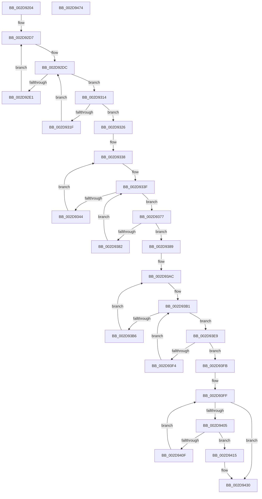

# PpmIdleUpdateSystemLatencyLimit

- RVA: `0x002D9204`–`0x002D9475` (길이 `625` bytes)
- VA: `0x00000001402D9204`
- 실행 섹션: `.text`
- PDB 이름 있음: `예`; PDB Function 태그: `아니요`
- unwind 정보 RVA: `0x00070304`
- 디코드: `156`개 명령, `625/625` bytes 표시
- 미해석 바이트: `0` (있으면 어셈블리에 `.byte`로 보존)

> 이 문서는 커널 이미지의 기계어와 PDB 기호를 분석해 생성했습니다. 4번과 5번은 함수 원형과 자료형을 바이너리 사용 방식에서 추정한 C 해석이며 원본 소스 복구 결과는 아닙니다.

## 1. Dependencies

- 직접 호출 지점: **19**; 고유 호출 대상: **11**
- 직접 호출자로 확인된 함수: **1**
- RIP 상대 이미지 참조: **10**

### Outgoing calls
- `0x002D9248` → [memset](../6C/memset_function_006C6C40.md) (function, `0x006C6C40`)
- `0x002D9256` → [memset](../6C/memset_function_006C6C40.md) (function, `0x006C6C40`)
- `0x002D9275` → [memset](../6C/memset_function_006C6C40.md) (function, `0x006C6C40`)
- `0x002D928D` → [memset](../6C/memset_function_006C6C40.md) (function, `0x006C6C40`)
- `0x002D9299` → [PpmAcquireLock](PpmAcquireLock_function_002D9AA4.md) (function, `0x002D9AA4`)
- `0x002D92A5` → [PopAcquireRwLockShared](PopAcquireRwLockShared_function_002D9A40.md) (function, `0x002D9A40`)
- `0x002D92C9` → [KiSubtractAffinityEx](KiSubtractAffinityEx_function_002D61E8.md) (function, `0x002D61E8`)
- `0x002D9301` → [KeGetPrcb](KeGetPrcb_function_002D85D0.md) (function, `0x002D85D0`)
- `0x002D930D` → [PpmIdleUpdateProcessorLatencyLimit](PpmIdleUpdateProcessorLatencyLimit_function_002D9480.md) (function, `0x002D9480`)
- `0x002D9364` → [KeGetPrcb](KeGetPrcb_function_002D85D0.md) (function, `0x002D85D0`)
- `0x002D9370` → [PpmIdleUpdateProcessorLatencyLimit](PpmIdleUpdateProcessorLatencyLimit_function_002D9480.md) (function, `0x002D9480`)
- `0x002D939E` → [KiSubtractAffinityEx](KiSubtractAffinityEx_function_002D61E8.md) (function, `0x002D61E8`)
- `0x002D93D6` → [KeGetPrcb](KeGetPrcb_function_002D85D0.md) (function, `0x002D85D0`)
- `0x002D93E2` → [PpmIdleUpdateProcessorLatencyLimit](PpmIdleUpdateProcessorLatencyLimit_function_002D9480.md) (function, `0x002D9480`)
- `0x002D9420` → [PpmEventAffinityMask](../5D/PpmEventAffinityMask_function_005DA500.md) (function, `0x005DA500`)
- `0x002D942B` → [HalRequestIpi](HalRequestIpi_function_002D1720.md) (function, `0x002D1720`)
- `0x002D9437` → [PopReleaseRwLock](PopReleaseRwLock_function_002DFBBC.md) (function, `0x002DFBBC`)
- `0x002D9443` → [PpmReleaseLock](PpmReleaseLock_function_002DA428.md) (function, `0x002DA428`)
- `0x002D9452` → [_security_check_cookie](../6A/_security_check_cookie_function_006AC640.md) (function, `0x006AC640`)

### Direct callers
- [PoFxSendSystemLatencyUpdate](../46/PoFxSendSystemLatencyUpdate_function_0046A008.md) at `0x0046A0E6`

### Static image references
- `0x002D9226` → RVA `0x00E0A740` (`.data`; read)
- `0x002D9292` → RVA `0x00F0CC00` (`.data`; read)
- `0x002D929E` → RVA `0x00F0CA70` (`.data`; read)
- `0x002D92B5` → RVA `0x00E0C0F0` (`.data`; read)
- `0x002D92BC` → RVA `0x00E0B3AC` (`.data`; write)
- `0x002D92C2` → RVA `0x00FC7120` (`ALMOSTRO`; read)
- `0x002D92F7` → RVA `0x00F231B8` (`.data`; read)
- `0x002D9326` → RVA `0x00E0BFE8` (`.data`; read)
- `0x002D932D` → RVA `0x00E0BFE0` (`.data`; read)
- `0x002D9419` → RVA `0x00010B58` (`.rdata`; read)

## 2. Other-region calls and transfers

- 다른 실행 섹션으로 향하는 call: **0**
- 별도 외부 분기/꼬리 이동을 확인하지 못했습니다.

## 3. Assembly (complete function range)

```asm
002D9204  48 8B C4                        mov rax, rsp
002D9207  48 89 58 08                     mov qword ptr [rax + 8], rbx
002D920B  48 89 70 10                     mov qword ptr [rax + 0x10], rsi
002D920F  48 89 78 18                     mov qword ptr [rax + 0x18], rdi
002D9213  55                              push rbp
002D9214  41 56                           push r14
002D9216  41 57                           push r15
002D9218  48 8D A8 88 FE FF FF            lea rbp, [rax - 0x178]
002D921F  48 81 EC 60 02 00 00            sub rsp, 0x260
002D9226  48 8B 05 13 15 B3 00            mov rax, qword ptr [rip + 0xb31513]
002D922D  48 33 C4                        xor rax, rsp
002D9230  48 89 85 50 01 00 00            mov qword ptr [rbp + 0x150], rax
002D9237  8B D9                           mov ebx, ecx
002D9239  BE 00 01 00 00                  mov esi, 0x100
002D923E  44 8B C6                        mov r8d, esi
002D9241  48 8D 4C 24 38                  lea rcx, [rsp + 0x38]
002D9246  33 D2                           xor edx, edx
002D9248  E8 F3 D9 3E 00                  call 0x1406c6c40
002D924D  44 8B C6                        mov r8d, esi
002D9250  48 8D 4D 48                     lea rcx, [rbp + 0x48]
002D9254  33 D2                           xor edx, edx
002D9256  E8 E5 D9 3E 00                  call 0x1406c6c40
002D925B  44 8B C6                        mov r8d, esi
002D925E  48 C7 45 40 01 00 20 00         mov qword ptr [rbp + 0x40], 0x200001
002D9266  33 D2                           xor edx, edx
002D9268  48 8D 4D 48                     lea rcx, [rbp + 0x48]
002D926C  41 BF 01 00 00 00               mov r15d, 1
002D9272  45 33 F6                        xor r14d, r14d
002D9275  E8 C6 D9 3E 00                  call 0x1406c6c40
002D927A  44 8B C6                        mov r8d, esi
002D927D  48 C7 44 24 30 01 00 20 00      mov qword ptr [rsp + 0x30], 0x200001
002D9286  33 D2                           xor edx, edx
002D9288  48 8D 4C 24 38                  lea rcx, [rsp + 0x38]
002D928D  E8 AE D9 3E 00                  call 0x1406c6c40
002D9292  48 8D 0D 67 39 C3 00            lea rcx, [rip + 0xc33967]
002D9299  E8 06 08 00 00                  call 0x1402d9aa4
002D929E  48 8D 0D CB 37 C3 00            lea rcx, [rip + 0xc337cb]
002D92A5  E8 96 07 00 00                  call 0x1402d9a40
002D92AA  44 0F B7 4C 24 32               movzx r9d, word ptr [rsp + 0x32]
002D92B0  4C 8D 44 24 30                  lea r8, [rsp + 0x30]
002D92B5  48 8D 15 34 2E B3 00            lea rdx, [rip + 0xb32e34]
002D92BC  89 1D EA 20 B3 00               mov dword ptr [rip + 0xb320ea], ebx
002D92C2  48 8D 0D 57 DE CE 00            lea rcx, [rip + 0xcede57]
002D92C9  E8 1A CF FF FF                  call 0x1402d61e8
002D92CE  48 8B 7C 24 38                  mov rdi, qword ptr [rsp + 0x38]
002D92D3  41 0F B7 DE                     movzx ebx, r14w
002D92D7  0F B7 4C 24 30                  movzx ecx, word ptr [rsp + 0x30]
002D92DC  48 85 FF                        test rdi, rdi
002D92DF  74 33                           je 0x1402d9314
002D92E1  48 0F BC D7                     bsf rdx, rdi
002D92E5  0F B7 CB                        movzx ecx, bx
002D92E8  0F B6 C2                        movzx eax, dl
002D92EB  48 0F B3 C7                     btr rdi, rax
002D92EF  C1 E1 06                        shl ecx, 6
002D92F2  0F B6 C2                        movzx eax, dl
002D92F5  03 C8                           add ecx, eax
002D92F7  48 8B 05 BA 9E C4 00            mov rax, qword ptr [rip + 0xc49eba]
002D92FE  8B 0C 88                        mov ecx, dword ptr [rax + rcx*4]
002D9301  E8 CA F2 FF FF                  call 0x1402d85d0
002D9306  48 8D 55 40                     lea rdx, [rbp + 0x40]
002D930A  48 8B C8                        mov rcx, rax
002D930D  E8 6E 01 00 00                  call 0x1402d9480
002D9312  EB C3                           jmp 0x1402d92d7
002D9314  66 41 03 DF                     add bx, r15w
002D9318  0F B7 DB                        movzx ebx, bx
002D931B  3B D9                           cmp ebx, ecx
002D931D  73 07                           jae 0x1402d9326
002D931F  48 8B 7C DC 38                  mov rdi, qword ptr [rsp + rbx*8 + 0x38]
002D9324  EB B6                           jmp 0x1402d92dc
002D9326  48 8B 3D BB 2C B3 00            mov rdi, qword ptr [rip + 0xb32cbb]
002D932D  48 8D 35 AC 2C B3 00            lea rsi, [rip + 0xb32cac]
002D9334  41 0F B7 DE                     movzx ebx, r14w
002D9338  0F B7 0D A1 2C B3 00            movzx ecx, word ptr [rip + 0xb32ca1]
002D933F  48 85 FF                        test rdi, rdi
002D9342  74 33                           je 0x1402d9377
002D9344  48 0F BC D7                     bsf rdx, rdi
002D9348  0F B7 CB                        movzx ecx, bx
002D934B  0F B6 C2                        movzx eax, dl
002D934E  48 0F B3 C7                     btr rdi, rax
002D9352  C1 E1 06                        shl ecx, 6
002D9355  0F B6 C2                        movzx eax, dl
002D9358  03 C8                           add ecx, eax
002D935A  48 8B 05 57 9E C4 00            mov rax, qword ptr [rip + 0xc49e57]
002D9361  8B 0C 88                        mov ecx, dword ptr [rax + rcx*4]
002D9364  E8 67 F2 FF FF                  call 0x1402d85d0
002D9369  48 8D 55 40                     lea rdx, [rbp + 0x40]
002D936D  48 8B C8                        mov rcx, rax
002D9370  E8 0B 01 00 00                  call 0x1402d9480
002D9375  EB C1                           jmp 0x1402d9338
002D9377  66 41 03 DF                     add bx, r15w
002D937B  0F B7 DB                        movzx ebx, bx
002D937E  3B D9                           cmp ebx, ecx
002D9380  73 07                           jae 0x1402d9389
002D9382  48 8B 7C DE 08                  mov rdi, qword ptr [rsi + rbx*8 + 8]
002D9387  EB B6                           jmp 0x1402d933f
002D9389  44 0F B7 4C 24 32               movzx r9d, word ptr [rsp + 0x32]
002D938F  4C 8D 44 24 30                  lea r8, [rsp + 0x30]
002D9394  48 8B D6                        mov rdx, rsi
002D9397  48 8D 0D 52 2D B3 00            lea rcx, [rip + 0xb32d52]
002D939E  E8 45 CE FF FF                  call 0x1402d61e8
002D93A3  48 8B 7C 24 38                  mov rdi, qword ptr [rsp + 0x38]
002D93A8  41 0F B7 DE                     movzx ebx, r14w
002D93AC  0F B7 4C 24 30                  movzx ecx, word ptr [rsp + 0x30]
002D93B1  48 85 FF                        test rdi, rdi
002D93B4  74 33                           je 0x1402d93e9
002D93B6  48 0F BC D7                     bsf rdx, rdi
002D93BA  0F B7 CB                        movzx ecx, bx
002D93BD  0F B6 C2                        movzx eax, dl
002D93C0  48 0F B3 C7                     btr rdi, rax
002D93C4  C1 E1 06                        shl ecx, 6
002D93C7  0F B6 C2                        movzx eax, dl
002D93CA  03 C8                           add ecx, eax
002D93CC  48 8B 05 E5 9D C4 00            mov rax, qword ptr [rip + 0xc49de5]
002D93D3  8B 0C 88                        mov ecx, dword ptr [rax + rcx*4]
002D93D6  E8 F5 F1 FF FF                  call 0x1402d85d0
002D93DB  48 8D 55 40                     lea rdx, [rbp + 0x40]
002D93DF  48 8B C8                        mov rcx, rax
002D93E2  E8 99 00 00 00                  call 0x1402d9480
002D93E7  EB C3                           jmp 0x1402d93ac
002D93E9  66 41 03 DF                     add bx, r15w
002D93ED  0F B7 DB                        movzx ebx, bx
002D93F0  3B D9                           cmp ebx, ecx
002D93F2  73 07                           jae 0x1402d93fb
002D93F4  48 8B 7C DC 38                  mov rdi, qword ptr [rsp + rbx*8 + 0x38]
002D93F9  EB B6                           jmp 0x1402d93b1
002D93FB  41 0F B7 CE                     movzx ecx, r14w
002D93FF  66 3B 4D 40                     cmp cx, word ptr [rbp + 0x40]
002D9403  73 2B                           jae 0x1402d9430
002D9405  0F B7 C1                        movzx eax, cx
002D9408  4C 39 74 C5 48                  cmp qword ptr [rbp + rax*8 + 0x48], r14
002D940D  75 06                           jne 0x1402d9415
002D940F  66 41 03 CF                     add cx, r15w
002D9413  EB EA                           jmp 0x1402d93ff
002D9415  48 8D 55 40                     lea rdx, [rbp + 0x40]
002D9419  48 8D 0D 38 77 D3 FF            lea rcx, [rip - 0x2c88c8]
002D9420  E8 DB 10 30 00                  call 0x1405da500
002D9425  48 8D 55 40                     lea rdx, [rbp + 0x40]
002D9429  33 C9                           xor ecx, ecx
002D942B  E8 F0 82 FF FF                  call 0x1402d1720
002D9430  48 8D 0D 39 36 C3 00            lea rcx, [rip + 0xc33639]
002D9437  E8 80 67 00 00                  call 0x1402dfbbc
002D943C  48 8D 0D BD 37 C3 00            lea rcx, [rip + 0xc337bd]
002D9443  E8 E0 0F 00 00                  call 0x1402da428
002D9448  48 8B 8D 50 01 00 00            mov rcx, qword ptr [rbp + 0x150]
002D944F  48 33 CC                        xor rcx, rsp
002D9452  E8 E9 31 3D 00                  call 0x1406ac640
002D9457  4C 8D 9C 24 60 02 00 00         lea r11, [rsp + 0x260]
002D945F  49 8B 5B 20                     mov rbx, qword ptr [r11 + 0x20]
002D9463  49 8B 73 28                     mov rsi, qword ptr [r11 + 0x28]
002D9467  49 8B 7B 30                     mov rdi, qword ptr [r11 + 0x30]
002D946B  49 8B E3                        mov rsp, r11
002D946E  41 5F                           pop r15
002D9470  41 5E                           pop r14
002D9472  5D                              pop rbp
002D9473  C3                              ret
002D9474  CC                              int3
```

## 4. C-style interpretation (structured pseudocode)

```c
__int64 __fastcall PpmIdleUpdateSystemLatencyLimit(int a1, int a2)
{
    __int64 result;
    __int64 v_r14;
    __int64 v_rbx;
    __int64 v_rsp;
    unsigned __int64 v_stack_m18;
    unsigned __int64 v_stack_m240;
    unsigned __int16 v_stack_m246;
    unsigned __int64 v_stack_m248;

    *(unsigned __int64 *)(v_rsp + 8) = v_rbx;
    *(unsigned __int64 *)(v_rsp + 16) = v_rsi;
    *(unsigned __int64 *)(v_rsp + 24) = v_rdi;
    v_rsp = (v_rsp) - (608);
    result = (*(unsigned __int64 *)(v_rip + 11736339)) ^ (v_rsp);
    *(unsigned __int64 *)(v_rsp - 376 + 336) = result;
    a2 = 0;
    result = memset(v_stack_m240, a2, 256, a4);
    a2 = 0;
    result = memset(v_rsp - 376 + 72, a2, 256, a4);
    *(unsigned __int64 *)(v_rsp - 376 + 64) = 0x200001ULL;
    a2 = 0;
    v_r14 = 0;
    result = memset(v_rsp - 376 + 72, a2, 256, a4);
    v_stack_m248 = 0x200001ULL;
    a2 = 0;
    result = memset(v_stack_m240, a2, 256, a4);
    result = PpmAcquireLock(v_rip + 12794215, a2, 256, a4);
    result = PopAcquireRwLockShared(v_rip + 12793803, a2, 256, a4);
    *(unsigned int *)(v_rip + 11739370) = (unsigned int)((unsigned int)(a1));
    result = KiSubtractAffinityEx(v_rip + 13557335, v_rip + 11742772, v_stack_m248, v_stack_m246);
loc_002D92D7:
loc_002D92DC:
    if (v_stack_m240 == 0) goto loc_002D9314;
    a1 = (unsigned int)((0) << (6));
    a1 = (unsigned int)((a1) + ((unsigned int)((unsigned __int8)(v_rip + 11742772))));
    result = KeGetPrcb((unsigned int)(*(unsigned int *)(*(unsigned __int64 *)(v_rip + 12885690) + a1 * 4)), v_rip + 11742772, v_stack_m248, v_stack_m246);
    result = PpmIdleUpdateProcessorLatencyLimit(result, v_rsp - 376 + 64, v_stack_m248, v_stack_m246);
    goto loc_002D92D7;
loc_002D9314:
    v_rbx = (unsigned __int16)((0) + (1));
    if (((unsigned int)((unsigned __int16)(v_rbx))) >= ((unsigned int)(result))) goto loc_002D9326;
    goto loc_002D92DC;
loc_002D9326:
loc_002D9338:
loc_002D933F:
    if (*(unsigned __int64 *)(v_rip + 11742395) == 0) goto loc_002D9377;
    a1 = (unsigned int)((0) << (6));
    a1 = (unsigned int)((a1) + ((unsigned int)((unsigned __int8)(v_rsp - 376 + 64))));
    result = KeGetPrcb((unsigned int)(*(unsigned int *)(*(unsigned __int64 *)(v_rip + 12885591) + a1 * 4)), v_rsp - 376 + 64, v_stack_m248, v_stack_m246);
    result = PpmIdleUpdateProcessorLatencyLimit(result, v_rsp - 376 + 64, v_stack_m248, v_stack_m246);
    goto loc_002D9338;
loc_002D9377:
    v_rbx = (unsigned __int16)((0) + (1));
    if (((unsigned int)((unsigned __int16)(v_rbx))) >= ((unsigned int)(result))) goto loc_002D9389;
    goto loc_002D933F;
loc_002D9389:
    result = KiSubtractAffinityEx(v_rip + 11742546, v_rip + 11742380, v_stack_m248, v_stack_m246);
loc_002D93AC:
loc_002D93B1:
    if (v_stack_m240 == 0) goto loc_002D93E9;
    a1 = (unsigned int)((0) << (6));
    a1 = (unsigned int)((a1) + ((unsigned int)((unsigned __int8)(v_rip + 11742380))));
    result = KeGetPrcb((unsigned int)(*(unsigned int *)(*(unsigned __int64 *)(v_rip + 12885477) + a1 * 4)), v_rip + 11742380, v_stack_m248, v_stack_m246);
    result = PpmIdleUpdateProcessorLatencyLimit(result, v_rsp - 376 + 64, v_stack_m248, v_stack_m246);
    goto loc_002D93AC;
loc_002D93E9:
    v_rbx = (unsigned __int16)((0) + (1));
    if (((unsigned int)((unsigned __int16)(v_rbx))) >= ((unsigned int)(result))) goto loc_002D93FB;
    goto loc_002D93B1;
loc_002D93FB:
loc_002D93FF:
    if (0 >= (*(unsigned __int16 *)(v_rsp - 376 + 64))) goto loc_002D9430;
    if ((*(unsigned __int64 *)(v_rsp - 376 + 0 * 8 + 72)) != 0) goto loc_002D9415;
    a1 = (unsigned __int16)((0) + (1));
    goto loc_002D93FF;
loc_002D9415:
    result = PpmEventAffinityMask(v_rip - 2918600, v_rsp - 376 + 64, v_stack_m248, v_stack_m246);
    a1 = 0;
    result = HalRequestIpi(a1, v_rsp - 376 + 64, v_stack_m248, v_stack_m246);
loc_002D9430:
    result = PopReleaseRwLock(v_rip + 12793401, v_rsp - 376 + 64, v_stack_m248, v_stack_m246);
    result = PpmReleaseLock(v_rip + 12793789, v_rsp - 376 + 64, v_stack_m248, v_stack_m246);
    a1 = (*(unsigned __int64 *)(v_rsp - 376 + 336)) ^ (v_rsp);
    result = _security_check_cookie(a1, v_rsp - 376 + 64, v_stack_m248, v_stack_m246);
    return result;
}
```

## 5. (Beta) C Style

```c
int64_t PpmIdleUpdateSystemLatencyLimit(int32_t Arg1, int32_t Arg2)
{
    int64_t result;
    int64_t local_r14;
    int64_t local_rbx;
    int64_t local_rsp;
    uint64_t v_stack_m18;
    uint64_t v_stack_m240;
    uint16_t v_stack_m246;
    uint64_t v_stack_m248;

    *(uint64_t *)(local_rsp + 0x8) = local_rbx;
    *(uint64_t *)(local_rsp + 0x10) = local_rsi;
    *(uint64_t *)(local_rsp + 0x18) = local_rdi;
    local_rsp = (local_rsp) - (608);
    result = (*(uint64_t *)(v_rip + 0xB31513)) ^ (local_rsp);
    *(uint64_t *)(local_rsp - 0x178 + 0x150) = result;
    Arg2 = 0;
    result = memset(v_stack_m240, Arg2, 256, a4);
    Arg2 = 0;
    result = memset(local_rsp - 376 + 72, Arg2, 256, a4);
    *(uint64_t *)(local_rsp - 0x178 + 0x40) = 0x200001ULL;
    Arg2 = 0;
    local_r14 = 0;
    result = memset(local_rsp - 376 + 72, Arg2, 256, a4);
    v_stack_m248 = 0x200001ULL;
    Arg2 = 0;
    result = memset(v_stack_m240, Arg2, 256, a4);
    result = PpmAcquireLock(v_rip + 12794215, Arg2, 256, a4);
    result = PopAcquireRwLockShared(v_rip + 12793803, Arg2, 256, a4);
    *(uint32_t *)(v_rip + 0xB320EA) = (uint32_t)((uint32_t)(Arg1));
    result = KiSubtractAffinityEx(v_rip + 13557335, v_rip + 11742772, v_stack_m248, v_stack_m246);
loc_002D92D7:
loc_002D92DC:
    if (v_stack_m240 == 0) goto loc_002D9314;
    Arg1 = (uint32_t)((0) << (6));
    Arg1 = (uint32_t)((Arg1) + ((uint32_t)((uint8_t)(v_rip + 11742772))));
    result = KeGetPrcb((uint32_t)(*(uint32_t *)(*(uint64_t *)(v_rip + 0xC49EBA) + Arg1 * 4)), v_rip + 11742772, v_stack_m248, v_stack_m246);
    result = PpmIdleUpdateProcessorLatencyLimit(result, local_rsp - 376 + 64, v_stack_m248, v_stack_m246);
    goto loc_002D92D7;
loc_002D9314:
    local_rbx = (uint16_t)((0) + (1));
    if (((uint32_t)((uint16_t)(local_rbx))) >= ((uint32_t)(result))) goto loc_002D9326;
    goto loc_002D92DC;
loc_002D9326:
loc_002D9338:
loc_002D933F:
    if (*(uint64_t *)(v_rip + 0xB32CBB) == 0) goto loc_002D9377;
    Arg1 = (uint32_t)((0) << (6));
    Arg1 = (uint32_t)((Arg1) + ((uint32_t)((uint8_t)(local_rsp - 376 + 64))));
    result = KeGetPrcb((uint32_t)(*(uint32_t *)(*(uint64_t *)(v_rip + 0xC49E57) + Arg1 * 4)), local_rsp - 376 + 64, v_stack_m248, v_stack_m246);
    result = PpmIdleUpdateProcessorLatencyLimit(result, local_rsp - 376 + 64, v_stack_m248, v_stack_m246);
    goto loc_002D9338;
loc_002D9377:
    local_rbx = (uint16_t)((0) + (1));
    if (((uint32_t)((uint16_t)(local_rbx))) >= ((uint32_t)(result))) goto loc_002D9389;
    goto loc_002D933F;
loc_002D9389:
    result = KiSubtractAffinityEx(v_rip + 11742546, v_rip + 11742380, v_stack_m248, v_stack_m246);
loc_002D93AC:
loc_002D93B1:
    if (v_stack_m240 == 0) goto loc_002D93E9;
    Arg1 = (uint32_t)((0) << (6));
    Arg1 = (uint32_t)((Arg1) + ((uint32_t)((uint8_t)(v_rip + 11742380))));
    result = KeGetPrcb((uint32_t)(*(uint32_t *)(*(uint64_t *)(v_rip + 0xC49DE5) + Arg1 * 4)), v_rip + 11742380, v_stack_m248, v_stack_m246);
    result = PpmIdleUpdateProcessorLatencyLimit(result, local_rsp - 376 + 64, v_stack_m248, v_stack_m246);
    goto loc_002D93AC;
loc_002D93E9:
    local_rbx = (uint16_t)((0) + (1));
    if (((uint32_t)((uint16_t)(local_rbx))) >= ((uint32_t)(result))) goto loc_002D93FB;
    goto loc_002D93B1;
loc_002D93FB:
loc_002D93FF:
    if (0 >= (*(uint16_t *)(local_rsp - 0x178 + 0x40))) goto loc_002D9430;
    if ((*(uint64_t *)(local_rsp - 0x178 + 0x0 * 8 + 0x48)) != 0) goto loc_002D9415;
    Arg1 = (uint16_t)((0) + (1));
    goto loc_002D93FF;
loc_002D9415:
    result = PpmEventAffinityMask(v_rip - 2918600, local_rsp - 376 + 64, v_stack_m248, v_stack_m246);
    Arg1 = 0;
    result = HalRequestIpi(Arg1, local_rsp - 376 + 64, v_stack_m248, v_stack_m246);
loc_002D9430:
    result = PopReleaseRwLock(v_rip + 12793401, local_rsp - 376 + 64, v_stack_m248, v_stack_m246);
    result = PpmReleaseLock(v_rip + 12793789, local_rsp - 376 + 64, v_stack_m248, v_stack_m246);
    Arg1 = (*(uint64_t *)(local_rsp - 0x178 + 0x150)) ^ (local_rsp);
    result = _security_check_cookie(Arg1, local_rsp - 376 + 64, v_stack_m248, v_stack_m246);
    return result;
}
```

## 6. Execution-region graph

[열기: 2D/3D 그래프와 함수 탐색 컨트롤 패널](../../../control-panel.html?section=text&rva=0x002D9204&view=graph)

- 2D 그래프는 위에서 아래로 흐르고, 3D 그래프는 빈 공간을 드래그해 회전합니다. Shift+드래그는 이동, 휠은 확대·축소, 함수 노드 선택은 대상 보고서 이동입니다.

### Static fallback


