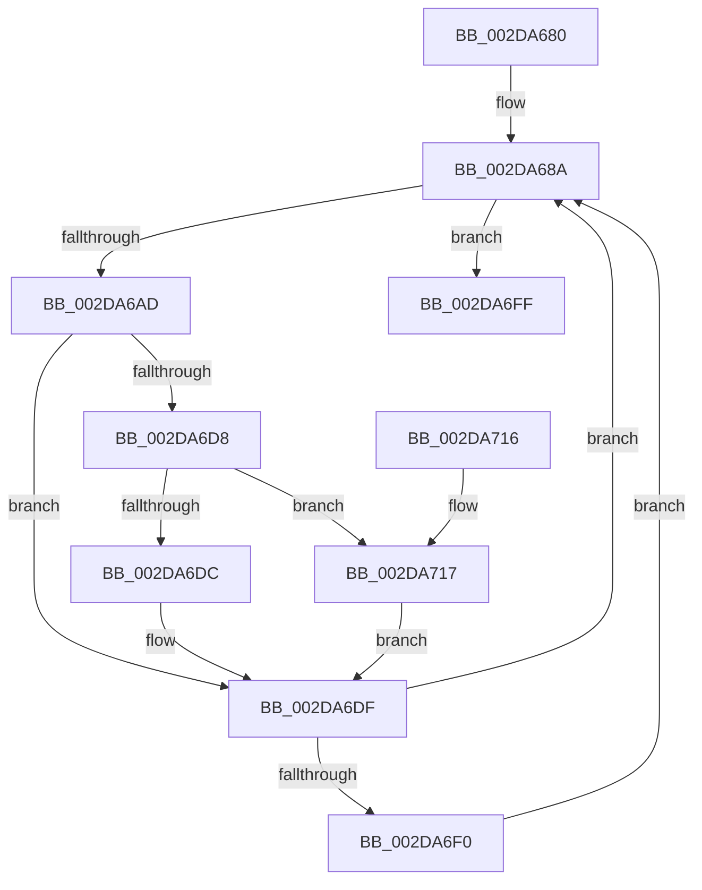

# PpmMediaBufferingWorker

- RVA: `0x002DA680`–`0x002DA728` (길이 `168` bytes)
- VA: `0x00000001402DA680`
- 실행 섹션: `.text`
- PDB 이름 있음: `예`; PDB Function 태그: `아니요`
- unwind 정보 RVA: `0x00070544`
- 디코드: `42`개 명령, `168/168` bytes 표시
- 미해석 바이트: `0` (있으면 어셈블리에 `.byte`로 보존)

> 이 문서는 커널 이미지의 기계어와 PDB 기호를 분석해 생성했습니다. 4번과 5번은 함수 원형과 자료형을 바이너리 사용 방식에서 추정한 C 해석이며 원본 소스 복구 결과는 아닙니다.

## 1. Dependencies

- 직접 호출 지점: **7**; 고유 호출 대상: **6**
- 직접 호출자로 확인된 함수: **0**
- RIP 상대 이미지 참조: **9**

### Outgoing calls
- `0x002DA691` → [KeAcquireSpinLockRaiseToDpc](../20/KeAcquireSpinLockRaiseToDpc_function_00208470.md) (function, `0x00208470`)
- `0x002DA6B3` → [KeReleaseSpinLock](../39/KeReleaseSpinLock_function_00392BA0.md) (function, `0x00392BA0`)
- `0x002DA6BA` → [PpmEventMediaBufferingNotify](PpmEventMediaBufferingNotify_function_002DA730.md) (function, `0x002DA730`)
- `0x002DA6C6` → [PpmAcquireLock](PpmAcquireLock_function_002D9AA4.md) (function, `0x002D9AA4`)
- `0x002DA6E6` → [PpmReleaseLock](PpmReleaseLock_function_002DA428.md) (function, `0x002DA428`)
- `0x002DA6F8` → [PpmPdcNotifyMediaBufferingUpdate](../../page/A6/PpmPdcNotifyMediaBufferingUpdate_function_00A6F0B8.md) (function, `0x00A6F0B8`)
- `0x002DA706` → [KeReleaseSpinLock](../39/KeReleaseSpinLock_function_00392BA0.md) (function, `0x00392BA0`)

### Direct callers
- 이 함수 시작 RVA로 연결되는 직접 call은 확인되지 않았습니다. 간접 호출은 완전히 역산할 수 없습니다.

### Static image references
- `0x002DA68A` → RVA `0x00F0E140` (`.data`; read)
- `0x002DA696` → RVA `0x00F0E149` (`.data`; read)
- `0x002DA6A3` → RVA `0x00F0CE4C` (`.data`; read)
- `0x002DA6AD` → RVA `0x00F0CE4C` (`.data`; write)
- `0x002DA6BF` → RVA `0x00F0CC00` (`.data`; read)
- `0x002DA6CB` → RVA `0x00F07778` (`.data`; read)
- `0x002DA6F2` → RVA `0x00F0E170` (`.data`; write)
- `0x002DA6FF` → RVA `0x00F0E148` (`.data`; write)
- `0x002DA717` → RVA `0x00F0E170` (`.data`; read)

## 2. Other-region calls and transfers

- 다른 실행 섹션으로 향하는 call: **1**
  - `0x002DA6F8` → [PpmPdcNotifyMediaBufferingUpdate](../../page/A6/PpmPdcNotifyMediaBufferingUpdate_function_00A6F0B8.md) (`.text` → `PAGE`)
- 별도 외부 분기/꼬리 이동을 확인하지 못했습니다.

## 3. Assembly (complete function range)

```asm
002DA680  48 89 5C 24 08                  mov qword ptr [rsp + 8], rbx
002DA685  57                              push rdi
002DA686  48 83 EC 20                     sub rsp, 0x20
002DA68A  48 8D 0D AF 3A C3 00            lea rcx, [rip + 0xc33aaf]
002DA691  E8 DA DD F2 FF                  call 0x140208470
002DA696  8A 1D AD 3A C3 00               mov bl, byte ptr [rip + 0xc33aad]
002DA69C  48 8D 0D 9D 3A C3 00            lea rcx, [rip + 0xc33a9d]
002DA6A3  3A 1D A3 27 C3 00               cmp bl, byte ptr [rip + 0xc327a3]
002DA6A9  8A D0                           mov dl, al
002DA6AB  74 52                           je 0x1402da6ff
002DA6AD  88 1D 99 27 C3 00               mov byte ptr [rip + 0xc32799], bl
002DA6B3  E8 E8 84 0B 00                  call 0x140392ba0
002DA6B8  8A CB                           mov cl, bl
002DA6BA  E8 71 00 00 00                  call 0x1402da730
002DA6BF  48 8D 0D 3A 25 C3 00            lea rcx, [rip + 0xc3253a]
002DA6C6  E8 D9 F3 FF FF                  call 0x1402d9aa4
002DA6CB  48 83 3D A5 D0 C2 00 00         cmp qword ptr [rip + 0xc2d0a5], 0
002DA6D3  40 B7 01                        mov dil, 1
002DA6D6  75 07                           jne 0x1402da6df
002DA6D8  84 DB                           test bl, bl
002DA6DA  74 3B                           je 0x1402da717
002DA6DC  40 32 FF                        xor dil, dil
002DA6DF  48 8D 0D 1A 25 C3 00            lea rcx, [rip + 0xc3251a]
002DA6E6  E8 3D FD FF FF                  call 0x1402da428
002DA6EB  40 84 FF                        test dil, dil
002DA6EE  74 9A                           je 0x1402da68a
002DA6F0  8A CB                           mov cl, bl
002DA6F2  88 1D 78 3A C3 00               mov byte ptr [rip + 0xc33a78], bl
002DA6F8  E8 BB 49 79 00                  call 0x140a6f0b8
002DA6FD  EB 8B                           jmp 0x1402da68a
002DA6FF  C6 05 42 3A C3 00 00            mov byte ptr [rip + 0xc33a42], 0
002DA706  E8 95 84 0B 00                  call 0x140392ba0
002DA70B  48 8B 5C 24 30                  mov rbx, qword ptr [rsp + 0x30]
002DA710  48 83 C4 20                     add rsp, 0x20
002DA714  5F                              pop rdi
002DA715  C3                              ret
002DA716  CC                              int3
002DA717  8A 05 53 3A C3 00               mov al, byte ptr [rip + 0xc33a53]
002DA71D  F6 D8                           neg al
002DA71F  40 1A FF                        sbb dil, dil
002DA722  40 80 E7 01                     and dil, 1
002DA726  EB B7                           jmp 0x1402da6df
```

## 4. C-style interpretation (structured pseudocode)

```c
__int64 __fastcall PpmMediaBufferingWorker(void)
{
    __int64 result;
    __int64 v_rdi;
    __int64 v_rsp;
    unsigned __int64 v_stack_p8;

    v_stack_p8 = v_rbx;
    v_rsp = (v_rsp) - (32);
loc_002DA68A:
    result = KeAcquireSpinLockRaiseToDpc(v_rip + 12794543, a2, a3, a4);
    if (((unsigned __int8)(*(unsigned __int8 *)(v_rip + 12794541))) == (*(unsigned __int8 *)(v_rip + 12789667))) goto loc_002DA6FF;
    *(unsigned __int8 *)(v_rip + 12789657) = (unsigned __int8)(*(unsigned __int8 *)(v_rip + 12794541));
    result = KeReleaseSpinLock(v_rip + 12794525, (unsigned __int8)(result), a3, a4);
    result = PpmEventMediaBufferingNotify((unsigned __int8)(*(unsigned __int8 *)(v_rip + 12794541)), (unsigned __int8)(result), a3, a4);
    result = PpmAcquireLock(v_rip + 12789050, (unsigned __int8)(result), a3, a4);
    if ((*(unsigned __int64 *)(v_rip + 12767397)) != 0) goto loc_002DA6DF;
    if ((unsigned __int8)(*(unsigned __int8 *)(v_rip + 12794541)) == 0) goto loc_002DA717;
    v_rdi = 0;
loc_002DA6DF:
    result = PpmReleaseLock(v_rip + 12789018, (unsigned __int8)(result), a3, a4);
    if (0 == 0) goto loc_002DA68A;
    *(unsigned __int8 *)(v_rip + 12794488) = (unsigned __int8)(*(unsigned __int8 *)(v_rip + 12794541));
    result = PpmPdcNotifyMediaBufferingUpdate((unsigned __int8)(*(unsigned __int8 *)(v_rip + 12794541)), (unsigned __int8)(result), a3, a4);
    goto loc_002DA68A;
loc_002DA6FF:
    *(unsigned __int8 *)(v_rip + 12794434) = 0;
    result = KeReleaseSpinLock((unsigned __int8)(*(unsigned __int8 *)(v_rip + 12794541)), (unsigned __int8)(result), a3, a4);
    v_rsp = (v_rsp) + (32);
    return result;
loc_002DA717:
    result = (unsigned __int8)(-(*(unsigned __int8 *)(v_rip + 12794451)));
    v_rdi = (unsigned __int8)((v_rdi) & (1));
    goto loc_002DA6DF;
}
```

## 5. (Beta) C Style

```c
void PpmMediaBufferingWorker(void)
{
    int64_t result;
    int64_t local_rdi;
    int64_t local_rsp;
    uint64_t v_stack_p8;

    v_stack_p8 = local_rbx;
    local_rsp = (local_rsp) - (32);
loc_002DA68A:
    result = KeAcquireSpinLockRaiseToDpc(v_rip + 12794543, a2, a3, a4);
    if (((uint8_t)(*(uint8_t *)(v_rip + 0xC33AAD))) == (*(uint8_t *)(v_rip + 0xC327A3))) goto loc_002DA6FF;
    *(uint8_t *)(v_rip + 0xC32799) = (uint8_t)(*(uint8_t *)(v_rip + 0xC33AAD));
    result = KeReleaseSpinLock(v_rip + 12794525, (uint8_t)(result), a3, a4);
    result = PpmEventMediaBufferingNotify((uint8_t)(*(uint8_t *)(v_rip + 0xC33AAD)), (uint8_t)(result), a3, a4);
    result = PpmAcquireLock(v_rip + 12789050, (uint8_t)(result), a3, a4);
    if ((*(uint64_t *)(v_rip + 0xC2D0A5)) != 0) goto loc_002DA6DF;
    if ((uint8_t)(*(uint8_t *)(v_rip + 0xC33AAD)) == 0) goto loc_002DA717;
    local_rdi = 0;
loc_002DA6DF:
    result = PpmReleaseLock(v_rip + 12789018, (uint8_t)(result), a3, a4);
    if (0 == 0) goto loc_002DA68A;
    *(uint8_t *)(v_rip + 0xC33A78) = (uint8_t)(*(uint8_t *)(v_rip + 0xC33AAD));
    result = PpmPdcNotifyMediaBufferingUpdate((uint8_t)(*(uint8_t *)(v_rip + 0xC33AAD)), (uint8_t)(result), a3, a4);
    goto loc_002DA68A;
loc_002DA6FF:
    *(uint8_t *)(v_rip + 0xC33A42) = 0;
    result = KeReleaseSpinLock((uint8_t)(*(uint8_t *)(v_rip + 0xC33AAD)), (uint8_t)(result), a3, a4);
    local_rsp = (local_rsp) + (32);
    return result;
loc_002DA717:
    result = (uint8_t)(-(*(uint8_t *)(v_rip + 0xC33A53)));
    local_rdi = (uint8_t)((local_rdi) & (1));
    goto loc_002DA6DF;
}
```

## 6. Execution-region graph

[열기: 2D/3D 그래프와 함수 탐색 컨트롤 패널](../../../control-panel.html?section=text&rva=0x002DA680&view=graph)

- 2D 그래프는 위에서 아래로 흐르고, 3D 그래프는 빈 공간을 드래그해 회전합니다. Shift+드래그는 이동, 휠은 확대·축소, 함수 노드 선택은 대상 보고서 이동입니다.

### Static fallback


