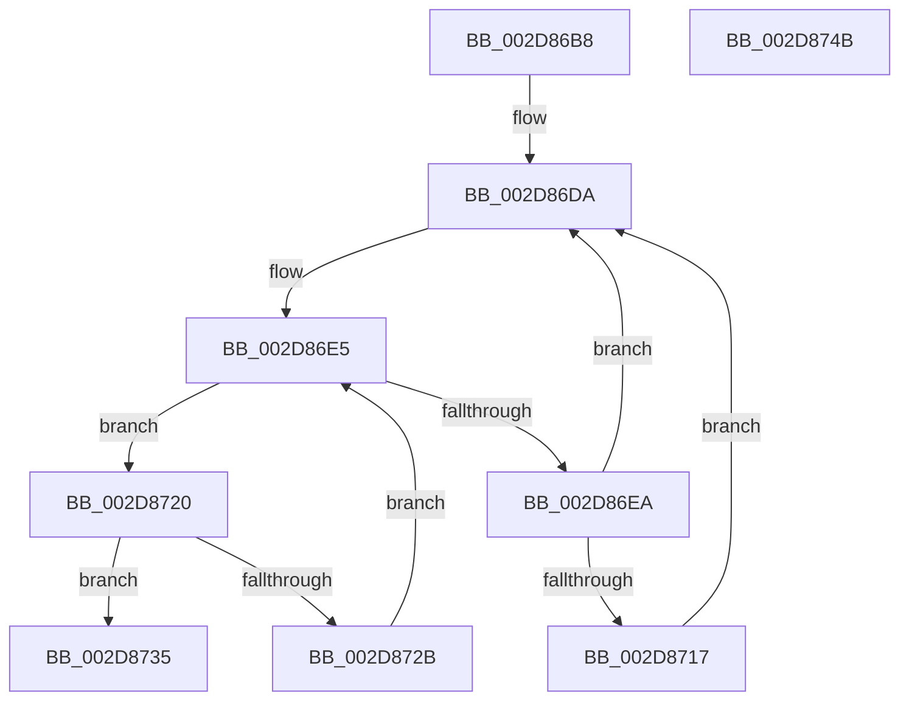

# PpmParkFindOverUtilizedProcessors

- RVA: `0x002D86B8`–`0x002D874C` (길이 `148` bytes)
- VA: `0x00000001402D86B8`
- 실행 섹션: `.text`
- PDB 이름 있음: `예`; PDB Function 태그: `아니요`
- unwind 정보 RVA: `0x000701D4`
- 디코드: `45`개 명령, `148/148` bytes 표시
- 미해석 바이트: `0` (있으면 어셈블리에 `.byte`로 보존)

> 이 문서는 커널 이미지의 기계어와 PDB 기호를 분석해 생성했습니다. 4번과 5번은 함수 원형과 자료형을 바이너리 사용 방식에서 추정한 C 해석이며 원본 소스 복구 결과는 아닙니다.

## 1. Dependencies

- 직접 호출 지점: **1**; 고유 호출 대상: **1**
- 직접 호출자로 확인된 함수: **1**
- RIP 상대 이미지 참조: **1**

### Outgoing calls
- `0x002D870A` → [KeGetPrcb](KeGetPrcb_function_002D85D0.md) (function, `0x002D85D0`)

### Direct callers
- [sub_006F6620](../6F/Unknown_function_006F6620.md) at `0x006F66F5`

### Static image references
- `0x002D8700` → RVA `0x00F231B8` (`.data`; read)

## 2. Other-region calls and transfers

- 다른 실행 섹션으로 향하는 call: **0**
- 별도 외부 분기/꼬리 이동을 확인하지 못했습니다.

## 3. Assembly (complete function range)

```asm
002D86B8  48 89 5C 24 10                  mov qword ptr [rsp + 0x10], rbx
002D86BD  48 89 6C 24 18                  mov qword ptr [rsp + 0x18], rbp
002D86C2  56                              push rsi
002D86C3  57                              push rdi
002D86C4  41 56                           push r14
002D86C6  48 83 EC 20                     sub rsp, 0x20
002D86CA  0F B7 59 04                     movzx ebx, word ptr [rcx + 4]
002D86CE  33 FF                           xor edi, edi
002D86D0  48 8B 71 10                     mov rsi, qword ptr [rcx + 0x10]
002D86D4  8B EA                           mov ebp, edx
002D86D6  44 8D 77 01                     lea r14d, [rdi + 1]
002D86DA  83 64 24 40 00                  and dword ptr [rsp + 0x40], 0
002D86DF  0F B7 CB                        movzx ecx, bx
002D86E2  41 03 CE                        add ecx, r14d
002D86E5  48 85 F6                        test rsi, rsi
002D86E8  74 36                           je 0x1402d8720
002D86EA  48 0F BC D6                     bsf rdx, rsi
002D86EE  0F B7 CB                        movzx ecx, bx
002D86F1  0F B6 C2                        movzx eax, dl
002D86F4  48 0F B3 C6                     btr rsi, rax
002D86F8  C1 E1 06                        shl ecx, 6
002D86FB  0F B6 C2                        movzx eax, dl
002D86FE  03 C8                           add ecx, eax
002D8700  48 8B 05 B1 AA C4 00            mov rax, qword ptr [rip + 0xc4aab1]
002D8707  8B 0C 88                        mov ecx, dword ptr [rax + rcx*4]
002D870A  E8 C1 FE FF FF                  call 0x1402d85d0
002D870F  39 A8 DC 89 00 00               cmp dword ptr [rax + 0x89dc], ebp
002D8715  72 C3                           jb 0x1402d86da
002D8717  48 0B B8 C8 00 00 00            or rdi, qword ptr [rax + 0xc8]
002D871E  EB BA                           jmp 0x1402d86da
002D8720  66 41 03 DE                     add bx, r14w
002D8724  0F B7 DB                        movzx ebx, bx
002D8727  3B D9                           cmp ebx, ecx
002D8729  73 0A                           jae 0x1402d8735
002D872B  48 8B 34 DD 08 00 00 00         mov rsi, qword ptr [rbx*8 + 8]
002D8733  EB B0                           jmp 0x1402d86e5
002D8735  48 8B 5C 24 48                  mov rbx, qword ptr [rsp + 0x48]
002D873A  48 8B C7                        mov rax, rdi
002D873D  48 8B 6C 24 50                  mov rbp, qword ptr [rsp + 0x50]
002D8742  48 83 C4 20                     add rsp, 0x20
002D8746  41 5E                           pop r14
002D8748  5F                              pop rdi
002D8749  5E                              pop rsi
002D874A  C3                              ret
002D874B  CC                              int3
```

## 4. C-style interpretation (structured pseudocode)

```c
__int64 __fastcall PpmParkFindOverUtilizedProcessors(__int64 a1, int a2)
{
    __int64 result;
    __int64 v_rbx;
    __int64 v_rdi;
    __int64 v_rsp;
    unsigned __int64 v_stack_p10;
    unsigned __int64 v_stack_p18;
    unsigned int v_stack_p8;

    v_stack_p10 = v_rbx;
    v_stack_p18 = v_rbp;
    v_rsp = (v_rsp) - (32);
    v_rdi = 0;
loc_002D86DA:
    a1 = (unsigned int)(((unsigned __int16)(*(unsigned __int16 *)(a1 + 4))) + ((unsigned int)(v_rdi + 1)));
loc_002D86E5:
    if (*(unsigned __int64 *)(a1 + 16) == 0) goto loc_002D8720;
    a1 = (unsigned int)(((unsigned __int16)(*(unsigned __int16 *)(a1 + 4))) << (6));
    a1 = (unsigned int)((a1) + ((unsigned int)((unsigned __int8)(a2))));
    result = KeGetPrcb((unsigned int)(*(unsigned int *)(*(unsigned __int64 *)(v_rip + 12888753) + a1 * 4)), a2, a3, a4);
    if ((*(unsigned int *)(result + 35292)) < ((unsigned int)((unsigned int)(a2)))) goto loc_002D86DA;
    v_rdi = (v_rdi) | (*(unsigned __int64 *)(result + 200));
    goto loc_002D86DA;
loc_002D8720:
    v_rbx = (unsigned __int16)((*(unsigned __int16 *)(a1 + 4)) + ((unsigned __int16)(v_rdi + 1)));
    if (((unsigned int)((unsigned __int16)(v_rbx))) >= ((unsigned int)((unsigned int)(*(unsigned int *)(*(unsigned __int64 *)(v_rip + 12888753) + a1 * 4))))) goto loc_002D8735;
    goto loc_002D86E5;
loc_002D8735:
    v_rsp = (v_rsp) + (32);
    return v_rdi;
}
```

## 5. (Beta) C Style

```c
int64_t PpmParkFindOverUtilizedProcessors(void *Arg1, int32_t Arg2)
{
    uint8_t *arg1 = (uint8_t *)Arg1;

    int64_t result;
    int64_t local_rbx;
    int64_t local_rdi;
    int64_t local_rsp;
    uint64_t v_stack_p10;
    uint64_t v_stack_p18;
    uint32_t v_stack_p8;

    v_stack_p10 = local_rbx;
    v_stack_p18 = local_rbp;
    local_rsp = (local_rsp) - (32);
    local_rdi = 0;
loc_002D86DA:
    Arg1 = (uint32_t)(((uint16_t)(*(uint16_t *)(arg1 + 0x4))) + ((uint32_t)(local_rdi + 1)));
loc_002D86E5:
    if (*(uint64_t *)(arg1 + 0x10) == 0) goto loc_002D8720;
    Arg1 = (uint32_t)(((uint16_t)(*(uint16_t *)(arg1 + 0x4))) << (6));
    Arg1 = (uint32_t)((Arg1) + ((uint32_t)((uint8_t)(Arg2))));
    result = KeGetPrcb((uint32_t)(*(uint32_t *)(*(uint64_t *)(v_rip + 0xC4AAB1) + arg1 * 4)), Arg2, a3, a4);
    if ((*(uint32_t *)(result + 0x89DC)) < ((uint32_t)((uint32_t)(Arg2)))) goto loc_002D86DA;
    local_rdi = (local_rdi) | (*(uint64_t *)(result + 0xC8));
    goto loc_002D86DA;
loc_002D8720:
    local_rbx = (uint16_t)((*(uint16_t *)(arg1 + 0x4)) + ((uint16_t)(local_rdi + 1)));
    if (((uint32_t)((uint16_t)(local_rbx))) >= ((uint32_t)((uint32_t)(*(uint32_t *)(*(uint64_t *)(v_rip + 0xC4AAB1) + arg1 * 4))))) goto loc_002D8735;
    goto loc_002D86E5;
loc_002D8735:
    local_rsp = (local_rsp) + (32);
    return local_rdi;
}
```

### 관측된 메모리 오프셋

구조체 형식이 확인되지 않은 접근은 인자 기준의 오프셋으로만 기록했습니다.

| 기준 인자 | 오프셋 표현 | 폭 (bit) | 접근 |
|---|---:|---:|---|
| `Arg1` | `+ 0x4` | `16` | `R` |
| `Arg1` | `+ 0x10` | `64` | `R` |

## 6. Execution-region graph

[열기: 2D/3D 그래프와 함수 탐색 컨트롤 패널](../../../control-panel.html?section=text&rva=0x002D86B8&view=graph)

- 2D 그래프는 위에서 아래로 흐르고, 3D 그래프는 빈 공간을 드래그해 회전합니다. Shift+드래그는 이동, 휠은 확대·축소, 함수 노드 선택은 대상 보고서 이동입니다.

### Static fallback


