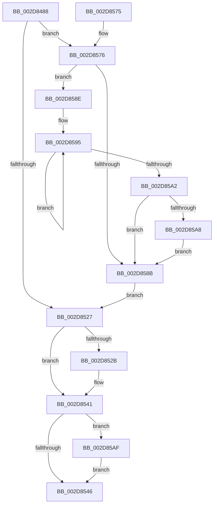

# PpmParkReportParkedCore

- RVA: `0x002D8488`–`0x002D85C0` (길이 `312` bytes)
- VA: `0x00000001402D8488`
- 실행 섹션: `.text`
- PDB 이름 있음: `예`; PDB Function 태그: `아니요`
- unwind 정보 RVA: `0x00070190`
- 디코드: `84`개 명령, `312/312` bytes 표시
- 미해석 바이트: `0` (있으면 어셈블리에 `.byte`로 보존)

> 이 문서는 커널 이미지의 기계어와 PDB 기호를 분석해 생성했습니다. 4번과 5번은 함수 원형과 자료형을 바이너리 사용 방식에서 추정한 C 해석이며 원본 소스 복구 결과는 아닙니다.

## 1. Dependencies

- 직접 호출 지점: **10**; 고유 호출 대상: **7**
- 직접 호출자로 확인된 함수: **1**
- RIP 상대 이미지 참조: **5**

### Outgoing calls
- `0x002D84B0` → [KeCheckProcessorAffinityEx](../30/KeCheckProcessorAffinityEx_function_00305150.md) (function, `0x00305150`)
- `0x002D84C6` → [KeCheckProcessorAffinityEx](../30/KeCheckProcessorAffinityEx_function_00305150.md) (function, `0x00305150`)
- `0x002D84F0` → [KeTransitionProcessorParkState](../35/KeTransitionProcessorParkState_function_003527EC.md) (function, `0x003527EC`)
- `0x002D8506` → [KeInterlockedSetProcessorAffinityEx](../35/KeInterlockedSetProcessorAffinityEx_function_00352560.md) (function, `0x00352560`)
- `0x002D850B` → [KeDisableInterrupts](../21/KeDisableInterrupts_function_00217BE0.md) (function, `0x00217BE0`)
- `0x002D8535` → [KeInterlockedSetProcessorAffinityEx](../35/KeInterlockedSetProcessorAffinityEx_function_00352560.md) (function, `0x00352560`)
- `0x002D854B` → [PpmEventCoreParkingStateChangeEx](../49/PpmEventCoreParkingStateChangeEx_function_00496018.md) (function, `0x00496018`)
- `0x002D8555` → [PpmIdleUpdateProcessorLatencyLimit](PpmIdleUpdateProcessorLatencyLimit_function_002D9480.md) (function, `0x002D9480`)
- `0x002D85A8` → [KiRemoveSystemWorkPriorityKick](../26/KiRemoveSystemWorkPriorityKick_function_002631D0.md) (function, `0x002631D0`)
- `0x002D85B9` → [KeInterlockedSetProcessorAffinityEx](../35/KeInterlockedSetProcessorAffinityEx_function_00352560.md) (function, `0x00352560`)

### Direct callers
- [PpmPerfAction](PpmPerfAction_function_002D7E70.md) at `0x002D7EB5`

### Static image references
- `0x002D84A9` → RVA `0x00E0BCB0` (`.data`; read)
- `0x002D84B7` → RVA `0x00E0B870` (`.data`; read)
- `0x002D84F8` → RVA `0x00E0C0F0` (`.data`; read)
- `0x002D852E` → RVA `0x00E0BFE0` (`.data`; read)
- `0x002D85B2` → RVA `0x00E0BDC0` (`.data`; read)

## 2. Other-region calls and transfers

- 다른 실행 섹션으로 향하는 call: **0**
- 별도 외부 분기/꼬리 이동을 확인하지 못했습니다.

## 3. Assembly (complete function range)

```asm
002D8488  48 8B C4                        mov rax, rsp
002D848B  48 89 58 08                     mov qword ptr [rax + 8], rbx
002D848F  48 89 68 10                     mov qword ptr [rax + 0x10], rbp
002D8493  48 89 70 18                     mov qword ptr [rax + 0x18], rsi
002D8497  48 89 78 20                     mov qword ptr [rax + 0x20], rdi
002D849B  41 56                           push r14
002D849D  48 83 EC 20                     sub rsp, 0x20
002D84A1  8B 59 24                        mov ebx, dword ptr [rcx + 0x24]
002D84A4  48 8B E9                        mov rbp, rcx
002D84A7  8B D3                           mov edx, ebx
002D84A9  48 8D 0D 00 38 B3 00            lea rcx, [rip + 0xb33800]
002D84B0  E8 9B CC 02 00                  call 0x140305150
002D84B5  85 C0                           test eax, eax
002D84B7  48 8D 0D B2 33 B3 00            lea rcx, [rip + 0xb333b2]
002D84BE  8B D3                           mov edx, ebx
002D84C0  8B F8                           mov edi, eax
002D84C2  40 0F 95 C6                     setne sil
002D84C6  E8 85 CC 02 00                  call 0x140305150
002D84CB  44 8B F0                        mov r14d, eax
002D84CE  F7 DF                           neg edi
002D84D0  B8 03 00 00 00                  mov eax, 3
002D84D5  48 8B CD                        mov rcx, rbp
002D84D8  1B D2                           sbb edx, edx
002D84DA  F7 DA                           neg edx
002D84DC  FF C2                           inc edx
002D84DE  45 85 F6                        test r14d, r14d
002D84E1  0F 45 D0                        cmovne edx, eax
002D84E4  33 DB                           xor ebx, ebx
002D84E6  40 0F B6 C6                     movzx eax, sil
002D84EA  45 85 F6                        test r14d, r14d
002D84ED  0F 44 D8                        cmove ebx, eax
002D84F0  E8 F7 A2 07 00                  call 0x1403527ec
002D84F5  8B 55 24                        mov edx, dword ptr [rbp + 0x24]
002D84F8  48 8D 0D F1 3B B3 00            lea rcx, [rip + 0xb33bf1]
002D84FF  C6 85 0C 8A 00 00 01            mov byte ptr [rbp + 0x8a0c], 1
002D8506  E8 55 A0 07 00                  call 0x140352560
002D850B  E8 D0 F6 F3 FF                  call 0x140217be0
002D8510  83 A5 A4 2D 00 00 00            and dword ptr [rbp + 0x2da4], 0
002D8517  8B 8D 40 86 00 00               mov ecx, dword ptr [rbp + 0x8640]
002D851D  89 8D A0 2D 00 00               mov dword ptr [rbp + 0x2da0], ecx
002D8523  84 C0                           test al, al
002D8525  75 4F                           jne 0x1402d8576
002D8527  84 DB                           test bl, bl
002D8529  74 16                           je 0x1402d8541
002D852B  8B 55 24                        mov edx, dword ptr [rbp + 0x24]
002D852E  48 8D 0D AB 3A B3 00            lea rcx, [rip + 0xb33aab]
002D8535  E8 26 A0 07 00                  call 0x140352560
002D853A  C6 85 0D 8A 00 00 01            mov byte ptr [rbp + 0x8a0d], 1
002D8541  45 85 F6                        test r14d, r14d
002D8544  75 69                           jne 0x1402d85af
002D8546  8A D3                           mov dl, bl
002D8548  48 8B CD                        mov rcx, rbp
002D854B  E8 C8 DA 1B 00                  call 0x140496018
002D8550  33 D2                           xor edx, edx
002D8552  48 8B CD                        mov rcx, rbp
002D8555  E8 26 0F 00 00                  call 0x1402d9480
002D855A  48 8B 5C 24 30                  mov rbx, qword ptr [rsp + 0x30]
002D855F  48 8B 6C 24 38                  mov rbp, qword ptr [rsp + 0x38]
002D8564  48 8B 74 24 40                  mov rsi, qword ptr [rsp + 0x40]
002D8569  48 8B 7C 24 48                  mov rdi, qword ptr [rsp + 0x48]
002D856E  48 83 C4 20                     add rsp, 0x20
002D8572  41 5E                           pop r14
002D8574  C3                              ret
002D8575  CC                              int3
002D8576  65 48 8B 0C 25 20 00 00 00      mov rcx, qword ptr gs:[0x20]
002D857F  4C 8B 81 B8 8E 00 00            mov r8, qword ptr [rcx + 0x8eb8]
002D8586  4D 85 C0                        test r8, r8
002D8589  75 03                           jne 0x1402d858e
002D858B  FB                              sti
002D858C  EB 99                           jmp 0x1402d8527
002D858E  41 0F 0D 08                     prefetchw byte ptr [r8]
002D8592  41 8B 00                        mov eax, dword ptr [r8]
002D8595  8B D0                           mov edx, eax
002D8597  0F BA F2 15                     btr edx, 0x15
002D859B  F0 41 0F B1 10                  lock cmpxchg dword ptr [r8], edx
002D85A0  75 F3                           jne 0x1402d8595
002D85A2  0F BA E0 15                     bt eax, 0x15
002D85A6  73 E3                           jae 0x1402d858b
002D85A8  E8 23 AC F8 FF                  call 0x1402631d0
002D85AD  EB DC                           jmp 0x1402d858b
002D85AF  8B 55 24                        mov edx, dword ptr [rbp + 0x24]
002D85B2  48 8D 0D 07 38 B3 00            lea rcx, [rip + 0xb33807]
002D85B9  E8 A2 9F 07 00                  call 0x140352560
002D85BE  EB 86                           jmp 0x1402d8546
```

## 4. C-style interpretation (structured pseudocode)

```c
__int64 __fastcall PpmParkReportParkedCore(__int64 a1)
{
    __int64 result;
    __int64 v_rbx;
    __int64 v_rdi;
    __int64 v_rsi;
    __int64 v_rsp;
    unsigned __int64 v_stack_p10;
    unsigned __int64 v_stack_p18;
    unsigned __int64 v_stack_p20;
    unsigned __int64 v_stack_p8;

    *(unsigned __int64 *)(v_rsp + 8) = v_rbx;
    *(unsigned __int64 *)(v_rsp + 16) = v_rbp;
    *(unsigned __int64 *)(v_rsp + 24) = v_rsi;
    *(unsigned __int64 *)(v_rsp + 32) = v_rdi;
    v_rsp = (v_rsp) - (32);
    result = KeCheckProcessorAffinityEx(v_rip + 11745280, (unsigned int)((unsigned int)((unsigned int)(*(unsigned int *)(a1 + 36)))), a3, a4);
    v_rsi = ((unsigned int)(result) != 0) ? 1 : 0;
    result = KeCheckProcessorAffinityEx(v_rip + 11744178, (unsigned int)((unsigned int)((unsigned int)(*(unsigned int *)(a1 + 36)))), a3, a4);
    v_rdi = (unsigned int)(-((unsigned int)((unsigned int)(result))));
    a2 = (unsigned int)(-((unsigned int)((unsigned int)((unsigned int)(*(unsigned int *)(a1 + 36))))));
    a2 = (unsigned int)((a2) + 1);
    if ((unsigned int)((unsigned int)((unsigned int)(result))) != 0) { a2 = 3; }
    v_rbx = 0;
    if ((unsigned int)((unsigned int)((unsigned int)(result))) == 0) { v_rbx = (unsigned int)((unsigned __int8)(v_rsi)); }
    result = KeTransitionProcessorParkState(a1, a2, a3, a4);
    *(unsigned __int8 *)(a1 + 35340) = 1;
    result = KeInterlockedSetProcessorAffinityEx(v_rip + 11746289, (unsigned int)(*(unsigned int *)(a1 + 36)), a3, a4);
    result = KeDisableInterrupts(v_rip + 11746289, (unsigned int)(*(unsigned int *)(a1 + 36)), a3, a4);
    *(unsigned int *)(a1 + 11680) = (unsigned int)((unsigned int)(*(unsigned int *)(a1 + 34368)));
    if ((unsigned __int8)(result) != 0) goto loc_002D8576;
loc_002D8527:
    if ((unsigned __int8)(v_rbx) != 0) {
        a2 = *(unsigned int *)(a1 + 36);
        a1 = v_rip + 11745963;
        result = KeInterlockedSetProcessorAffinityEx(a1, a2, a3, a4);
        *(unsigned __int8 *)(a1 + 35341) = 1;
    }
    if ((unsigned int)((unsigned int)((unsigned int)(result))) != 0) goto loc_002D85AF;
loc_002D8546:
    result = PpmEventCoreParkingStateChangeEx(a1, (unsigned __int8)(v_rbx), a3, a4);
    a2 = 0;
    result = PpmIdleUpdateProcessorLatencyLimit(a1, a2, a3, a4);
    v_rsp = (v_rsp) + (32);
    return result;
loc_002D8576:
    if (*(unsigned __int64 *)(*(unsigned __int64 *)(gs_base + (0 + 32)) + 36536) != 0) goto loc_002D858E;
loc_002D858B:
    goto loc_002D8527;
loc_002D858E:
loc_002D8595:
    if (*(unsigned __int64 *)(*(unsigned __int64 *)(gs_base + (0 + 32)) + 36536) != 0) goto loc_002D8595;
    if (condition_is_above_or_equal) goto loc_002D858B;
    result = KiRemoveSystemWorkPriorityKick(*(unsigned __int64 *)(gs_base + (0 + 32)), (unsigned int)((unsigned int)((unsigned int)(*(unsigned int *)(*(unsigned __int64 *)(*(unsigned __int64 *)(gs_base + (0 + 32)) + 36536))))), *(unsigned __int64 *)(*(unsigned __int64 *)(gs_base + (0 + 32)) + 36536), a4);
    goto loc_002D858B;
loc_002D85AF:
    result = KeInterlockedSetProcessorAffinityEx(v_rip + 11745287, (unsigned int)(*(unsigned int *)(v_stack_p10 + 36)), *(unsigned __int64 *)(*(unsigned __int64 *)(gs_base + (0 + 32)) + 36536), a4);
    goto loc_002D8546;
}
```

## 5. (Beta) C Style

```c
int64_t PpmParkReportParkedCore(void *Arg1)
{
    uint8_t *arg1 = (uint8_t *)Arg1;

    int64_t result;
    int64_t local_rbx;
    int64_t local_rdi;
    int64_t local_rsi;
    int64_t local_rsp;
    uint64_t v_stack_p10;
    uint64_t v_stack_p18;
    uint64_t v_stack_p20;
    uint64_t v_stack_p8;

    *(uint64_t *)(local_rsp + 0x8) = local_rbx;
    *(uint64_t *)(local_rsp + 0x10) = local_rbp;
    *(uint64_t *)(local_rsp + 0x18) = local_rsi;
    *(uint64_t *)(local_rsp + 0x20) = local_rdi;
    local_rsp = (local_rsp) - (32);
    result = KeCheckProcessorAffinityEx(v_rip + 11745280, (uint32_t)((uint32_t)((uint32_t)(*(uint32_t *)(arg1 + 0x24)))), a3, a4);
    local_rsi = ((uint32_t)(result) != 0) ? 1 : 0;
    result = KeCheckProcessorAffinityEx(v_rip + 11744178, (uint32_t)((uint32_t)((uint32_t)(*(uint32_t *)(arg1 + 0x24)))), a3, a4);
    local_rdi = (uint32_t)(-((uint32_t)((uint32_t)(result))));
    a2 = (uint32_t)(-((uint32_t)((uint32_t)((uint32_t)(*(uint32_t *)(arg1 + 0x24))))));
    a2 = (uint32_t)((a2) + 1);
    if ((uint32_t)((uint32_t)((uint32_t)(result))) != 0) { a2 = 3; }
    local_rbx = 0;
    if ((uint32_t)((uint32_t)((uint32_t)(result))) == 0) { local_rbx = (uint32_t)((uint8_t)(local_rsi)); }
    result = KeTransitionProcessorParkState(Arg1, a2, a3, a4);
    *(uint8_t *)(arg1 + 0x8A0C) = 1;
    result = KeInterlockedSetProcessorAffinityEx(v_rip + 11746289, (uint32_t)(*(uint32_t *)(arg1 + 0x24)), a3, a4);
    result = KeDisableInterrupts(v_rip + 11746289, (uint32_t)(*(uint32_t *)(arg1 + 0x24)), a3, a4);
    *(uint32_t *)(arg1 + 0x2DA0) = (uint32_t)((uint32_t)(*(uint32_t *)(arg1 + 0x8640)));
    if ((uint8_t)(result) != 0) goto loc_002D8576;
loc_002D8527:
    if ((uint8_t)(local_rbx) != 0) {
        a2 = *(uint32_t *)(arg1 + 0x24);
        Arg1 = v_rip + 11745963;
        result = KeInterlockedSetProcessorAffinityEx(Arg1, a2, a3, a4);
        *(uint8_t *)(arg1 + 0x8A0D) = 1;
    }
    if ((uint32_t)((uint32_t)((uint32_t)(result))) != 0) goto loc_002D85AF;
loc_002D8546:
    result = PpmEventCoreParkingStateChangeEx(Arg1, (uint8_t)(local_rbx), a3, a4);
    a2 = 0;
    result = PpmIdleUpdateProcessorLatencyLimit(Arg1, a2, a3, a4);
    local_rsp = (local_rsp) + (32);
    return result;
loc_002D8576:
    if (*(uint64_t *)(*(uint64_t *)(gs_base + (0 + 0x20)) + 0x8EB8) != 0) goto loc_002D858E;
loc_002D858B:
    goto loc_002D8527;
loc_002D858E:
loc_002D8595:
    if (*(uint64_t *)(*(uint64_t *)(gs_base + (0 + 0x20)) + 0x8EB8) != 0) goto loc_002D8595;
    if (condition_is_above_or_equal) goto loc_002D858B;
    result = KiRemoveSystemWorkPriorityKick(*(uint64_t *)(gs_base + (0 + 0x20)), (uint32_t)((uint32_t)((uint32_t)(*(uint32_t *)(*(uint64_t *)(*(uint64_t *)(gs_base + (0 + 0x20)) + 0x8EB8))))), *(uint64_t *)(*(uint64_t *)(gs_base + (0 + 0x20)) + 0x8EB8), a4);
    goto loc_002D858B;
loc_002D85AF:
    result = KeInterlockedSetProcessorAffinityEx(v_rip + 11745287, (uint32_t)(*(uint32_t *)(v_stack_p10 + 0x24)), *(uint64_t *)(*(uint64_t *)(gs_base + (0 + 0x20)) + 0x8EB8), a4);
    goto loc_002D8546;
}
```

### 관측된 메모리 오프셋

구조체 형식이 확인되지 않은 접근은 인자 기준의 오프셋으로만 기록했습니다.

| 기준 인자 | 오프셋 표현 | 폭 (bit) | 접근 |
|---|---:|---:|---|
| `Arg1` | `+ 0x24` | `32` | `R` |
| `Arg1` | `+ 0x2DA0` | `32` | `W` |
| `Arg1` | `+ 0x2DA4` | `32` | `R/W` |
| `Arg1` | `+ 0x8640` | `32` | `R` |
| `Arg1` | `+ 0x8A0C` | `8` | `W` |
| `Arg1` | `+ 0x8A0D` | `8` | `W` |

## 6. Execution-region graph

[열기: 2D/3D 그래프와 함수 탐색 컨트롤 패널](../../../control-panel.html?section=text&rva=0x002D8488&view=graph)

- 2D 그래프는 위에서 아래로 흐르고, 3D 그래프는 빈 공간을 드래그해 회전합니다. Shift+드래그는 이동, 휠은 확대·축소, 함수 노드 선택은 대상 보고서 이동입니다.

### Static fallback


