# PpmParkReportParkedCores

- RVA: `0x002D5CB0`–`0x002D61E1` (길이 `1,329` bytes)
- VA: `0x00000001402D5CB0`
- 실행 섹션: `.text`
- PDB 이름 있음: `예`; PDB Function 태그: `아니요`
- unwind 정보 RVA: `0x0006FD3C`
- 디코드: `312`개 명령, `1,329/1,329` bytes 표시
- 미해석 바이트: `0` (있으면 어셈블리에 `.byte`로 보존)

> 이 문서는 커널 이미지의 기계어와 PDB 기호를 분석해 생성했습니다. 4번과 5번은 함수 원형과 자료형을 바이너리 사용 방식에서 추정한 C 해석이며 원본 소스 복구 결과는 아닙니다.

## 1. Dependencies

- 직접 호출 지점: **20**; 고유 호출 대상: **8**
- 직접 호출자로 확인된 함수: **0**
- RIP 상대 이미지 참조: **15**

### Outgoing calls
- `0x002D5CF6` → [memset](../6C/memset_function_006C6C40.md) (function, `0x006C6C40`)
- `0x002D5D07` → [memset](../6C/memset_function_006C6C40.md) (function, `0x006C6C40`)
- `0x002D5D18` → [memset](../6C/memset_function_006C6C40.md) (function, `0x006C6C40`)
- `0x002D5D26` → [memset](../6C/memset_function_006C6C40.md) (function, `0x006C6C40`)
- `0x002D5D58` → [memset](../6C/memset_function_006C6C40.md) (function, `0x006C6C40`)
- `0x002D5DEF` → [memset](../6C/memset_function_006C6C40.md) (function, `0x006C6C40`)
- `0x002D5E0D` → [KiSubtractAffinityEx](KiSubtractAffinityEx_function_002D61E8.md) (function, `0x002D61E8`)
- `0x002D5E23` → [memset](../6C/memset_function_006C6C40.md) (function, `0x006C6C40`)
- `0x002D5E3F` → [KiXorAffinityEx](KiXorAffinityEx_function_002D62D0.md) (function, `0x002D62D0`)
- `0x002D5EBE` → [memset](../6C/memset_function_006C6C40.md) (function, `0x006C6C40`)
- `0x002D5EE5` → [KiXorAffinityEx](KiXorAffinityEx_function_002D62D0.md) (function, `0x002D62D0`)
- `0x002D5F62` → [_security_check_cookie](../6A/_security_check_cookie_function_006AC640.md) (function, `0x006AC640`)
- `0x002D60D2` → [KeGetPrcb](KeGetPrcb_function_002D85D0.md) (function, `0x002D85D0`)
- `0x002D60DF` → [PpmPerfQueueAction](PpmPerfQueueAction_function_002D91B0.md) (function, `0x002D91B0`)
- `0x002D612E` → [KeGetPrcb](KeGetPrcb_function_002D85D0.md) (function, `0x002D85D0`)
- `0x002D613B` → [PpmPerfQueueAction](PpmPerfQueueAction_function_002D91B0.md) (function, `0x002D91B0`)
- `0x002D6185` → [KeGetPrcb](KeGetPrcb_function_002D85D0.md) (function, `0x002D85D0`)
- `0x002D6192` → [PpmPerfQueueAction](PpmPerfQueueAction_function_002D91B0.md) (function, `0x002D91B0`)
- `0x002D61B4` → [KeUpdateSoftParkRankList](KeUpdateSoftParkRankList_function_002D5998.md) (function, `0x002D5998`)
- `0x002D61B9` → [PpmEventSoftParkRankListChanged](PpmEventSoftParkRankListChanged_function_002D58D8.md) (function, `0x002D58D8`)

### Direct callers
- 이 함수 시작 RVA로 연결되는 직접 call은 확인되지 않았습니다. 간접 호출은 완전히 역산할 수 없습니다.

### Static image references
- `0x002D5CD6` → RVA `0x00E0A740` (`.data`; read)
- `0x002D5D34` → RVA `0x00F083D0` (`.data`; read)
- `0x002D5D64` → RVA `0x00E0BED0` (`.data`; read)
- `0x002D5D75` → RVA `0x00E0B980` (`.data`; read)
- `0x002D5E31` → RVA `0x00E0BCB0` (`.data`; read)
- `0x002D5E38` → RVA `0x00E0BFE0` (`.data`; read)
- `0x002D5ED7` → RVA `0x00E0B870` (`.data`; read)
- `0x002D5EDE` → RVA `0x00E0BDC0` (`.data`; read)
- `0x002D60A0` → RVA `0x00F0B278` (`.data`; write)
- `0x002D60C8` → RVA `0x00F231B8` (`.data`; read)
- `0x002D61AB` → RVA `0x00F083C0` (`.data`; read)
- `0x002D61BE` → RVA `0x00F083B8` (`.data`; read)
- `0x002D61C5` → RVA `0x00F083C8` (`.data`; read)
- `0x002D61CC` → RVA `0x00F083B8` (`.data`; write)
- `0x002D61D3` → RVA `0x00F083C8` (`.data`; write)

## 2. Other-region calls and transfers

- 다른 실행 섹션으로 향하는 call: **0**
- 별도 외부 분기/꼬리 이동을 확인하지 못했습니다.

## 3. Assembly (complete function range)

```asm
002D5CB0  48 8B C4                        mov rax, rsp
002D5CB3  48 89 58 08                     mov qword ptr [rax + 8], rbx
002D5CB7  48 89 70 10                     mov qword ptr [rax + 0x10], rsi
002D5CBB  48 89 78 18                     mov qword ptr [rax + 0x18], rdi
002D5CBF  55                              push rbp
002D5CC0  41 54                           push r12
002D5CC2  41 55                           push r13
002D5CC4  41 56                           push r14
002D5CC6  41 57                           push r15
002D5CC8  48 8D A8 58 FC FF FF            lea rbp, [rax - 0x3a8]
002D5CCF  48 81 EC 80 04 00 00            sub rsp, 0x480
002D5CD6  48 8B 05 63 4A B3 00            mov rax, qword ptr [rip + 0xb34a63]
002D5CDD  48 33 C4                        xor rax, rsp
002D5CE0  48 89 85 70 03 00 00            mov qword ptr [rbp + 0x370], rax
002D5CE7  BB 00 01 00 00                  mov ebx, 0x100
002D5CEC  48 8D 4C 24 38                  lea rcx, [rsp + 0x38]
002D5CF1  44 8B C3                        mov r8d, ebx
002D5CF4  33 D2                           xor edx, edx
002D5CF6  E8 45 0F 3F 00                  call 0x1406c6c40
002D5CFB  44 8B C3                        mov r8d, ebx
002D5CFE  48 8D 8D 58 01 00 00            lea rcx, [rbp + 0x158]
002D5D05  33 D2                           xor edx, edx
002D5D07  E8 34 0F 3F 00                  call 0x1406c6c40
002D5D0C  44 8B C3                        mov r8d, ebx
002D5D0F  48 8D 8D 68 02 00 00            lea rcx, [rbp + 0x268]
002D5D16  33 D2                           xor edx, edx
002D5D18  E8 23 0F 3F 00                  call 0x1406c6c40
002D5D1D  44 8B C3                        mov r8d, ebx
002D5D20  48 8D 4D 48                     lea rcx, [rbp + 0x48]
002D5D24  33 D2                           xor edx, edx
002D5D26  E8 15 0F 3F 00                  call 0x1406c6c40
002D5D2B  45 33 E4                        xor r12d, r12d
002D5D2E  41 BD 01 00 00 00               mov r13d, 1
002D5D34  44 39 25 95 26 C3 00            cmp dword ptr [rip + 0xc32695], r12d
002D5D3B  0F 84 14 02 00 00               je 0x1402d5f55
002D5D41  41 8D 75 1F                     lea esi, [r13 + 0x1f]
002D5D45  44 8B C3                        mov r8d, ebx
002D5D48  33 D2                           xor edx, edx
002D5D4A  66 89 B5 52 01 00 00            mov word ptr [rbp + 0x152], si
002D5D51  48 8D 8D 58 01 00 00            lea rcx, [rbp + 0x158]
002D5D58  E8 E3 0E 3F 00                  call 0x1406c6c40
002D5D5D  0F B7 95 52 01 00 00            movzx edx, word ptr [rbp + 0x152]
002D5D64  4C 8D 35 65 61 B3 00            lea r14, [rip + 0xb36165]
002D5D6B  0F B7 0D 5E 61 B3 00            movzx ecx, word ptr [rip + 0xb3615e]
002D5D72  0F B7 C2                        movzx eax, dx
002D5D75  66 39 0D 04 5C B3 00            cmp word ptr [rip + 0xb35c04], cx
002D5D7C  45 8B FC                        mov r15d, r12d
002D5D7F  45 0F B7 C4                     movzx r8d, r12w
002D5D83  66 0F 42 0D F5 5B B3 00         cmovb cx, word ptr [rip + 0xb35bf5]
002D5D8B  66 3B CA                        cmp cx, dx
002D5D8E  0F B7 F9                        movzx edi, cx
002D5D91  66 0F 47 FA                     cmova di, dx
002D5D95  66 0F 46 C1                     cmovbe ax, cx
002D5D99  66 89 BD 50 01 00 00            mov word ptr [rbp + 0x150], di
002D5DA0  66 44 3B E0                     cmp r12w, ax
002D5DA4  0F 82 DF 01 00 00               jb 0x1402d5f89
002D5DAA  44 89 A5 54 01 00 00            mov dword ptr [rbp + 0x154], r12d
002D5DB1  66 44 3B C2                     cmp r8w, dx
002D5DB5  73 21                           jae 0x1402d5dd8
002D5DB7  41 0F B7 C0                     movzx eax, r8w
002D5DBB  66 45 03 C5                     add r8w, r13w
002D5DBF  4C 89 A4 C5 58 01 00 00         mov qword ptr [rbp + rax*8 + 0x158], r12
002D5DC7  66 44 3B 85 52 01 00 00         cmp r8w, word ptr [rbp + 0x152]
002D5DCF  72 E6                           jb 0x1402d5db7
002D5DD1  0F B7 BD 50 01 00 00            movzx edi, word ptr [rbp + 0x150]
002D5DD8  4C 8B C3                        mov r8, rbx
002D5DDB  48 C7 85 60 02 00 00 01 00 20 00  mov qword ptr [rbp + 0x260], 0x200001
002D5DE6  33 D2                           xor edx, edx
002D5DE8  48 8D 8D 68 02 00 00            lea rcx, [rbp + 0x268]
002D5DEF  E8 4C 0E 3F 00                  call 0x1406c6c40
002D5DF4  44 0F B7 8D 62 02 00 00         movzx r9d, word ptr [rbp + 0x262]
002D5DFC  4C 8D 85 60 02 00 00            lea r8, [rbp + 0x260]
002D5E03  48 8D 15 76 5B B3 00            lea rdx, [rip + 0xb35b76]
002D5E0A  49 8B CE                        mov rcx, r14
002D5E0D  E8 D6 03 00 00                  call 0x1402d61e8
002D5E12  33 D2                           xor edx, edx
002D5E14  48 C7 45 40 01 00 20 00         mov qword ptr [rbp + 0x40], 0x200001
002D5E1C  48 8D 4D 48                     lea rcx, [rbp + 0x48]
002D5E20  4C 8B C3                        mov r8, rbx
002D5E23  E8 18 0E 3F 00                  call 0x1406c6c40
002D5E28  44 0F B7 4D 42                  movzx r9d, word ptr [rbp + 0x42]
002D5E2D  4C 8D 45 40                     lea r8, [rbp + 0x40]
002D5E31  48 8D 15 78 5E B3 00            lea rdx, [rip + 0xb35e78]
002D5E38  48 8D 0D A1 61 B3 00            lea rcx, [rip + 0xb361a1]
002D5E3F  E8 8C 04 00 00                  call 0x1402d62d0
002D5E44  44 0F B7 45 42                  movzx r8d, word ptr [rbp + 0x42]
002D5E49  41 8B DC                        mov ebx, r12d
002D5E4C  44 0F B7 B5 60 02 00 00         movzx r14d, word ptr [rbp + 0x260]
002D5E54  41 0F B7 C0                     movzx eax, r8w
002D5E58  66 44 39 75 40                  cmp word ptr [rbp + 0x40], r14w
002D5E5D  41 0F B7 CE                     movzx ecx, r14w
002D5E61  41 0F B7 D4                     movzx edx, r12w
002D5E65  66 0F 42 4D 40                  cmovb cx, word ptr [rbp + 0x40]
002D5E6A  66 41 3B C8                     cmp cx, r8w
002D5E6E  0F B7 F1                        movzx esi, cx
002D5E71  66 41 0F 47 F0                  cmova si, r8w
002D5E76  66 0F 46 C1                     cmovbe ax, cx
002D5E7A  66 89 75 40                     mov word ptr [rbp + 0x40], si
002D5E7E  66 44 3B E0                     cmp r12w, ax
002D5E82  0F 82 3F 01 00 00               jb 0x1402d5fc7
002D5E88  44 89 65 44                     mov dword ptr [rbp + 0x44], r12d
002D5E8C  66 41 3B D0                     cmp dx, r8w
002D5E90  73 16                           jae 0x1402d5ea8
002D5E92  0F B7 C2                        movzx eax, dx
002D5E95  66 41 03 D5                     add dx, r13w
002D5E99  4C 89 64 C5 48                  mov qword ptr [rbp + rax*8 + 0x48], r12
002D5E9E  66 3B 55 42                     cmp dx, word ptr [rbp + 0x42]
002D5EA2  72 EE                           jb 0x1402d5e92
002D5EA4  0F B7 75 40                     movzx esi, word ptr [rbp + 0x40]
002D5EA8  33 D2                           xor edx, edx
002D5EAA  48 C7 44 24 30 01 00 20 00      mov qword ptr [rsp + 0x30], 0x200001
002D5EB3  41 B8 00 01 00 00               mov r8d, 0x100
002D5EB9  48 8D 4C 24 38                  lea rcx, [rsp + 0x38]
002D5EBE  E8 7D 0D 3F 00                  call 0x1406c6c40
002D5EC3  41 0B DF                        or ebx, r15d
002D5EC6  0F 85 53 01 00 00               jne 0x1402d601f
002D5ECC  44 0F B7 4C 24 32               movzx r9d, word ptr [rsp + 0x32]
002D5ED2  4C 8D 44 24 30                  lea r8, [rsp + 0x30]
002D5ED7  48 8D 15 92 59 B3 00            lea rdx, [rip + 0xb35992]
002D5EDE  48 8D 0D DB 5E B3 00            lea rcx, [rip + 0xb35edb]
002D5EE5  E8 E6 03 00 00                  call 0x1402d62d0
002D5EEA  66 44 39 74 24 30               cmp word ptr [rsp + 0x30], r14w
002D5EF0  45 8B C4                        mov r8d, r12d
002D5EF3  44 0F B7 4C 24 32               movzx r9d, word ptr [rsp + 0x32]
002D5EF9  41 0F B7 D4                     movzx edx, r12w
002D5EFD  66 44 0F 42 74 24 30            cmovb r14w, word ptr [rsp + 0x30]
002D5F04  41 0F B7 C1                     movzx eax, r9w
002D5F08  66 45 3B F1                     cmp r14w, r9w
002D5F0C  41 0F B7 CE                     movzx ecx, r14w
002D5F10  66 41 0F 47 C9                  cmova cx, r9w
002D5F15  66 41 0F 46 C6                  cmovbe ax, r14w
002D5F1A  66 89 4C 24 30                  mov word ptr [rsp + 0x30], cx
002D5F1F  66 44 3B E0                     cmp r12w, ax
002D5F23  0F 82 C9 00 00 00               jb 0x1402d5ff2
002D5F29  44 89 64 24 34                  mov dword ptr [rsp + 0x34], r12d
002D5F2E  66 41 3B D1                     cmp dx, r9w
002D5F32  73 18                           jae 0x1402d5f4c
002D5F34  0F B7 C2                        movzx eax, dx
002D5F37  66 41 03 D5                     add dx, r13w
002D5F3B  4C 89 64 C4 38                  mov qword ptr [rsp + rax*8 + 0x38], r12
002D5F40  66 3B 54 24 32                  cmp dx, word ptr [rsp + 0x32]
002D5F45  72 ED                           jb 0x1402d5f34
002D5F47  0F B7 4C 24 30                  movzx ecx, word ptr [rsp + 0x30]
002D5F4C  45 85 C0                        test r8d, r8d
002D5F4F  0F 85 CF 00 00 00               jne 0x1402d6024
002D5F55  41 8A C5                        mov al, r13b
002D5F58  48 8B 8D 70 03 00 00            mov rcx, qword ptr [rbp + 0x370]
002D5F5F  48 33 CC                        xor rcx, rsp
002D5F62  E8 D9 66 3D 00                  call 0x1406ac640
002D5F67  4C 8D 9C 24 80 04 00 00         lea r11, [rsp + 0x480]
002D5F6F  49 8B 5B 30                     mov rbx, qword ptr [r11 + 0x30]
002D5F73  49 8B 73 38                     mov rsi, qword ptr [r11 + 0x38]
002D5F77  49 8B 7B 40                     mov rdi, qword ptr [r11 + 0x40]
002D5F7B  49 8B E3                        mov rsp, r11
002D5F7E  41 5F                           pop r15
002D5F80  41 5E                           pop r14
002D5F82  41 5D                           pop r13
002D5F84  41 5C                           pop r12
002D5F86  5D                              pop rbp
002D5F87  C3                              ret
002D5F88  CC                              int3
002D5F89  48 8D 35 F0 59 B3 00            lea rsi, [rip + 0xb359f0]
002D5F90  41 0F B7 D0                     movzx edx, r8w
002D5F94  49 8B 4C D6 08                  mov rcx, qword ptr [r14 + rdx*8 + 8]
002D5F99  48 23 4C D6 08                  and rcx, qword ptr [rsi + rdx*8 + 8]
002D5F9E  48 89 8C D5 58 01 00 00         mov qword ptr [rbp + rdx*8 + 0x158], rcx
002D5FA6  0F B7 BD 50 01 00 00            movzx edi, word ptr [rbp + 0x150]
002D5FAD  45 0F 45 FD                     cmovne r15d, r13d
002D5FB1  66 45 03 C5                     add r8w, r13w
002D5FB5  66 44 3B C7                     cmp r8w, di
002D5FB9  72 D5                           jb 0x1402d5f90
002D5FBB  0F B7 95 52 01 00 00            movzx edx, word ptr [rbp + 0x152]
002D5FC2  E9 E3 FD FF FF                  jmp 0x1402d5daa
002D5FC7  0F B7 CA                        movzx ecx, dx
002D5FCA  48 8B 84 CD 68 02 00 00         mov rax, qword ptr [rbp + rcx*8 + 0x268]
002D5FD2  48 21 44 CD 48                  and qword ptr [rbp + rcx*8 + 0x48], rax
002D5FD7  0F B7 75 40                     movzx esi, word ptr [rbp + 0x40]
002D5FDB  41 0F 45 DD                     cmovne ebx, r13d
002D5FDF  66 41 03 D5                     add dx, r13w
002D5FE3  66 3B D6                        cmp dx, si
002D5FE6  72 DF                           jb 0x1402d5fc7
002D5FE8  44 0F B7 45 42                  movzx r8d, word ptr [rbp + 0x42]
002D5FED  E9 96 FE FF FF                  jmp 0x1402d5e88
002D5FF2  0F B7 CA                        movzx ecx, dx
002D5FF5  48 8B 84 CD 68 02 00 00         mov rax, qword ptr [rbp + rcx*8 + 0x268]
002D5FFD  48 21 44 CC 38                  and qword ptr [rsp + rcx*8 + 0x38], rax
002D6002  0F B7 4C 24 30                  movzx ecx, word ptr [rsp + 0x30]
002D6007  45 0F 45 C5                     cmovne r8d, r13d
002D600B  66 41 03 D5                     add dx, r13w
002D600F  66 3B D1                        cmp dx, cx
002D6012  72 DE                           jb 0x1402d5ff2
002D6014  44 0F B7 4C 24 32               movzx r9d, word ptr [rsp + 0x32]
002D601A  E9 0A FF FF FF                  jmp 0x1402d5f29
002D601F  0F B7 4C 24 30                  movzx ecx, word ptr [rsp + 0x30]
002D6024  45 8B D4                        mov r10d, r12d
002D6027  66 44 3B E7                     cmp r12w, di
002D602B  73 1C                           jae 0x1402d6049
002D602D  48 8D 95 58 01 00 00            lea rdx, [rbp + 0x158]
002D6034  44 0F B7 C7                     movzx r8d, di
002D6038  F3 48 0F B8 02                  popcnt rax, qword ptr [rdx]
002D603D  44 03 D0                        add r10d, eax
002D6040  48 8D 52 08                     lea rdx, [rdx + 8]
002D6044  4D 2B C5                        sub r8, r13
002D6047  75 EF                           jne 0x1402d6038
002D6049  45 8B CC                        mov r9d, r12d
002D604C  66 44 3B E6                     cmp r12w, si
002D6050  73 19                           jae 0x1402d606b
002D6052  48 8D 55 48                     lea rdx, [rbp + 0x48]
002D6056  44 0F B7 C6                     movzx r8d, si
002D605A  F3 48 0F B8 02                  popcnt rax, qword ptr [rdx]
002D605F  44 03 C8                        add r9d, eax
002D6062  48 8D 52 08                     lea rdx, [rdx + 8]
002D6066  4D 2B C5                        sub r8, r13
002D6069  75 EF                           jne 0x1402d605a
002D606B  45 8B C4                        mov r8d, r12d
002D606E  66 44 3B E1                     cmp r12w, cx
002D6072  73 1A                           jae 0x1402d608e
002D6074  48 8D 54 24 38                  lea rdx, [rsp + 0x38]
002D6079  44 0F B7 D9                     movzx r11d, cx
002D607D  F3 48 0F B8 02                  popcnt rax, qword ptr [rdx]
002D6082  44 03 C0                        add r8d, eax
002D6085  48 8D 52 08                     lea rdx, [rdx + 8]
002D6089  4D 2B DD                        sub r11, r13
002D608C  75 EF                           jne 0x1402d607d
002D608E  48 8B BD 58 01 00 00            mov rdi, qword ptr [rbp + 0x158]
002D6095  43 8D 04 08                     lea eax, [r8 + r9]
002D6099  41 03 C2                        add eax, r10d
002D609C  41 0F B7 DC                     movzx ebx, r12w
002D60A0  89 05 D2 51 C3 00               mov dword ptr [rip + 0xc351d2], eax
002D60A6  0F B7 8D 50 01 00 00            movzx ecx, word ptr [rbp + 0x150]
002D60AD  48 85 FF                        test rdi, rdi
002D60B0  74 34                           je 0x1402d60e6
002D60B2  48 0F BC D7                     bsf rdx, rdi
002D60B6  0F B7 CB                        movzx ecx, bx
002D60B9  0F B6 C2                        movzx eax, dl
002D60BC  48 0F B3 C7                     btr rdi, rax
002D60C0  C1 E1 06                        shl ecx, 6
002D60C3  0F B6 C2                        movzx eax, dl
002D60C6  03 C8                           add ecx, eax
002D60C8  48 8B 05 E9 D0 C4 00            mov rax, qword ptr [rip + 0xc4d0e9]
002D60CF  8B 0C 88                        mov ecx, dword ptr [rax + rcx*4]
002D60D2  E8 F9 24 00 00                  call 0x1402d85d0
002D60D7  48 8B C8                        mov rcx, rax
002D60DA  BA 03 00 00 00                  mov edx, 3
002D60DF  E8 CC 30 00 00                  call 0x1402d91b0
002D60E4  EB C0                           jmp 0x1402d60a6
002D60E6  66 41 03 DD                     add bx, r13w
002D60EA  0F B7 DB                        movzx ebx, bx
002D60ED  3B D9                           cmp ebx, ecx
002D60EF  73 0A                           jae 0x1402d60fb
002D60F1  48 8B BC DD 58 01 00 00         mov rdi, qword ptr [rbp + rbx*8 + 0x158]
002D60F9  EB B2                           jmp 0x1402d60ad
002D60FB  48 8B 7C 24 38                  mov rdi, qword ptr [rsp + 0x38]
002D6100  41 0F B7 DC                     movzx ebx, r12w
002D6104  0F B7 4C 24 30                  movzx ecx, word ptr [rsp + 0x30]
002D6109  48 85 FF                        test rdi, rdi
002D610C  74 34                           je 0x1402d6142
002D610E  48 0F BC D7                     bsf rdx, rdi
002D6112  0F B7 CB                        movzx ecx, bx
002D6115  0F B6 C2                        movzx eax, dl
002D6118  48 0F B3 C7                     btr rdi, rax
002D611C  C1 E1 06                        shl ecx, 6
002D611F  0F B6 C2                        movzx eax, dl
002D6122  03 C8                           add ecx, eax
002D6124  48 8B 05 8D D0 C4 00            mov rax, qword ptr [rip + 0xc4d08d]
002D612B  8B 0C 88                        mov ecx, dword ptr [rax + rcx*4]
002D612E  E8 9D 24 00 00                  call 0x1402d85d0
002D6133  48 8B C8                        mov rcx, rax
002D6136  BA 05 00 00 00                  mov edx, 5
002D613B  E8 70 30 00 00                  call 0x1402d91b0
002D6140  EB C2                           jmp 0x1402d6104
002D6142  66 41 03 DD                     add bx, r13w
002D6146  0F B7 DB                        movzx ebx, bx
002D6149  3B D9                           cmp ebx, ecx
002D614B  73 07                           jae 0x1402d6154
002D614D  48 8B 7C DC 38                  mov rdi, qword ptr [rsp + rbx*8 + 0x38]
002D6152  EB B5                           jmp 0x1402d6109
002D6154  48 8B 7D 48                     mov rdi, qword ptr [rbp + 0x48]
002D6158  41 0F B7 DC                     movzx ebx, r12w
002D615C  0F B7 4D 40                     movzx ecx, word ptr [rbp + 0x40]
002D6160  48 85 FF                        test rdi, rdi
002D6163  74 34                           je 0x1402d6199
002D6165  48 0F BC D7                     bsf rdx, rdi
002D6169  0F B7 CB                        movzx ecx, bx
002D616C  0F B6 C2                        movzx eax, dl
002D616F  48 0F B3 C7                     btr rdi, rax
002D6173  C1 E1 06                        shl ecx, 6
002D6176  0F B6 C2                        movzx eax, dl
002D6179  03 C8                           add ecx, eax
002D617B  48 8B 05 36 D0 C4 00            mov rax, qword ptr [rip + 0xc4d036]
002D6182  8B 0C 88                        mov ecx, dword ptr [rax + rcx*4]
002D6185  E8 46 24 00 00                  call 0x1402d85d0
002D618A  48 8B C8                        mov rcx, rax
002D618D  BA 04 00 00 00                  mov edx, 4
002D6192  E8 19 30 00 00                  call 0x1402d91b0
002D6197  EB C3                           jmp 0x1402d615c
002D6199  66 41 03 DD                     add bx, r13w
002D619D  0F B7 DB                        movzx ebx, bx
002D61A0  3B D9                           cmp ebx, ecx
002D61A2  73 07                           jae 0x1402d61ab
002D61A4  48 8B 7C DD 48                  mov rdi, qword ptr [rbp + rbx*8 + 0x48]
002D61A9  EB B5                           jmp 0x1402d6160
002D61AB  44 38 25 0E 22 C3 00            cmp byte ptr [rip + 0xc3220e], r12b
002D61B2  74 26                           je 0x1402d61da
002D61B4  E8 DF F7 FF FF                  call 0x1402d5998
002D61B9  E8 1A F7 FF FF                  call 0x1402d58d8
002D61BE  48 8B 0D F3 21 C3 00            mov rcx, qword ptr [rip + 0xc321f3]
002D61C5  48 8B 05 FC 21 C3 00            mov rax, qword ptr [rip + 0xc321fc]
002D61CC  48 89 05 E5 21 C3 00            mov qword ptr [rip + 0xc321e5], rax
002D61D3  48 89 0D EE 21 C3 00            mov qword ptr [rip + 0xc321ee], rcx
002D61DA  32 C0                           xor al, al
002D61DC  E9 77 FD FF FF                  jmp 0x1402d5f58
```

## 4. C-style interpretation (structured pseudocode)

```c
__int64 __fastcall PpmParkReportParkedCores(__int64 a1, int a2)
{
    __int64 result;
    __int64 v_r10;
    __int64 v_r11;
    __int64 v_r12;
    __int64 v_r14;
    __int64 v_r15;
    __int64 v_rbx;
    __int64 v_rdi;
    __int64 v_rsi;
    __int64 v_rsp;
    unsigned __int64 v_stack_m28;
    unsigned __int64 v_stack_m448;
    unsigned __int16 v_stack_m44E;
    unsigned __int16 v_stack_m450;
    unsigned __int64 v_stack_m470;
    unsigned int v_stack_m474;
    unsigned __int16 v_stack_m476;
    unsigned __int64 v_stack_m478;

    *(unsigned __int64 *)(v_rsp + 8) = v_rbx;
    *(unsigned __int64 *)(v_rsp + 16) = v_rsi;
    *(unsigned __int64 *)(v_rsp + 24) = v_rdi;
    v_rsp = (v_rsp) - (0x480ULL);
    result = (*(unsigned __int64 *)(v_rip + 11749987)) ^ (v_rsp);
    *(unsigned __int64 *)(v_rsp - 936 + 880) = result;
    a2 = 0;
    result = memset(v_stack_m470, a2, 256, a4);
    a2 = 0;
    result = memset(v_rsp - 936 + 344, a2, 256, a4);
    a2 = 0;
    result = memset(v_rsp - 936 + 616, a2, 256, a4);
    a2 = 0;
    result = memset(v_rsp - 936 + 72, a2, 256, a4);
    v_r12 = 0;
    if ((*(unsigned int *)(v_rip + 12789397)) == 0) goto loc_002D5F55;
    a2 = 0;
    *(unsigned __int16 *)(v_rsp - 936 + 338) = (unsigned __int16)(1 + 31);
    result = memset(v_rsp - 936 + 344, a2, 256, a4);
    a1 = *(unsigned __int16 *)(v_rip + 11755870);
    if ((*(unsigned __int16 *)(v_rip + 11754500)) < ((unsigned __int16)(*(unsigned __int16 *)(v_rip + 11755870)))) { a1 = *(unsigned __int16 *)(v_rip + 11754485); }
    v_rdi = (unsigned __int16)(a1);
    if (((unsigned __int16)(a1)) > ((unsigned __int16)(*(unsigned __int16 *)(v_rsp - 936 + 338)))) { v_rdi = (unsigned __int16)(*(unsigned __int16 *)(v_rsp - 936 + 338)); }
    result = (unsigned __int16)(*(unsigned __int16 *)(v_rsp - 936 + 338));
    if (((unsigned __int16)(a1)) <= ((unsigned __int16)(*(unsigned __int16 *)(v_rsp - 936 + 338)))) { result = (unsigned __int16)(a1); }
    *(unsigned __int16 *)(v_rsp - 936 + 336) = (unsigned __int16)(v_rdi);
    if (0 < ((unsigned __int16)(result))) goto loc_002D5F89;
loc_002D5DAA:
    *(unsigned int *)(v_rsp - 936 + 340) = 0;
    if (0 >= ((unsigned __int16)(*(unsigned __int16 *)(v_rsp - 936 + 338)))) goto loc_002D5DD8;
loc_002D5DB7:
    a3 = (unsigned __int16)((0) + (1));
    *(unsigned __int64 *)(v_rsp - 936 + 0 * 8 + 344) = 0;
    if (((unsigned __int16)(a3)) < (*(unsigned __int16 *)(v_rsp - 936 + 338))) goto loc_002D5DB7;
loc_002D5DD8:
    *(unsigned __int64 *)(v_rsp - 936 + 608) = 0x200001ULL;
    a2 = 0;
    result = memset(v_rsp - 936 + 616, a2, 256, a4);
    result = KiSubtractAffinityEx(v_rip + 11755877, v_rip + 11754358, v_rsp - 936 + 608, *(unsigned __int16 *)(v_rsp - 936 + 610));
    a2 = 0;
    *(unsigned __int64 *)(v_rsp - 936 + 64) = 0x200001ULL;
    result = memset(v_rsp - 936 + 72, a2, 256, *(unsigned __int16 *)(v_rsp - 936 + 610));
    result = KiXorAffinityEx(v_rip + 11755937, v_rip + 11755128, v_rsp - 936 + 64, *(unsigned __int16 *)(v_rsp - 936 + 66));
    a1 = (unsigned __int16)(*(unsigned __int16 *)(v_rsp - 936 + 608));
    if ((*(unsigned __int16 *)(v_rsp - 936 + 64)) < ((unsigned __int16)(*(unsigned __int16 *)(v_rsp - 936 + 608)))) { a1 = *(unsigned __int16 *)(v_rsp - 936 + 64); }
    v_rsi = (unsigned __int16)(a1);
    if (((unsigned __int16)(a1)) > ((unsigned __int16)(*(unsigned __int16 *)(v_rsp - 936 + 66)))) { v_rsi = (unsigned __int16)(*(unsigned __int16 *)(v_rsp - 936 + 66)); }
    result = (unsigned __int16)(*(unsigned __int16 *)(v_rsp - 936 + 66));
    if (((unsigned __int16)(a1)) <= ((unsigned __int16)(*(unsigned __int16 *)(v_rsp - 936 + 66)))) { result = (unsigned __int16)(a1); }
    *(unsigned __int16 *)(v_rsp - 936 + 64) = (unsigned __int16)(v_rsi);
    if (0 < ((unsigned __int16)(result))) goto loc_002D5FC7;
loc_002D5E88:
    *(unsigned int *)(v_rsp - 936 + 68) = 0;
    if (0 >= ((unsigned __int16)(*(unsigned __int16 *)(v_rsp - 936 + 66)))) goto loc_002D5EA8;
loc_002D5E92:
    a2 = (unsigned __int16)((0) + (1));
    *(unsigned __int64 *)(v_rsp - 936 + 0 * 8 + 72) = 0;
    if (((unsigned __int16)(a2)) < (*(unsigned __int16 *)(v_rsp - 936 + 66))) goto loc_002D5E92;
loc_002D5EA8:
    a2 = 0;
    v_stack_m478 = 0x200001ULL;
    result = memset(v_stack_m470, a2, 256, *(unsigned __int16 *)(v_rsp - 936 + 66));
    v_rbx = (unsigned int)((0) | (0));
    if (condition_is_not_equal) goto loc_002D601F;
    result = KiXorAffinityEx(v_rip + 11755227, v_rip + 11753874, v_stack_m478, v_stack_m476);
    v_r14 = *(unsigned __int16 *)(v_rsp - 936 + 608);
    if (v_stack_m478 < ((unsigned __int16)(*(unsigned __int16 *)(v_rsp - 936 + 608)))) { v_r14 = v_stack_m478; }
    a1 = (unsigned __int16)(v_r14);
    if (((unsigned __int16)(v_r14)) > ((unsigned __int16)(v_stack_m476))) { a1 = (unsigned __int16)(v_stack_m476); }
    result = (unsigned __int16)(v_stack_m476);
    if (((unsigned __int16)(v_r14)) <= ((unsigned __int16)(v_stack_m476))) { result = (unsigned __int16)(v_r14); }
    v_stack_m478 = (unsigned __int16)(a1);
    if (0 < ((unsigned __int16)(result))) goto loc_002D5FF2;
loc_002D5F29:
    v_stack_m474 = 0;
    if (0 >= ((unsigned __int16)(v_stack_m476))) goto loc_002D5F4C;
loc_002D5F34:
    a2 = (unsigned __int16)((0) + (1));
    *(unsigned __int64 *)(v_rsp + 0 * 8 + 56) = 0;
    if (((unsigned __int16)(a2)) < v_stack_m476) goto loc_002D5F34;
loc_002D5F4C:
    if (0 != 0) goto loc_002D6024;
loc_002D5F55:
loc_002D5F58:
    a1 = (*(unsigned __int64 *)(v_rsp - 936 + 880)) ^ (v_rsp);
    result = _security_check_cookie(a1, a2, 0, v_stack_m476);
    return result;
loc_002D5F89:
loc_002D5F90:
    a1 = (*(unsigned __int64 *)(v_r14 + 0 * 8 + 8)) & (*(unsigned __int64 *)(v_rip + 11753968 + 0 * 8 + 8));
    *(unsigned __int64 *)(v_rsp - 936 + 0 * 8 + 344) = a1;
    v_r15 = 0;
    if (condition_is_not_equal) { v_r15 = 1; }
    a3 = (unsigned __int16)((0) + (1));
    if (((unsigned __int16)(a3)) < ((unsigned __int16)(*(unsigned __int16 *)(v_rsp - 936 + 336)))) goto loc_002D5F90;
    goto loc_002D5DAA;
loc_002D5FC7:
    v_rbx = *(unsigned __int64 *)(v_stack_m28 + 48);
    if (((unsigned __int16)(a3)) != ((unsigned __int16)(*(unsigned __int16 *)(v_rsp - 936 + 336)))) { v_rbx = 1; }
    a2 = (unsigned __int16)((*(unsigned __int16 *)(v_rsp - 936 + 338)) + (1));
    if (((unsigned __int16)(a2)) < ((unsigned __int16)(*(unsigned __int16 *)(v_rsp - 936 + 64)))) goto loc_002D5FC7;
    goto loc_002D5E88;
loc_002D5FF2:
    a3 = *(unsigned __int16 *)(v_rsp - 936 + 66);
    if (((unsigned __int16)(a2)) != ((unsigned __int16)(*(unsigned __int16 *)(v_rsp - 936 + 64)))) { a3 = 1; }
    a2 = (unsigned __int16)((a2) + (1));
    if (((unsigned __int16)(a2)) < ((unsigned __int16)(v_stack_m450))) goto loc_002D5FF2;
    goto loc_002D5F29;
loc_002D601F:
loc_002D6024:
    if (0 >= ((unsigned __int16)(*(unsigned __int16 *)(v_rsp - 936 + 336)))) goto loc_002D6049;
loc_002D6038:
    v_r10 = (unsigned int)((0) + ((unsigned int)(*(unsigned __int64 *)(v_rsp - 936 + (unsigned __int16)(a2) * 8 + 616))));
    a3 = ((unsigned __int16)(*(unsigned __int16 *)(v_rsp - 936 + 336))) - (1);
    if (condition_is_not_equal) goto loc_002D6038;
loc_002D6049:
    if (0 >= ((unsigned __int16)(*(unsigned __int16 *)(v_rsp - 936 + 64)))) goto loc_002D606B;
loc_002D605A:
    a4 = (unsigned int)((0) + ((unsigned int)(*(unsigned __int64 *)(v_rsp - 936 + (unsigned __int16)(a2) * 8 + 616))));
    a3 = ((unsigned __int16)(*(unsigned __int16 *)(v_rsp - 936 + 64))) - (1);
    if (condition_is_not_equal) goto loc_002D605A;
loc_002D606B:
    if (0 >= ((unsigned __int16)(v_stack_m450))) goto loc_002D608E;
loc_002D607D:
    a3 = (unsigned int)((0) + ((unsigned int)(*(unsigned __int64 *)(v_rsp - 936 + (unsigned __int16)(a2) * 8 + 616))));
    v_r11 = ((unsigned __int16)(v_stack_m450)) - (1);
    if (condition_is_not_equal) goto loc_002D607D;
loc_002D608E:
    result = (unsigned int)((a3 + a4 * 1) + ((unsigned int)(v_r10)));
    *(unsigned int *)(v_rip + 12800466) = (unsigned int)(result);
loc_002D60A6:
loc_002D60AD:
    if (*(unsigned __int64 *)(v_rsp - 936 + 344) == 0) goto loc_002D60E6;
    a1 = (unsigned int)((0) << (6));
    a1 = (unsigned int)((a1) + ((unsigned int)((unsigned __int8)(v_stack_m448 + 8))));
    result = KeGetPrcb((unsigned int)(*(unsigned int *)(*(unsigned __int64 *)(v_rip + 12898537) + a1 * 4)), v_stack_m448 + 8, a3, a4);
    result = PpmPerfQueueAction(result, 3, a3, a4);
    goto loc_002D60A6;
loc_002D60E6:
    v_rbx = (unsigned __int16)((0) + (1));
    if (((unsigned int)((unsigned __int16)(v_rbx))) >= ((unsigned int)(result))) goto loc_002D60FB;
    goto loc_002D60AD;
loc_002D60FB:
loc_002D6104:
loc_002D6109:
    if (v_stack_m448 == 0) goto loc_002D6142;
    a1 = (unsigned int)((0) << (6));
    a1 = (unsigned int)((a1) + (3));
    result = KeGetPrcb((unsigned int)(*(unsigned int *)(*(unsigned __int64 *)(v_rip + 12898445) + a1 * 4)), 3, a3, a4);
    result = PpmPerfQueueAction(result, 5, a3, a4);
    goto loc_002D6104;
loc_002D6142:
    v_rbx = (unsigned __int16)((0) + (1));
    if (((unsigned int)((unsigned __int16)(v_rbx))) >= ((unsigned int)(result))) goto loc_002D6154;
    goto loc_002D6109;
loc_002D6154:
loc_002D615C:
loc_002D6160:
    if (*(unsigned __int64 *)(v_rsp - 936 + 72) == 0) goto loc_002D6199;
    a1 = (unsigned int)((0) << (6));
    a1 = (unsigned int)((a1) + (5));
    result = KeGetPrcb((unsigned int)(*(unsigned int *)(*(unsigned __int64 *)(v_rip + 12898358) + a1 * 4)), 5, a3, a4);
    result = PpmPerfQueueAction(result, 4, a3, a4);
    goto loc_002D615C;
loc_002D6199:
    v_rbx = (unsigned __int16)((0) + (1));
    if (((unsigned int)((unsigned __int16)(v_rbx))) >= ((unsigned int)(result))) goto loc_002D61AB;
    goto loc_002D6160;
loc_002D61AB:
    if ((*(unsigned __int8 *)(v_rip + 12788238)) != 0) {
        result = KeUpdateSoftParkRankList(result, 4, a3, a4);
        result = PpmEventSoftParkRankListChanged(result, 4, a3, a4);
        a1 = *(unsigned __int64 *)(v_rip + 12788211);
        result = *(unsigned __int64 *)(v_rip + 12788220);
        *(unsigned __int64 *)(v_rip + 12788197) = result;
        *(unsigned __int64 *)(v_rip + 12788206) = a1;
    }
    result = 0;
    goto loc_002D5F58;
}
```

## 5. (Beta) C Style

```c
int64_t PpmParkReportParkedCores(int64_t Arg1, int32_t Arg2)
{
    int64_t result;
    int64_t local_r10;
    int64_t local_r11;
    int64_t local_r12;
    int64_t local_r14;
    int64_t local_r15;
    int64_t local_rbx;
    int64_t local_rdi;
    int64_t local_rsi;
    int64_t local_rsp;
    uint64_t v_stack_m28;
    uint64_t v_stack_m448;
    uint16_t v_stack_m44E;
    uint16_t v_stack_m450;
    uint64_t v_stack_m470;
    uint32_t v_stack_m474;
    uint16_t v_stack_m476;
    uint64_t v_stack_m478;

    *(uint64_t *)(local_rsp + 0x8) = local_rbx;
    *(uint64_t *)(local_rsp + 0x10) = local_rsi;
    *(uint64_t *)(local_rsp + 0x18) = local_rdi;
    local_rsp = (local_rsp) - (0x480ULL);
    result = (*(uint64_t *)(v_rip + 0xB34A63)) ^ (local_rsp);
    *(uint64_t *)(local_rsp - 0x3A8 + 0x370) = result;
    Arg2 = 0;
    result = memset(v_stack_m470, Arg2, 256, a4);
    Arg2 = 0;
    result = memset(local_rsp - 936 + 344, Arg2, 256, a4);
    Arg2 = 0;
    result = memset(local_rsp - 936 + 616, Arg2, 256, a4);
    Arg2 = 0;
    result = memset(local_rsp - 936 + 72, Arg2, 256, a4);
    local_r12 = 0;
    if ((*(uint32_t *)(v_rip + 0xC32695)) == 0) goto loc_002D5F55;
    Arg2 = 0;
    *(uint16_t *)(local_rsp - 0x3A8 + 0x152) = (uint16_t)(1 + 31);
    result = memset(local_rsp - 936 + 344, Arg2, 256, a4);
    Arg1 = *(uint16_t *)(v_rip + 0xB3615E);
    if ((*(uint16_t *)(v_rip + 0xB35C04)) < ((uint16_t)(*(uint16_t *)(v_rip + 0xB3615E)))) { Arg1 = *(uint16_t *)(v_rip + 0xB35BF5); }
    local_rdi = (uint16_t)(Arg1);
    if (((uint16_t)(Arg1)) > ((uint16_t)(*(uint16_t *)(local_rsp - 0x3A8 + 0x152)))) { local_rdi = (uint16_t)(*(uint16_t *)(local_rsp - 0x3A8 + 0x152)); }
    result = (uint16_t)(*(uint16_t *)(local_rsp - 0x3A8 + 0x152));
    if (((uint16_t)(Arg1)) <= ((uint16_t)(*(uint16_t *)(local_rsp - 0x3A8 + 0x152)))) { result = (uint16_t)(Arg1); }
    *(uint16_t *)(local_rsp - 0x3A8 + 0x150) = (uint16_t)(local_rdi);
    if (0 < ((uint16_t)(result))) goto loc_002D5F89;
loc_002D5DAA:
    *(uint32_t *)(local_rsp - 0x3A8 + 0x154) = 0;
    if (0 >= ((uint16_t)(*(uint16_t *)(local_rsp - 0x3A8 + 0x152)))) goto loc_002D5DD8;
loc_002D5DB7:
    a3 = (uint16_t)((0) + (1));
    *(uint64_t *)(local_rsp - 0x3A8 + 0x0 * 8 + 0x158) = 0;
    if (((uint16_t)(a3)) < (*(uint16_t *)(local_rsp - 0x3A8 + 0x152))) goto loc_002D5DB7;
loc_002D5DD8:
    *(uint64_t *)(local_rsp - 0x3A8 + 0x260) = 0x200001ULL;
    Arg2 = 0;
    result = memset(local_rsp - 936 + 616, Arg2, 256, a4);
    result = KiSubtractAffinityEx(v_rip + 11755877, v_rip + 11754358, local_rsp - 936 + 608, *(uint16_t *)(local_rsp - 0x3A8 + 0x262));
    Arg2 = 0;
    *(uint64_t *)(local_rsp - 0x3A8 + 0x40) = 0x200001ULL;
    result = memset(local_rsp - 936 + 72, Arg2, 256, *(uint16_t *)(local_rsp - 0x3A8 + 0x262));
    result = KiXorAffinityEx(v_rip + 11755937, v_rip + 11755128, local_rsp - 936 + 64, *(uint16_t *)(local_rsp - 0x3A8 + 0x42));
    Arg1 = (uint16_t)(*(uint16_t *)(local_rsp - 0x3A8 + 0x260));
    if ((*(uint16_t *)(local_rsp - 0x3A8 + 0x40)) < ((uint16_t)(*(uint16_t *)(local_rsp - 0x3A8 + 0x260)))) { Arg1 = *(uint16_t *)(local_rsp - 0x3A8 + 0x40); }
    local_rsi = (uint16_t)(Arg1);
    if (((uint16_t)(Arg1)) > ((uint16_t)(*(uint16_t *)(local_rsp - 0x3A8 + 0x42)))) { local_rsi = (uint16_t)(*(uint16_t *)(local_rsp - 0x3A8 + 0x42)); }
    result = (uint16_t)(*(uint16_t *)(local_rsp - 0x3A8 + 0x42));
    if (((uint16_t)(Arg1)) <= ((uint16_t)(*(uint16_t *)(local_rsp - 0x3A8 + 0x42)))) { result = (uint16_t)(Arg1); }
    *(uint16_t *)(local_rsp - 0x3A8 + 0x40) = (uint16_t)(local_rsi);
    if (0 < ((uint16_t)(result))) goto loc_002D5FC7;
loc_002D5E88:
    *(uint32_t *)(local_rsp - 0x3A8 + 0x44) = 0;
    if (0 >= ((uint16_t)(*(uint16_t *)(local_rsp - 0x3A8 + 0x42)))) goto loc_002D5EA8;
loc_002D5E92:
    Arg2 = (uint16_t)((0) + (1));
    *(uint64_t *)(local_rsp - 0x3A8 + 0x0 * 8 + 0x48) = 0;
    if (((uint16_t)(Arg2)) < (*(uint16_t *)(local_rsp - 0x3A8 + 0x42))) goto loc_002D5E92;
loc_002D5EA8:
    Arg2 = 0;
    v_stack_m478 = 0x200001ULL;
    result = memset(v_stack_m470, Arg2, 256, *(uint16_t *)(local_rsp - 0x3A8 + 0x42));
    local_rbx = (uint32_t)((0) | (0));
    if (condition_is_not_equal) goto loc_002D601F;
    result = KiXorAffinityEx(v_rip + 11755227, v_rip + 11753874, v_stack_m478, v_stack_m476);
    local_r14 = *(uint16_t *)(local_rsp - 0x3A8 + 0x260);
    if (v_stack_m478 < ((uint16_t)(*(uint16_t *)(local_rsp - 0x3A8 + 0x260)))) { local_r14 = v_stack_m478; }
    Arg1 = (uint16_t)(local_r14);
    if (((uint16_t)(local_r14)) > ((uint16_t)(v_stack_m476))) { Arg1 = (uint16_t)(v_stack_m476); }
    result = (uint16_t)(v_stack_m476);
    if (((uint16_t)(local_r14)) <= ((uint16_t)(v_stack_m476))) { result = (uint16_t)(local_r14); }
    v_stack_m478 = (uint16_t)(Arg1);
    if (0 < ((uint16_t)(result))) goto loc_002D5FF2;
loc_002D5F29:
    v_stack_m474 = 0;
    if (0 >= ((uint16_t)(v_stack_m476))) goto loc_002D5F4C;
loc_002D5F34:
    Arg2 = (uint16_t)((0) + (1));
    *(uint64_t *)(local_rsp + 0x0 * 8 + 0x38) = 0;
    if (((uint16_t)(Arg2)) < v_stack_m476) goto loc_002D5F34;
loc_002D5F4C:
    if (0 != 0) goto loc_002D6024;
loc_002D5F55:
loc_002D5F58:
    Arg1 = (*(uint64_t *)(local_rsp - 0x3A8 + 0x370)) ^ (local_rsp);
    result = _security_check_cookie(Arg1, Arg2, 0, v_stack_m476);
    return result;
loc_002D5F89:
loc_002D5F90:
    Arg1 = (*(uint64_t *)(local_r14 + 0x0 * 8 + 0x8)) & (*(uint64_t *)(v_rip + 0xB359F0 + 0x0 * 8 + 0x8));
    *(uint64_t *)(local_rsp - 0x3A8 + 0x0 * 8 + 0x158) = Arg1;
    local_r15 = 0;
    if (condition_is_not_equal) { local_r15 = 1; }
    a3 = (uint16_t)((0) + (1));
    if (((uint16_t)(a3)) < ((uint16_t)(*(uint16_t *)(local_rsp - 0x3A8 + 0x150)))) goto loc_002D5F90;
    goto loc_002D5DAA;
loc_002D5FC7:
    local_rbx = *(uint64_t *)(v_stack_m28 + 0x30);
    if (((uint16_t)(a3)) != ((uint16_t)(*(uint16_t *)(local_rsp - 0x3A8 + 0x150)))) { local_rbx = 1; }
    Arg2 = (uint16_t)((*(uint16_t *)(local_rsp - 0x3A8 + 0x152)) + (1));
    if (((uint16_t)(Arg2)) < ((uint16_t)(*(uint16_t *)(local_rsp - 0x3A8 + 0x40)))) goto loc_002D5FC7;
    goto loc_002D5E88;
loc_002D5FF2:
    a3 = *(uint16_t *)(local_rsp - 0x3A8 + 0x42);
    if (((uint16_t)(Arg2)) != ((uint16_t)(*(uint16_t *)(local_rsp - 0x3A8 + 0x40)))) { a3 = 1; }
    Arg2 = (uint16_t)((Arg2) + (1));
    if (((uint16_t)(Arg2)) < ((uint16_t)(v_stack_m450))) goto loc_002D5FF2;
    goto loc_002D5F29;
loc_002D601F:
loc_002D6024:
    if (0 >= ((uint16_t)(*(uint16_t *)(local_rsp - 0x3A8 + 0x150)))) goto loc_002D6049;
loc_002D6038:
    local_r10 = (uint32_t)((0) + ((uint32_t)(*(uint64_t *)(local_rsp - 0x3A8 + (uint16_t)(Arg2) * 8 + 0x268))));
    a3 = ((uint16_t)(*(uint16_t *)(local_rsp - 0x3A8 + 0x150))) - (1);
    if (condition_is_not_equal) goto loc_002D6038;
loc_002D6049:
    if (0 >= ((uint16_t)(*(uint16_t *)(local_rsp - 0x3A8 + 0x40)))) goto loc_002D606B;
loc_002D605A:
    a4 = (uint32_t)((0) + ((uint32_t)(*(uint64_t *)(local_rsp - 0x3A8 + (uint16_t)(Arg2) * 8 + 0x268))));
    a3 = ((uint16_t)(*(uint16_t *)(local_rsp - 0x3A8 + 0x40))) - (1);
    if (condition_is_not_equal) goto loc_002D605A;
loc_002D606B:
    if (0 >= ((uint16_t)(v_stack_m450))) goto loc_002D608E;
loc_002D607D:
    a3 = (uint32_t)((0) + ((uint32_t)(*(uint64_t *)(local_rsp - 0x3A8 + (uint16_t)(Arg2) * 8 + 0x268))));
    local_r11 = ((uint16_t)(v_stack_m450)) - (1);
    if (condition_is_not_equal) goto loc_002D607D;
loc_002D608E:
    result = (uint32_t)((a3 + a4 * 1) + ((uint32_t)(local_r10)));
    *(uint32_t *)(v_rip + 0xC351D2) = (uint32_t)(result);
loc_002D60A6:
loc_002D60AD:
    if (*(uint64_t *)(local_rsp - 0x3A8 + 0x158) == 0) goto loc_002D60E6;
    Arg1 = (uint32_t)((0) << (6));
    Arg1 = (uint32_t)((Arg1) + ((uint32_t)((uint8_t)(v_stack_m448 + 8))));
    result = KeGetPrcb((uint32_t)(*(uint32_t *)(*(uint64_t *)(v_rip + 0xC4D0E9) + Arg1 * 4)), v_stack_m448 + 8, a3, a4);
    result = PpmPerfQueueAction(result, 3, a3, a4);
    goto loc_002D60A6;
loc_002D60E6:
    local_rbx = (uint16_t)((0) + (1));
    if (((uint32_t)((uint16_t)(local_rbx))) >= ((uint32_t)(result))) goto loc_002D60FB;
    goto loc_002D60AD;
loc_002D60FB:
loc_002D6104:
loc_002D6109:
    if (v_stack_m448 == 0) goto loc_002D6142;
    Arg1 = (uint32_t)((0) << (6));
    Arg1 = (uint32_t)((Arg1) + (3));
    result = KeGetPrcb((uint32_t)(*(uint32_t *)(*(uint64_t *)(v_rip + 0xC4D08D) + Arg1 * 4)), 3, a3, a4);
    result = PpmPerfQueueAction(result, 5, a3, a4);
    goto loc_002D6104;
loc_002D6142:
    local_rbx = (uint16_t)((0) + (1));
    if (((uint32_t)((uint16_t)(local_rbx))) >= ((uint32_t)(result))) goto loc_002D6154;
    goto loc_002D6109;
loc_002D6154:
loc_002D615C:
loc_002D6160:
    if (*(uint64_t *)(local_rsp - 0x3A8 + 0x48) == 0) goto loc_002D6199;
    Arg1 = (uint32_t)((0) << (6));
    Arg1 = (uint32_t)((Arg1) + (5));
    result = KeGetPrcb((uint32_t)(*(uint32_t *)(*(uint64_t *)(v_rip + 0xC4D036) + Arg1 * 4)), 5, a3, a4);
    result = PpmPerfQueueAction(result, 4, a3, a4);
    goto loc_002D615C;
loc_002D6199:
    local_rbx = (uint16_t)((0) + (1));
    if (((uint32_t)((uint16_t)(local_rbx))) >= ((uint32_t)(result))) goto loc_002D61AB;
    goto loc_002D6160;
loc_002D61AB:
    if ((*(uint8_t *)(v_rip + 0xC3220E)) != 0) {
        result = KeUpdateSoftParkRankList(result, 4, a3, a4);
        result = PpmEventSoftParkRankListChanged(result, 4, a3, a4);
        Arg1 = *(uint64_t *)(v_rip + 0xC321F3);
        result = *(uint64_t *)(v_rip + 0xC321FC);
        *(uint64_t *)(v_rip + 0xC321E5) = result;
        *(uint64_t *)(v_rip + 0xC321EE) = Arg1;
    }
    result = 0;
    goto loc_002D5F58;
}
```

## 6. Execution-region graph

[열기: 2D/3D 그래프와 함수 탐색 컨트롤 패널](../../../control-panel.html?section=text&rva=0x002D5CB0&view=graph)

- 2D 그래프는 위에서 아래로 흐르고, 3D 그래프는 빈 공간을 드래그해 회전합니다. Shift+드래그는 이동, 휠은 확대·축소, 함수 노드 선택은 대상 보고서 이동입니다.

### Static fallback

```mermaid
flowchart TD
  bb_002D5CB0[BB_002D5CB0]
  bb_002D5D41[BB_002D5D41]
  bb_002D5DAA[BB_002D5DAA]
  bb_002D5DB7[BB_002D5DB7]
  bb_002D5DD1[BB_002D5DD1]
  bb_002D5DD8[BB_002D5DD8]
  bb_002D5E88[BB_002D5E88]
  bb_002D5E92[BB_002D5E92]
  bb_002D5EA4[BB_002D5EA4]
  bb_002D5EA8[BB_002D5EA8]
  bb_002D5ECC[BB_002D5ECC]
  bb_002D5F29[BB_002D5F29]
  bb_002D5F34[BB_002D5F34]
  bb_002D5F47[BB_002D5F47]
  bb_002D5F4C[BB_002D5F4C]
  bb_002D5F55[BB_002D5F55]
  bb_002D5F58[BB_002D5F58]
  bb_002D5F88[BB_002D5F88]
  bb_002D5F89[BB_002D5F89]
  bb_002D5F90[BB_002D5F90]
  bb_002D5FBB[BB_002D5FBB]
  bb_002D5FC7[BB_002D5FC7]
  bb_002D5FE8[BB_002D5FE8]
  bb_002D5FF2[BB_002D5FF2]
  bb_002D6014[BB_002D6014]
  bb_002D601F[BB_002D601F]
  bb_002D6024[BB_002D6024]
  bb_002D602D[BB_002D602D]
  bb_002D6038[BB_002D6038]
  bb_002D6049[BB_002D6049]
  bb_002D6052[BB_002D6052]
  bb_002D605A[BB_002D605A]
  bb_002D606B[BB_002D606B]
  bb_002D6074[BB_002D6074]
  bb_002D607D[BB_002D607D]
  bb_002D608E[BB_002D608E]
  bb_002D60A6[BB_002D60A6]
  bb_002D60AD[BB_002D60AD]
  bb_002D60B2[BB_002D60B2]
  bb_002D60E6[BB_002D60E6]
  bb_002D60F1[BB_002D60F1]
  bb_002D60FB[BB_002D60FB]
  bb_002D6104[BB_002D6104]
  bb_002D6109[BB_002D6109]
  bb_002D610E[BB_002D610E]
  bb_002D6142[BB_002D6142]
  bb_002D614D[BB_002D614D]
  bb_002D6154[BB_002D6154]
  bb_002D615C[BB_002D615C]
  bb_002D6160[BB_002D6160]
  bb_002D6165[BB_002D6165]
  bb_002D6199[BB_002D6199]
  bb_002D61A4[BB_002D61A4]
  bb_002D61AB[BB_002D61AB]
  bb_002D61B4[BB_002D61B4]
  bb_002D61DA[BB_002D61DA]
  bb_002D5CB0 -->|branch| bb_002D5F55
  bb_002D5CB0 -->|fallthrough| bb_002D5D41
  bb_002D5D41 -->|branch| bb_002D5F89
  bb_002D5D41 -->|fallthrough| bb_002D5DAA
  bb_002D5DAA -->|branch| bb_002D5DD8
  bb_002D5DAA -->|fallthrough| bb_002D5DB7
  bb_002D5DB7 -->|branch| bb_002D5DB7
  bb_002D5DB7 -->|fallthrough| bb_002D5DD1
  bb_002D5DD1 -->|flow| bb_002D5DD8
  bb_002D5DD8 -->|branch| bb_002D5FC7
  bb_002D5DD8 -->|fallthrough| bb_002D5E88
  bb_002D5E88 -->|branch| bb_002D5EA8
  bb_002D5E88 -->|fallthrough| bb_002D5E92
  bb_002D5E92 -->|branch| bb_002D5E92
  bb_002D5E92 -->|fallthrough| bb_002D5EA4
  bb_002D5EA4 -->|flow| bb_002D5EA8
  bb_002D5EA8 -->|branch| bb_002D601F
  bb_002D5EA8 -->|fallthrough| bb_002D5ECC
  bb_002D5ECC -->|branch| bb_002D5FF2
  bb_002D5ECC -->|fallthrough| bb_002D5F29
  bb_002D5F29 -->|branch| bb_002D5F4C
  bb_002D5F29 -->|fallthrough| bb_002D5F34
  bb_002D5F34 -->|branch| bb_002D5F34
  bb_002D5F34 -->|fallthrough| bb_002D5F47
  bb_002D5F47 -->|flow| bb_002D5F4C
  bb_002D5F4C -->|branch| bb_002D6024
  bb_002D5F4C -->|fallthrough| bb_002D5F55
  bb_002D5F55 -->|flow| bb_002D5F58
  bb_002D5F88 -->|flow| bb_002D5F89
  bb_002D5F89 -->|flow| bb_002D5F90
  bb_002D5F90 -->|branch| bb_002D5F90
  bb_002D5F90 -->|fallthrough| bb_002D5FBB
  bb_002D5FBB -->|branch| bb_002D5DAA
  bb_002D5FC7 -->|branch| bb_002D5FC7
  bb_002D5FC7 -->|fallthrough| bb_002D5FE8
  bb_002D5FE8 -->|branch| bb_002D5E88
  bb_002D5FF2 -->|branch| bb_002D5FF2
  bb_002D5FF2 -->|fallthrough| bb_002D6014
  bb_002D6014 -->|branch| bb_002D5F29
  bb_002D601F -->|flow| bb_002D6024
  bb_002D6024 -->|branch| bb_002D6049
  bb_002D6024 -->|fallthrough| bb_002D602D
  bb_002D602D -->|flow| bb_002D6038
  bb_002D6038 -->|branch| bb_002D6038
  bb_002D6038 -->|fallthrough| bb_002D6049
  bb_002D6049 -->|branch| bb_002D606B
  bb_002D6049 -->|fallthrough| bb_002D6052
  bb_002D6052 -->|flow| bb_002D605A
  bb_002D605A -->|branch| bb_002D605A
  bb_002D605A -->|fallthrough| bb_002D606B
  bb_002D606B -->|branch| bb_002D608E
  bb_002D606B -->|fallthrough| bb_002D6074
  bb_002D6074 -->|flow| bb_002D607D
  bb_002D607D -->|branch| bb_002D607D
  bb_002D607D -->|fallthrough| bb_002D608E
  bb_002D608E -->|flow| bb_002D60A6
  bb_002D60A6 -->|flow| bb_002D60AD
  bb_002D60AD -->|branch| bb_002D60E6
  bb_002D60AD -->|fallthrough| bb_002D60B2
  bb_002D60B2 -->|branch| bb_002D60A6
  bb_002D60E6 -->|branch| bb_002D60FB
  bb_002D60E6 -->|fallthrough| bb_002D60F1
  bb_002D60F1 -->|branch| bb_002D60AD
  bb_002D60FB -->|flow| bb_002D6104
  bb_002D6104 -->|flow| bb_002D6109
  bb_002D6109 -->|branch| bb_002D6142
  bb_002D6109 -->|fallthrough| bb_002D610E
  bb_002D610E -->|branch| bb_002D6104
  bb_002D6142 -->|branch| bb_002D6154
  bb_002D6142 -->|fallthrough| bb_002D614D
  bb_002D614D -->|branch| bb_002D6109
  bb_002D6154 -->|flow| bb_002D615C
  bb_002D615C -->|flow| bb_002D6160
  bb_002D6160 -->|branch| bb_002D6199
  bb_002D6160 -->|fallthrough| bb_002D6165
  bb_002D6165 -->|branch| bb_002D615C
  bb_002D6199 -->|branch| bb_002D61AB
  bb_002D6199 -->|fallthrough| bb_002D61A4
  bb_002D61A4 -->|branch| bb_002D6160
  bb_002D61AB -->|branch| bb_002D61DA
  bb_002D61AB -->|fallthrough| bb_002D61B4
  bb_002D61B4 -->|flow| bb_002D61DA
  bb_002D61DA -->|branch| bb_002D5F58
```


