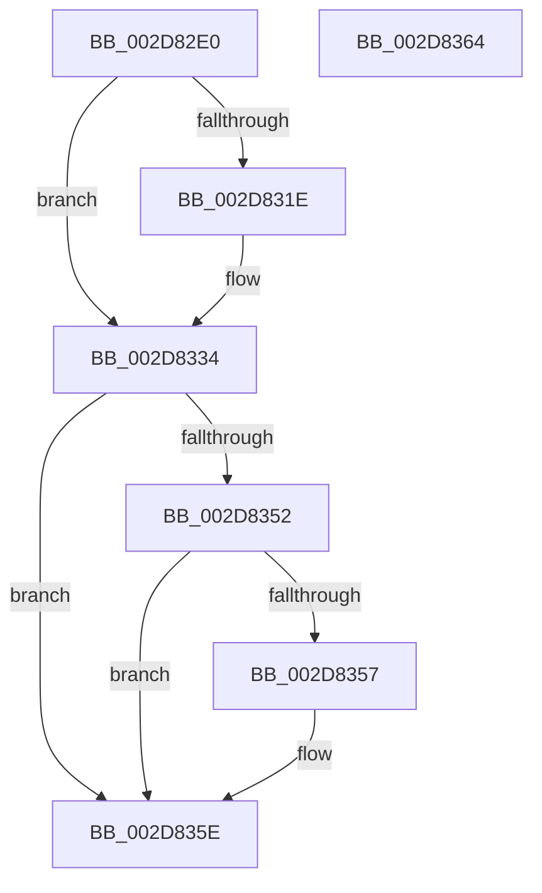

# PpmParkReportUnparkedCore

- RVA: `0x002D82E0`–`0x002D8365` (길이 `133` bytes)
- VA: `0x00000001402D82E0`
- 실행 섹션: `.text`
- PDB 이름 있음: `예`; PDB Function 태그: `아니요`
- unwind 정보 RVA: `0x0005CF00`
- 디코드: `33`개 명령, `133/133` bytes 표시
- 미해석 바이트: `0` (있으면 어셈블리에 `.byte`로 보존)

> 이 문서는 커널 이미지의 기계어와 PDB 기호를 분석해 생성했습니다. 4번과 5번은 함수 원형과 자료형을 바이너리 사용 방식에서 추정한 C 해석이며 원본 소스 복구 결과는 아닙니다.

## 1. Dependencies

- 직접 호출 지점: **6**; 고유 호출 대상: **4**
- 직접 호출자로 확인된 함수: **1**
- RIP 상대 이미지 참조: **3**

### Outgoing calls
- `0x002D82EB` → [KeTransitionProcessorParkState](../35/KeTransitionProcessorParkState_function_003527EC.md) (function, `0x003527EC`)
- `0x002D8301` → [KeInterlockedClearProcessorAffinityEx](../35/KeInterlockedClearProcessorAffinityEx_function_003524F0.md) (function, `0x003524F0`)
- `0x002D8310` → [KeInterlockedClearProcessorAffinityEx](../35/KeInterlockedClearProcessorAffinityEx_function_003524F0.md) (function, `0x003524F0`)
- `0x002D8328` → [KeInterlockedClearProcessorAffinityEx](../35/KeInterlockedClearProcessorAffinityEx_function_003524F0.md) (function, `0x003524F0`)
- `0x002D8337` → [PpmEventCoreParkingStateChange](../49/PpmEventCoreParkingStateChange_function_004995D8.md) (function, `0x004995D8`)
- `0x002D8341` → [PpmIdleUpdateProcessorLatencyLimit](PpmIdleUpdateProcessorLatencyLimit_function_002D9480.md) (function, `0x002D9480`)

### Direct callers
- [PpmPerfAction](PpmPerfAction_function_002D7E70.md) at `0x002D7EA3`

### Static image references
- `0x002D82F3` → RVA `0x00E0C0F0` (`.data`; read)
- `0x002D8309` → RVA `0x00E0BDC0` (`.data`; read)
- `0x002D8321` → RVA `0x00E0BFE0` (`.data`; read)

## 2. Other-region calls and transfers

- 다른 실행 섹션으로 향하는 call: **0**
- 별도 외부 분기/꼬리 이동을 확인하지 못했습니다.

## 3. Assembly (complete function range)

```asm
002D82E0  40 53                           push rbx
002D82E2  48 83 EC 20                     sub rsp, 0x20
002D82E6  33 D2                           xor edx, edx
002D82E8  48 8B D9                        mov rbx, rcx
002D82EB  E8 FC A4 07 00                  call 0x1403527ec
002D82F0  8B 53 24                        mov edx, dword ptr [rbx + 0x24]
002D82F3  48 8D 0D F6 3D B3 00            lea rcx, [rip + 0xb33df6]
002D82FA  C6 83 0C 8A 00 00 00            mov byte ptr [rbx + 0x8a0c], 0
002D8301  E8 EA A1 07 00                  call 0x1403524f0
002D8306  8B 53 24                        mov edx, dword ptr [rbx + 0x24]
002D8309  48 8D 0D B0 3A B3 00            lea rcx, [rip + 0xb33ab0]
002D8310  E8 DB A1 07 00                  call 0x1403524f0
002D8315  80 BB 0D 8A 00 00 00            cmp byte ptr [rbx + 0x8a0d], 0
002D831C  74 16                           je 0x1402d8334
002D831E  8B 53 24                        mov edx, dword ptr [rbx + 0x24]
002D8321  48 8D 0D B8 3C B3 00            lea rcx, [rip + 0xb33cb8]
002D8328  E8 C3 A1 07 00                  call 0x1403524f0
002D832D  C6 83 0D 8A 00 00 00            mov byte ptr [rbx + 0x8a0d], 0
002D8334  48 8B CB                        mov rcx, rbx
002D8337  E8 9C 12 1C 00                  call 0x1404995d8
002D833C  33 D2                           xor edx, edx
002D833E  48 8B CB                        mov rcx, rbx
002D8341  E8 3A 11 00 00                  call 0x1402d9480
002D8346  48 8B 83 40 88 00 00            mov rax, qword ptr [rbx + 0x8840]
002D834D  48 85 C0                        test rax, rax
002D8350  74 0C                           je 0x1402d835e
002D8352  80 38 00                        cmp byte ptr [rax], 0
002D8355  74 07                           je 0x1402d835e
002D8357  C6 83 89 88 00 00 01            mov byte ptr [rbx + 0x8889], 1
002D835E  48 83 C4 20                     add rsp, 0x20
002D8362  5B                              pop rbx
002D8363  C3                              ret
002D8364  CC                              int3
```

## 4. C-style interpretation (structured pseudocode)

```c
__int64 __fastcall PpmParkReportUnparkedCore(__int64 a1, int a2)
{
    __int64 result;
    __int64 v_rsp;

    v_rsp = (v_rsp) - (32);
    a2 = 0;
    result = KeTransitionProcessorParkState(a1, a2, a3, a4);
    *(unsigned __int8 *)(a1 + 35340) = 0;
    result = KeInterlockedClearProcessorAffinityEx(v_rip + 11746806, (unsigned int)(*(unsigned int *)(a1 + 36)), a3, a4);
    result = KeInterlockedClearProcessorAffinityEx(v_rip + 11745968, (unsigned int)(*(unsigned int *)(a1 + 36)), a3, a4);
    if ((*(unsigned __int8 *)(a1 + 35341)) != 0) {
        a2 = *(unsigned int *)(a1 + 36);
        a1 = v_rip + 11746488;
        result = KeInterlockedClearProcessorAffinityEx(a1, a2, a3, a4);
        *(unsigned __int8 *)(a1 + 35341) = 0;
    }
    result = PpmEventCoreParkingStateChange(a1, a2, a3, a4);
    a2 = 0;
    result = PpmIdleUpdateProcessorLatencyLimit(a1, a2, a3, a4);
    if (*(unsigned __int64 *)(a1 + 34880) == 0) goto loc_002D835E;
    if ((*(unsigned __int8 *)(*(unsigned __int64 *)(a1 + 34880))) != 0) {
        *(unsigned __int8 *)(a1 + 34953) = 1;
    }
    v_rsp = (v_rsp) + (32);
    return *(unsigned __int64 *)(a1 + 34880);
}
```

## 5. (Beta) C Style

```c
int64_t PpmParkReportUnparkedCore(void *Arg1, int32_t Arg2)
{
    uint8_t *arg1 = (uint8_t *)Arg1;

    int64_t result;
    int64_t local_rsp;

    local_rsp = (local_rsp) - (32);
    Arg2 = 0;
    result = KeTransitionProcessorParkState(Arg1, Arg2, a3, a4);
    *(uint8_t *)(arg1 + 0x8A0C) = 0;
    result = KeInterlockedClearProcessorAffinityEx(v_rip + 11746806, (uint32_t)(*(uint32_t *)(arg1 + 0x24)), a3, a4);
    result = KeInterlockedClearProcessorAffinityEx(v_rip + 11745968, (uint32_t)(*(uint32_t *)(arg1 + 0x24)), a3, a4);
    if ((*(uint8_t *)(arg1 + 0x8A0D)) != 0) {
        Arg2 = *(uint32_t *)(arg1 + 0x24);
        Arg1 = v_rip + 11746488;
        result = KeInterlockedClearProcessorAffinityEx(Arg1, Arg2, a3, a4);
        *(uint8_t *)(arg1 + 0x8A0D) = 0;
    }
    result = PpmEventCoreParkingStateChange(Arg1, Arg2, a3, a4);
    Arg2 = 0;
    result = PpmIdleUpdateProcessorLatencyLimit(Arg1, Arg2, a3, a4);
    if (*(uint64_t *)(arg1 + 0x8840) == 0) goto loc_002D835E;
    if ((*(uint8_t *)(*(uint64_t *)(arg1 + 0x8840))) != 0) {
        *(uint8_t *)(arg1 + 0x8889) = 1;
    }
    local_rsp = (local_rsp) + (32);
    return *(uint64_t *)(arg1 + 0x8840);
}
```

### 관측된 메모리 오프셋

구조체 형식이 확인되지 않은 접근은 인자 기준의 오프셋으로만 기록했습니다.

| 기준 인자 | 오프셋 표현 | 폭 (bit) | 접근 |
|---|---:|---:|---|
| `Arg1` | `+ 0x24` | `32` | `R` |
| `Arg1` | `+ 0x8840` | `64` | `R` |
| `Arg1` | `+ 0x8889` | `8` | `W` |
| `Arg1` | `+ 0x8A0C` | `8` | `W` |
| `Arg1` | `+ 0x8A0D` | `8` | `R` |
| `Arg1` | `+ 0x8A0D` | `8` | `W` |

## 6. Execution-region graph

[열기: 2D/3D 그래프와 함수 탐색 컨트롤 패널](../../../control-panel.html?section=text&rva=0x002D82E0&view=graph)

- 2D 그래프는 위에서 아래로 흐르고, 3D 그래프는 빈 공간을 드래그해 회전합니다. Shift+드래그는 이동, 휠은 확대·축소, 함수 노드 선택은 대상 보고서 이동입니다.

### Static fallback


