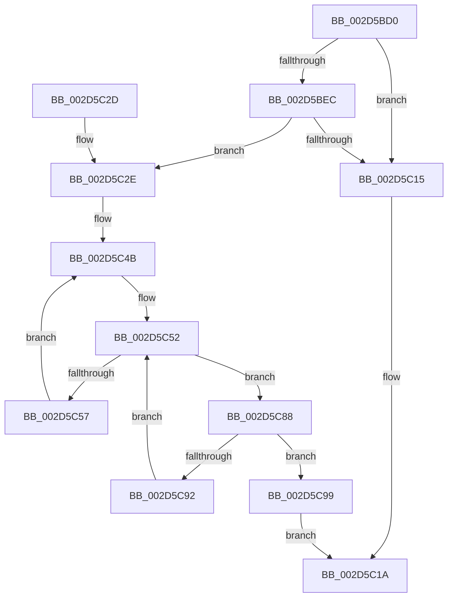

# PpmParkReportUnparkedCores

- RVA: `0x002D5BD0`–`0x002D5CA0` (길이 `208` bytes)
- VA: `0x00000001402D5BD0`
- 실행 섹션: `.text`
- PDB 이름 있음: `예`; PDB Function 태그: `아니요`
- unwind 정보 RVA: `0x0006FD24`
- 디코드: `57`개 명령, `208/208` bytes 표시
- 미해석 바이트: `0` (있으면 어셈블리에 `.byte`로 보존)

> 이 문서는 커널 이미지의 기계어와 PDB 기호를 분석해 생성했습니다. 4번과 5번은 함수 원형과 자료형을 바이너리 사용 방식에서 추정한 C 해석이며 원본 소스 복구 결과는 아닙니다.

## 1. Dependencies

- 직접 호출 지점: **4**; 고유 호출 대상: **4**
- 직접 호출자로 확인된 함수: **0**
- RIP 상대 이미지 참조: **8**

### Outgoing calls
- `0x002D5C0C` → [KiSubtractAffinityEx](KiSubtractAffinityEx_function_002D61E8.md) (function, `0x002D61E8`)
- `0x002D5C31` → [KeCountSetBitsAffinityEx](../2C/KeCountSetBitsAffinityEx_function_002CE6E0.md) (function, `0x002CE6E0`)
- `0x002D5C77` → [KeGetPrcb](KeGetPrcb_function_002D85D0.md) (function, `0x002D85D0`)
- `0x002D5C81` → [PpmPerfQueueAction](PpmPerfQueueAction_function_002D91B0.md) (function, `0x002D91B0`)

### Direct callers
- 이 함수 시작 RVA로 연결되는 직접 call은 확인되지 않았습니다. 간접 호출은 완전히 역산할 수 없습니다.

### Static image references
- `0x002D5BE4` → RVA `0x00F083D0` (`.data`; read)
- `0x002D5BEC` → RVA `0x00E0BBA2` (`.data`; read)
- `0x002D5BF4` → RVA `0x00E0BBA0` (`.data`; read)
- `0x002D5BFE` → RVA `0x00E0BED0` (`.data`; read)
- `0x002D5C05` → RVA `0x00E0B980` (`.data`; read)
- `0x002D5C36` → RVA `0x00E0BBA8` (`.data`; read)
- `0x002D5C40` → RVA `0x00F0B278` (`.data`; write)
- `0x002D5C6D` → RVA `0x00F231B8` (`.data`; read)

## 2. Other-region calls and transfers

- 다른 실행 섹션으로 향하는 call: **0**
- 별도 외부 분기/꼬리 이동을 확인하지 못했습니다.

## 3. Assembly (complete function range)

```asm
002D5BD0  48 89 5C 24 10                  mov qword ptr [rsp + 0x10], rbx
002D5BD5  48 89 6C 24 18                  mov qword ptr [rsp + 0x18], rbp
002D5BDA  56                              push rsi
002D5BDB  57                              push rdi
002D5BDC  41 56                           push r14
002D5BDE  48 83 EC 20                     sub rsp, 0x20
002D5BE2  33 ED                           xor ebp, ebp
002D5BE4  39 2D E6 27 C3 00               cmp dword ptr [rip + 0xc327e6], ebp
002D5BEA  74 29                           je 0x1402d5c15
002D5BEC  44 0F B7 0D AE 5F B3 00         movzx r9d, word ptr [rip + 0xb35fae]
002D5BF4  4C 8D 35 A5 5F B3 00            lea r14, [rip + 0xb35fa5]
002D5BFB  4D 8B C6                        mov r8, r14
002D5BFE  48 8D 15 CB 62 B3 00            lea rdx, [rip + 0xb362cb]
002D5C05  48 8D 0D 74 5D B3 00            lea rcx, [rip + 0xb35d74]
002D5C0C  E8 D7 05 00 00                  call 0x1402d61e8
002D5C11  85 C0                           test eax, eax
002D5C13  75 19                           jne 0x1402d5c2e
002D5C15  B8 01 00 00 00                  mov eax, 1
002D5C1A  48 8B 5C 24 48                  mov rbx, qword ptr [rsp + 0x48]
002D5C1F  48 8B 6C 24 50                  mov rbp, qword ptr [rsp + 0x50]
002D5C24  48 83 C4 20                     add rsp, 0x20
002D5C28  41 5E                           pop r14
002D5C2A  5F                              pop rdi
002D5C2B  5E                              pop rsi
002D5C2C  C3                              ret
002D5C2D  CC                              int3
002D5C2E  49 8B CE                        mov rcx, r14
002D5C31  E8 AA 8A FF FF                  call 0x1402ce6e0
002D5C36  48 8B 35 6B 5F B3 00            mov rsi, qword ptr [rip + 0xb35f6b]
002D5C3D  0F B7 DD                        movzx ebx, bp
002D5C40  89 05 32 56 C3 00               mov dword ptr [rip + 0xc35632], eax
002D5C46  BF 01 00 00 00                  mov edi, 1
002D5C4B  0F B7 0D 4E 5F B3 00            movzx ecx, word ptr [rip + 0xb35f4e]
002D5C52  48 85 F6                        test rsi, rsi
002D5C55  74 31                           je 0x1402d5c88
002D5C57  48 0F BC D6                     bsf rdx, rsi
002D5C5B  0F B7 CB                        movzx ecx, bx
002D5C5E  0F B6 C2                        movzx eax, dl
002D5C61  48 0F B3 C6                     btr rsi, rax
002D5C65  C1 E1 06                        shl ecx, 6
002D5C68  0F B6 C2                        movzx eax, dl
002D5C6B  03 C8                           add ecx, eax
002D5C6D  48 8B 05 44 D5 C4 00            mov rax, qword ptr [rip + 0xc4d544]
002D5C74  8B 0C 88                        mov ecx, dword ptr [rax + rcx*4]
002D5C77  E8 54 29 00 00                  call 0x1402d85d0
002D5C7C  48 8B C8                        mov rcx, rax
002D5C7F  8B D7                           mov edx, edi
002D5C81  E8 2A 35 00 00                  call 0x1402d91b0
002D5C86  EB C3                           jmp 0x1402d5c4b
002D5C88  66 03 DF                        add bx, di
002D5C8B  0F B7 DB                        movzx ebx, bx
002D5C8E  3B D9                           cmp ebx, ecx
002D5C90  73 07                           jae 0x1402d5c99
002D5C92  49 8B 74 DE 08                  mov rsi, qword ptr [r14 + rbx*8 + 8]
002D5C97  EB B9                           jmp 0x1402d5c52
002D5C99  32 C0                           xor al, al
002D5C9B  E9 7A FF FF FF                  jmp 0x1402d5c1a
```

## 4. C-style interpretation (structured pseudocode)

```c
__int64 __fastcall PpmParkReportUnparkedCores(void)
{
    __int64 result;
    __int64 v_rbp;
    __int64 v_rbx;
    __int64 v_rsp;
    unsigned __int64 v_stack_p10;
    unsigned __int64 v_stack_p18;

    v_stack_p10 = v_rbx;
    v_stack_p18 = v_rbp;
    v_rsp = (v_rsp) - (32);
    v_rbp = 0;
    if ((*(unsigned int *)(v_rip + 12789734)) == 0) goto loc_002D5C15;
    result = KiSubtractAffinityEx(v_rip + 11754868, v_rip + 11756235, v_rip + 11755429, *(unsigned __int16 *)(v_rip + 11755438));
    if ((unsigned int)(result) != 0) goto loc_002D5C2E;
loc_002D5C15:
loc_002D5C1A:
    v_rsp = (v_rsp) + (32);
    return 1;
loc_002D5C2E:
    result = KeCountSetBitsAffinityEx(v_rip + 11755429, v_rip + 11756235, v_rip + 11755429, *(unsigned __int16 *)(v_rip + 11755438));
    *(unsigned int *)(v_rip + 12801586) = (unsigned int)(result);
loc_002D5C4B:
loc_002D5C52:
    if (*(unsigned __int64 *)(v_rip + 11755371) == 0) goto loc_002D5C88;
    a1 = (unsigned int)(((unsigned __int16)((unsigned __int16)(v_stack_p18))) << (6));
    a1 = (unsigned int)((a1) + ((unsigned int)((unsigned __int8)(v_rip + 11756235))));
    result = KeGetPrcb((unsigned int)(*(unsigned int *)(*(unsigned __int64 *)(v_rip + 12899652) + a1 * 4)), v_rip + 11756235, v_rip + 11755429, *(unsigned __int16 *)(v_rip + 11755438));
    result = PpmPerfQueueAction(result, 1, v_rip + 11755429, *(unsigned __int16 *)(v_rip + 11755438));
    goto loc_002D5C4B;
loc_002D5C88:
    v_rbx = (unsigned __int16)(((unsigned __int16)(v_stack_p18)) + (1));
    if (((unsigned int)((unsigned __int16)(v_rbx))) >= ((unsigned int)(result))) goto loc_002D5C99;
    goto loc_002D5C52;
loc_002D5C99:
    result = 0;
    goto loc_002D5C1A;
}
```

## 5. (Beta) C Style

```c
void PpmParkReportUnparkedCores(void)
{
    int64_t result;
    int64_t local_rbp;
    int64_t local_rbx;
    int64_t local_rsp;
    uint64_t v_stack_p10;
    uint64_t v_stack_p18;

    v_stack_p10 = local_rbx;
    v_stack_p18 = local_rbp;
    local_rsp = (local_rsp) - (32);
    local_rbp = 0;
    if ((*(uint32_t *)(v_rip + 0xC327E6)) == 0) goto loc_002D5C15;
    result = KiSubtractAffinityEx(v_rip + 11754868, v_rip + 11756235, v_rip + 11755429, *(uint16_t *)(v_rip + 0xB35FAE));
    if ((uint32_t)(result) != 0) goto loc_002D5C2E;
loc_002D5C15:
loc_002D5C1A:
    local_rsp = (local_rsp) + (32);
    return 1;
loc_002D5C2E:
    result = KeCountSetBitsAffinityEx(v_rip + 11755429, v_rip + 11756235, v_rip + 11755429, *(uint16_t *)(v_rip + 0xB35FAE));
    *(uint32_t *)(v_rip + 0xC35632) = (uint32_t)(result);
loc_002D5C4B:
loc_002D5C52:
    if (*(uint64_t *)(v_rip + 0xB35F6B) == 0) goto loc_002D5C88;
    a1 = (uint32_t)(((uint16_t)((uint16_t)(v_stack_p18))) << (6));
    a1 = (uint32_t)((a1) + ((uint32_t)((uint8_t)(v_rip + 11756235))));
    result = KeGetPrcb((uint32_t)(*(uint32_t *)(*(uint64_t *)(v_rip + 0xC4D544) + a1 * 4)), v_rip + 11756235, v_rip + 11755429, *(uint16_t *)(v_rip + 0xB35FAE));
    result = PpmPerfQueueAction(result, 1, v_rip + 11755429, *(uint16_t *)(v_rip + 0xB35FAE));
    goto loc_002D5C4B;
loc_002D5C88:
    local_rbx = (uint16_t)(((uint16_t)(v_stack_p18)) + (1));
    if (((uint32_t)((uint16_t)(local_rbx))) >= ((uint32_t)(result))) goto loc_002D5C99;
    goto loc_002D5C52;
loc_002D5C99:
    result = 0;
    goto loc_002D5C1A;
}
```

## 6. Execution-region graph

[열기: 2D/3D 그래프와 함수 탐색 컨트롤 패널](../../../control-panel.html?section=text&rva=0x002D5BD0&view=graph)

- 2D 그래프는 위에서 아래로 흐르고, 3D 그래프는 빈 공간을 드래그해 회전합니다. Shift+드래그는 이동, 휠은 확대·축소, 함수 노드 선택은 대상 보고서 이동입니다.

### Static fallback


