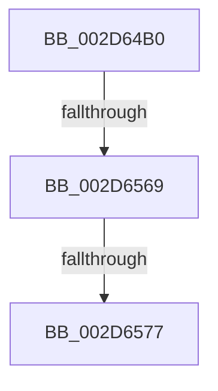

# PpmParkSteerInterrupts

- RVA: `0x002D64B0`–`0x002D6584` (길이 `212` bytes)
- VA: `0x00000001402D64B0`
- 실행 섹션: `.text`
- PDB 이름 있음: `예`; PDB Function 태그: `예`
- unwind 정보 RVA: `0x0006FDCC`
- 디코드: `42`개 명령, `212/212` bytes 표시
- 미해석 바이트: `0` (있으면 어셈블리에 `.byte`로 보존)

> 이 문서는 커널 이미지의 기계어와 PDB 기호를 분석해 생성했습니다. 4번과 5번은 함수 원형과 자료형을 바이너리 사용 방식에서 추정한 C 해석이며 원본 소스 복구 결과는 아닙니다.

## 1. Dependencies

- 직접 호출 지점: **6**; 고유 호출 대상: **1**
- 직접 호출자로 확인된 함수: **0**
- RIP 상대 이미지 참조: **4**

### Outgoing calls
- `0x002D64E3` → [memset](../6C/memset_function_006C6C40.md) (function, `0x006C6C40`)
- `0x002D6504` → [memset](../6C/memset_function_006C6C40.md) (function, `0x006C6C40`)
- `0x002D6518` → [memset](../6C/memset_function_006C6C40.md) (function, `0x006C6C40`)
- `0x002D652C` → [memset](../6C/memset_function_006C6C40.md) (function, `0x006C6C40`)
- `0x002D653E` → [memset](../6C/memset_function_006C6C40.md) (function, `0x006C6C40`)
- `0x002D6552` → [memset](../6C/memset_function_006C6C40.md) (function, `0x006C6C40`)

### Direct callers
- 이 함수 시작 RVA로 연결되는 직접 call은 확인되지 않았습니다. 간접 호출은 완전히 역산할 수 없습니다.

### Static image references
- `0x002D64C3` → RVA `0x00E0A740` (`.data`; read)
- `0x002D6557` → RVA `0x00E67A6C` (`.data`; read)
- `0x002D6569` → RVA `0x00F10CEC` (`.data`; read)
- `0x002D6577` → RVA `0x00F070F8` (`.data`; read)

## 2. Other-region calls and transfers

- 다른 실행 섹션으로 향하는 call: **0**
- call이 아닌 외부 분기/꼬리 이동: **3**
  - `0x002D6563` → [sub_002D6A87](Unknown_function_002D6A87.md) (`tail-transfer`)
  - `0x002D6571` → [sub_002D6A87](Unknown_function_002D6A87.md) (`tail-transfer`)
  - `0x002D657E` → [sub_002D6BD6](Unknown_function_002D6BD6.md) (`tail-transfer`)

## 3. Assembly (complete function range)

```asm
002D64B0  40 55                           push rbp
002D64B2  41 54                           push r12
002D64B4  48 8D AC 24 08 FA FF FF         lea rbp, [rsp - 0x5f8]
002D64BC  48 81 EC F8 06 00 00            sub rsp, 0x6f8
002D64C3  48 8B 05 76 42 B3 00            mov rax, qword ptr [rip + 0xb34276]
002D64CA  48 33 C4                        xor rax, rsp
002D64CD  48 89 85 D0 05 00 00            mov qword ptr [rbp + 0x5d0], rax
002D64D4  33 D2                           xor edx, edx
002D64D6  48 8D 8D A8 02 00 00            lea rcx, [rbp + 0x2a8]
002D64DD  41 B8 00 01 00 00               mov r8d, 0x100
002D64E3  E8 58 07 3F 00                  call 0x1406c6c40
002D64E8  45 33 E4                        xor r12d, r12d
002D64EB  48 8D 8D 80 00 00 00            lea rcx, [rbp + 0x80]
002D64F2  33 D2                           xor edx, edx
002D64F4  4C 89 64 24 58                  mov qword ptr [rsp + 0x58], r12
002D64F9  41 B8 08 01 00 00               mov r8d, 0x108
002D64FF  4C 89 64 24 68                  mov qword ptr [rsp + 0x68], r12
002D6504  E8 37 07 3F 00                  call 0x1406c6c40
002D6509  33 D2                           xor edx, edx
002D650B  48 8D 8D 98 01 00 00            lea rcx, [rbp + 0x198]
002D6512  41 B8 00 01 00 00               mov r8d, 0x100
002D6518  E8 23 07 3F 00                  call 0x1406c6c40
002D651D  33 D2                           xor edx, edx
002D651F  48 8D 8D B0 03 00 00            lea rcx, [rbp + 0x3b0]
002D6526  41 B8 08 01 00 00               mov r8d, 0x108
002D652C  E8 0F 07 3F 00                  call 0x1406c6c40
002D6531  33 D2                           xor edx, edx
002D6533  48 8D 4C 24 78                  lea rcx, [rsp + 0x78]
002D6538  41 B8 00 01 00 00               mov r8d, 0x100
002D653E  E8 FD 06 3F 00                  call 0x1406c6c40
002D6543  33 D2                           xor edx, edx
002D6545  48 8D 8D C0 04 00 00            lea rcx, [rbp + 0x4c0]
002D654C  41 B8 08 01 00 00               mov r8d, 0x108
002D6552  E8 E9 06 3F 00                  call 0x1406c6c40
002D6557  44 39 25 0E 15 B9 00            cmp dword ptr [rip + 0xb9150e], r12d
002D655E  44 89 64 24 50                  mov dword ptr [rsp + 0x50], r12d
002D6563  0F 85 1E 05 00 00               jne 0x1402d6a87
002D6569  8B 05 7D A7 C3 00               mov eax, dword ptr [rip + 0xc3a77d]
002D656F  85 C0                           test eax, eax
002D6571  0F 84 10 05 00 00               je 0x1402d6a87
002D6577  4C 39 25 7A 0B C3 00            cmp qword ptr [rip + 0xc30b7a], r12
002D657E  0F 84 52 06 00 00               je 0x1402d6bd6
```

## 4. C-style interpretation (structured pseudocode)

```c
__int64 __fastcall PpmParkSteerInterrupts(__int64 a1, int a2)
{
    __int64 result;
    __int64 v_r12;
    __int64 v_rsp;
    unsigned __int64 v_stack_m148;
    unsigned __int64 v_stack_m258;
    unsigned __int64 v_stack_m360;
    unsigned __int64 v_stack_m38;
    unsigned __int64 v_stack_m470;
    unsigned __int64 v_stack_m588;
    unsigned __int64 v_stack_m608;
    unsigned __int64 v_stack_m690;
    unsigned __int64 v_stack_m6A0;
    unsigned __int64 v_stack_m6B0;
    unsigned int v_stack_m6B8;

    v_rsp = (v_rsp) - (0x6F8ULL);
    result = (*(unsigned __int64 *)(v_rip + 11747958)) ^ (v_rsp);
    v_stack_m38 = result;
    a2 = 0;
    result = memset(v_stack_m360, a2, 256, a4);
    v_r12 = 0;
    a2 = 0;
    v_stack_m6B0 = 0;
    v_stack_m6A0 = 0;
    result = memset(v_stack_m588, a2, 264, a4);
    a2 = 0;
    result = memset(v_stack_m470, a2, 256, a4);
    a2 = 0;
    result = memset(v_stack_m258, a2, 264, a4);
    a2 = 0;
    result = memset(v_stack_m690, a2, 256, a4);
    a2 = 0;
    result = memset(v_stack_m148, a2, 264, a4);
    v_stack_m6B8 = 0;
}
```

## 5. (Beta) C Style

```c
int64_t PpmParkSteerInterrupts(int64_t Arg1, int32_t Arg2)
{
    int64_t result;
    int64_t local_r12;
    int64_t local_rsp;
    uint64_t v_stack_m148;
    uint64_t v_stack_m258;
    uint64_t v_stack_m360;
    uint64_t v_stack_m38;
    uint64_t v_stack_m470;
    uint64_t v_stack_m588;
    uint64_t v_stack_m608;
    uint64_t v_stack_m690;
    uint64_t v_stack_m6A0;
    uint64_t v_stack_m6B0;
    uint32_t v_stack_m6B8;

    local_rsp = (local_rsp) - (0x6F8ULL);
    result = (*(uint64_t *)(v_rip + 0xB34276)) ^ (local_rsp);
    v_stack_m38 = result;
    Arg2 = 0;
    result = memset(v_stack_m360, Arg2, 256, a4);
    local_r12 = 0;
    Arg2 = 0;
    v_stack_m6B0 = 0;
    v_stack_m6A0 = 0;
    result = memset(v_stack_m588, Arg2, 264, a4);
    Arg2 = 0;
    result = memset(v_stack_m470, Arg2, 256, a4);
    Arg2 = 0;
    result = memset(v_stack_m258, Arg2, 264, a4);
    Arg2 = 0;
    result = memset(v_stack_m690, Arg2, 256, a4);
    Arg2 = 0;
    result = memset(v_stack_m148, Arg2, 264, a4);
    v_stack_m6B8 = 0;
}
```

## 6. Execution-region graph

[열기: 2D/3D 그래프와 함수 탐색 컨트롤 패널](../../../control-panel.html?section=text&rva=0x002D64B0&view=graph)

- 2D 그래프는 위에서 아래로 흐르고, 3D 그래프는 빈 공간을 드래그해 회전합니다. Shift+드래그는 이동, 휠은 확대·축소, 함수 노드 선택은 대상 보고서 이동입니다.

### Static fallback


