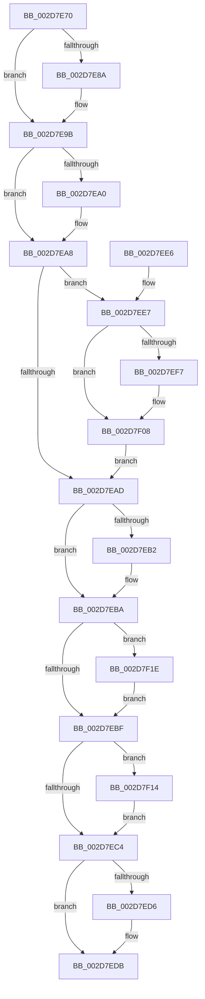

# PpmPerfAction

- RVA: `0x002D7E70`–`0x002D7F28` (길이 `184` bytes)
- VA: `0x00000001402D7E70`
- 실행 섹션: `.text`
- PDB 이름 있음: `예`; PDB Function 태그: `아니요`
- unwind 정보 RVA: `0x0007013C`
- 디코드: `53`개 명령, `184/184` bytes 표시
- 미해석 바이트: `0` (있으면 어셈블리에 `.byte`로 보존)

> 이 문서는 커널 이미지의 기계어와 PDB 기호를 분석해 생성했습니다. 4번과 5번은 함수 원형과 자료형을 바이너리 사용 방식에서 추정한 C 해석이며 원본 소스 복구 결과는 아닙니다.

## 1. Dependencies

- 직접 호출 지점: **8**; 고유 호출 대상: **7**
- 직접 호출자로 확인된 함수: **1**
- RIP 상대 이미지 참조: **1**

### Outgoing calls
- `0x002D7E96` → [PpmPerfSnapDeliveredPerformance](PpmPerfSnapDeliveredPerformance_function_002D7F30.md) (function, `0x002D7F30`)
- `0x002D7EA3` → [PpmParkReportUnparkedCore](PpmParkReportUnparkedCore_function_002D82E0.md) (function, `0x002D82E0`)
- `0x002D7EB5` → [PpmParkReportParkedCore](PpmParkReportParkedCore_function_002D8488.md) (function, `0x002D8488`)
- `0x002D7ED6` → [PpmCheckContinueExecution](PpmCheckContinueExecution_function_002D836C.md) (function, `0x002D836C`)
- `0x002D7F03` → [PpmPerfApplyProcessorState](PpmPerfApplyProcessorState_function_002DA4BC.md) (function, `0x002DA4BC`)
- `0x002D7F0D` → [PpmPerfApplyProcessorState](PpmPerfApplyProcessorState_function_002DA4BC.md) (function, `0x002DA4BC`)
- `0x002D7F17` → [PpmParkReportSoftParkChange](../35/PpmParkReportSoftParkChange_function_003526DC.md) (function, `0x003526DC`)
- `0x002D7F21` → [PpmParkReportForceParkChange](../5D/PpmParkReportForceParkChange_function_005DBE30.md) (function, `0x005DBE30`)

### Direct callers
- [KiExecuteAllDpcs](../25/KiExecuteAllDpcs_function_0025B740.md) at `0x0025BDC6`

### Static image references
- `0x002D7EC9` → RVA `0x00F0B278` (`.data`; read/write)

## 2. Other-region calls and transfers

- 다른 실행 섹션으로 향하는 call: **0**
- 별도 외부 분기/꼬리 이동을 확인하지 못했습니다.

## 3. Assembly (complete function range)

```asm
002D7E70  48 89 5C 24 08                  mov qword ptr [rsp + 8], rbx
002D7E75  57                              push rdi
002D7E76  48 83 EC 20                     sub rsp, 0x20
002D7E7A  33 DB                           xor ebx, ebx
002D7E7C  48 8B FA                        mov rdi, rdx
002D7E7F  87 9A 98 89 00 00               xchg dword ptr [rdx + 0x8998], ebx
002D7E85  F6 C3 01                        test bl, 1
002D7E88  74 11                           je 0x1402d7e9b
002D7E8A  48 8D 8A B0 89 00 00            lea rcx, [rdx + 0x89b0]
002D7E91  45 33 C0                        xor r8d, r8d
002D7E94  33 D2                           xor edx, edx
002D7E96  E8 95 00 00 00                  call 0x1402d7f30
002D7E9B  F6 C3 02                        test bl, 2
002D7E9E  74 08                           je 0x1402d7ea8
002D7EA0  48 8B CF                        mov rcx, rdi
002D7EA3  E8 38 04 00 00                  call 0x1402d82e0
002D7EA8  F6 C3 04                        test bl, 4
002D7EAB  75 3A                           jne 0x1402d7ee7
002D7EAD  F6 C3 08                        test bl, 8
002D7EB0  74 08                           je 0x1402d7eba
002D7EB2  48 8B CF                        mov rcx, rdi
002D7EB5  E8 CE 05 00 00                  call 0x1402d8488
002D7EBA  F6 C3 20                        test bl, 0x20
002D7EBD  75 5F                           jne 0x1402d7f1e
002D7EBF  F6 C3 10                        test bl, 0x10
002D7EC2  75 50                           jne 0x1402d7f14
002D7EC4  B8 FF FF FF FF                  mov eax, 0xffffffff
002D7EC9  F0 0F C1 05 A7 33 C3 00         lock xadd dword ptr [rip + 0xc333a7], eax
002D7ED1  83 F8 01                        cmp eax, 1
002D7ED4  75 05                           jne 0x1402d7edb
002D7ED6  E8 91 04 00 00                  call 0x1402d836c
002D7EDB  48 8B 5C 24 30                  mov rbx, qword ptr [rsp + 0x30]
002D7EE0  48 83 C4 20                     add rsp, 0x20
002D7EE4  5F                              pop rdi
002D7EE5  C3                              ret
002D7EE6  CC                              int3
002D7EE7  48 8B 87 B8 89 00 00            mov rax, qword ptr [rdi + 0x89b8]
002D7EEE  80 B8 8C 00 00 00 00            cmp byte ptr [rax + 0x8c], 0
002D7EF5  74 11                           je 0x1402d7f08
002D7EF7  B2 01                           mov dl, 1
002D7EF9  C6 80 8C 00 00 00 00            mov byte ptr [rax + 0x8c], 0
002D7F00  48 8B CF                        mov rcx, rdi
002D7F03  E8 B4 25 00 00                  call 0x1402da4bc
002D7F08  33 D2                           xor edx, edx
002D7F0A  48 8B CF                        mov rcx, rdi
002D7F0D  E8 AA 25 00 00                  call 0x1402da4bc
002D7F12  EB 99                           jmp 0x1402d7ead
002D7F14  48 8B CF                        mov rcx, rdi
002D7F17  E8 C0 A7 07 00                  call 0x1403526dc
002D7F1C  EB A6                           jmp 0x1402d7ec4
002D7F1E  48 8B CF                        mov rcx, rdi
002D7F21  E8 0A 3F 30 00                  call 0x1405dbe30
002D7F26  EB 97                           jmp 0x1402d7ebf
```

## 4. C-style interpretation (structured pseudocode)

```c
__int64 __fastcall PpmPerfAction(__int64 a1, __int64 a2, int a3)
{
    __int64 result;
    __int64 v_rbx;
    __int64 v_rsp;
    unsigned __int64 v_stack_p8;

    v_stack_p8 = v_rbx;
    v_rsp = (v_rsp) - (32);
    v_rbx = 0;
    if (((0) & (1)) != 0) {
        a1 = a2 + 35248;
        a3 = 0;
        a2 = 0;
        result = PpmPerfSnapDeliveredPerformance(a1, a2, a3, a4);
    }
    if (((0) & (2)) != 0) {
        a1 = 0;
        result = PpmParkReportUnparkedCore(a1, a2, a3, a4);
    }
    if (((0) & (4)) != 0) goto loc_002D7EE7;
loc_002D7EAD:
    if (((0) & (8)) != 0) {
        a1 = 0;
        result = PpmParkReportParkedCore(a1, a2, a3, a4);
    }
    if (((0) & (32)) != 0) goto loc_002D7F1E;
loc_002D7EBF:
    if (((0) & (16)) != 0) goto loc_002D7F14;
loc_002D7EC4:
    result = (unsigned int)(0xFFFFFFFFULL);
    if (((unsigned int)((unsigned int)(0xFFFFFFFFULL))) == 1) {
        result = PpmCheckContinueExecution(a1, a2, a3, a4);
    }
    v_rsp = (v_rsp) + (32);
    return result;
loc_002D7EE7:
    result = *(unsigned __int64 *)(a2 + 35256);
    if ((*(unsigned __int8 *)(*(unsigned __int64 *)(a2 + 35256) + 140)) != 0) {
        a2 = 1;
        *(unsigned __int8 *)(*(unsigned __int64 *)(a2 + 35256) + 140) = 0;
        a1 = a2;
        result = PpmPerfApplyProcessorState(a1, a2, a3, a4);
    }
    a2 = 0;
    result = PpmPerfApplyProcessorState(0, a2, a3, a4);
    goto loc_002D7EAD;
loc_002D7F14:
    result = PpmParkReportSoftParkChange(0, a2, a3, a4);
    goto loc_002D7EC4;
loc_002D7F1E:
    result = PpmParkReportForceParkChange(0, a2, a3, a4);
    goto loc_002D7EBF;
}
```

## 5. (Beta) C Style

```c
int64_t PpmPerfAction(int64_t Arg1, void *Arg2, int32_t Arg3)
{
    uint8_t *arg2 = (uint8_t *)Arg2;

    int64_t result;
    int64_t local_rbx;
    int64_t local_rsp;
    uint64_t v_stack_p8;

    v_stack_p8 = local_rbx;
    local_rsp = (local_rsp) - (32);
    local_rbx = 0;
    if (((0) & (1)) != 0) {
        Arg1 = Arg2 + 35248;
        Arg3 = 0;
        Arg2 = 0;
        result = PpmPerfSnapDeliveredPerformance(Arg1, Arg2, Arg3, a4);
    }
    if (((0) & (2)) != 0) {
        Arg1 = 0;
        result = PpmParkReportUnparkedCore(Arg1, Arg2, Arg3, a4);
    }
    if (((0) & (4)) != 0) goto loc_002D7EE7;
loc_002D7EAD:
    if (((0) & (8)) != 0) {
        Arg1 = 0;
        result = PpmParkReportParkedCore(Arg1, Arg2, Arg3, a4);
    }
    if (((0) & (32)) != 0) goto loc_002D7F1E;
loc_002D7EBF:
    if (((0) & (16)) != 0) goto loc_002D7F14;
loc_002D7EC4:
    result = (uint32_t)(0xFFFFFFFFULL);
    if (((uint32_t)((uint32_t)(0xFFFFFFFFULL))) == 1) {
        result = PpmCheckContinueExecution(Arg1, Arg2, Arg3, a4);
    }
    local_rsp = (local_rsp) + (32);
    return result;
loc_002D7EE7:
    result = *(uint64_t *)(arg2 + 0x89B8);
    if ((*(uint8_t *)(*(uint64_t *)(arg2 + 0x89B8) + 0x8C)) != 0) {
        Arg2 = 1;
        *(uint8_t *)(*(uint64_t *)(arg2 + 0x89B8) + 0x8C) = 0;
        Arg1 = Arg2;
        result = PpmPerfApplyProcessorState(Arg1, Arg2, Arg3, a4);
    }
    Arg2 = 0;
    result = PpmPerfApplyProcessorState(0, Arg2, Arg3, a4);
    goto loc_002D7EAD;
loc_002D7F14:
    result = PpmParkReportSoftParkChange(0, Arg2, Arg3, a4);
    goto loc_002D7EC4;
loc_002D7F1E:
    result = PpmParkReportForceParkChange(0, Arg2, Arg3, a4);
    goto loc_002D7EBF;
}
```

### 관측된 메모리 오프셋

구조체 형식이 확인되지 않은 접근은 인자 기준의 오프셋으로만 기록했습니다.

| 기준 인자 | 오프셋 표현 | 폭 (bit) | 접근 |
|---|---:|---:|---|
| `Arg2` | `+ 0x8998` | `32` | `R/W` |
| `Arg2` | `+ 0x89B0` | `64` | `R` |
| `Arg2` | `+ 0x89B8` | `64` | `R` |

## 6. Execution-region graph

[열기: 2D/3D 그래프와 함수 탐색 컨트롤 패널](../../../control-panel.html?section=text&rva=0x002D7E70&view=graph)

- 2D 그래프는 위에서 아래로 흐르고, 3D 그래프는 빈 공간을 드래그해 회전합니다. Shift+드래그는 이동, 휠은 확대·축소, 함수 노드 선택은 대상 보고서 이동입니다.

### Static fallback


