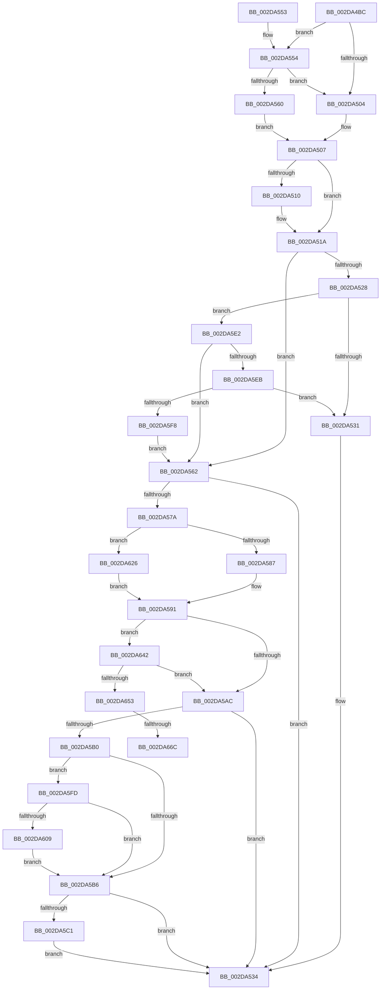

# PpmPerfApplyProcessorState

- RVA: `0x002DA4BC`–`0x002DA678` (길이 `444` bytes)
- VA: `0x00000001402DA4BC`
- 실행 섹션: `.text`
- PDB 이름 있음: `예`; PDB Function 태그: `예`
- unwind 정보 RVA: `0x00070514`
- 디코드: `112`개 명령, `444/444` bytes 표시
- 미해석 바이트: `0` (있으면 어셈블리에 `.byte`로 보존)

> 이 문서는 커널 이미지의 기계어와 PDB 기호를 분석해 생성했습니다. 4번과 5번은 함수 원형과 자료형을 바이너리 사용 방식에서 추정한 C 해석이며 원본 소스 복구 결과는 아닙니다.

## 1. Dependencies

- 직접 호출 지점: **10**; 고유 호출 대상: **10**
- 직접 호출자로 확인된 함수: **2**
- RIP 상대 이미지 참조: **0**

### Outgoing calls
- `0x002DA564` → [KeQueryPerformanceCounter](../37/KeQueryPerformanceCounter_function_0037E7E0.md) (function, `0x0037E7E0`)
- `0x002DA56F` → [PpmContinueTimeAccumulation](PpmContinueTimeAccumulation_function_002DC5A8.md) (function, `0x002DC5A8`)
- `0x002DA59C` → [PpmPerfArbitratorApplyProcessorState](../39/PpmPerfArbitratorApplyProcessorState_function_00391E00.md) (function, `0x00391E00`)
- `0x002DA5C4` → [PpmEventLegacyProcessorPerfStateChange](../48/PpmEventLegacyProcessorPerfStateChange_function_004800AC.md) (function, `0x004800AC`)
- `0x002DA5D0` → [PpmScaleIdleStateValues](../44/PpmScaleIdleStateValues_function_00447674.md) (function, `0x00447674`)
- `0x002DA5D8` → [PpmEventTraceExpectedUtility](../47/PpmEventTraceExpectedUtility_function_0047B280.md) (function, `0x0047B280`)
- `0x002DA61F` → [guard_dispatch_icall](../6B/guard_dispatch_icall_function_006BAAD0.md) (function, `0x006BAAD0`)
- `0x002DA626` → [KeDisableInterrupts](../21/KeDisableInterrupts_function_00217BE0.md) (function, `0x00217BE0`)
- `0x002DA638` → [KeAcquireSpinLockAtDpcLevel](../20/KeAcquireSpinLockAtDpcLevel_function_00208430.md) (function, `0x00208430`)
- `0x002DA645` → [KxReleaseSpinLock](../20/KxReleaseSpinLock_function_00206670.md) (function, `0x00206670`)

### Direct callers
- [PpmPerfAction](PpmPerfAction_function_002D7E70.md) at `0x002D7F03`
- [PpmPerfAction](PpmPerfAction_function_002D7E70.md) at `0x002D7F0D`
- [PpmPerfApplyProcessorStates](PpmPerfApplyProcessorStates_function_002D8EF0.md) at `0x002D903A`
- [PpmPerfApplyProcessorStates](PpmPerfApplyProcessorStates_function_002D8EF0.md) at `0x002D907E`

### Static image references
- 디코드된 RIP-relative 메모리 참조가 없습니다.

## 2. Other-region calls and transfers

- 다른 실행 섹션으로 향하는 call: **0**
- call이 아닌 외부 분기/꼬리 이동: **2**
  - `0x002DA666` → [sub_006DDD5E + 0x18](../6D/Unknown_function_006DDD5E.md) (`tail-transfer`)
  - `0x002DA673` → [sub_006DDD5E](../6D/Unknown_function_006DDD5E.md) (`tail-transfer`)

## 3. Assembly (complete function range)

```asm
002DA4BC  48 8B C4                        mov rax, rsp
002DA4BF  48 89 58 08                     mov qword ptr [rax + 8], rbx
002DA4C3  48 89 68 18                     mov qword ptr [rax + 0x18], rbp
002DA4C7  48 89 70 20                     mov qword ptr [rax + 0x20], rsi
002DA4CB  88 50 10                        mov byte ptr [rax + 0x10], dl
002DA4CE  57                              push rdi
002DA4CF  41 54                           push r12
002DA4D1  41 55                           push r13
002DA4D3  41 56                           push r14
002DA4D5  41 57                           push r15
002DA4D7  48 83 EC 30                     sub rsp, 0x30
002DA4DB  48 8B A9 B8 89 00 00            mov rbp, qword ptr [rcx + 0x89b8]
002DA4E2  4C 8D A9 B0 89 00 00            lea r13, [rcx + 0x89b0]
002DA4E9  49 8B 7D 00                     mov rdi, qword ptr [r13]
002DA4ED  4C 8B F1                        mov r14, rcx
002DA4F0  45 33 FF                        xor r15d, r15d
002DA4F3  8A C2                           mov al, dl
002DA4F5  41 BC 01 00 00 00               mov r12d, 1
002DA4FB  48 8B 4F 10                     mov rcx, qword ptr [rdi + 0x10]
002DA4FF  4C 3B E9                        cmp r13, rcx
002DA502  75 50                           jne 0x1402da554
002DA504  41 8A F4                        mov sil, r12b
002DA507  80 BF E9 01 00 00 FD            cmp byte ptr [rdi + 0x1e9], 0xfd
002DA50E  74 0A                           je 0x1402da51a
002DA510  84 C0                           test al, al
002DA512  40 0F B6 F6                     movzx esi, sil
002DA516  41 0F 45 F4                     cmovne esi, r12d
002DA51A  65 48 8B 04 25 20 00 00 00      mov rax, qword ptr gs:[0x20]
002DA523  4C 3B F0                        cmp r14, rax
002DA526  74 3A                           je 0x1402da562
002DA528  4C 3B E9                        cmp r13, rcx
002DA52B  0F 85 B1 00 00 00               jne 0x1402da5e2
002DA531  41 8A DF                        mov bl, r15b
002DA534  48 8B 6C 24 70                  mov rbp, qword ptr [rsp + 0x70]
002DA539  8A C3                           mov al, bl
002DA53B  48 8B 5C 24 60                  mov rbx, qword ptr [rsp + 0x60]
002DA540  48 8B 74 24 78                  mov rsi, qword ptr [rsp + 0x78]
002DA545  48 83 C4 30                     add rsp, 0x30
002DA549  41 5F                           pop r15
002DA54B  41 5E                           pop r14
002DA54D  41 5D                           pop r13
002DA54F  41 5C                           pop r12
002DA551  5F                              pop rdi
002DA552  C3                              ret
002DA553  CC                              int3
002DA554  41 8A F7                        mov sil, r15b
002DA557  44 38 BF EE 01 00 00            cmp byte ptr [rdi + 0x1ee], r15b
002DA55E  75 A4                           jne 0x1402da504
002DA560  EB A5                           jmp 0x1402da507
002DA562  33 C9                           xor ecx, ecx
002DA564  E8 77 42 0A 00                  call 0x14037e7e0
002DA569  48 8B D0                        mov rdx, rax
002DA56C  49 8B CE                        mov rcx, r14
002DA56F  E8 34 20 00 00                  call 0x1402dc5a8
002DA574  8A D8                           mov bl, al
002DA576  84 C0                           test al, al
002DA578  74 BA                           je 0x1402da534
002DA57A  44 38 BD 8D 00 00 00            cmp byte ptr [rbp + 0x8d], r15b
002DA581  0F 85 9F 00 00 00               jne 0x1402da626
002DA587  45 8A E7                        mov r12b, r15b
002DA58A  48 81 C5 90 00 00 00            add rbp, 0x90
002DA591  44 8A 44 24 68                  mov r8b, byte ptr [rsp + 0x68]
002DA596  40 8A D6                        mov dl, sil
002DA599  49 8B CE                        mov rcx, r14
002DA59C  E8 5F 78 0B 00                  call 0x140391e00
002DA5A1  8A D8                           mov bl, al
002DA5A3  45 84 E4                        test r12b, r12b
002DA5A6  0F 85 96 00 00 00               jne 0x1402da642
002DA5AC  84 DB                           test bl, bl
002DA5AE  74 84                           je 0x1402da534
002DA5B0  4C 3B 6F 10                     cmp r13, qword ptr [rdi + 0x10]
002DA5B4  74 47                           je 0x1402da5fd
002DA5B6  80 7C 24 68 00                  cmp byte ptr [rsp + 0x68], 0
002DA5BB  0F 85 73 FF FF FF               jne 0x1402da534
002DA5C1  49 8B CE                        mov rcx, r14
002DA5C4  E8 E3 5A 1A 00                  call 0x1404800ac
002DA5C9  49 8D 8E 40 88 00 00            lea rcx, [r14 + 0x8840]
002DA5D0  E8 9F D0 16 00                  call 0x140447674
002DA5D5  49 8B CD                        mov rcx, r13
002DA5D8  E8 A3 0C 1A 00                  call 0x14047b280
002DA5DD  E9 52 FF FF FF                  jmp 0x1402da534
002DA5E2  40 84 F6                        test sil, sil
002DA5E5  0F 84 77 FF FF FF               je 0x1402da562
002DA5EB  44 38 BF EB 01 00 00            cmp byte ptr [rdi + 0x1eb], r15b
002DA5F2  0F 85 39 FF FF FF               jne 0x1402da531
002DA5F8  E9 65 FF FF FF                  jmp 0x1402da562
002DA5FD  48 8B 87 98 01 00 00            mov rax, qword ptr [rdi + 0x198]
002DA604  48 85 C0                        test rax, rax
002DA607  74 AD                           je 0x1402da5b6
002DA609  44 8A 4C 24 68                  mov r9b, byte ptr [rsp + 0x68]
002DA60E  48 8D 97 28 03 00 00            lea rdx, [rdi + 0x328]
002DA615  48 8B 8F 20 01 00 00            mov rcx, qword ptr [rdi + 0x120]
002DA61C  44 8A C6                        mov r8b, sil
002DA61F  E8 AC 04 3E 00                  call 0x1406baad0
002DA624  EB 90                           jmp 0x1402da5b6
002DA626  E8 B5 D5 F3 FF                  call 0x140217be0
002DA62B  48 81 C5 90 00 00 00            add rbp, 0x90
002DA632  44 8A F8                        mov r15b, al
002DA635  48 8B CD                        mov rcx, rbp
002DA638  E8 F3 DD F2 FF                  call 0x140208430
002DA63D  E9 4F FF FF FF                  jmp 0x1402da591
002DA642  48 8B CD                        mov rcx, rbp
002DA645  E8 26 C0 F2 FF                  call 0x140206670
002DA64A  45 84 FF                        test r15b, r15b
002DA64D  0F 84 59 FF FF FF               je 0x1402da5ac
002DA653  65 48 8B 0C 25 20 00 00 00      mov rcx, qword ptr gs:[0x20]
002DA65C  4C 8B 81 B8 8E 00 00            mov r8, qword ptr [rcx + 0x8eb8]
002DA663  4D 85 C0                        test r8, r8
002DA666  0F 84 0A 37 40 00               je 0x1406ddd76
002DA66C  41 0F 0D 08                     prefetchw byte ptr [r8]
002DA670  41 8B 00                        mov eax, dword ptr [r8]
002DA673  E9 E6 36 40 00                  jmp 0x1406ddd5e
```

## 4. C-style interpretation (structured pseudocode)

```c
__int64 __fastcall PpmPerfApplyProcessorState(__int64 a1, unsigned __int8 a2)
{
    __int64 result;
    __int64 v_r15;
    __int64 v_rbp;
    __int64 v_rsi;
    __int64 v_rsp;
    unsigned __int64 v_stack_p18;
    unsigned __int64 v_stack_p20;
    unsigned __int8 v_stack_p68;
    unsigned __int64 v_stack_p8;

    *(unsigned __int64 *)(v_rsp + 8) = v_rbx;
    *(unsigned __int64 *)(v_rsp + 24) = v_rbp;
    *(unsigned __int64 *)(v_rsp + 32) = v_rsi;
    *(unsigned __int8 *)(v_rsp + 16) = a2;
    v_rsp = (v_rsp) - (48);
    v_r15 = 0;
    if ((a1 + 35248) != (*(unsigned __int64 *)(*(unsigned __int64 *)(a1 + 35248) + 16))) goto loc_002DA554;
loc_002DA504:
loc_002DA507:
    v_rsi = 1;
    if ((*(unsigned __int8 *)(*(unsigned __int64 *)(a1 + 35248) + 489)) != 253) {
        v_rsi = 1;
        if (a2 != 0) { v_rsi = 1; }
    }
    if (a1 == (*(unsigned __int64 *)(gs_base + (0 + 32)))) goto loc_002DA562;
    if ((a1 + 35248) != (*(unsigned __int64 *)(*(unsigned __int64 *)(a1 + 35248) + 16))) goto loc_002DA5E2;
loc_002DA531:
loc_002DA534:
    v_rsp = (v_rsp) + (48);
    return 0;
loc_002DA554:
    if ((*(unsigned __int8 *)(*(unsigned __int64 *)(a1 + 35248) + 494)) != 0) goto loc_002DA504;
    goto loc_002DA507;
loc_002DA562:
    a1 = 0;
    result = KeQueryPerformanceCounter(a1, a2, a3, a4);
    result = PpmContinueTimeAccumulation(0, result, a3, a4);
    if ((unsigned __int8)(result) == 0) goto loc_002DA534;
    if ((*(unsigned __int8 *)(v_stack_p18 + 141)) != 0) goto loc_002DA626;
    v_rbp = (v_stack_p18) + (144);
loc_002DA591:
    result = PpmPerfArbitratorApplyProcessorState(0, 0, v_stack_p68, a4);
    if (0 != 0) goto loc_002DA642;
loc_002DA5AC:
    if ((unsigned __int8)((unsigned __int8)(result)) == 0) goto loc_002DA534;
    if ((a1 + 35248) == (*(unsigned __int64 *)(*(unsigned __int64 *)(a1 + 35248) + 16))) goto loc_002DA5FD;
loc_002DA5B6:
    if (v_stack_p68 != 0) goto loc_002DA534;
    result = PpmEventLegacyProcessorPerfStateChange(0, 0, v_stack_p68, a4);
    result = PpmScaleIdleStateValues(a1 + 34880, 0, v_stack_p68, a4);
    result = PpmEventTraceExpectedUtility(a1 + 35248, 0, v_stack_p68, a4);
    goto loc_002DA534;
loc_002DA5E2:
    if (0 == 0) goto loc_002DA562;
    if ((*(unsigned __int8 *)(*(unsigned __int64 *)(a1 + 35248) + 491)) != 0) goto loc_002DA531;
    goto loc_002DA562;
loc_002DA5FD:
    if (*(unsigned __int64 *)(*(unsigned __int64 *)(a1 + 35248) + 408) == 0) goto loc_002DA5B6;
    result = guard_dispatch_icall(*(unsigned __int64 *)(*(unsigned __int64 *)(a1 + 35248) + 288), *(unsigned __int64 *)(a1 + 35248) + 808, 0, v_stack_p68);
    goto loc_002DA5B6;
loc_002DA626:
    result = KeDisableInterrupts(*(unsigned __int64 *)(*(unsigned __int64 *)(a1 + 35248) + 288), *(unsigned __int64 *)(a1 + 35248) + 808, 0, v_stack_p68);
    v_rbp = (v_rbp) + (144);
    result = KeAcquireSpinLockAtDpcLevel(v_rbp, *(unsigned __int64 *)(a1 + 35248) + 808, 0, v_stack_p68);
    goto loc_002DA591;
loc_002DA642:
    result = KxReleaseSpinLock(v_rbp, *(unsigned __int64 *)(a1 + 35248) + 808, 0, v_stack_p68);
    if ((unsigned __int8)((unsigned __int8)(result)) == 0) goto loc_002DA5AC;
}
```

## 5. (Beta) C Style

```c
int64_t PpmPerfApplyProcessorState(void *Arg1, uint8_t Arg2)
{
    uint8_t *arg1 = (uint8_t *)Arg1;

    int64_t result;
    int64_t local_r15;
    int64_t local_rbp;
    int64_t local_rsi;
    int64_t local_rsp;
    uint64_t v_stack_p18;
    uint64_t v_stack_p20;
    uint8_t v_stack_p68;
    uint64_t v_stack_p8;

    *(uint64_t *)(local_rsp + 0x8) = local_rbx;
    *(uint64_t *)(local_rsp + 0x18) = local_rbp;
    *(uint64_t *)(local_rsp + 0x20) = local_rsi;
    *(uint8_t *)(local_rsp + 0x10) = Arg2;
    local_rsp = (local_rsp) - (48);
    local_r15 = 0;
    if ((Arg1 + 35248) != (*(uint64_t *)(*(uint64_t *)(arg1 + 0x89B0) + 0x10))) goto loc_002DA554;
loc_002DA504:
loc_002DA507:
    local_rsi = 1;
    if ((*(uint8_t *)(*(uint64_t *)(arg1 + 0x89B0) + 0x1E9)) != 253) {
        local_rsi = 1;
        if (Arg2 != 0) { local_rsi = 1; }
    }
    if (Arg1 == (*(uint64_t *)(gs_base + (0 + 0x20)))) goto loc_002DA562;
    if ((Arg1 + 35248) != (*(uint64_t *)(*(uint64_t *)(arg1 + 0x89B0) + 0x10))) goto loc_002DA5E2;
loc_002DA531:
loc_002DA534:
    local_rsp = (local_rsp) + (48);
    return 0;
loc_002DA554:
    if ((*(uint8_t *)(*(uint64_t *)(arg1 + 0x89B0) + 0x1EE)) != 0) goto loc_002DA504;
    goto loc_002DA507;
loc_002DA562:
    Arg1 = 0;
    result = KeQueryPerformanceCounter(Arg1, Arg2, a3, a4);
    result = PpmContinueTimeAccumulation(0, result, a3, a4);
    if ((uint8_t)(result) == 0) goto loc_002DA534;
    if ((*(uint8_t *)(v_stack_p18 + 0x8D)) != 0) goto loc_002DA626;
    local_rbp = (v_stack_p18) + (144);
loc_002DA591:
    result = PpmPerfArbitratorApplyProcessorState(0, 0, v_stack_p68, a4);
    if (0 != 0) goto loc_002DA642;
loc_002DA5AC:
    if ((uint8_t)((uint8_t)(result)) == 0) goto loc_002DA534;
    if ((Arg1 + 35248) == (*(uint64_t *)(*(uint64_t *)(arg1 + 0x89B0) + 0x10))) goto loc_002DA5FD;
loc_002DA5B6:
    if (v_stack_p68 != 0) goto loc_002DA534;
    result = PpmEventLegacyProcessorPerfStateChange(0, 0, v_stack_p68, a4);
    result = PpmScaleIdleStateValues(Arg1 + 34880, 0, v_stack_p68, a4);
    result = PpmEventTraceExpectedUtility(Arg1 + 35248, 0, v_stack_p68, a4);
    goto loc_002DA534;
loc_002DA5E2:
    if (0 == 0) goto loc_002DA562;
    if ((*(uint8_t *)(*(uint64_t *)(arg1 + 0x89B0) + 0x1EB)) != 0) goto loc_002DA531;
    goto loc_002DA562;
loc_002DA5FD:
    if (*(uint64_t *)(*(uint64_t *)(arg1 + 0x89B0) + 0x198) == 0) goto loc_002DA5B6;
    result = guard_dispatch_icall(*(uint64_t *)(*(uint64_t *)(arg1 + 0x89B0) + 0x120), *(uint64_t *)(arg1 + 0x89B0) + 808, 0, v_stack_p68);
    goto loc_002DA5B6;
loc_002DA626:
    result = KeDisableInterrupts(*(uint64_t *)(*(uint64_t *)(arg1 + 0x89B0) + 0x120), *(uint64_t *)(arg1 + 0x89B0) + 808, 0, v_stack_p68);
    local_rbp = (local_rbp) + (144);
    result = KeAcquireSpinLockAtDpcLevel(local_rbp, *(uint64_t *)(arg1 + 0x89B0) + 808, 0, v_stack_p68);
    goto loc_002DA591;
loc_002DA642:
    result = KxReleaseSpinLock(local_rbp, *(uint64_t *)(arg1 + 0x89B0) + 808, 0, v_stack_p68);
    if ((uint8_t)((uint8_t)(result)) == 0) goto loc_002DA5AC;
}
```

### 관측된 메모리 오프셋

구조체 형식이 확인되지 않은 접근은 인자 기준의 오프셋으로만 기록했습니다.

| 기준 인자 | 오프셋 표현 | 폭 (bit) | 접근 |
|---|---:|---:|---|
| `Arg1` | `+ 0x0` | `64` | `R` |
| `Arg1` | `+ 0x89B0` | `64` | `R` |
| `Arg1` | `+ 0x89B8` | `64` | `R` |

## 6. Execution-region graph

[열기: 2D/3D 그래프와 함수 탐색 컨트롤 패널](../../../control-panel.html?section=text&rva=0x002DA4BC&view=graph)

- 2D 그래프는 위에서 아래로 흐르고, 3D 그래프는 빈 공간을 드래그해 회전합니다. Shift+드래그는 이동, 휠은 확대·축소, 함수 노드 선택은 대상 보고서 이동입니다.

### Static fallback


