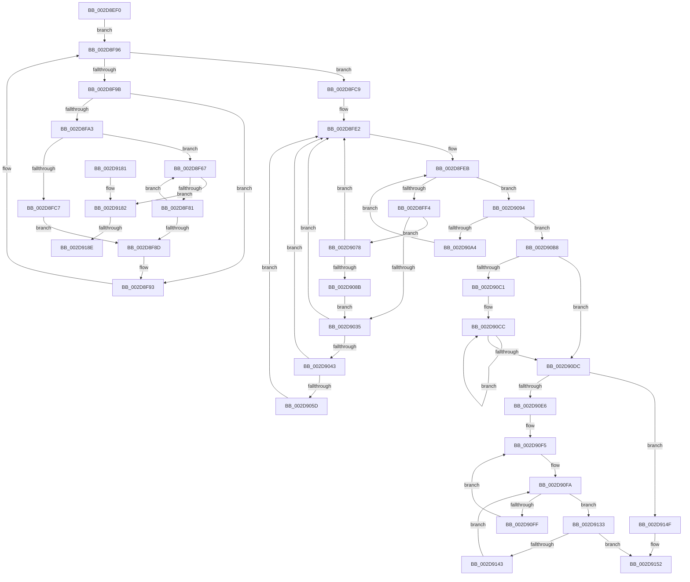

# PpmPerfApplyProcessorStates

- RVA: `0x002D8EF0`–`0x002D91A7` (길이 `695` bytes)
- VA: `0x00000001402D8EF0`
- 실행 섹션: `.text`
- PDB 이름 있음: `예`; PDB Function 태그: `예`
- unwind 정보 RVA: `0x000702C8`
- 디코드: `177`개 명령, `695/695` bytes 표시
- 미해석 바이트: `0` (있으면 어셈블리에 `.byte`로 보존)

> 이 문서는 커널 이미지의 기계어와 PDB 기호를 분석해 생성했습니다. 4번과 5번은 함수 원형과 자료형을 바이너리 사용 방식에서 추정한 C 해석이며 원본 소스 복구 결과는 아닙니다.

## 1. Dependencies

- 직접 호출 지점: **9**; 고유 호출 대상: **7**
- 직접 호출자로 확인된 함수: **0**
- RIP 상대 이미지 참조: **5**

### Outgoing calls
- `0x002D8F52` → [memset](../6C/memset_function_006C6C40.md) (function, `0x006C6C40`)
- `0x002D8FB7` → [KiOrAffinityEx](../39/KiOrAffinityEx_function_0039A84C.md) (function, `0x0039A84C`)
- `0x002D901D` → [KeGetPrcb](KeGetPrcb_function_002D85D0.md) (function, `0x002D85D0`)
- `0x002D903A` → [PpmPerfApplyProcessorState](PpmPerfApplyProcessorState_function_002DA4BC.md) (function, `0x002DA4BC`)
- `0x002D907E` → [PpmPerfApplyProcessorState](PpmPerfApplyProcessorState_function_002DA4BC.md) (function, `0x002DA4BC`)
- `0x002D911F` → [KeGetPrcb](KeGetPrcb_function_002D85D0.md) (function, `0x002D85D0`)
- `0x002D912C` → [PpmPerfQueueAction](PpmPerfQueueAction_function_002D91B0.md) (function, `0x002D91B0`)
- `0x002D915B` → [_security_check_cookie](../6A/_security_check_cookie_function_006AC640.md) (function, `0x006AC640`)
- `0x002D9197` → [PpmPerfApplyHiddenProcessorState](../5D/PpmPerfApplyHiddenProcessorState_function_005D4048.md) (function, `0x005D4048`)

### Direct callers
- 이 함수 시작 RVA로 연결되는 직접 call은 확인되지 않았습니다. 간접 호출은 완전히 역산할 수 없습니다.

### Static image references
- `0x002D8F14` → RVA `0x00E0A740` (`.data`; read)
- `0x002D8F57` → RVA `0x00FC6BA8` (`ALMOSTRO`; read)
- `0x002D900F` → RVA `0x00F231B8` (`.data`; read)
- `0x002D9043` → RVA `0x00F231B0` (`.data`; read)
- `0x002D90DC` → RVA `0x00F0B278` (`.data`; write)

## 2. Other-region calls and transfers

- 다른 실행 섹션으로 향하는 call: **0**
- call이 아닌 외부 분기/꼬리 이동: **2**
  - `0x002D9188` → [sub_006DDD4A](../6D/Unknown_function_006DDD4A.md) (`tail-transfer`)
  - `0x002D91A2` → [sub_006DDD4A](../6D/Unknown_function_006DDD4A.md) (`tail-transfer`)

## 3. Assembly (complete function range)

```asm
002D8EF0  48 89 5C 24 08                  mov qword ptr [rsp + 8], rbx
002D8EF5  48 89 74 24 10                  mov qword ptr [rsp + 0x10], rsi
002D8EFA  48 89 7C 24 18                  mov qword ptr [rsp + 0x18], rdi
002D8EFF  55                              push rbp
002D8F00  41 54                           push r12
002D8F02  41 55                           push r13
002D8F04  41 56                           push r14
002D8F06  41 57                           push r15
002D8F08  48 8D 6C 24 A0                  lea rbp, [rsp - 0x60]
002D8F0D  48 81 EC 60 01 00 00            sub rsp, 0x160
002D8F14  48 8B 05 25 18 B3 00            mov rax, qword ptr [rip + 0xb31825]
002D8F1B  48 33 C4                        xor rax, rsp
002D8F1E  48 89 45 50                     mov qword ptr [rbp + 0x50], rax
002D8F22  33 C0                           xor eax, eax
002D8F24  48 C7 44 24 40 01 00 20 00      mov qword ptr [rsp + 0x40], 0x200001
002D8F2D  0F 57 C0                        xorps xmm0, xmm0
002D8F30  48 89 44 24 30                  mov qword ptr [rsp + 0x30], rax
002D8F35  33 DB                           xor ebx, ebx
002D8F37  48 8D 4C 24 50                  lea rcx, [rsp + 0x50]
002D8F3C  33 D2                           xor edx, edx
002D8F3E  48 89 5C 24 48                  mov qword ptr [rsp + 0x48], rbx
002D8F43  41 B8 F8 00 00 00               mov r8d, 0xf8
002D8F49  44 8D 68 01                     lea r13d, [rax + 1]
002D8F4D  0F 11 44 24 20                  movups xmmword ptr [rsp + 0x20], xmm0
002D8F52  E8 E9 DC 3E 00                  call 0x1406c6c40
002D8F57  48 8B 3D 4A DC CE 00            mov rdi, qword ptr [rip + 0xcedc4a]
002D8F5E  4C 8D 3D 43 DC CE 00            lea r15, [rip + 0xcedc43]
002D8F65  EB 2F                           jmp 0x1402d8f96
002D8F67  41 8B C6                        mov eax, r14d
002D8F6A  48 69 F0 A8 04 00 00            imul rsi, rax, 0x4a8
002D8F71  48 03 B7 38 01 00 00            add rsi, qword ptr [rdi + 0x138]
002D8F78  39 5E 10                        cmp dword ptr [rsi + 0x10], ebx
002D8F7B  0F 85 01 02 00 00               jne 0x1402d9182
002D8F81  45 03 F5                        add r14d, r13d
002D8F84  44 3B B7 28 01 00 00            cmp r14d, dword ptr [rdi + 0x128]
002D8F8B  72 DA                           jb 0x1402d8f67
002D8F8D  88 9F BE 04 00 00               mov byte ptr [rdi + 0x4be], bl
002D8F93  48 8B 3F                        mov rdi, qword ptr [rdi]
002D8F96  49 3B FF                        cmp rdi, r15
002D8F99  74 2E                           je 0x1402d8fc9
002D8F9B  38 9F BE 04 00 00               cmp byte ptr [rdi + 0x4be], bl
002D8FA1  74 F0                           je 0x1402d8f93
002D8FA3  44 0F B7 4C 24 42               movzx r9d, word ptr [rsp + 0x42]
002D8FA9  48 8D 4F 18                     lea rcx, [rdi + 0x18]
002D8FAD  4C 8D 44 24 40                  lea r8, [rsp + 0x40]
002D8FB2  48 8D 54 24 40                  lea rdx, [rsp + 0x40]
002D8FB7  E8 90 18 0C 00                  call 0x14039a84c
002D8FBC  44 8B F3                        mov r14d, ebx
002D8FBF  39 9F 28 01 00 00               cmp dword ptr [rdi + 0x128], ebx
002D8FC5  77 A0                           ja 0x1402d8f67
002D8FC7  EB C4                           jmp 0x1402d8f8d
002D8FC9  48 8B 7C 24 48                  mov rdi, qword ptr [rsp + 0x48]
002D8FCE  48 8D 44 24 40                  lea rax, [rsp + 0x40]
002D8FD3  0F B7 74 24 30                  movzx esi, word ptr [rsp + 0x30]
002D8FD8  48 89 7C 24 28                  mov qword ptr [rsp + 0x28], rdi
002D8FDD  48 89 44 24 20                  mov qword ptr [rsp + 0x20], rax
002D8FE2  0F B7 4C 24 40                  movzx ecx, word ptr [rsp + 0x40]
002D8FE7  89 5C 24 38                     mov dword ptr [rsp + 0x38], ebx
002D8FEB  48 85 FF                        test rdi, rdi
002D8FEE  0F 84 A0 00 00 00               je 0x1402d9094
002D8FF4  48 0F BC D7                     bsf rdx, rdi
002D8FF8  0F B7 CE                        movzx ecx, si
002D8FFB  0F B6 C2                        movzx eax, dl
002D8FFE  48 0F B3 C7                     btr rdi, rax
002D9002  C1 E1 06                        shl ecx, 6
002D9005  0F B6 C2                        movzx eax, dl
002D9008  03 C8                           add ecx, eax
002D900A  48 89 7C 24 28                  mov qword ptr [rsp + 0x28], rdi
002D900F  48 8B 05 A2 A1 C4 00            mov rax, qword ptr [rip + 0xc4a1a2]
002D9016  44 8B 24 88                     mov r12d, dword ptr [rax + rcx*4]
002D901A  41 8B CC                        mov ecx, r12d
002D901D  E8 AE F5 FF FF                  call 0x1402d85d0
002D9022  4C 8B F0                        mov r14, rax
002D9025  4C 8B B8 B8 89 00 00            mov r15, qword ptr [rax + 0x89b8]
002D902C  41 38 9F 8C 00 00 00            cmp byte ptr [r15 + 0x8c], bl
002D9033  75 43                           jne 0x1402d9078
002D9035  33 D2                           xor edx, edx
002D9037  49 8B CE                        mov rcx, r14
002D903A  E8 7D 14 00 00                  call 0x1402da4bc
002D903F  84 C0                           test al, al
002D9041  74 9F                           je 0x1402d8fe2
002D9043  48 8B 05 66 A1 C4 00            mov rax, qword ptr [rip + 0xc4a166]
002D904A  46 8B 04 A0                     mov r8d, dword ptr [rax + r12*4]
002D904E  41 8B C8                        mov ecx, r8d
002D9051  0F B7 44 24 40                  movzx eax, word ptr [rsp + 0x40]
002D9056  C1 E9 06                        shr ecx, 6
002D9059  3B C1                           cmp eax, ecx
002D905B  76 85                           jbe 0x1402d8fe2
002D905D  8B D1                           mov edx, ecx
002D905F  41 8B C8                        mov ecx, r8d
002D9062  83 E1 3F                        and ecx, 0x3f
002D9065  48 8B 44 D4 48                  mov rax, qword ptr [rsp + rdx*8 + 0x48]
002D906A  48 0F B3 C8                     btr rax, rcx
002D906E  48 89 44 D4 48                  mov qword ptr [rsp + rdx*8 + 0x48], rax
002D9073  E9 6A FF FF FF                  jmp 0x1402d8fe2
002D9078  41 8A D5                        mov dl, r13b
002D907B  49 8B CE                        mov rcx, r14
002D907E  E8 39 14 00 00                  call 0x1402da4bc
002D9083  84 C0                           test al, al
002D9085  0F 84 57 FF FF FF               je 0x1402d8fe2
002D908B  41 88 9F 8C 00 00 00            mov byte ptr [r15 + 0x8c], bl
002D9092  EB A1                           jmp 0x1402d9035
002D9094  66 41 03 F5                     add si, r13w
002D9098  0F B7 C6                        movzx eax, si
002D909B  66 89 44 24 30                  mov word ptr [rsp + 0x30], ax
002D90A0  3B C1                           cmp eax, ecx
002D90A2  73 14                           jae 0x1402d90b8
002D90A4  48 8B 7C C4 48                  mov rdi, qword ptr [rsp + rax*8 + 0x48]
002D90A9  0F B7 74 24 30                  movzx esi, word ptr [rsp + 0x30]
002D90AE  48 89 7C 24 28                  mov qword ptr [rsp + 0x28], rdi
002D90B3  E9 33 FF FF FF                  jmp 0x1402d8feb
002D90B8  8B CB                           mov ecx, ebx
002D90BA  66 3B 5C 24 40                  cmp bx, word ptr [rsp + 0x40]
002D90BF  73 1B                           jae 0x1402d90dc
002D90C1  44 0F B7 44 24 40               movzx r8d, word ptr [rsp + 0x40]
002D90C7  48 8D 54 24 48                  lea rdx, [rsp + 0x48]
002D90CC  F3 48 0F B8 02                  popcnt rax, qword ptr [rdx]
002D90D1  03 C8                           add ecx, eax
002D90D3  48 8D 52 08                     lea rdx, [rdx + 8]
002D90D7  4D 2B C5                        sub r8, r13
002D90DA  75 F0                           jne 0x1402d90cc
002D90DC  89 0D 96 21 C3 00               mov dword ptr [rip + 0xc32196], ecx
002D90E2  85 C9                           test ecx, ecx
002D90E4  74 69                           je 0x1402d914f
002D90E6  48 8B 74 24 48                  mov rsi, qword ptr [rsp + 0x48]
002D90EB  66 89 5C 24 30                  mov word ptr [rsp + 0x30], bx
002D90F0  0F B7 7C 24 30                  movzx edi, word ptr [rsp + 0x30]
002D90F5  0F B7 4C 24 40                  movzx ecx, word ptr [rsp + 0x40]
002D90FA  48 85 F6                        test rsi, rsi
002D90FD  74 34                           je 0x1402d9133
002D90FF  48 0F BC D6                     bsf rdx, rsi
002D9103  0F B7 CF                        movzx ecx, di
002D9106  0F B6 C2                        movzx eax, dl
002D9109  48 0F B3 C6                     btr rsi, rax
002D910D  C1 E1 06                        shl ecx, 6
002D9110  0F B6 C2                        movzx eax, dl
002D9113  03 C8                           add ecx, eax
002D9115  48 8B 05 9C A0 C4 00            mov rax, qword ptr [rip + 0xc4a09c]
002D911C  8B 0C 88                        mov ecx, dword ptr [rax + rcx*4]
002D911F  E8 AC F4 FF FF                  call 0x1402d85d0
002D9124  BA 02 00 00 00                  mov edx, 2
002D9129  48 8B C8                        mov rcx, rax
002D912C  E8 7F 00 00 00                  call 0x1402d91b0
002D9131  EB C2                           jmp 0x1402d90f5
002D9133  66 41 03 FD                     add di, r13w
002D9137  0F B7 C7                        movzx eax, di
002D913A  66 89 44 24 30                  mov word ptr [rsp + 0x30], ax
002D913F  3B C1                           cmp eax, ecx
002D9141  73 0F                           jae 0x1402d9152
002D9143  48 8B 74 C4 48                  mov rsi, qword ptr [rsp + rax*8 + 0x48]
002D9148  0F B7 7C 24 30                  movzx edi, word ptr [rsp + 0x30]
002D914D  EB AB                           jmp 0x1402d90fa
002D914F  41 8A DD                        mov bl, r13b
002D9152  8A C3                           mov al, bl
002D9154  48 8B 4D 50                     mov rcx, qword ptr [rbp + 0x50]
002D9158  48 33 CC                        xor rcx, rsp
002D915B  E8 E0 34 3D 00                  call 0x1406ac640
002D9160  4C 8D 9C 24 60 01 00 00         lea r11, [rsp + 0x160]
002D9168  49 8B 5B 30                     mov rbx, qword ptr [r11 + 0x30]
002D916C  49 8B 73 38                     mov rsi, qword ptr [r11 + 0x38]
002D9170  49 8B 7B 40                     mov rdi, qword ptr [r11 + 0x40]
002D9174  49 8B E3                        mov rsp, r11
002D9177  41 5F                           pop r15
002D9179  41 5E                           pop r14
002D917B  41 5D                           pop r13
002D917D  41 5C                           pop r12
002D917F  5D                              pop rbp
002D9180  C3                              ret
002D9181  CC                              int3
002D9182  38 9E 8C 00 00 00               cmp byte ptr [rsi + 0x8c], bl
002D9188  0F 84 BC 4B 40 00               je 0x1406ddd4a
002D918E  45 8A C5                        mov r8b, r13b
002D9191  48 8B D6                        mov rdx, rsi
002D9194  48 8B CF                        mov rcx, rdi
002D9197  E8 AC AE 2F 00                  call 0x1405d4048
002D919C  88 9E 8C 00 00 00               mov byte ptr [rsi + 0x8c], bl
002D91A2  E9 A3 4B 40 00                  jmp 0x1406ddd4a
```

## 4. C-style interpretation (structured pseudocode)

```c
__int64 __fastcall PpmPerfApplyProcessorStates(__int64 a1, int a2)
{
    __int64 result;
    __int64 v_r14;
    __int64 v_rbx;
    __int64 v_rdi;
    __int64 v_rsi;
    __int64 v_rsp;
    unsigned __int64 v_stack_m138;
    unsigned __int64 v_stack_m140;
    unsigned __int16 v_stack_m146;
    unsigned __int64 v_stack_m148;
    unsigned int v_stack_m150;
    unsigned __int64 v_stack_m158;
    unsigned __int64 v_stack_m160;
    unsigned __int64 v_stack_m168;
    unsigned __int64 v_stack_m28;
    unsigned __int64 v_stack_m38;
    unsigned __int64 v_stack_m88;
    unsigned __int64 v_stack_p10;
    unsigned __int64 v_stack_p18;
    unsigned __int64 v_stack_p8;

    v_stack_p8 = v_rbx;
    v_stack_p10 = v_rsi;
    v_stack_p18 = v_rdi;
    v_rsp = (v_rsp) - (352);
    result = (*(unsigned __int64 *)(v_rip + 11737125)) ^ (v_rsp);
    v_stack_m38 = result;
    result = 0;
    v_stack_m148 = 0x200001ULL;
    v_stack_m158 = 0;
    v_rbx = 0;
    a2 = 0;
    v_stack_m140 = 0;
    v_stack_m168 = v_xmm0;
    result = memset(v_stack_m138, a2, 248, a4);
    goto loc_002D8F96;
loc_002D8F67:
    v_rsi = (v_rsi) * ((unsigned int)((unsigned int)(v_r14)));
    v_rsi = (v_rsi) + (*(unsigned __int64 *)(*(unsigned __int64 *)(v_rip + 13556810) + 312));
    if ((*(unsigned int *)(v_rsi + 16)) != 0) goto loc_002D9182;
    v_r14 = (unsigned int)((v_r14) + ((unsigned int)(result + 1)));
    if (((unsigned int)(v_r14)) < (*(unsigned int *)(*(unsigned __int64 *)(v_rip + 13556810) + 296))) goto loc_002D8F67;
loc_002D8F8D:
    *(unsigned __int8 *)(*(unsigned __int64 *)(v_rip + 13556810) + 1214) = 0;
loc_002D8F93:
loc_002D8F96:
    if ((*(unsigned __int64 *)(*(unsigned __int64 *)(v_rip + 13556810))) == (v_rip + 13556803)) goto loc_002D8FC9;
    if ((*(unsigned __int8 *)(*(unsigned __int64 *)(*(unsigned __int64 *)(v_rip + 13556810)) + 1214)) == 0) goto loc_002D8F93;
    result = KiOrAffinityEx(*(unsigned __int64 *)(*(unsigned __int64 *)(v_rip + 13556810)) + 24, v_stack_m148, v_stack_m148, v_stack_m146);
    if ((*(unsigned int *)(*(unsigned __int64 *)(*(unsigned __int64 *)(v_rip + 13556810)) + 296)) > 0) goto loc_002D8F67;
    goto loc_002D8F8D;
loc_002D8FC9:
    v_stack_m160 = v_stack_m140;
    v_stack_m168 = v_stack_m148;
loc_002D8FE2:
    v_stack_m150 = 0;
loc_002D8FEB:
    if (v_stack_m140 == 0) goto loc_002D9094;
    a1 = (unsigned int)(((unsigned __int16)(v_stack_m158)) << (6));
    a1 = (unsigned int)((a1) + ((unsigned int)((unsigned __int8)(v_stack_m148))));
    v_stack_m160 = v_stack_m140;
    result = KeGetPrcb((unsigned int)((unsigned int)((unsigned int)(*(unsigned int *)(*(unsigned __int64 *)(v_rip + 12886434) + a1 * 4)))), v_stack_m148, v_stack_m148, v_stack_m146);
    if ((*(unsigned __int8 *)(*(unsigned __int64 *)(result + 35256) + 140)) != 0) goto loc_002D9078;
loc_002D9035:
    a2 = 0;
    result = PpmPerfApplyProcessorState(result, a2, v_stack_m148, v_stack_m146);
    if ((unsigned __int8)(result) == 0) goto loc_002D8FE2;
    a1 = (unsigned int)(((unsigned int)((unsigned int)((unsigned int)(*(unsigned int *)(*(unsigned __int64 *)(v_rip + 12886374) + (unsigned int)(*(unsigned int *)(*(unsigned __int64 *)(v_rip + 12886434) + a1 * 4)) * 4))))) >> (6));
    if (((unsigned int)(v_stack_m148)) <= ((unsigned int)(a1))) goto loc_002D8FE2;
    a1 = (unsigned int)(((unsigned int)((unsigned int)((unsigned int)(*(unsigned int *)(*(unsigned __int64 *)(v_rip + 12886374) + (unsigned int)(*(unsigned int *)(*(unsigned __int64 *)(v_rip + 12886434) + a1 * 4)) * 4))))) & (63));
    *(unsigned __int64 *)(v_rsp + (unsigned int)((unsigned int)(a1)) * 8 + 72) = *(unsigned __int64 *)(v_rsp + (unsigned int)((unsigned int)(a1)) * 8 + 72);
    goto loc_002D8FE2;
loc_002D9078:
    result = PpmPerfApplyProcessorState(result, (unsigned __int8)(result + 1), (unsigned int)(*(unsigned int *)(*(unsigned __int64 *)(v_rip + 12886374) + (unsigned int)(*(unsigned int *)(*(unsigned __int64 *)(v_rip + 12886434) + a1 * 4)) * 4)), v_stack_m146);
    if ((unsigned __int8)(result) == 0) goto loc_002D8FE2;
    *(unsigned __int8 *)(*(unsigned __int64 *)(result + 35256) + 140) = 0;
    goto loc_002D9035;
loc_002D9094:
    v_rsi = (unsigned __int16)((v_stack_m158) + ((unsigned __int16)(result + 1)));
    v_stack_m158 = (unsigned __int16)((unsigned __int16)(v_rsi));
    if (((unsigned int)((unsigned __int16)(v_rsi))) >= ((unsigned int)(result))) goto loc_002D90B8;
    v_stack_m160 = *(unsigned __int64 *)(v_rsp + (unsigned __int16)(v_rsi) * 8 + 72);
    goto loc_002D8FEB;
loc_002D90B8:
    if (0 >= v_stack_m148) goto loc_002D90DC;
loc_002D90CC:
    a1 = (unsigned int)((0) + ((unsigned int)((unsigned __int16)(v_rsi))));
    a3 = (v_stack_m148) - (result + 1);
    if (condition_is_not_equal) goto loc_002D90CC;
loc_002D90DC:
    *(unsigned int *)(v_rip + 12788118) = (unsigned int)(a1);
    if ((unsigned int)(a1) == 0) goto loc_002D914F;
    v_stack_m158 = 0;
loc_002D90F5:
loc_002D90FA:
    if (v_stack_m140 == 0) goto loc_002D9133;
    a1 = (unsigned int)(((unsigned __int16)(v_stack_m158)) << (6));
    a1 = (unsigned int)((a1) + ((unsigned int)((unsigned __int8)(v_stack_m140 + 8))));
    result = KeGetPrcb((unsigned int)(*(unsigned int *)(*(unsigned __int64 *)(v_rip + 12886172) + a1 * 4)), v_stack_m140 + 8, a3, v_stack_m146);
    result = PpmPerfQueueAction(result, 2, a3, v_stack_m146);
    goto loc_002D90F5;
loc_002D9133:
    v_rdi = (unsigned __int16)((v_stack_m158) + ((unsigned __int16)(result + 1)));
    v_stack_m158 = (unsigned __int16)((unsigned __int16)(v_rdi));
    if (((unsigned int)((unsigned __int16)(v_rdi))) >= ((unsigned int)(result))) goto loc_002D9152;
    goto loc_002D90FA;
loc_002D914F:
loc_002D9152:
    a1 = (v_stack_m38) ^ (v_rsp);
    result = _security_check_cookie(a1, 2, a3, v_stack_m146);
    return result;
loc_002D9182:
    result = PpmPerfApplyHiddenProcessorState(*(unsigned __int64 *)(v_stack_m28 + 64), *(unsigned __int64 *)(v_stack_m28 + 56), (unsigned __int8)(result + 1), v_stack_m146);
    *(unsigned __int8 *)(*(unsigned __int64 *)(v_stack_m28 + 56) + 140) = (unsigned __int8)(*(unsigned __int64 *)(v_stack_m28 + 48));
}
```

## 5. (Beta) C Style

```c
int64_t PpmPerfApplyProcessorStates(int64_t Arg1, int32_t Arg2)
{
    int64_t result;
    int64_t local_r14;
    int64_t local_rbx;
    int64_t local_rdi;
    int64_t local_rsi;
    int64_t local_rsp;
    uint64_t v_stack_m138;
    uint64_t v_stack_m140;
    uint16_t v_stack_m146;
    uint64_t v_stack_m148;
    uint32_t v_stack_m150;
    uint64_t v_stack_m158;
    uint64_t v_stack_m160;
    uint64_t v_stack_m168;
    uint64_t v_stack_m28;
    uint64_t v_stack_m38;
    uint64_t v_stack_m88;
    uint64_t v_stack_p10;
    uint64_t v_stack_p18;
    uint64_t v_stack_p8;

    v_stack_p8 = local_rbx;
    v_stack_p10 = local_rsi;
    v_stack_p18 = local_rdi;
    local_rsp = (local_rsp) - (352);
    result = (*(uint64_t *)(v_rip + 0xB31825)) ^ (local_rsp);
    v_stack_m38 = result;
    result = 0;
    v_stack_m148 = 0x200001ULL;
    v_stack_m158 = 0;
    local_rbx = 0;
    Arg2 = 0;
    v_stack_m140 = 0;
    v_stack_m168 = v_xmm0;
    result = memset(v_stack_m138, Arg2, 248, a4);
    goto loc_002D8F96;
loc_002D8F67:
    local_rsi = (local_rsi) * ((uint32_t)((uint32_t)(local_r14)));
    local_rsi = (local_rsi) + (*(uint64_t *)(*(uint64_t *)(v_rip + 0xCEDC4A) + 0x138));
    if ((*(uint32_t *)(local_rsi + 0x10)) != 0) goto loc_002D9182;
    local_r14 = (uint32_t)((local_r14) + ((uint32_t)(result + 1)));
    if (((uint32_t)(local_r14)) < (*(uint32_t *)(*(uint64_t *)(v_rip + 0xCEDC4A) + 0x128))) goto loc_002D8F67;
loc_002D8F8D:
    *(uint8_t *)(*(uint64_t *)(v_rip + 0xCEDC4A) + 0x4BE) = 0;
loc_002D8F93:
loc_002D8F96:
    if ((*(uint64_t *)(*(uint64_t *)(v_rip + 0xCEDC4A))) == (v_rip + 13556803)) goto loc_002D8FC9;
    if ((*(uint8_t *)(*(uint64_t *)(*(uint64_t *)(v_rip + 0xCEDC4A)) + 0x4BE)) == 0) goto loc_002D8F93;
    result = KiOrAffinityEx(*(uint64_t *)(*(uint64_t *)(v_rip + 0xCEDC4A)) + 24, v_stack_m148, v_stack_m148, v_stack_m146);
    if ((*(uint32_t *)(*(uint64_t *)(*(uint64_t *)(v_rip + 0xCEDC4A)) + 0x128)) > 0) goto loc_002D8F67;
    goto loc_002D8F8D;
loc_002D8FC9:
    v_stack_m160 = v_stack_m140;
    v_stack_m168 = v_stack_m148;
loc_002D8FE2:
    v_stack_m150 = 0;
loc_002D8FEB:
    if (v_stack_m140 == 0) goto loc_002D9094;
    Arg1 = (uint32_t)(((uint16_t)(v_stack_m158)) << (6));
    Arg1 = (uint32_t)((Arg1) + ((uint32_t)((uint8_t)(v_stack_m148))));
    v_stack_m160 = v_stack_m140;
    result = KeGetPrcb((uint32_t)((uint32_t)((uint32_t)(*(uint32_t *)(*(uint64_t *)(v_rip + 0xC4A1A2) + Arg1 * 4)))), v_stack_m148, v_stack_m148, v_stack_m146);
    if ((*(uint8_t *)(*(uint64_t *)(result + 0x89B8) + 0x8C)) != 0) goto loc_002D9078;
loc_002D9035:
    Arg2 = 0;
    result = PpmPerfApplyProcessorState(result, Arg2, v_stack_m148, v_stack_m146);
    if ((uint8_t)(result) == 0) goto loc_002D8FE2;
    Arg1 = (uint32_t)(((uint32_t)((uint32_t)((uint32_t)(*(uint32_t *)(*(uint64_t *)(v_rip + 0xC4A166) + (uint32_t)(*(uint32_t *)(*(uint64_t *)(v_rip + 0xC4A1A2) + Arg1 * 4)) * 4))))) >> (6));
    if (((uint32_t)(v_stack_m148)) <= ((uint32_t)(Arg1))) goto loc_002D8FE2;
    Arg1 = (uint32_t)(((uint32_t)((uint32_t)((uint32_t)(*(uint32_t *)(*(uint64_t *)(v_rip + 0xC4A166) + (uint32_t)(*(uint32_t *)(*(uint64_t *)(v_rip + 0xC4A1A2) + Arg1 * 4)) * 4))))) & (63));
    *(uint64_t *)(local_rsp + (uint32_t)((uint32_t)(Arg1)) * 8 + 0x48) = *(uint64_t *)(local_rsp + (uint32_t)((uint32_t)(Arg1)) * 8 + 0x48);
    goto loc_002D8FE2;
loc_002D9078:
    result = PpmPerfApplyProcessorState(result, (uint8_t)(result + 1), (uint32_t)(*(uint32_t *)(*(uint64_t *)(v_rip + 0xC4A166) + (uint32_t)(*(uint32_t *)(*(uint64_t *)(v_rip + 0xC4A1A2) + Arg1 * 4)) * 4)), v_stack_m146);
    if ((uint8_t)(result) == 0) goto loc_002D8FE2;
    *(uint8_t *)(*(uint64_t *)(result + 0x89B8) + 0x8C) = 0;
    goto loc_002D9035;
loc_002D9094:
    local_rsi = (uint16_t)((v_stack_m158) + ((uint16_t)(result + 1)));
    v_stack_m158 = (uint16_t)((uint16_t)(local_rsi));
    if (((uint32_t)((uint16_t)(local_rsi))) >= ((uint32_t)(result))) goto loc_002D90B8;
    v_stack_m160 = *(uint64_t *)(local_rsp + (uint16_t)(local_rsi) * 8 + 0x48);
    goto loc_002D8FEB;
loc_002D90B8:
    if (0 >= v_stack_m148) goto loc_002D90DC;
loc_002D90CC:
    Arg1 = (uint32_t)((0) + ((uint32_t)((uint16_t)(local_rsi))));
    a3 = (v_stack_m148) - (result + 1);
    if (condition_is_not_equal) goto loc_002D90CC;
loc_002D90DC:
    *(uint32_t *)(v_rip + 0xC32196) = (uint32_t)(Arg1);
    if ((uint32_t)(Arg1) == 0) goto loc_002D914F;
    v_stack_m158 = 0;
loc_002D90F5:
loc_002D90FA:
    if (v_stack_m140 == 0) goto loc_002D9133;
    Arg1 = (uint32_t)(((uint16_t)(v_stack_m158)) << (6));
    Arg1 = (uint32_t)((Arg1) + ((uint32_t)((uint8_t)(v_stack_m140 + 8))));
    result = KeGetPrcb((uint32_t)(*(uint32_t *)(*(uint64_t *)(v_rip + 0xC4A09C) + Arg1 * 4)), v_stack_m140 + 8, a3, v_stack_m146);
    result = PpmPerfQueueAction(result, 2, a3, v_stack_m146);
    goto loc_002D90F5;
loc_002D9133:
    local_rdi = (uint16_t)((v_stack_m158) + ((uint16_t)(result + 1)));
    v_stack_m158 = (uint16_t)((uint16_t)(local_rdi));
    if (((uint32_t)((uint16_t)(local_rdi))) >= ((uint32_t)(result))) goto loc_002D9152;
    goto loc_002D90FA;
loc_002D914F:
loc_002D9152:
    Arg1 = (v_stack_m38) ^ (local_rsp);
    result = _security_check_cookie(Arg1, 2, a3, v_stack_m146);
    return result;
loc_002D9182:
    result = PpmPerfApplyHiddenProcessorState(*(uint64_t *)(v_stack_m28 + 0x40), *(uint64_t *)(v_stack_m28 + 0x38), (uint8_t)(result + 1), v_stack_m146);
    *(uint8_t *)(*(uint64_t *)(v_stack_m28 + 0x38) + 0x8C) = (uint8_t)(*(uint64_t *)(v_stack_m28 + 0x30));
}
```

## 6. Execution-region graph

[열기: 2D/3D 그래프와 함수 탐색 컨트롤 패널](../../../control-panel.html?section=text&rva=0x002D8EF0&view=graph)

- 2D 그래프는 위에서 아래로 흐르고, 3D 그래프는 빈 공간을 드래그해 회전합니다. Shift+드래그는 이동, 휠은 확대·축소, 함수 노드 선택은 대상 보고서 이동입니다.

### Static fallback


