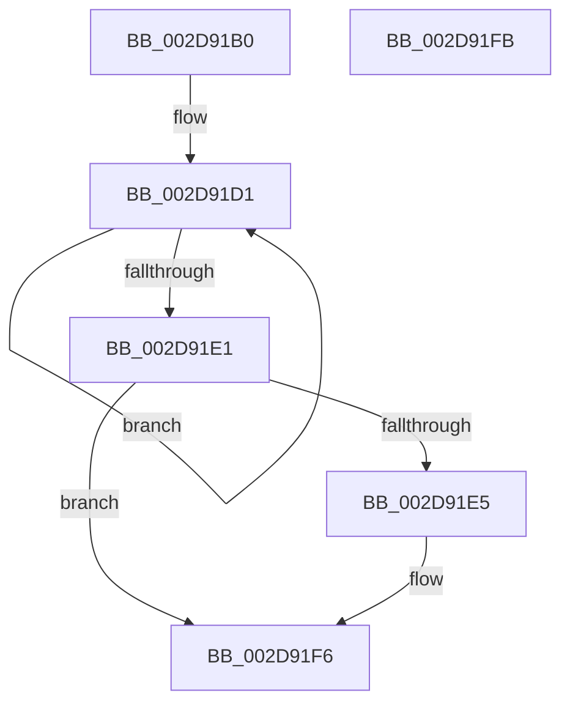

# PpmPerfQueueAction

- RVA: `0x002D91B0`–`0x002D91FC` (길이 `76` bytes)
- VA: `0x00000001402D91B0`
- 실행 섹션: `.text`
- PDB 이름 있음: `예`; PDB Function 태그: `아니요`
- unwind 정보 RVA: `0x0005C788`
- 디코드: `20`개 명령, `76/76` bytes 표시
- 미해석 바이트: `0` (있으면 어셈블리에 `.byte`로 보존)

> 이 문서는 커널 이미지의 기계어와 PDB 기호를 분석해 생성했습니다. 4번과 5번은 함수 원형과 자료형을 바이너리 사용 방식에서 추정한 C 해석이며 원본 소스 복구 결과는 아닙니다.

## 1. Dependencies

- 직접 호출 지점: **1**; 고유 호출 대상: **1**
- 직접 호출자로 확인된 함수: **4**
- RIP 상대 이미지 참조: **0**

### Outgoing calls
- `0x002D91F1` → [KeInsertQueueDpc](../20/KeInsertQueueDpc_function_00207C50.md) (function, `0x00207C50`)

### Direct callers
- [PpmParkReportUnparkedCores](PpmParkReportUnparkedCores_function_002D5BD0.md) at `0x002D5C81`
- [PpmParkReportParkedCores](PpmParkReportParkedCores_function_002D5CB0.md) at `0x002D60DF`
- [PpmParkReportParkedCores](PpmParkReportParkedCores_function_002D5CB0.md) at `0x002D613B`
- [PpmParkReportParkedCores](PpmParkReportParkedCores_function_002D5CB0.md) at `0x002D6192`
- [PpmPerfApplyProcessorStates](PpmPerfApplyProcessorStates_function_002D8EF0.md) at `0x002D912C`
- [PpmParkUnblockIdle](../46/PpmParkUnblockIdle_function_00460270.md) at `0x004603D1`

### Static image references
- 디코드된 RIP-relative 메모리 참조가 없습니다.

## 2. Other-region calls and transfers

- 다른 실행 섹션으로 향하는 call: **0**
- 별도 외부 분기/꼬리 이동을 확인하지 못했습니다.

## 3. Assembly (complete function range)

```asm
002D91B0  48 83 EC 28                     sub rsp, 0x28
002D91B4  4C 8B C1                        mov r8, rcx
002D91B7  41 B9 01 00 00 00               mov r9d, 1
002D91BD  8B CA                           mov ecx, edx
002D91BF  41 D3 E1                        shl r9d, cl
002D91C2  41 0F 0D 88 98 89 00 00         prefetchw byte ptr [r8 + 0x8998]
002D91CA  41 8B 80 98 89 00 00            mov eax, dword ptr [r8 + 0x8998]
002D91D1  8B D0                           mov edx, eax
002D91D3  41 0B D1                        or edx, r9d
002D91D6  F0 41 0F B1 90 98 89 00 00      lock cmpxchg dword ptr [r8 + 0x8998], edx
002D91DF  75 F0                           jne 0x1402d91d1
002D91E1  85 C0                           test eax, eax
002D91E3  75 11                           jne 0x1402d91f6
002D91E5  49 8D 88 58 89 00 00            lea rcx, [r8 + 0x8958]
002D91EC  33 D2                           xor edx, edx
002D91EE  45 33 C0                        xor r8d, r8d
002D91F1  E8 5A EA F2 FF                  call 0x140207c50
002D91F6  48 83 C4 28                     add rsp, 0x28
002D91FA  C3                              ret
002D91FB  CC                              int3
```

## 4. C-style interpretation (structured pseudocode)

```c
__int64 __fastcall PpmPerfQueueAction(__int64 a1, int a2)
{
    __int64 result;
    __int64 v_rsp;

    v_rsp = (v_rsp) - (40);
    a4 = (unsigned int)((1) << ((unsigned __int8)((unsigned int)(a2))));
loc_002D91D1:
    a2 = (unsigned int)(((unsigned int)((unsigned int)((unsigned int)(*(unsigned int *)(a1 + 35224))))) | ((unsigned int)(a4)));
    if (condition_is_not_equal) goto loc_002D91D1;
    result = (unsigned int)(*(unsigned int *)(a1 + 35224));
    if ((unsigned int)((unsigned int)(*(unsigned int *)(a1 + 35224))) == 0) {
        a1 = a1 + 35160;
        a2 = 0;
        a3 = 0;
        result = KeInsertQueueDpc(a1, a2, a3, a4);
    }
    v_rsp = (v_rsp) + (40);
    return result;
}
```

## 5. (Beta) C Style

```c
int64_t PpmPerfQueueAction(void *Arg1, int32_t Arg2)
{
    uint8_t *arg1 = (uint8_t *)Arg1;

    int64_t result;
    int64_t local_rsp;

    local_rsp = (local_rsp) - (40);
    a4 = (uint32_t)((1) << ((uint8_t)((uint32_t)(Arg2))));
loc_002D91D1:
    Arg2 = (uint32_t)(((uint32_t)((uint32_t)((uint32_t)(*(uint32_t *)(arg1 + 0x8998))))) | ((uint32_t)(a4)));
    if (condition_is_not_equal) goto loc_002D91D1;
    result = (uint32_t)(*(uint32_t *)(arg1 + 0x8998));
    if ((uint32_t)((uint32_t)(*(uint32_t *)(arg1 + 0x8998))) == 0) {
        Arg1 = Arg1 + 35160;
        Arg2 = 0;
        a3 = 0;
        result = KeInsertQueueDpc(Arg1, Arg2, a3, a4);
    }
    local_rsp = (local_rsp) + (40);
    return result;
}
```

### 관측된 메모리 오프셋

구조체 형식이 확인되지 않은 접근은 인자 기준의 오프셋으로만 기록했습니다.

| 기준 인자 | 오프셋 표현 | 폭 (bit) | 접근 |
|---|---:|---:|---|
| `Arg1` | `+ 0x8958` | `64` | `R` |
| `Arg1` | `+ 0x8998` | `8` | `R` |
| `Arg1` | `+ 0x8998` | `32` | `R` |

## 6. Execution-region graph

[열기: 2D/3D 그래프와 함수 탐색 컨트롤 패널](../../../control-panel.html?section=text&rva=0x002D91B0&view=graph)

- 2D 그래프는 위에서 아래로 흐르고, 3D 그래프는 빈 공간을 드래그해 회전합니다. Shift+드래그는 이동, 휠은 확대·축소, 함수 노드 선택은 대상 보고서 이동입니다.

### Static fallback


