# PpmPerfSnapDeliveredPerformance

- RVA: `0x002D7F30`–`0x002D82D9` (길이 `937` bytes)
- VA: `0x00000001402D7F30`
- 실행 섹션: `.text`
- PDB 이름 있음: `예`; PDB Function 태그: `예`
- unwind 정보 RVA: `0x0007014C`
- 디코드: `222`개 명령, `937/937` bytes 표시
- 미해석 바이트: `0` (있으면 어셈블리에 `.byte`로 보존)

> 이 문서는 커널 이미지의 기계어와 PDB 기호를 분석해 생성했습니다. 4번과 5번은 함수 원형과 자료형을 바이너리 사용 방식에서 추정한 C 해석이며 원본 소스 복구 결과는 아닙니다.

## 1. Dependencies

- 직접 호출 지점: **11**; 고유 호출 대상: **8**
- 직접 호출자로 확인된 함수: **4**
- RIP 상대 이미지 참조: **0**

### Outgoing calls
- `0x002D7FAF` → [PpmSnapPerformanceAccumulation](PpmSnapPerformanceAccumulation_function_002DE090.md) (function, `0x002DE090`)
- `0x002D8080` → [PpmEventTraceDeliveredPerfChange](../43/PpmEventTraceDeliveredPerfChange_function_0043B200.md) (function, `0x0043B200`)
- `0x002D80B3` → [Feature_Servicing_PowersnapCyclesFix__private_IsEnabledDeviceUsageNoInline](../4E/Feature_Servicing_PowersnapCyclesFix__private_IsEnabledDeviceUsageNoInline_function_004EF908.md) (function, `0x004EF908`)
- `0x002D8127` → [Feature_Servicing_PowersnapCyclesFix__private_IsEnabledDeviceUsageNoInline](../4E/Feature_Servicing_PowersnapCyclesFix__private_IsEnabledDeviceUsageNoInline_function_004EF908.md) (function, `0x004EF908`)
- `0x002D819D` → [PpmPerfSnapProcessorCyclesWorkloadClass](../44/PpmPerfSnapProcessorCyclesWorkloadClass_function_004406C0.md) (function, `0x004406C0`)
- `0x002D81ED` → [memcpy](../6C/memcpy_function_006C6840.md) (function, `0x006C6840`)
- `0x002D8226` → [PpmPerfCheckForIllegalProcessorThrottle](../44/PpmPerfCheckForIllegalProcessorThrottle_function_0044B700.md) (function, `0x0044B700`)
- `0x002D822E` → [PpmPerfUpdateHwDebugData](../45/PpmPerfUpdateHwDebugData_function_0045A5E0.md) (function, `0x0045A5E0`)
- `0x002D8241` → [PpmConvertTime](../44/PpmConvertTime_function_00447530.md) (function, `0x00447530`)
- `0x002D8258` → [Feature_Servicing_PowersnapCyclesFix__private_IsEnabledDeviceUsageNoInline](../4E/Feature_Servicing_PowersnapCyclesFix__private_IsEnabledDeviceUsageNoInline_function_004EF908.md) (function, `0x004EF908`)
- `0x002D8270` → [PpmConvertTime](../44/PpmConvertTime_function_00447530.md) (function, `0x00447530`)

### Direct callers
- [sub_002D7BB3](Unknown_function_002D7BB3.md) at `0x002D7C4A`
- [PpmPerfAction](PpmPerfAction_function_002D7E70.md) at `0x002D7E96`
- [sub_006DDC2E](../6D/Unknown_function_006DDC2E.md) at `0x006DDC3D`
- [sub_006DDC62](../6D/Unknown_function_006DDC62.md) at `0x006DDC99`

### Static image references
- 디코드된 RIP-relative 메모리 참조가 없습니다.

## 2. Other-region calls and transfers

- 다른 실행 섹션으로 향하는 call: **0**
- call이 아닌 외부 분기/꼬리 이동: **1**
  - `0x002D8297` → [sub_006DDCB6](../6D/Unknown_function_006DDCB6.md) (`tail-transfer`)

## 3. Assembly (complete function range)

```asm
002D7F30  48 89 5C 24 10                  mov qword ptr [rsp + 0x10], rbx
002D7F35  55                              push rbp
002D7F36  56                              push rsi
002D7F37  57                              push rdi
002D7F38  41 54                           push r12
002D7F3A  41 55                           push r13
002D7F3C  41 56                           push r14
002D7F3E  41 57                           push r15
002D7F40  48 83 EC 50                     sub rsp, 0x50
002D7F44  48 8B 59 10                     mov rbx, qword ptr [rcx + 0x10]
002D7F48  49 8B F0                        mov rsi, r8
002D7F4B  44 8A F2                        mov r14b, dl
002D7F4E  48 8B F9                        mov rdi, rcx
002D7F51  48 85 DB                        test rbx, rbx
002D7F54  0F 84 98 02 00 00               je 0x1402d81f2
002D7F5A  80 79 44 00                     cmp byte ptr [rcx + 0x44], 0
002D7F5E  4C 8D 63 60                     lea r12, [rbx + 0x60]
002D7F62  48 8B 83 D8 00 00 00            mov rax, qword ptr [rbx + 0xd8]
002D7F69  4C 8B AB 98 00 00 00            mov r13, qword ptr [rbx + 0x98]
002D7F70  48 89 84 24 A8 00 00 00         mov qword ptr [rsp + 0xa8], rax
002D7F78  0F 84 0F 03 00 00               je 0x1402d828d
002D7F7E  65 48 8B 04 25 20 00 00 00      mov rax, qword ptr gs:[0x20]
002D7F87  48 8D A9 50 76 FF FF            lea rbp, [rcx - 0x89b0]
002D7F8E  48 3B E8                        cmp rbp, rax
002D7F91  4C 89 6C 24 28                  mov qword ptr [rsp + 0x28], r13
002D7F96  41 B1 01                        mov r9b, 1
002D7F99  48 89 6C 24 30                  mov qword ptr [rsp + 0x30], rbp
002D7F9E  41 0F 95 C7                     setne r15b
002D7FA2  4C 89 64 24 20                  mov qword ptr [rsp + 0x20], r12
002D7FA7  45 8A C7                        mov r8b, r15b
002D7FAA  33 D2                           xor edx, edx
002D7FAC  48 8B CD                        mov rcx, rbp
002D7FAF  E8 DC 60 00 00                  call 0x1402de090
002D7FB4  84 C0                           test al, al
002D7FB6  0F 84 38 02 00 00               je 0x1402d81f4
002D7FBC  4D 8B 34 24                     mov r14, qword ptr [r12]
002D7FC0  48 8B 83 A0 00 00 00            mov rax, qword ptr [rbx + 0xa0]
002D7FC7  4C 3B F0                        cmp r14, rax
002D7FCA  0F 86 CC 02 00 00               jbe 0x1402d829c
002D7FD0  49 8B 74 24 08                  mov rsi, qword ptr [r12 + 8]
002D7FD5  4C 2B F0                        sub r14, rax
002D7FD8  48 2B B3 A8 00 00 00            sub rsi, qword ptr [rbx + 0xa8]
002D7FDF  49 3B F6                        cmp rsi, r14
002D7FE2  0F 87 BB 02 00 00               ja 0x1402d82a3
002D7FE8  48 85 ED                        test rbp, rbp
002D7FEB  0F 85 29 02 00 00               jne 0x1402d821a
002D7FF1  48 85 F6                        test rsi, rsi
002D7FF4  0F 84 A8 01 00 00               je 0x1402d81a2
002D7FFA  49 8B 44 24 20                  mov rax, qword ptr [r12 + 0x20]
002D7FFF  33 D2                           xor edx, edx
002D8001  48 2B 83 C0 00 00 00            sub rax, qword ptr [rbx + 0xc0]
002D8008  4D 8B 4C 24 18                  mov r9, qword ptr [r12 + 0x18]
002D800D  4C 2B 8B B8 00 00 00            sub r9, qword ptr [rbx + 0xb8]
002D8014  48 8B 0F                        mov rcx, qword ptr [rdi]
002D8017  48 F7 F6                        div rsi
002D801A  33 D2                           xor edx, edx
002D801C  4C 8B D0                        mov r10, rax
002D801F  49 8B C1                        mov rax, r9
002D8022  48 F7 F6                        div rsi
002D8025  4C 8B C0                        mov r8, rax
002D8028  48 85 C9                        test rcx, rcx
002D802B  0F 84 7C 02 00 00               je 0x1402d82ad
002D8031  8B 89 C0 01 00 00               mov ecx, dword ptr [rcx + 0x1c0]
002D8037  8B C1                           mov eax, ecx
002D8039  48 89 44 24 40                  mov qword ptr [rsp + 0x40], rax
002D803E  48 B8 15 AE 47 E1 7A 14 AE 47   movabs rax, 0x47ae147ae147ae15
002D8048  49 0F AF C9                     imul rcx, r9
002D804C  48 F7 E1                        mul rcx
002D804F  48 2B CA                        sub rcx, rdx
002D8052  48 D1 E9                        shr rcx, 1
002D8055  48 8D 04 0A                     lea rax, [rdx + rcx]
002D8059  33 D2                           xor edx, edx
002D805B  48 C1 E8 06                     shr rax, 6
002D805F  48 F7 F6                        div rsi
002D8062  4C 8B F8                        mov r15, rax
002D8065  44 3B 93 E0 00 00 00            cmp r10d, dword ptr [rbx + 0xe0]
002D806C  0F 84 43 02 00 00               je 0x1402d82b5
002D8072  45 8B CF                        mov r9d, r15d
002D8075  4C 89 74 24 20                  mov qword ptr [rsp + 0x20], r14
002D807A  41 8B D2                        mov edx, r10d
002D807D  48 8B CF                        mov rcx, rdi
002D8080  E8 7B 31 16 00                  call 0x14043b200
002D8085  80 7F 44 00                     cmp byte ptr [rdi + 0x44], 0
002D8089  0F 84 13 01 00 00               je 0x1402d81a2
002D808F  49 8B 75 00                     mov rsi, qword ptr [r13]
002D8093  B8 1F 85 EB 51                  mov eax, 0x51eb851f
002D8098  41 F7 E7                        mul r15d
002D809B  48 8B 84 24 A8 00 00 00         mov rax, qword ptr [rsp + 0xa8]
002D80A3  BF 2F 00 00 00                  mov edi, 0x2f
002D80A8  C1 EA 05                        shr edx, 5
002D80AB  3B D7                           cmp edx, edi
002D80AD  0F 42 FA                        cmovb edi, edx
002D80B0  48 2B 30                        sub rsi, qword ptr [rax]
002D80B3  E8 50 78 21 00                  call 0x1404ef908
002D80B8  85 C0                           test eax, eax
002D80BA  0F 84 4D 01 00 00               je 0x1402d820d
002D80C0  8B 45 44                        mov eax, dword ptr [rbp + 0x44]
002D80C3  89 84 24 90 00 00 00            mov dword ptr [rsp + 0x90], eax
002D80CA  41 8B C7                        mov eax, r15d
002D80CD  45 33 F6                        xor r14d, r14d
002D80D0  48 89 44 24 38                  mov qword ptr [rsp + 0x38], rax
002D80D5  8B E8                           mov ebp, eax
002D80D7  45 8B 55 30                     mov r10d, dword ptr [r13 + 0x30]
002D80DB  45 33 FF                        xor r15d, r15d
002D80DE  4C 8B A4 24 A8 00 00 00         mov r12, qword ptr [rsp + 0xa8]
002D80E6  45 33 C0                        xor r8d, r8d
002D80E9  45 85 D2                        test r10d, r10d
002D80EC  74 21                           je 0x1402d810f
002D80EE  43 8D 14 70                     lea edx, [r8 + r14*2]
002D80F2  4D 8B CA                        mov r9, r10
002D80F5  41 0F AF 55 30                  imul edx, dword ptr [r13 + 0x30]
002D80FA  49 8B 4C D5 38                  mov rcx, qword ptr [r13 + rdx*8 + 0x38]
002D80FF  49 2B 4C D4 38                  sub rcx, qword ptr [r12 + rdx*8 + 0x38]
002D8104  FF C2                           inc edx
002D8106  4C 03 F9                        add r15, rcx
002D8109  49 83 E9 01                     sub r9, 1
002D810D  75 EB                           jne 0x1402d80fa
002D810F  41 FF C0                        inc r8d
002D8112  41 83 F8 02                     cmp r8d, 2
002D8116  72 D1                           jb 0x1402d80e9
002D8118  48 8B C6                        mov rax, rsi
002D811B  49 2B C7                        sub rax, r15
002D811E  4C 3B FE                        cmp r15, rsi
002D8121  48 1B F6                        sbb rsi, rsi
002D8124  48 23 F0                        and rsi, rax
002D8127  E8 DC 77 21 00                  call 0x1404ef908
002D812C  44 8B A4 24 90 00 00 00         mov r12d, dword ptr [rsp + 0x90]
002D8134  85 C0                           test eax, eax
002D8136  0F 85 FC 00 00 00               jne 0x1402d8238
002D813C  48 8B C5                        mov rax, rbp
002D813F  33 D2                           xor edx, edx
002D8141  49 0F AF C7                     imul rax, r15
002D8145  48 F7 74 24 40                  div qword ptr [rsp + 0x40]
002D814A  48 8B C8                        mov rcx, rax
002D814D  45 85 F6                        test r14d, r14d
002D8150  0F 84 F5 00 00 00               je 0x1402d824b
002D8156  41 83 FE 02                     cmp r14d, 2
002D815A  0F 85 67 01 00 00               jne 0x1402d82c7
002D8160  48 01 8C FB 78 02 00 00         add qword ptr [rbx + rdi*8 + 0x278], rcx
002D8168  48 01 8C FB F8 03 00 00         add qword ptr [rbx + rdi*8 + 0x3f8], rcx
002D8170  41 FF C6                        inc r14d
002D8173  41 83 FE 07                     cmp r14d, 7
002D8177  0F 82 5A FF FF FF               jb 0x1402d80d7
002D817D  48 8B 6C 24 30                  mov rbp, qword ptr [rsp + 0x30]
002D8182  4C 8D 63 60                     lea r12, [rbx + 0x60]
002D8186  48 85 F6                        test rsi, rsi
002D8189  0F 85 C9 00 00 00               jne 0x1402d8258
002D818F  4C 8B 84 24 A8 00 00 00         mov r8, qword ptr [rsp + 0xa8]
002D8197  49 8B D5                        mov rdx, r13
002D819A  48 8B CD                        mov rcx, rbp
002D819D  E8 1E 85 16 00                  call 0x1404406c0
002D81A2  41 0F 10 04 24                  movups xmm0, xmmword ptr [r12]
002D81A7  48 8B 8C 24 A8 00 00 00         mov rcx, qword ptr [rsp + 0xa8]
002D81AF  49 8B D5                        mov rdx, r13
002D81B2  0F 11 83 A0 00 00 00            movups xmmword ptr [rbx + 0xa0], xmm0
002D81B9  41 0F 10 4C 24 10               movups xmm1, xmmword ptr [r12 + 0x10]
002D81BF  0F 11 8B B0 00 00 00            movups xmmword ptr [rbx + 0xb0], xmm1
002D81C6  41 0F 10 44 24 20               movups xmm0, xmmword ptr [r12 + 0x20]
002D81CC  0F 11 83 C0 00 00 00            movups xmmword ptr [rbx + 0xc0], xmm0
002D81D3  F2 41 0F 10 4C 24 30            movsd xmm1, qword ptr [r12 + 0x30]
002D81DA  F2 0F 11 8B D0 00 00 00         movsd qword ptr [rbx + 0xd0], xmm1
002D81E2  41 6B 45 30 70                  imul eax, dword ptr [r13 + 0x30], 0x70
002D81E7  83 C0 38                        add eax, 0x38
002D81EA  4C 63 C0                        movsxd r8, eax
002D81ED  E8 4E E6 3E 00                  call 0x1406c6840
002D81F2  B0 01                           mov al, 1
002D81F4  48 8B 9C 24 98 00 00 00         mov rbx, qword ptr [rsp + 0x98]
002D81FC  48 83 C4 50                     add rsp, 0x50
002D8200  41 5F                           pop r15
002D8202  41 5E                           pop r14
002D8204  41 5D                           pop r13
002D8206  41 5C                           pop r12
002D8208  5F                              pop rdi
002D8209  5E                              pop rsi
002D820A  5D                              pop rbp
002D820B  C3                              ret
002D820C  CC                              int3
002D820D  83 A4 24 90 00 00 00 00         and dword ptr [rsp + 0x90], 0
002D8215  E9 B0 FE FF FF                  jmp 0x1402d80ca
002D821A  45 84 FF                        test r15b, r15b
002D821D  0F 85 CE FD FF FF               jne 0x1402d7ff1
002D8223  48 8B CD                        mov rcx, rbp
002D8226  E8 D5 34 17 00                  call 0x14044b700
002D822B  48 8B CD                        mov rcx, rbp
002D822E  E8 AD 23 18 00                  call 0x14045a5e0
002D8233  E9 B9 FD FF FF                  jmp 0x1402d7ff1
002D8238  49 8B D4                        mov rdx, r12
002D823B  4C 8B C5                        mov r8, rbp
002D823E  49 8B CF                        mov rcx, r15
002D8241  E8 EA F2 16 00                  call 0x140447530
002D8246  E9 FF FE FF FF                  jmp 0x1402d814a
002D824B  48 01 8C FB F8 00 00 00         add qword ptr [rbx + rdi*8 + 0xf8], rcx
002D8253  E9 10 FF FF FF                  jmp 0x1402d8168
002D8258  E8 AB 76 21 00                  call 0x1404ef908
002D825D  85 C0                           test eax, eax
002D825F  74 17                           je 0x1402d8278
002D8261  8B 94 24 90 00 00 00            mov edx, dword ptr [rsp + 0x90]
002D8268  48 8B CE                        mov rcx, rsi
002D826B  4C 8B 44 24 38                  mov r8, qword ptr [rsp + 0x38]
002D8270  E8 BB F2 16 00                  call 0x140447530
002D8275  48 8B F0                        mov rsi, rax
002D8278  48 01 B4 FB F8 00 00 00         add qword ptr [rbx + rdi*8 + 0xf8], rsi
002D8280  48 01 B4 FB F8 03 00 00         add qword ptr [rbx + rdi*8 + 0x3f8], rsi
002D8288  E9 02 FF FF FF                  jmp 0x1402d818f
002D828D  33 ED                           xor ebp, ebp
002D828F  48 89 6C 24 30                  mov qword ptr [rsp + 0x30], rbp
002D8294  45 32 FF                        xor r15b, r15b
002D8297  E9 1A 5A 40 00                  jmp 0x1406ddcb6
002D829C  32 C0                           xor al, al
002D829E  E9 51 FF FF FF                  jmp 0x1402d81f4
002D82A3  45 84 FF                        test r15b, r15b
002D82A6  75 F4                           jne 0x1402d829c
002D82A8  E9 3B FD FF FF                  jmp 0x1402d7fe8
002D82AD  8B 4D 44                        mov ecx, dword ptr [rbp + 0x44]
002D82B0  E9 82 FD FF FF                  jmp 0x1402d8037
002D82B5  44 3B 83 E4 00 00 00            cmp r8d, dword ptr [rbx + 0xe4]
002D82BC  0F 84 C3 FD FF FF               je 0x1402d8085
002D82C2  E9 AB FD FF FF                  jmp 0x1402d8072
002D82C7  41 8D 46 FB                     lea eax, [r14 - 5]
002D82CB  83 F8 01                        cmp eax, 1
002D82CE  0F 87 94 FE FF FF               ja 0x1402d8168
002D82D4  E9 87 FE FF FF                  jmp 0x1402d8160
```

## 4. C-style interpretation (structured pseudocode)

```c
__int64 __fastcall PpmPerfSnapDeliveredPerformance(__int64 a1, int a2, __int64 a3)
{
    __int64 result;
    __int64 v_r14;
    __int64 v_r15;
    __int64 v_rbp;
    __int64 v_rdi;
    __int64 v_rsi;
    __int64 v_rsp;
    unsigned __int64 v_stack_m48;
    unsigned __int64 v_stack_m50;
    unsigned __int64 v_stack_m58;
    unsigned __int64 v_stack_m60;
    unsigned __int64 v_stack_m68;
    unsigned __int64 v_stack_p10;
    unsigned __int64 v_stack_p20;
    unsigned __int64 v_stack_p30;
    unsigned __int64 v_stack_p38;
    unsigned int v_stack_p8;
    unsigned int v_stack_p90;

    v_stack_p10 = v_rbx;
    v_rsp = (v_rsp) - (80);
    if (*(unsigned __int64 *)(a1 + 16) == 0) goto loc_002D81F2;
    v_stack_p20 = *(unsigned __int64 *)(*(unsigned __int64 *)(a1 + 16) + 216);
    if ((*(unsigned __int8 *)(a1 + 68)) == 0) goto loc_002D828D;
    v_stack_m60 = *(unsigned __int64 *)(*(unsigned __int64 *)(a1 + 16) + 152);
    v_stack_m58 = a1 - 35248;
    v_r15 = ((a1 - 35248) != (*(unsigned __int64 *)(gs_base + (0 + 32)))) ? 1 : 0;
    v_stack_m68 = *(unsigned __int64 *)(a1 + 16) + 96;
    a2 = 0;
    result = PpmSnapPerformanceAccumulation(a1 - 35248, a2, (unsigned __int8)(v_r15), 1);
    if ((unsigned __int8)(result) == 0) goto loc_002D81F4;
    if ((*(unsigned __int64 *)(*(unsigned __int64 *)(a1 + 16) + 96)) <= (*(unsigned __int64 *)(*(unsigned __int64 *)(a1 + 16) + 160))) goto loc_002D829C;
    v_r14 = (*(unsigned __int64 *)(*(unsigned __int64 *)(a1 + 16) + 96)) - (*(unsigned __int64 *)(*(unsigned __int64 *)(a1 + 16) + 160));
    v_rsi = (*(unsigned __int64 *)(*(unsigned __int64 *)(a1 + 16) + 96 + 8)) - (*(unsigned __int64 *)(*(unsigned __int64 *)(a1 + 16) + 168));
    if (v_rsi > v_r14) goto loc_002D82A3;
loc_002D7FE8:
    if (a1 - 35248 != 0) goto loc_002D821A;
loc_002D7FF1:
    if (v_rsi == 0) goto loc_002D81A2;
    a2 = 0;
    result = (*(unsigned __int64 *)(*(unsigned __int64 *)(a1 + 16) + 96 + 32)) - (*(unsigned __int64 *)(*(unsigned __int64 *)(a1 + 16) + 192));
    a4 = (*(unsigned __int64 *)(*(unsigned __int64 *)(a1 + 16) + 96 + 24)) - (*(unsigned __int64 *)(*(unsigned __int64 *)(a1 + 16) + 184));
    a2 = 0;
    if (*(unsigned __int64 *)(a1) == 0) goto loc_002D82AD;
loc_002D8037:
    v_stack_m48 = (unsigned int)((unsigned int)((unsigned int)(*(unsigned int *)(*(unsigned __int64 *)(a1) + 448))));
    a1 = ((unsigned int)(*(unsigned int *)(*(unsigned __int64 *)(a1) + 448))) * (a4);
    a1 = (a1) - (0);
    a1 = (a1) >> (1);
    a2 = 0;
    result = (a2 + a1 * 1) >> (6);
    if (((unsigned int)(result)) == (*(unsigned int *)(*(unsigned __int64 *)(a1 + 16) + 224))) goto loc_002D82B5;
loc_002D8072:
    v_stack_m68 = v_r14;
    result = PpmEventTraceDeliveredPerfChange(a1, (unsigned int)((unsigned int)(result)), a4, (unsigned int)((unsigned int)(result)));
loc_002D8085:
    if ((*(unsigned __int8 *)(a1 + 68)) == 0) goto loc_002D81A2;
    a2 = (unsigned int)(((unsigned int)((unsigned int)(result))) >> (5));
    v_rdi = 47;
    if (a2 < 47) { v_rdi = a2; }
    v_rsi = (*(unsigned __int64 *)(*(unsigned __int64 *)(*(unsigned __int64 *)(a1 + 16) + 152))) - (*(unsigned __int64 *)(v_stack_p20));
    result = Feature_Servicing_PowersnapCyclesFix__private_IsEnabledDeviceUsageNoInline(a1, a2, a4, (unsigned int)((unsigned int)(result)));
    if ((unsigned int)(result) == 0) goto loc_002D820D;
    v_stack_p8 = (unsigned int)((unsigned int)(*(unsigned int *)(a1 - 35248 + 68)));
loc_002D80CA:
    v_r14 = 0;
    v_stack_m50 = (unsigned int)((unsigned int)(result));
loc_002D80D7:
    v_r15 = 0;
    a3 = 0;
loc_002D80E9:
    if ((unsigned int)((unsigned int)(*(unsigned int *)(*(unsigned __int64 *)(*(unsigned __int64 *)(a1 + 16) + 152) + 48))) == 0) goto loc_002D810F;
    a2 = (unsigned int)((a3 + v_r14 * 2) * (*(unsigned int *)(*(unsigned __int64 *)(*(unsigned __int64 *)(a1 + 16) + 152) + 48)));
loc_002D80FA:
    a1 = (*(unsigned __int64 *)(*(unsigned __int64 *)(*(unsigned __int64 *)(a1 + 16) + 152) + a2 * 8 + 56)) - (*(unsigned __int64 *)(v_stack_p20 + a2 * 8 + 56));
    a2 = (unsigned int)((a2) + 1);
    v_r15 = (v_r15) + (a1);
    a4 = ((unsigned int)(*(unsigned int *)(*(unsigned __int64 *)(*(unsigned __int64 *)(a1 + 16) + 152) + 48))) - (1);
    if (condition_is_not_equal) goto loc_002D80FA;
loc_002D810F:
    a3 = (unsigned int)((a3) + 1);
    if (((unsigned int)(a3)) < 2) goto loc_002D80E9;
    result = (v_rsi) - (v_r15);
    v_rsi = (v_rsi) & (result);
    result = Feature_Servicing_PowersnapCyclesFix__private_IsEnabledDeviceUsageNoInline(a1, a2, a3, a4);
    if ((unsigned int)(result) != 0) goto loc_002D8238;
    a2 = 0;
    result = ((unsigned int)((unsigned int)((unsigned int)((unsigned int)(result))))) * (v_r15);
loc_002D814A:
    if (0 == 0) goto loc_002D824B;
    if (0 != 2) goto loc_002D82C7;
loc_002D8160:
loc_002D8168:
    v_r14 = (unsigned int)((v_r14) + 1);
    if (((unsigned int)(v_r14)) < 7) goto loc_002D80D7;
    if (v_rsi != 0) goto loc_002D8258;
loc_002D818F:
    result = PpmPerfSnapProcessorCyclesWorkloadClass(v_stack_m58, *(unsigned __int64 *)(*(unsigned __int64 *)(a1 + 16) + 152), v_stack_p20, a4);
loc_002D81A2:
    *(unsigned __int64 *)(*(unsigned __int64 *)(a1 + 16) + 160) = v_xmm0;
    *(unsigned __int64 *)(*(unsigned __int64 *)(a1 + 16) + 176) = v_xmm1;
    *(unsigned __int64 *)(*(unsigned __int64 *)(a1 + 16) + 192) = v_xmm0;
    *(unsigned __int64 *)(*(unsigned __int64 *)(a1 + 16) + 208) = v_xmm1;
    result = (unsigned int)((result) * (*(unsigned int *)(*(unsigned __int64 *)(*(unsigned __int64 *)(a1 + 16) + 152) + 48)));
    result = (unsigned int)((result) + (56));
    result = memcpy(v_stack_p20, *(unsigned __int64 *)(*(unsigned __int64 *)(a1 + 16) + 152), (int)((unsigned int)(result)), a4);
loc_002D81F2:
loc_002D81F4:
    v_rsp = (v_rsp) + (80);
    return 1;
loc_002D820D:
    goto loc_002D80CA;
loc_002D821A:
    if ((unsigned __int8)(v_r15) != 0) goto loc_002D7FF1;
    result = PpmPerfCheckForIllegalProcessorThrottle(v_stack_m58, *(unsigned __int64 *)(*(unsigned __int64 *)(a1 + 16) + 152), (int)((unsigned int)(result)), a4);
    result = PpmPerfUpdateHwDebugData(v_stack_m58, *(unsigned __int64 *)(*(unsigned __int64 *)(a1 + 16) + 152), (int)((unsigned int)(result)), a4);
    goto loc_002D7FF1;
loc_002D8238:
    result = PpmConvertTime(v_r15, *(unsigned __int64 *)(a1 + 16) + 96, v_stack_m58, a4);
    goto loc_002D814A;
loc_002D824B:
    goto loc_002D8168;
loc_002D8258:
    result = Feature_Servicing_PowersnapCyclesFix__private_IsEnabledDeviceUsageNoInline(v_r15, *(unsigned __int64 *)(a1 + 16) + 96, v_stack_m58, a4);
    if ((unsigned int)(result) != 0) {
        a2 = v_stack_p90;
        a1 = v_rsi;
        a3 = v_stack_p38;
        result = PpmConvertTime(a1, a2, a3, a4);
        v_rsi = result;
    }
    goto loc_002D818F;
loc_002D828D:
    v_rbp = 0;
    v_stack_p30 = 0;
    v_r15 = 0;
loc_002D829C:
    result = 0;
    goto loc_002D81F4;
loc_002D82A3:
    if (0 != 0) goto loc_002D829C;
    goto loc_002D7FE8;
loc_002D82AD:
    goto loc_002D8037;
loc_002D82B5:
    if (((unsigned int)(a3)) == (*(unsigned int *)(v_stack_p10 + 228))) goto loc_002D8085;
    goto loc_002D8072;
loc_002D82C7:
    if (((unsigned int)(v_r14 - 5)) > 1) goto loc_002D8168;
    goto loc_002D8160;
}
```

## 5. (Beta) C Style

```c
int64_t PpmPerfSnapDeliveredPerformance(void *Arg1, int32_t Arg2, int64_t Arg3)
{
    uint8_t *arg1 = (uint8_t *)Arg1;

    int64_t result;
    int64_t local_r14;
    int64_t local_r15;
    int64_t local_rbp;
    int64_t local_rdi;
    int64_t local_rsi;
    int64_t local_rsp;
    uint64_t v_stack_m48;
    uint64_t v_stack_m50;
    uint64_t v_stack_m58;
    uint64_t v_stack_m60;
    uint64_t v_stack_m68;
    uint64_t v_stack_p10;
    uint64_t v_stack_p20;
    uint64_t v_stack_p30;
    uint64_t v_stack_p38;
    uint32_t v_stack_p8;
    uint32_t v_stack_p90;

    v_stack_p10 = local_rbx;
    local_rsp = (local_rsp) - (80);
    if (*(uint64_t *)(arg1 + 0x10) == 0) goto loc_002D81F2;
    v_stack_p20 = *(uint64_t *)(*(uint64_t *)(arg1 + 0x10) + 0xD8);
    if ((*(uint8_t *)(arg1 + 0x44)) == 0) goto loc_002D828D;
    v_stack_m60 = *(uint64_t *)(*(uint64_t *)(arg1 + 0x10) + 0x98);
    v_stack_m58 = Arg1 - 35248;
    local_r15 = ((Arg1 - 35248) != (*(uint64_t *)(gs_base + (0 + 0x20)))) ? 1 : 0;
    v_stack_m68 = *(uint64_t *)(arg1 + 0x10) + 96;
    Arg2 = 0;
    result = PpmSnapPerformanceAccumulation(Arg1 - 35248, Arg2, (uint8_t)(local_r15), 1);
    if ((uint8_t)(result) == 0) goto loc_002D81F4;
    if ((*(uint64_t *)(*(uint64_t *)(arg1 + 0x10) + 0x60)) <= (*(uint64_t *)(*(uint64_t *)(arg1 + 0x10) + 0xA0))) goto loc_002D829C;
    local_r14 = (*(uint64_t *)(*(uint64_t *)(arg1 + 0x10) + 0x60)) - (*(uint64_t *)(*(uint64_t *)(arg1 + 0x10) + 0xA0));
    local_rsi = (*(uint64_t *)(*(uint64_t *)(arg1 + 0x10) + 0x60 + 0x8)) - (*(uint64_t *)(*(uint64_t *)(arg1 + 0x10) + 0xA8));
    if (local_rsi > local_r14) goto loc_002D82A3;
loc_002D7FE8:
    if (Arg1 - 35248 != 0) goto loc_002D821A;
loc_002D7FF1:
    if (local_rsi == 0) goto loc_002D81A2;
    Arg2 = 0;
    result = (*(uint64_t *)(*(uint64_t *)(arg1 + 0x10) + 0x60 + 0x20)) - (*(uint64_t *)(*(uint64_t *)(arg1 + 0x10) + 0xC0));
    a4 = (*(uint64_t *)(*(uint64_t *)(arg1 + 0x10) + 0x60 + 0x18)) - (*(uint64_t *)(*(uint64_t *)(arg1 + 0x10) + 0xB8));
    Arg2 = 0;
    if (*(uint64_t *)(arg1) == 0) goto loc_002D82AD;
loc_002D8037:
    v_stack_m48 = (uint32_t)((uint32_t)((uint32_t)(*(uint32_t *)(*(uint64_t *)(arg1) + 0x1C0))));
    Arg1 = ((uint32_t)(*(uint32_t *)(*(uint64_t *)(arg1) + 0x1C0))) * (a4);
    Arg1 = (Arg1) - (0);
    Arg1 = (Arg1) >> (1);
    Arg2 = 0;
    result = (Arg2 + Arg1 * 1) >> (6);
    if (((uint32_t)(result)) == (*(uint32_t *)(*(uint64_t *)(arg1 + 0x10) + 0xE0))) goto loc_002D82B5;
loc_002D8072:
    v_stack_m68 = local_r14;
    result = PpmEventTraceDeliveredPerfChange(Arg1, (uint32_t)((uint32_t)(result)), a4, (uint32_t)((uint32_t)(result)));
loc_002D8085:
    if ((*(uint8_t *)(arg1 + 0x44)) == 0) goto loc_002D81A2;
    Arg2 = (uint32_t)(((uint32_t)((uint32_t)(result))) >> (5));
    local_rdi = 47;
    if (Arg2 < 47) { local_rdi = Arg2; }
    local_rsi = (*(uint64_t *)(*(uint64_t *)(*(uint64_t *)(arg1 + 0x10) + 0x98))) - (*(uint64_t *)(v_stack_p20));
    result = Feature_Servicing_PowersnapCyclesFix__private_IsEnabledDeviceUsageNoInline(Arg1, Arg2, a4, (uint32_t)((uint32_t)(result)));
    if ((uint32_t)(result) == 0) goto loc_002D820D;
    v_stack_p8 = (uint32_t)((uint32_t)(*(uint32_t *)(arg1 - 0x89B0 + 0x44)));
loc_002D80CA:
    local_r14 = 0;
    v_stack_m50 = (uint32_t)((uint32_t)(result));
loc_002D80D7:
    local_r15 = 0;
    Arg3 = 0;
loc_002D80E9:
    if ((uint32_t)((uint32_t)(*(uint32_t *)(*(uint64_t *)(*(uint64_t *)(arg1 + 0x10) + 0x98) + 0x30))) == 0) goto loc_002D810F;
    Arg2 = (uint32_t)((Arg3 + local_r14 * 2) * (*(uint32_t *)(*(uint64_t *)(*(uint64_t *)(arg1 + 0x10) + 0x98) + 0x30)));
loc_002D80FA:
    Arg1 = (*(uint64_t *)(*(uint64_t *)(*(uint64_t *)(arg1 + 0x10) + 0x98) + Arg2 * 8 + 0x38)) - (*(uint64_t *)(v_stack_p20 + Arg2 * 8 + 0x38));
    Arg2 = (uint32_t)((Arg2) + 1);
    local_r15 = (local_r15) + (Arg1);
    a4 = ((uint32_t)(*(uint32_t *)(*(uint64_t *)(*(uint64_t *)(arg1 + 0x10) + 0x98) + 0x30))) - (1);
    if (condition_is_not_equal) goto loc_002D80FA;
loc_002D810F:
    Arg3 = (uint32_t)((Arg3) + 1);
    if (((uint32_t)(Arg3)) < 2) goto loc_002D80E9;
    result = (local_rsi) - (local_r15);
    local_rsi = (local_rsi) & (result);
    result = Feature_Servicing_PowersnapCyclesFix__private_IsEnabledDeviceUsageNoInline(Arg1, Arg2, Arg3, a4);
    if ((uint32_t)(result) != 0) goto loc_002D8238;
    Arg2 = 0;
    result = ((uint32_t)((uint32_t)((uint32_t)((uint32_t)(result))))) * (local_r15);
loc_002D814A:
    if (0 == 0) goto loc_002D824B;
    if (0 != 2) goto loc_002D82C7;
loc_002D8160:
loc_002D8168:
    local_r14 = (uint32_t)((local_r14) + 1);
    if (((uint32_t)(local_r14)) < 7) goto loc_002D80D7;
    if (local_rsi != 0) goto loc_002D8258;
loc_002D818F:
    result = PpmPerfSnapProcessorCyclesWorkloadClass(v_stack_m58, *(uint64_t *)(*(uint64_t *)(arg1 + 0x10) + 0x98), v_stack_p20, a4);
loc_002D81A2:
    *(uint64_t *)(*(uint64_t *)(arg1 + 0x10) + 0xA0) = v_xmm0;
    *(uint64_t *)(*(uint64_t *)(arg1 + 0x10) + 0xB0) = v_xmm1;
    *(uint64_t *)(*(uint64_t *)(arg1 + 0x10) + 0xC0) = v_xmm0;
    *(uint64_t *)(*(uint64_t *)(arg1 + 0x10) + 0xD0) = v_xmm1;
    result = (uint32_t)((result) * (*(uint32_t *)(*(uint64_t *)(*(uint64_t *)(arg1 + 0x10) + 0x98) + 0x30)));
    result = (uint32_t)((result) + (56));
    result = memcpy(v_stack_p20, *(uint64_t *)(*(uint64_t *)(arg1 + 0x10) + 0x98), (int32_t)((uint32_t)(result)), a4);
loc_002D81F2:
loc_002D81F4:
    local_rsp = (local_rsp) + (80);
    return 1;
loc_002D820D:
    goto loc_002D80CA;
loc_002D821A:
    if ((uint8_t)(local_r15) != 0) goto loc_002D7FF1;
    result = PpmPerfCheckForIllegalProcessorThrottle(v_stack_m58, *(uint64_t *)(*(uint64_t *)(arg1 + 0x10) + 0x98), (int32_t)((uint32_t)(result)), a4);
    result = PpmPerfUpdateHwDebugData(v_stack_m58, *(uint64_t *)(*(uint64_t *)(arg1 + 0x10) + 0x98), (int32_t)((uint32_t)(result)), a4);
    goto loc_002D7FF1;
loc_002D8238:
    result = PpmConvertTime(local_r15, *(uint64_t *)(arg1 + 0x10) + 96, v_stack_m58, a4);
    goto loc_002D814A;
loc_002D824B:
    goto loc_002D8168;
loc_002D8258:
    result = Feature_Servicing_PowersnapCyclesFix__private_IsEnabledDeviceUsageNoInline(local_r15, *(uint64_t *)(arg1 + 0x10) + 96, v_stack_m58, a4);
    if ((uint32_t)(result) != 0) {
        Arg2 = v_stack_p90;
        Arg1 = local_rsi;
        Arg3 = v_stack_p38;
        result = PpmConvertTime(Arg1, Arg2, Arg3, a4);
        local_rsi = result;
    }
    goto loc_002D818F;
loc_002D828D:
    local_rbp = 0;
    v_stack_p30 = 0;
    local_r15 = 0;
loc_002D829C:
    result = 0;
    goto loc_002D81F4;
loc_002D82A3:
    if (0 != 0) goto loc_002D829C;
    goto loc_002D7FE8;
loc_002D82AD:
    goto loc_002D8037;
loc_002D82B5:
    if (((uint32_t)(Arg3)) == (*(uint32_t *)(v_stack_p10 + 0xE4))) goto loc_002D8085;
    goto loc_002D8072;
loc_002D82C7:
    if (((uint32_t)(local_r14 - 5)) > 1) goto loc_002D8168;
    goto loc_002D8160;
}
```

### 관측된 메모리 오프셋

구조체 형식이 확인되지 않은 접근은 인자 기준의 오프셋으로만 기록했습니다.

| 기준 인자 | 오프셋 표현 | 폭 (bit) | 접근 |
|---|---:|---:|---|
| `Arg1` | `- 0x89B0` | `64` | `R` |
| `Arg1` | `+ 0x0` | `64` | `R` |
| `Arg1` | `+ 0x10` | `64` | `R` |
| `Arg1` | `+ 0x44` | `8` | `R` |

## 6. Execution-region graph

[열기: 2D/3D 그래프와 함수 탐색 컨트롤 패널](../../../control-panel.html?section=text&rva=0x002D7F30&view=graph)

- 2D 그래프는 위에서 아래로 흐르고, 3D 그래프는 빈 공간을 드래그해 회전합니다. Shift+드래그는 이동, 휠은 확대·축소, 함수 노드 선택은 대상 보고서 이동입니다.

### Static fallback

```mermaid
flowchart TD
  bb_002D7F30[BB_002D7F30]
  bb_002D7F5A[BB_002D7F5A]
  bb_002D7F7E[BB_002D7F7E]
  bb_002D7FBC[BB_002D7FBC]
  bb_002D7FD0[BB_002D7FD0]
  bb_002D7FE8[BB_002D7FE8]
  bb_002D7FF1[BB_002D7FF1]
  bb_002D7FFA[BB_002D7FFA]
  bb_002D8031[BB_002D8031]
  bb_002D8037[BB_002D8037]
  bb_002D8072[BB_002D8072]
  bb_002D8085[BB_002D8085]
  bb_002D808F[BB_002D808F]
  bb_002D80C0[BB_002D80C0]
  bb_002D80CA[BB_002D80CA]
  bb_002D80D7[BB_002D80D7]
  bb_002D80E9[BB_002D80E9]
  bb_002D80EE[BB_002D80EE]
  bb_002D80FA[BB_002D80FA]
  bb_002D810F[BB_002D810F]
  bb_002D8118[BB_002D8118]
  bb_002D813C[BB_002D813C]
  bb_002D814A[BB_002D814A]
  bb_002D8156[BB_002D8156]
  bb_002D8160[BB_002D8160]
  bb_002D8168[BB_002D8168]
  bb_002D817D[BB_002D817D]
  bb_002D818F[BB_002D818F]
  bb_002D81A2[BB_002D81A2]
  bb_002D81F2[BB_002D81F2]
  bb_002D81F4[BB_002D81F4]
  bb_002D820C[BB_002D820C]
  bb_002D820D[BB_002D820D]
  bb_002D821A[BB_002D821A]
  bb_002D8223[BB_002D8223]
  bb_002D8238[BB_002D8238]
  bb_002D824B[BB_002D824B]
  bb_002D8258[BB_002D8258]
  bb_002D8261[BB_002D8261]
  bb_002D8278[BB_002D8278]
  bb_002D828D[BB_002D828D]
  bb_002D829C[BB_002D829C]
  bb_002D82A3[BB_002D82A3]
  bb_002D82A8[BB_002D82A8]
  bb_002D82AD[BB_002D82AD]
  bb_002D82B5[BB_002D82B5]
  bb_002D82C2[BB_002D82C2]
  bb_002D82C7[BB_002D82C7]
  bb_002D82D4[BB_002D82D4]
  bb_002D7F30 -->|branch| bb_002D81F2
  bb_002D7F30 -->|fallthrough| bb_002D7F5A
  bb_002D7F5A -->|branch| bb_002D828D
  bb_002D7F5A -->|fallthrough| bb_002D7F7E
  bb_002D7F7E -->|branch| bb_002D81F4
  bb_002D7F7E -->|fallthrough| bb_002D7FBC
  bb_002D7FBC -->|branch| bb_002D829C
  bb_002D7FBC -->|fallthrough| bb_002D7FD0
  bb_002D7FD0 -->|branch| bb_002D82A3
  bb_002D7FD0 -->|fallthrough| bb_002D7FE8
  bb_002D7FE8 -->|branch| bb_002D821A
  bb_002D7FE8 -->|fallthrough| bb_002D7FF1
  bb_002D7FF1 -->|branch| bb_002D81A2
  bb_002D7FF1 -->|fallthrough| bb_002D7FFA
  bb_002D7FFA -->|branch| bb_002D82AD
  bb_002D7FFA -->|fallthrough| bb_002D8031
  bb_002D8031 -->|flow| bb_002D8037
  bb_002D8037 -->|branch| bb_002D82B5
  bb_002D8037 -->|fallthrough| bb_002D8072
  bb_002D8072 -->|flow| bb_002D8085
  bb_002D8085 -->|branch| bb_002D81A2
  bb_002D8085 -->|fallthrough| bb_002D808F
  bb_002D808F -->|branch| bb_002D820D
  bb_002D808F -->|fallthrough| bb_002D80C0
  bb_002D80C0 -->|flow| bb_002D80CA
  bb_002D80CA -->|flow| bb_002D80D7
  bb_002D80D7 -->|flow| bb_002D80E9
  bb_002D80E9 -->|branch| bb_002D810F
  bb_002D80E9 -->|fallthrough| bb_002D80EE
  bb_002D80EE -->|flow| bb_002D80FA
  bb_002D80FA -->|branch| bb_002D80FA
  bb_002D80FA -->|fallthrough| bb_002D810F
  bb_002D810F -->|branch| bb_002D80E9
  bb_002D810F -->|fallthrough| bb_002D8118
  bb_002D8118 -->|branch| bb_002D8238
  bb_002D8118 -->|fallthrough| bb_002D813C
  bb_002D813C -->|flow| bb_002D814A
  bb_002D814A -->|branch| bb_002D824B
  bb_002D814A -->|fallthrough| bb_002D8156
  bb_002D8156 -->|branch| bb_002D82C7
  bb_002D8156 -->|fallthrough| bb_002D8160
  bb_002D8160 -->|flow| bb_002D8168
  bb_002D8168 -->|branch| bb_002D80D7
  bb_002D8168 -->|fallthrough| bb_002D817D
  bb_002D817D -->|branch| bb_002D8258
  bb_002D817D -->|fallthrough| bb_002D818F
  bb_002D818F -->|flow| bb_002D81A2
  bb_002D81A2 -->|flow| bb_002D81F2
  bb_002D81F2 -->|flow| bb_002D81F4
  bb_002D820C -->|flow| bb_002D820D
  bb_002D820D -->|branch| bb_002D80CA
  bb_002D821A -->|branch| bb_002D7FF1
  bb_002D821A -->|fallthrough| bb_002D8223
  bb_002D8223 -->|branch| bb_002D7FF1
  bb_002D8238 -->|branch| bb_002D814A
  bb_002D824B -->|branch| bb_002D8168
  bb_002D8258 -->|branch| bb_002D8278
  bb_002D8258 -->|fallthrough| bb_002D8261
  bb_002D8261 -->|flow| bb_002D8278
  bb_002D8278 -->|branch| bb_002D818F
  bb_002D829C -->|branch| bb_002D81F4
  bb_002D82A3 -->|branch| bb_002D829C
  bb_002D82A3 -->|fallthrough| bb_002D82A8
  bb_002D82A8 -->|branch| bb_002D7FE8
  bb_002D82AD -->|branch| bb_002D8037
  bb_002D82B5 -->|branch| bb_002D8085
  bb_002D82B5 -->|fallthrough| bb_002D82C2
  bb_002D82C2 -->|branch| bb_002D8072
  bb_002D82C7 -->|branch| bb_002D8168
  bb_002D82C7 -->|fallthrough| bb_002D82D4
  bb_002D82D4 -->|branch| bb_002D8160
```


