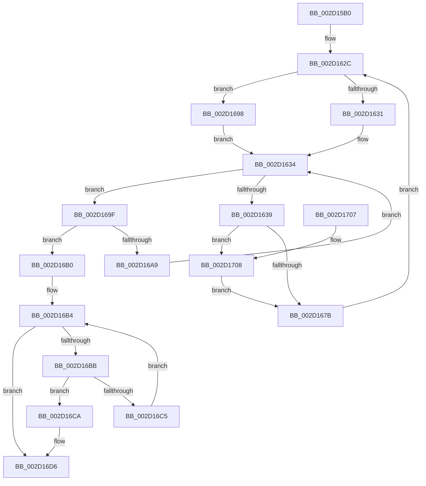

# PpmUnlockProcessors

- RVA: `0x002D15B0`–`0x002D1719` (길이 `361` bytes)
- VA: `0x00000001402D15B0`
- 실행 섹션: `.text`
- PDB 이름 있음: `예`; PDB Function 태그: `아니요`
- unwind 정보 RVA: `0x0006F7C0`
- 디코드: `97`개 명령, `361/361` bytes 표시
- 미해석 바이트: `0` (있으면 어셈블리에 `.byte`로 보존)

> 이 문서는 커널 이미지의 기계어와 PDB 기호를 분석해 생성했습니다. 4번과 5번은 함수 원형과 자료형을 바이너리 사용 방식에서 추정한 C 해석이며 원본 소스 복구 결과는 아닙니다.

## 1. Dependencies

- 직접 호출 지점: **9**; 고유 호출 대상: **8**
- 직접 호출자로 확인된 함수: **2**
- RIP 상대 이미지 참조: **2**

### Outgoing calls
- `0x002D15F6` → [memset](../6C/memset_function_006C6C40.md) (function, `0x006C6C40`)
- `0x002D1616` → [memset](../6C/memset_function_006C6C40.md) (function, `0x006C6C40`)
- `0x002D165B` → [KeGetPrcb](KeGetPrcb_function_002D85D0.md) (function, `0x002D85D0`)
- `0x002D166E` → [PpmIdleUnlockProcessor](../4F/PpmIdleUnlockProcessor_function_004FB1E4.md) (function, `0x004FB1E4`)
- `0x002D1682` → [KeInterlockedClearProcessorAffinityEx](../35/KeInterlockedClearProcessorAffinityEx_function_003524F0.md) (function, `0x003524F0`)
- `0x002D168C` → [KeRemoveProcessorAffinityEx](../30/KeRemoveProcessorAffinityEx_function_00304E10.md) (function, `0x00304E10`)
- `0x002D16D1` → [HalRequestIpi](HalRequestIpi_function_002D1720.md) (function, `0x002D1720`)
- `0x002D16E1` → [_security_check_cookie](../6A/_security_check_cookie_function_006AC640.md) (function, `0x006AC640`)
- `0x002D170F` → [KeAddProcessorAffinityEx](../25/KeAddProcessorAffinityEx_function_0025B6F0.md) (function, `0x0025B6F0`)

### Direct callers
- [PpmIdleSelectStates](../2C/PpmIdleSelectStates_function_002CFFE8.md) at `0x002D0574`
- [PpmIdleSelectStates](../2C/PpmIdleSelectStates_function_002CFFE8.md) at `0x002D05A0`
- [PpmIdleExecuteTransition](PpmIdleExecuteTransition_function_002D0A1C.md) at `0x002D0CD4`

### Static image references
- `0x002D15CF` → RVA `0x00E0A740` (`.data`; read)
- `0x002D164F` → RVA `0x00F231B8` (`.data`; read)

## 2. Other-region calls and transfers

- 다른 실행 섹션으로 향하는 call: **0**
- 별도 외부 분기/꼬리 이동을 확인하지 못했습니다.

## 3. Assembly (complete function range)

```asm
002D15B0  48 89 5C 24 10                  mov qword ptr [rsp + 0x10], rbx
002D15B5  48 89 6C 24 18                  mov qword ptr [rsp + 0x18], rbp
002D15BA  48 89 74 24 20                  mov qword ptr [rsp + 0x20], rsi
002D15BF  57                              push rdi
002D15C0  41 54                           push r12
002D15C2  41 55                           push r13
002D15C4  41 56                           push r14
002D15C6  41 57                           push r15
002D15C8  48 81 EC 50 01 00 00            sub rsp, 0x150
002D15CF  48 8B 05 6A 91 B3 00            mov rax, qword ptr [rip + 0xb3916a]
002D15D6  48 33 C4                        xor rax, rsp
002D15D9  48 89 84 24 40 01 00 00         mov qword ptr [rsp + 0x140], rax
002D15E1  48 8B FA                        mov rdi, rdx
002D15E4  4C 8B F9                        mov r15, rcx
002D15E7  BB 00 01 00 00                  mov ebx, 0x100
002D15EC  48 8D 4C 24 38                  lea rcx, [rsp + 0x38]
002D15F1  44 8B C3                        mov r8d, ebx
002D15F4  33 D2                           xor edx, edx
002D15F6  E8 45 56 3F 00                  call 0x1406c6c40
002D15FB  44 8B C3                        mov r8d, ebx
002D15FE  48 C7 44 24 30 01 00 20 00      mov qword ptr [rsp + 0x30], 0x200001
002D1607  33 D2                           xor edx, edx
002D1609  48 8D 4C 24 38                  lea rcx, [rsp + 0x38]
002D160E  45 33 ED                        xor r13d, r13d
002D1611  BD 01 00 00 00                  mov ebp, 1
002D1616  E8 25 56 3F 00                  call 0x1406c6c40
002D161B  65 44 8B 24 25 A4 01 00 00      mov r12d, dword ptr gs:[0x1a4]
002D1624  41 0F B7 DD                     movzx ebx, r13w
002D1628  48 8B 77 08                     mov rsi, qword ptr [rdi + 8]
002D162C  48 85 FF                        test rdi, rdi
002D162F  74 67                           je 0x1402d1698
002D1631  0F B7 0F                        movzx ecx, word ptr [rdi]
002D1634  48 85 F6                        test rsi, rsi
002D1637  74 66                           je 0x1402d169f
002D1639  48 0F BC D6                     bsf rdx, rsi
002D163D  0F B7 CB                        movzx ecx, bx
002D1640  0F B6 C2                        movzx eax, dl
002D1643  C1 E1 06                        shl ecx, 6
002D1646  48 0F B3 C6                     btr rsi, rax
002D164A  0F B6 C2                        movzx eax, dl
002D164D  03 C8                           add ecx, eax
002D164F  48 8B 05 62 1B C5 00            mov rax, qword ptr [rip + 0xc51b62]
002D1656  8B 2C 88                        mov ebp, dword ptr [rax + rcx*4]
002D1659  8B CD                           mov ecx, ebp
002D165B  E8 70 6F 00 00                  call 0x1402d85d0
002D1660  4C 8B B0 40 88 00 00            mov r14, qword ptr [rax + 0x8840]
002D1667  48 8D 88 8C 88 00 00            lea rcx, [rax + 0x888c]
002D166E  E8 71 9B 22 00                  call 0x1404fb1e4
002D1673  3C 06                           cmp al, 6
002D1675  0F 84 8D 00 00 00               je 0x1402d1708
002D167B  49 8D 4E 48                     lea rcx, [r14 + 0x48]
002D167F  41 8B D4                        mov edx, r12d
002D1682  E8 69 0E 08 00                  call 0x1403524f0
002D1687  8B D5                           mov edx, ebp
002D1689  49 8B CF                        mov rcx, r15
002D168C  E8 7F 37 03 00                  call 0x140304e10
002D1691  BD 01 00 00 00                  mov ebp, 1
002D1696  EB 94                           jmp 0x1402d162c
002D1698  0F B7 CB                        movzx ecx, bx
002D169B  03 CD                           add ecx, ebp
002D169D  EB 95                           jmp 0x1402d1634
002D169F  66 03 DD                        add bx, bp
002D16A2  0F B7 DB                        movzx ebx, bx
002D16A5  3B D9                           cmp ebx, ecx
002D16A7  73 07                           jae 0x1402d16b0
002D16A9  48 8B 74 DF 08                  mov rsi, qword ptr [rdi + rbx*8 + 8]
002D16AE  EB 84                           jmp 0x1402d1634
002D16B0  41 0F B7 CD                     movzx ecx, r13w
002D16B4  66 3B 4C 24 30                  cmp cx, word ptr [rsp + 0x30]
002D16B9  73 1B                           jae 0x1402d16d6
002D16BB  0F B7 C1                        movzx eax, cx
002D16BE  4C 39 6C C4 38                  cmp qword ptr [rsp + rax*8 + 0x38], r13
002D16C3  75 05                           jne 0x1402d16ca
002D16C5  66 03 CD                        add cx, bp
002D16C8  EB EA                           jmp 0x1402d16b4
002D16CA  48 8D 54 24 30                  lea rdx, [rsp + 0x30]
002D16CF  33 C9                           xor ecx, ecx
002D16D1  E8 4A 00 00 00                  call 0x1402d1720
002D16D6  48 8B 8C 24 40 01 00 00         mov rcx, qword ptr [rsp + 0x140]
002D16DE  48 33 CC                        xor rcx, rsp
002D16E1  E8 5A AF 3D 00                  call 0x1406ac640
002D16E6  4C 8D 9C 24 50 01 00 00         lea r11, [rsp + 0x150]
002D16EE  49 8B 5B 38                     mov rbx, qword ptr [r11 + 0x38]
002D16F2  49 8B 6B 40                     mov rbp, qword ptr [r11 + 0x40]
002D16F6  49 8B 73 48                     mov rsi, qword ptr [r11 + 0x48]
002D16FA  49 8B E3                        mov rsp, r11
002D16FD  41 5F                           pop r15
002D16FF  41 5E                           pop r14
002D1701  41 5D                           pop r13
002D1703  41 5C                           pop r12
002D1705  5F                              pop rdi
002D1706  C3                              ret
002D1707  CC                              int3
002D1708  8B D5                           mov edx, ebp
002D170A  48 8D 4C 24 30                  lea rcx, [rsp + 0x30]
002D170F  E8 DC 9F F8 FF                  call 0x14025b6f0
002D1714  E9 62 FF FF FF                  jmp 0x1402d167b
```

## 4. C-style interpretation (structured pseudocode)

```c
__int64 __fastcall PpmUnlockProcessors(__int64 a1, __int64 a2)
{
    __int64 result;
    __int64 v_r13;
    __int64 v_rbx;
    __int64 v_rsp;
    unsigned __int64 v_stack_m120;
    unsigned __int64 v_stack_m140;
    unsigned __int64 v_stack_m148;
    unsigned __int64 v_stack_m28;
    unsigned __int64 v_stack_m38;
    unsigned __int64 v_stack_p10;
    unsigned __int64 v_stack_p18;
    unsigned __int64 v_stack_p20;

    v_stack_p10 = v_rbx;
    v_stack_p18 = v_rbp;
    v_stack_p20 = v_rsi;
    v_rsp = (v_rsp) - (336);
    result = (*(unsigned __int64 *)(v_rip + 11768170)) ^ (v_rsp);
    v_stack_m38 = result;
    a2 = 0;
    result = memset(v_stack_m140, a2, 256, a4);
    v_stack_m148 = 0x200001ULL;
    a2 = 0;
    v_r13 = 0;
    result = memset(v_stack_m140, a2, 256, a4);
loc_002D162C:
    if (0 == 0) goto loc_002D1698;
loc_002D1634:
    if (*(unsigned __int64 *)(a2 + 8) == 0) goto loc_002D169F;
    a1 = (unsigned int)((0) << (6));
    a1 = (unsigned int)((a1) + (0));
    result = KeGetPrcb((unsigned int)((unsigned int)((unsigned int)(*(unsigned int *)(*(unsigned __int64 *)(v_rip + 12917602) + a1 * 4)))), a2, 256, a4);
    result = PpmIdleUnlockProcessor(result + 34956, a2, 256, a4);
    if (((unsigned __int8)(result)) == 6) goto loc_002D1708;
loc_002D167B:
    result = KeInterlockedClearProcessorAffinityEx(*(unsigned __int64 *)(result + 34880) + 72, (unsigned int)((unsigned int)((unsigned int)(*(unsigned int *)(gs_base + (0 + 420))))), 256, a4);
    result = KeRemoveProcessorAffinityEx(a1, (unsigned int)((unsigned int)((unsigned int)(*(unsigned int *)(*(unsigned __int64 *)(v_rip + 12917602) + a1 * 4)))), 256, a4);
    goto loc_002D162C;
loc_002D1698:
    a1 = (unsigned int)((0) + (1));
    goto loc_002D1634;
loc_002D169F:
    v_rbx = (unsigned __int16)((0) + (1));
    if (((unsigned int)((unsigned __int16)(v_rbx))) >= ((unsigned int)(a1))) goto loc_002D16B0;
    goto loc_002D1634;
loc_002D16B0:
loc_002D16B4:
    if (0 >= v_stack_m148) goto loc_002D16D6;
    if ((*(unsigned __int64 *)(v_rsp + 0 * 8 + 56)) != 0) goto loc_002D16CA;
    a1 = (unsigned __int16)((0) + (1));
    goto loc_002D16B4;
loc_002D16CA:
    a1 = 0;
    result = HalRequestIpi(a1, v_stack_m148, 256, a4);
loc_002D16D6:
    a1 = (v_stack_m38) ^ (v_rsp);
    result = _security_check_cookie(a1, v_stack_m148, 256, a4);
    return result;
loc_002D1708:
    result = KeAddProcessorAffinityEx(v_stack_m120, (unsigned int)((unsigned int)(*(unsigned __int64 *)(v_stack_m28 + 64))), 256, a4);
    goto loc_002D167B;
}
```

## 5. (Beta) C Style

```c
int64_t PpmUnlockProcessors(int64_t Arg1, void *Arg2)
{
    uint8_t *arg2 = (uint8_t *)Arg2;

    int64_t result;
    int64_t local_r13;
    int64_t local_rbx;
    int64_t local_rsp;
    uint64_t v_stack_m120;
    uint64_t v_stack_m140;
    uint64_t v_stack_m148;
    uint64_t v_stack_m28;
    uint64_t v_stack_m38;
    uint64_t v_stack_p10;
    uint64_t v_stack_p18;
    uint64_t v_stack_p20;

    v_stack_p10 = local_rbx;
    v_stack_p18 = local_rbp;
    v_stack_p20 = local_rsi;
    local_rsp = (local_rsp) - (336);
    result = (*(uint64_t *)(v_rip + 0xB3916A)) ^ (local_rsp);
    v_stack_m38 = result;
    Arg2 = 0;
    result = memset(v_stack_m140, Arg2, 256, a4);
    v_stack_m148 = 0x200001ULL;
    Arg2 = 0;
    local_r13 = 0;
    result = memset(v_stack_m140, Arg2, 256, a4);
loc_002D162C:
    if (0 == 0) goto loc_002D1698;
loc_002D1634:
    if (*(uint64_t *)(arg2 + 0x8) == 0) goto loc_002D169F;
    Arg1 = (uint32_t)((0) << (6));
    Arg1 = (uint32_t)((Arg1) + (0));
    result = KeGetPrcb((uint32_t)((uint32_t)((uint32_t)(*(uint32_t *)(*(uint64_t *)(v_rip + 0xC51B62) + Arg1 * 4)))), Arg2, 256, a4);
    result = PpmIdleUnlockProcessor(result + 34956, Arg2, 256, a4);
    if (((uint8_t)(result)) == 6) goto loc_002D1708;
loc_002D167B:
    result = KeInterlockedClearProcessorAffinityEx(*(uint64_t *)(result + 0x8840) + 72, (uint32_t)((uint32_t)((uint32_t)(*(uint32_t *)(gs_base + (0 + 0x1A4))))), 256, a4);
    result = KeRemoveProcessorAffinityEx(Arg1, (uint32_t)((uint32_t)((uint32_t)(*(uint32_t *)(*(uint64_t *)(v_rip + 0xC51B62) + Arg1 * 4)))), 256, a4);
    goto loc_002D162C;
loc_002D1698:
    Arg1 = (uint32_t)((0) + (1));
    goto loc_002D1634;
loc_002D169F:
    local_rbx = (uint16_t)((0) + (1));
    if (((uint32_t)((uint16_t)(local_rbx))) >= ((uint32_t)(Arg1))) goto loc_002D16B0;
    goto loc_002D1634;
loc_002D16B0:
loc_002D16B4:
    if (0 >= v_stack_m148) goto loc_002D16D6;
    if ((*(uint64_t *)(local_rsp + 0x0 * 8 + 0x38)) != 0) goto loc_002D16CA;
    Arg1 = (uint16_t)((0) + (1));
    goto loc_002D16B4;
loc_002D16CA:
    Arg1 = 0;
    result = HalRequestIpi(Arg1, v_stack_m148, 256, a4);
loc_002D16D6:
    Arg1 = (v_stack_m38) ^ (local_rsp);
    result = _security_check_cookie(Arg1, v_stack_m148, 256, a4);
    return result;
loc_002D1708:
    result = KeAddProcessorAffinityEx(v_stack_m120, (uint32_t)((uint32_t)(*(uint64_t *)(v_stack_m28 + 0x40))), 256, a4);
    goto loc_002D167B;
}
```

### 관측된 메모리 오프셋

구조체 형식이 확인되지 않은 접근은 인자 기준의 오프셋으로만 기록했습니다.

| 기준 인자 | 오프셋 표현 | 폭 (bit) | 접근 |
|---|---:|---:|---|
| `Arg2` | `+ 0x8` | `64` | `R` |

## 6. Execution-region graph

[열기: 2D/3D 그래프와 함수 탐색 컨트롤 패널](../../../control-panel.html?section=text&rva=0x002D15B0&view=graph)

- 2D 그래프는 위에서 아래로 흐르고, 3D 그래프는 빈 공간을 드래그해 회전합니다. Shift+드래그는 이동, 휠은 확대·축소, 함수 노드 선택은 대상 보고서 이동입니다.

### Static fallback


