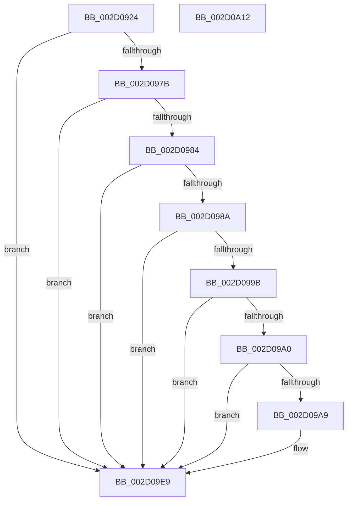

# PpmWakeClockOwnerIfNeeded

- RVA: `0x002D0924`–`0x002D0A13` (길이 `239` bytes)
- VA: `0x00000001402D0924`
- 실행 섹션: `.text`
- PDB 이름 있음: `예`; PDB Function 태그: `아니요`
- unwind 정보 RVA: `0x0006F718`
- 디코드: `56`개 명령, `239/239` bytes 표시
- 미해석 바이트: `0` (있으면 어셈블리에 `.byte`로 보존)

> 이 문서는 커널 이미지의 기계어와 PDB 기호를 분석해 생성했습니다. 4번과 5번은 함수 원형과 자료형을 바이너리 사용 방식에서 추정한 C 해석이며 원본 소스 복구 결과는 아닙니다.

## 1. Dependencies

- 직접 호출 지점: **6**; 고유 호출 대상: **5**
- 직접 호출자로 확인된 함수: **1**
- RIP 상대 이미지 참조: **5**

### Outgoing calls
- `0x002D0960` → [memset](../6C/memset_function_006C6C40.md) (function, `0x006C6C40`)
- `0x002D09A0` → [PoAllProcessorsDeepIdle](../5C/PoAllProcessorsDeepIdle_function_005CF1C4.md) (function, `0x005CF1C4`)
- `0x002D09C3` → [memset](../6C/memset_function_006C6C40.md) (function, `0x006C6C40`)
- `0x002D09CF` → [KeAddProcessorAffinityEx](../25/KeAddProcessorAffinityEx_function_0025B6F0.md) (function, `0x0025B6F0`)
- `0x002D09E4` → [HalRequestIpi](HalRequestIpi_function_002D1720.md) (function, `0x002D1720`)
- `0x002D09F4` → [_security_check_cookie](../6A/_security_check_cookie_function_006AC640.md) (function, `0x006AC640`)

### Direct callers
- [PoIdle](../2C/PoIdle_function_002CFB40.md) at `0x002CFC85`

### Static image references
- `0x002D093B` → RVA `0x00E0A740` (`.data`; read)
- `0x002D0965` → RVA `0x00FC5364` (`ALMOSTRO`; read)
- `0x002D0973` → RVA `0x00F21FB0` (`.data`; read)
- `0x002D097B` → RVA `0x00FC6F8C` (`ALMOSTRO`; read)
- `0x002D098A` → RVA `0x00FC8C40` (`ALMOSTRO`; read)

## 2. Other-region calls and transfers

- 다른 실행 섹션으로 향하는 call: **0**
- 별도 외부 분기/꼬리 이동을 확인하지 못했습니다.

## 3. Assembly (complete function range)

```asm
002D0924  48 89 5C 24 10                  mov qword ptr [rsp + 0x10], rbx
002D0929  48 89 6C 24 18                  mov qword ptr [rsp + 0x18], rbp
002D092E  48 89 74 24 20                  mov qword ptr [rsp + 0x20], rsi
002D0933  57                              push rdi
002D0934  48 81 EC 40 01 00 00            sub rsp, 0x140
002D093B  48 8B 05 FE 9D B3 00            mov rax, qword ptr [rip + 0xb39dfe]
002D0942  48 33 C4                        xor rax, rsp
002D0945  48 89 84 24 30 01 00 00         mov qword ptr [rsp + 0x130], rax
002D094D  40 8A F2                        mov sil, dl
002D0950  48 8B D9                        mov rbx, rcx
002D0953  33 D2                           xor edx, edx
002D0955  48 8D 4C 24 28                  lea rcx, [rsp + 0x28]
002D095A  41 B8 00 01 00 00               mov r8d, 0x100
002D0960  E8 DB 62 3F 00                  call 0x1406c6c40
002D0965  80 3D F8 49 CF 00 00            cmp byte ptr [rip + 0xcf49f8], 0
002D096C  48 8B AB 40 88 00 00            mov rbp, qword ptr [rbx + 0x8840]
002D0973  8B 3D 37 16 C5 00               mov edi, dword ptr [rip + 0xc51637]
002D0979  75 6E                           jne 0x1402d09e9
002D097B  83 3D 0A 66 CF 00 00            cmp dword ptr [rip + 0xcf660a], 0
002D0982  75 65                           jne 0x1402d09e9
002D0984  80 7B 21 00                     cmp byte ptr [rbx + 0x21], 0
002D0988  75 5F                           jne 0x1402d09e9
002D098A  48 8D 0D AF 82 CF 00            lea rcx, [rip + 0xcf82af]
002D0991  48 8B 04 F9                     mov rax, qword ptr [rcx + rdi*8]
002D0995  80 78 21 00                     cmp byte ptr [rax + 0x21], 0
002D0999  74 4E                           je 0x1402d09e9
002D099B  40 84 F6                        test sil, sil
002D099E  75 49                           jne 0x1402d09e9
002D09A0  E8 1F E8 2F 00                  call 0x1405cf1c4
002D09A5  84 C0                           test al, al
002D09A7  74 40                           je 0x1402d09e9
002D09A9  83 64 24 24 00                  and dword ptr [rsp + 0x24], 0
002D09AE  48 8D 4C 24 28                  lea rcx, [rsp + 0x28]
002D09B3  33 D2                           xor edx, edx
002D09B5  C7 44 24 20 01 00 20 00         mov dword ptr [rsp + 0x20], 0x200001
002D09BD  41 B8 00 01 00 00               mov r8d, 0x100
002D09C3  E8 78 62 3F 00                  call 0x1406c6c40
002D09C8  8B D7                           mov edx, edi
002D09CA  48 8D 4C 24 20                  lea rcx, [rsp + 0x20]
002D09CF  E8 1C AD F8 FF                  call 0x14025b6f0
002D09D4  B8 00 08 00 00                  mov eax, 0x800
002D09D9  48 8D 54 24 20                  lea rdx, [rsp + 0x20]
002D09DE  66 09 45 38                     or word ptr [rbp + 0x38], ax
002D09E2  33 C9                           xor ecx, ecx
002D09E4  E8 37 0D 00 00                  call 0x1402d1720
002D09E9  48 8B 8C 24 30 01 00 00         mov rcx, qword ptr [rsp + 0x130]
002D09F1  48 33 CC                        xor rcx, rsp
002D09F4  E8 47 BC 3D 00                  call 0x1406ac640
002D09F9  4C 8D 9C 24 40 01 00 00         lea r11, [rsp + 0x140]
002D0A01  49 8B 5B 18                     mov rbx, qword ptr [r11 + 0x18]
002D0A05  49 8B 6B 20                     mov rbp, qword ptr [r11 + 0x20]
002D0A09  49 8B 73 28                     mov rsi, qword ptr [r11 + 0x28]
002D0A0D  49 8B E3                        mov rsp, r11
002D0A10  5F                              pop rdi
002D0A11  C3                              ret
002D0A12  CC                              int3
```

## 4. C-style interpretation (structured pseudocode)

```c
__int64 __fastcall PpmWakeClockOwnerIfNeeded(__int64 a1, int a2)
{
    __int64 result;
    __int64 v_rsp;
    unsigned __int64 v_stack_m120;
    unsigned int v_stack_m124;
    unsigned int v_stack_m128;
    unsigned __int64 v_stack_m18;
    unsigned __int64 v_stack_m8;
    unsigned __int64 v_stack_p10;
    unsigned __int64 v_stack_p18;
    unsigned __int64 v_stack_p20;

    v_stack_p10 = v_rbx;
    v_stack_p18 = v_rbp;
    v_stack_p20 = v_rsi;
    v_rsp = (v_rsp) - (320);
    result = (*(unsigned __int64 *)(v_rip + 11771390)) ^ (v_rsp);
    v_stack_m18 = result;
    a2 = 0;
    result = memset(v_stack_m120, a2, 256, a4);
    if ((*(unsigned __int8 *)(v_rip + 13584888)) != 0) goto loc_002D09E9;
    if ((*(unsigned int *)(v_rip + 13592074)) != 0) goto loc_002D09E9;
    if ((*(unsigned __int8 *)(a1 + 33)) != 0) goto loc_002D09E9;
    if ((*(unsigned __int8 *)(*(unsigned __int64 *)(v_rip + 13599407 + (unsigned int)(*(unsigned int *)(v_rip + 12916279)) * 8) + 33)) == 0) goto loc_002D09E9;
    if ((unsigned __int8)((unsigned __int8)(a2)) != 0) goto loc_002D09E9;
    result = PoAllProcessorsDeepIdle(v_rip + 13599407, a2, 256, a4);
    if ((unsigned __int8)(result) != 0) {
        a1 = v_stack_m120;
        a2 = 0;
        v_stack_m128 = 0x200001ULL;
        a3 = 256;
        result = memset(a1, a2, a3, a4);
        a2 = (unsigned int)((unsigned int)(*(unsigned int *)(v_rip + 12916279)));
        a1 = v_stack_m128;
        result = KeAddProcessorAffinityEx(a1, a2, a3, a4);
        result = 0x800ULL;
        a2 = v_stack_m128;
        a1 = 0;
        result = HalRequestIpi(a1, a2, a3, a4);
    }
    a1 = (v_stack_m18) ^ (v_rsp);
    result = _security_check_cookie(a1, a2, a3, a4);
    return result;
}
```

## 5. (Beta) C Style

```c
int64_t PpmWakeClockOwnerIfNeeded(void *Arg1, int32_t Arg2)
{
    uint8_t *arg1 = (uint8_t *)Arg1;

    int64_t result;
    int64_t local_rsp;
    uint64_t v_stack_m120;
    uint32_t v_stack_m124;
    uint32_t v_stack_m128;
    uint64_t v_stack_m18;
    uint64_t v_stack_m8;
    uint64_t v_stack_p10;
    uint64_t v_stack_p18;
    uint64_t v_stack_p20;

    v_stack_p10 = local_rbx;
    v_stack_p18 = local_rbp;
    v_stack_p20 = local_rsi;
    local_rsp = (local_rsp) - (320);
    result = (*(uint64_t *)(v_rip + 0xB39DFE)) ^ (local_rsp);
    v_stack_m18 = result;
    Arg2 = 0;
    result = memset(v_stack_m120, Arg2, 256, a4);
    if ((*(uint8_t *)(v_rip + 0xCF49F8)) != 0) goto loc_002D09E9;
    if ((*(uint32_t *)(v_rip + 0xCF660A)) != 0) goto loc_002D09E9;
    if ((*(uint8_t *)(arg1 + 0x21)) != 0) goto loc_002D09E9;
    if ((*(uint8_t *)(*(uint64_t *)(v_rip + 0xCF82AF + (uint32_t)(*(uint32_t *)(v_rip + 0xC51637)) * 8) + 0x21)) == 0) goto loc_002D09E9;
    if ((uint8_t)((uint8_t)(Arg2)) != 0) goto loc_002D09E9;
    result = PoAllProcessorsDeepIdle(v_rip + 13599407, Arg2, 256, a4);
    if ((uint8_t)(result) != 0) {
        Arg1 = v_stack_m120;
        Arg2 = 0;
        v_stack_m128 = 0x200001ULL;
        a3 = 256;
        result = memset(Arg1, Arg2, a3, a4);
        Arg2 = (uint32_t)((uint32_t)(*(uint32_t *)(v_rip + 0xC51637)));
        Arg1 = v_stack_m128;
        result = KeAddProcessorAffinityEx(Arg1, Arg2, a3, a4);
        result = 0x800ULL;
        Arg2 = v_stack_m128;
        Arg1 = 0;
        result = HalRequestIpi(Arg1, Arg2, a3, a4);
    }
    Arg1 = (v_stack_m18) ^ (local_rsp);
    result = _security_check_cookie(Arg1, Arg2, a3, a4);
    return result;
}
```

### 관측된 메모리 오프셋

구조체 형식이 확인되지 않은 접근은 인자 기준의 오프셋으로만 기록했습니다.

| 기준 인자 | 오프셋 표현 | 폭 (bit) | 접근 |
|---|---:|---:|---|
| `Arg1` | `+ 0x21` | `8` | `R` |
| `Arg1` | `+ 0x8840` | `64` | `R` |

## 6. Execution-region graph

[열기: 2D/3D 그래프와 함수 탐색 컨트롤 패널](../../../control-panel.html?section=text&rva=0x002D0924&view=graph)

- 2D 그래프는 위에서 아래로 흐르고, 3D 그래프는 빈 공간을 드래그해 회전합니다. Shift+드래그는 이동, 휠은 확대·축소, 함수 노드 선택은 대상 보고서 이동입니다.

### Static fallback


