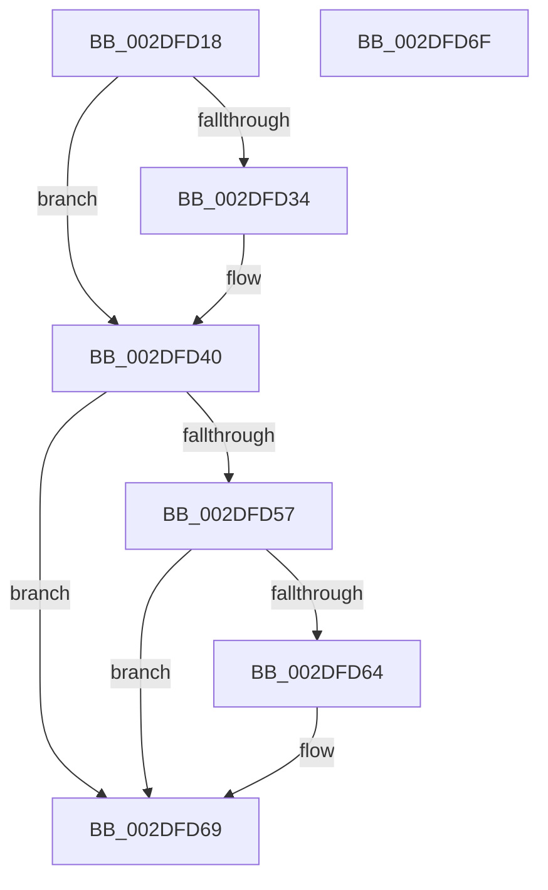

# PspUnlockProcessListExclusive

- RVA: `0x002DFD18`–`0x002DFD70` (길이 `88` bytes)
- VA: `0x00000001402DFD18`
- 실행 섹션: `.text`
- PDB 이름 있음: `예`; PDB Function 태그: `아니요`
- unwind 정보 RVA: `0x0005CF00`
- 디코드: `24`개 명령, `88/88` bytes 표시
- 미해석 바이트: `0` (있으면 어셈블리에 `.byte`로 보존)

> 이 문서는 커널 이미지의 기계어와 PDB 기호를 분석해 생성했습니다. 4번과 5번은 함수 원형과 자료형을 바이너리 사용 방식에서 추정한 C 해석이며 원본 소스 복구 결과는 아닙니다.

## 1. Dependencies

- 직접 호출 지점: **3**; 고유 호출 대상: **3**
- 직접 호출자로 확인된 함수: **19**
- RIP 상대 이미지 참조: **2**

### Outgoing calls
- `0x002DFD3B` → [ExfTryToWakePushLock](../26/ExfTryToWakePushLock_function_00265DD0.md) (function, `0x00265DD0`)
- `0x002DFD47` → [KeAbPostRelease](../2E/KeAbPostRelease_function_002E1600.md) (function, `0x002E1600`)
- `0x002DFD64` → [KiCheckForKernelApcDelivery](../2E/KiCheckForKernelApcDelivery_function_002E2C80.md) (function, `0x002E2C80`)

### Direct callers
- [PspDetachSession](../22/PspDetachSession_function_0022480C.md) at `0x00224855`
- [PsGetSessionObjectById](../22/PsGetSessionObjectById_function_002250C0.md) at `0x00225118`
- [PsGetSessionById](../22/PsGetSessionById_function_00225150.md) at `0x002251B7`
- [PsAttachSession](../5E/PsAttachSession_function_005E4F40.md) at `0x005E4F7C`
- [PsAttachSession](../5E/PsAttachSession_function_005E4F40.md) at `0x005E4F8B`
- [PsIsSessionInCurrentServerSilo](../5E/PsIsSessionInCurrentServerSilo_function_005E4FE8.md) at `0x005E5073`
- [PspInitializeSessionGlobals](../../page/70/PspInitializeSessionGlobals_function_007005B8.md) at `0x00700645`
- [PspInitializeSessionGlobals](../../page/70/PspInitializeSessionGlobals_function_007005B8.md) at `0x00700672`
- [PspInitializeSessionGlobals](../../page/70/PspInitializeSessionGlobals_function_007005B8.md) at `0x007006A5`
- [PspAttachSession](../../page/78/PspAttachSession_function_00788EB0.md) at `0x00788F09`
- [PspAttachSession](../../page/78/PspAttachSession_function_00788EB0.md) at `0x00788F20`
- [PspDereferenceSessionFinal](../../page/78/PspDereferenceSessionFinal_function_00788F5C.md) at `0x00788FB0`
- [PspDereferenceSessionFinal](../../page/78/PspDereferenceSessionFinal_function_00788F5C.md) at `0x00788FCA`
- [PspDereferenceSessionFinal](../../page/78/PspDereferenceSessionFinal_function_00788F5C.md) at `0x0078906D`
- [PspFreeSessionId](../../page/78/PspFreeSessionId_function_007890B8.md) at `0x007890F0`
- [PspGetNewSessionId](../../page/78/PspGetNewSessionId_function_00789108.md) at `0x007891F7`
- [PspMarkSessionReferenceProcess](../../page/78/PspMarkSessionReferenceProcess_function_00789220.md) at `0x0078928C`
- [PspUnlinkSessionId](../../page/78/PspUnlinkSessionId_function_007895D8.md) at `0x0078962B`
- [PspProcessDelete](../../page/90/PspProcessDelete_function_00907B90.md) at `0x00907C31`
- [PsGetNextSession](../../page/91/PsGetNextSession_function_009128C0.md) at `0x0091291F`
- [PsGetNextSession](../../page/91/PsGetNextSession_function_009128C0.md) at `0x0091296B`
- [PspInsertProcess](../../page/94/PspInsertProcess_function_009472CC.md) at `0x009473DC`
- [PsJoinSession](../../page/A5/PsJoinSession_function_00A5F118.md) at `0x00A5F181`
- [PsUnlinkProcessFromSession](../../page/A8/PsUnlinkProcessFromSession_function_00A8AA88.md) at `0x00A8AAEC`
- [PsSessionSetUnloadAddress](../../page/AA/PsSessionSetUnloadAddress_function_00AABECC.md) at `0x00AABF21`
- [PspMakeSessionVisible](../../page/AC/PspMakeSessionVisible_function_00ACA0B8.md) at `0x00ACA14E`

### Static image references
- `0x002DFD25` → RVA `0x00FD9AF8` (`PAGEDATA`; read/write)
- `0x002DFD34` → RVA `0x00FD9AF8` (`PAGEDATA`; read)

## 2. Other-region calls and transfers

- 다른 실행 섹션으로 향하는 call: **0**
- 별도 외부 분기/꼬리 이동을 확인하지 못했습니다.

## 3. Assembly (complete function range)

```asm
002DFD18  40 53                           push rbx
002DFD1A  48 83 EC 20                     sub rsp, 0x20
002DFD1E  48 8B D9                        mov rbx, rcx
002DFD21  48 83 C8 FF                     or rax, 0xffffffffffffffff
002DFD25  F0 48 0F C1 05 CA 9D CF 00      lock xadd qword ptr [rip + 0xcf9dca], rax
002DFD2E  24 06                           and al, 6
002DFD30  3C 02                           cmp al, 2
002DFD32  75 0C                           jne 0x1402dfd40
002DFD34  48 8D 0D BD 9D CF 00            lea rcx, [rip + 0xcf9dbd]
002DFD3B  E8 90 60 F8 FF                  call 0x140265dd0
002DFD40  48 8D 0D B1 9D CF 00            lea rcx, [rip + 0xcf9db1]
002DFD47  E8 B4 18 00 00                  call 0x1402e1600
002DFD4C  90                              nop
002DFD4D  66 83 83 E6 01 00 00 01         add word ptr [rbx + 0x1e6], 1
002DFD55  75 12                           jne 0x1402dfd69
002DFD57  48 8D 83 98 00 00 00            lea rax, [rbx + 0x98]
002DFD5E  90                              nop
002DFD5F  48 39 00                        cmp qword ptr [rax], rax
002DFD62  74 05                           je 0x1402dfd69
002DFD64  E8 17 2F 00 00                  call 0x1402e2c80
002DFD69  48 83 C4 20                     add rsp, 0x20
002DFD6D  5B                              pop rbx
002DFD6E  C3                              ret
002DFD6F  CC                              int3
```

## 4. C-style interpretation (structured pseudocode)

```c
__int64 __fastcall PspUnlockProcessListExclusive(__int64 a1)
{
    __int64 result;
    __int64 v_rsp;

    v_rsp = (v_rsp) - (32);
    result = (result) | (-1);
    result = (unsigned __int8)((result) & (6));
    if (((unsigned __int8)(result)) == 2) {
        a1 = v_rip + 13606333;
        result = ExfTryToWakePushLock(a1, a2, a3, a4);
    }
    result = KeAbPostRelease(v_rip + 13606321, a2, a3, a4);
    if (((unsigned __int8)(result)) != 2) goto loc_002DFD69;
    result = a1 + 152;
    if ((*(unsigned __int64 *)(a1 + 152)) != (a1 + 152)) {
        result = KiCheckForKernelApcDelivery(v_rip + 13606321, a2, a3, a4);
    }
    v_rsp = (v_rsp) + (32);
    return result;
}
```

## 5. (Beta) C Style

```c
int64_t PspUnlockProcessListExclusive(void *Arg1)
{
    uint8_t *arg1 = (uint8_t *)Arg1;

    int64_t result;
    int64_t local_rsp;

    local_rsp = (local_rsp) - (32);
    result = (result) | (-1);
    result = (uint8_t)((result) & (6));
    if (((uint8_t)(result)) == 2) {
        Arg1 = v_rip + 13606333;
        result = ExfTryToWakePushLock(Arg1, a2, a3, a4);
    }
    result = KeAbPostRelease(v_rip + 13606321, a2, a3, a4);
    if (((uint8_t)(result)) != 2) goto loc_002DFD69;
    result = Arg1 + 152;
    if ((*(uint64_t *)(arg1 + 0x98)) != (Arg1 + 152)) {
        result = KiCheckForKernelApcDelivery(v_rip + 13606321, a2, a3, a4);
    }
    local_rsp = (local_rsp) + (32);
    return result;
}
```

### 관측된 메모리 오프셋

구조체 형식이 확인되지 않은 접근은 인자 기준의 오프셋으로만 기록했습니다.

| 기준 인자 | 오프셋 표현 | 폭 (bit) | 접근 |
|---|---:|---:|---|
| `Arg1` | `+ 0x0` | `64` | `R` |
| `Arg1` | `+ 0x98` | `64` | `R` |
| `Arg1` | `+ 0x1E6` | `16` | `R/W` |

## 6. Execution-region graph

[열기: 2D/3D 그래프와 함수 탐색 컨트롤 패널](../../../control-panel.html?section=text&rva=0x002DFD18&view=graph)

- 2D 그래프는 위에서 아래로 흐르고, 3D 그래프는 빈 공간을 드래그해 회전합니다. Shift+드래그는 이동, 휠은 확대·축소, 함수 노드 선택은 대상 보고서 이동입니다.

### Static fallback


