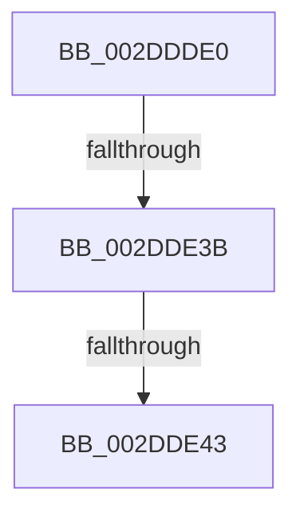

# SMKM_STORE_MGR&lt;SM_TRAITS&gt;::SmFeEvictUpdatePass

- RVA: `0x002DDDE0`–`0x002DDE53` (길이 `115` bytes)
- VA: `0x00000001402DDDE0`
- 실행 섹션: `.text`
- PDB 이름 있음: `예`; PDB Function 태그: `아니요`
- unwind 정보 RVA: `0x0007092C`
- 디코드: `30`개 명령, `115/115` bytes 표시
- 미해석 바이트: `0` (있으면 어셈블리에 `.byte`로 보존)

> 이 문서는 커널 이미지의 기계어와 PDB 기호를 분석해 생성했습니다. 4번과 5번은 함수 원형과 자료형을 바이너리 사용 방식에서 추정한 C 해석이며 원본 소스 복구 결과는 아닙니다.

## 1. Dependencies

- 직접 호출 지점: **0**; 고유 호출 대상: **0**
- 직접 호출자로 확인된 함수: **1**
- RIP 상대 이미지 참조: **0**

### Outgoing calls
- 직접 디코드된 call 명령이 없습니다.

### Direct callers
- [sub_002DF8DD](Unknown_function_002DF8DD.md) at `0x002DFAB7`

### Static image references
- 디코드된 RIP-relative 메모리 참조가 없습니다.

## 2. Other-region calls and transfers

- 다른 실행 섹션으로 향하는 call: **0**
- call이 아닌 외부 분기/꼬리 이동: **2**
  - `0x002DDE35` → [sub_002DE05D](Unknown_function_002DE05D.md) (`tail-transfer`)
  - `0x002DDE3D` → [sub_002DE05D](Unknown_function_002DE05D.md) (`tail-transfer`)

## 3. Assembly (complete function range)

```asm
002DDDE0  40 53                           push rbx
002DDDE2  55                              push rbp
002DDDE3  57                              push rdi
002DDDE4  41 54                           push r12
002DDDE6  41 56                           push r14
002DDDE8  48 83 EC 50                     sub rsp, 0x50
002DDDEC  45 8B 10                        mov r10d, dword ptr [r8]
002DDDEF  45 33 F6                        xor r14d, r14d
002DDDF2  8B 1A                           mov ebx, dword ptr [rdx]
002DDDF4  33 ED                           xor ebp, ebp
002DDDF6  48 8B 94 24 A0 00 00 00         mov rdx, qword ptr [rsp + 0xa0]
002DDDFE  4C 8B E1                        mov r12, rcx
002DDE01  4C 89 44 24 20                  mov qword ptr [rsp + 0x20], r8
002DDE06  41 B8 00 04 00 00               mov r8d, 0x400
002DDE0C  4C 89 4C 24 28                  mov qword ptr [rsp + 0x28], r9
002DDE11  8D 7B FF                        lea edi, [rbx - 1]
002DDE14  48 89 8C 24 98 00 00 00         mov qword ptr [rsp + 0x98], rcx
002DDE1C  8B 42 18                        mov eax, dword ptr [rdx + 0x18]
002DDE1F  41 03 FA                        add edi, r10d
002DDE22  44 89 94 24 88 00 00 00         mov dword ptr [rsp + 0x88], r10d
002DDE2A  44 89 84 24 80 00 00 00         mov dword ptr [rsp + 0x80], r8d
002DDE32  83 F8 FF                        cmp eax, -1
002DDE35  0F 84 22 02 00 00               je 0x1402de05d
002DDE3B  85 C0                           test eax, eax
002DDE3D  0F 84 1A 02 00 00               je 0x1402de05d
002DDE43  FF C8                           dec eax
002DDE45  48 C1 E0 04                     shl rax, 4
002DDE49  48 03 02                        add rax, qword ptr [rdx]
002DDE4C  4C 8B 08                        mov r9, qword ptr [rax]
002DDE4F  48 8B 50 08                     mov rdx, qword ptr [rax + 8]
```

## 4. C-style interpretation (structured pseudocode)

```c
__int64 __fastcall SMKM_STORE_MGR_SM_TRAITS___SmFeEvictUpdatePass(__int64 a1, __int64 a2, __int64 a3, __int64 a4, __int64 a5)
{
    __int64 result;
    __int64 v_r14;
    __int64 v_rbp;
    __int64 v_rdi;
    __int64 v_rsp;
    unsigned __int64 v_stack_m50;
    unsigned __int64 v_stack_m58;
    unsigned int v_stack_p10;
    unsigned __int64 v_stack_p20;
    unsigned int v_stack_p8;

    v_rsp = (v_rsp) - (80);
    v_r14 = 0;
    v_rbp = 0;
    v_stack_m58 = a3;
    v_stack_m50 = a4;
    v_stack_p20 = a1;
    v_rdi = (unsigned int)(((unsigned int)(*(unsigned int *)(a2)) - 1) + ((unsigned int)((unsigned int)(*(unsigned int *)(a3)))));
    v_stack_p10 = (unsigned int)((unsigned int)(*(unsigned int *)(a3)));
    v_stack_p8 = (unsigned int)((unsigned int)(0x400ULL));
    result = (unsigned int)(((unsigned int)(*(unsigned int *)(a5 + 24))) - 1);
    result = (result) << (4);
    result = (result) + (*(unsigned __int64 *)(a5));
    return result;
}
```

## 5. (Beta) C Style

```c
int64_t SMKM_STORE_MGR_SM_TRAITS___SmFeEvictUpdatePass(int64_t Arg1, void *Arg2, void *Arg3, int64_t Arg4, void *Arg5)
{
    uint8_t *arg2 = (uint8_t *)Arg2;
    uint8_t *arg3 = (uint8_t *)Arg3;
    uint8_t *arg5 = (uint8_t *)Arg5;

    int64_t result;
    int64_t local_r14;
    int64_t local_rbp;
    int64_t local_rdi;
    int64_t local_rsp;
    uint64_t v_stack_m50;
    uint64_t v_stack_m58;
    uint32_t v_stack_p10;
    uint64_t v_stack_p20;
    uint32_t v_stack_p8;

    local_rsp = (local_rsp) - (80);
    local_r14 = 0;
    local_rbp = 0;
    v_stack_m58 = Arg3;
    v_stack_m50 = Arg4;
    v_stack_p20 = Arg1;
    local_rdi = (uint32_t)(((uint32_t)(*(uint32_t *)(arg2)) - 1) + ((uint32_t)((uint32_t)(*(uint32_t *)(arg3)))));
    v_stack_p10 = (uint32_t)((uint32_t)(*(uint32_t *)(arg3)));
    v_stack_p8 = (uint32_t)((uint32_t)(0x400ULL));
    result = (uint32_t)(((uint32_t)(*(uint32_t *)(arg5 + 0x18))) - 1);
    result = (result) << (4);
    result = (result) + (*(uint64_t *)(arg5));
    return result;
}
```

### 관측된 메모리 오프셋

구조체 형식이 확인되지 않은 접근은 인자 기준의 오프셋으로만 기록했습니다.

| 기준 인자 | 오프셋 표현 | 폭 (bit) | 접근 |
|---|---:|---:|---|
| `Arg2` | `+ 0x0` | `32` | `R` |
| `Arg3` | `+ 0x0` | `32` | `R` |
| `Arg5` | `+ 0x0` | `64` | `R` |
| `Arg5` | `+ 0x18` | `32` | `R` |

## 6. Execution-region graph

[열기: 2D/3D 그래프와 함수 탐색 컨트롤 패널](../../../control-panel.html?section=text&rva=0x002DDDE0&view=graph)

- 2D 그래프는 위에서 아래로 흐르고, 3D 그래프는 빈 공간을 드래그해 회전합니다. Shift+드래그는 이동, 휠은 확대·축소, 함수 노드 선택은 대상 보고서 이동입니다.

### Static fallback


