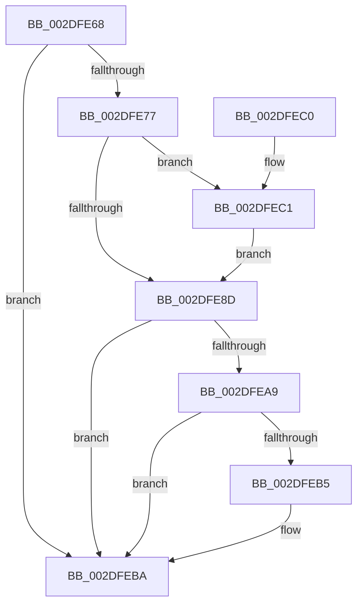

# SMKM_STORE&lt;SM_TRAITS&gt;::SmStReleaseStoreLockExclusive

- RVA: `0x002DFE68`–`0x002DFECB` (길이 `99` bytes)
- VA: `0x00000001402DFE68`
- 실행 섹션: `.text`
- PDB 이름 있음: `예`; PDB Function 태그: `아니요`
- unwind 정보 RVA: `0x00064CA8`
- 디코드: `28`개 명령, `99/99` bytes 표시
- 미해석 바이트: `0` (있으면 어셈블리에 `.byte`로 보존)

> 이 문서는 커널 이미지의 기계어와 PDB 기호를 분석해 생성했습니다. 4번과 5번은 함수 원형과 자료형을 바이너리 사용 방식에서 추정한 C 해석이며 원본 소스 복구 결과는 아닙니다.

## 1. Dependencies

- 직접 호출 지점: **3**; 고유 호출 대상: **3**
- 직접 호출자로 확인된 함수: **5**
- RIP 상대 이미지 참조: **0**

### Outgoing calls
- `0x002DFE90` → [KeAbPostRelease](../2E/KeAbPostRelease_function_002E1600.md) (function, `0x002E1600`)
- `0x002DFEB5` → [KiCheckForKernelApcDelivery](../2E/KiCheckForKernelApcDelivery_function_002E2C80.md) (function, `0x002E2C80`)
- `0x002DFEC4` → [ExfTryToWakePushLock](../26/ExfTryToWakePushLock_function_00265DD0.md) (function, `0x00265DD0`)

### Direct callers
- [ST_STORE&lt;SM_TRAITS&gt;::StDmPageRemove](../20/ST_STORE_SM_TRAITS_StDmPageRemove_function_002049A0.md) at `0x00204DA4`
- [ST_STORE&lt;SM_TRAITS&gt;::StDmPageRemove](../20/ST_STORE_SM_TRAITS_StDmPageRemove_function_002049A0.md) at `0x00204E5C`
- [ST_STORE&lt;SM_TRAITS&gt;::StDmpSinglePageAdd](../20/ST_STORE_SM_TRAITS_StDmpSinglePageAdd_function_0020502C.md) at `0x002050CB`
- [sub_00206865](../20/Unknown_function_00206865.md) at `0x00206CC9`
- [SMKM_STORE&lt;SM_TRAITS&gt;::SmStCleanup](../3B/SMKM_STORE_SM_TRAITS_SmStCleanup_function_003B00E0.md) at `0x003B0203`
- [SMKM_STORE&lt;SM_TRAITS&gt;::SmStHelperSendCommand](../3B/SMKM_STORE_SM_TRAITS_SmStHelperSendCommand_function_003B0530.md) at `0x003B0607`

### Static image references
- 디코드된 RIP-relative 메모리 참조가 없습니다.

## 2. Other-region calls and transfers

- 다른 실행 섹션으로 향하는 call: **0**
- 별도 외부 분기/꼬리 이동을 확인하지 못했습니다.

## 3. Assembly (complete function range)

```asm
002DFE68  40 53                           push rbx
002DFE6A  48 83 EC 20                     sub rsp, 0x20
002DFE6E  F6 81 95 1A 00 00 04            test byte ptr [rcx + 0x1a95], 4
002DFE75  74 43                           je 0x1402dfeba
002DFE77  48 8D 99 98 1A 00 00            lea rbx, [rcx + 0x1a98]
002DFE7E  48 83 C8 FF                     or rax, 0xffffffffffffffff
002DFE82  F0 48 0F C1 03                  lock xadd qword ptr [rbx], rax
002DFE87  24 06                           and al, 6
002DFE89  3C 02                           cmp al, 2
002DFE8B  74 34                           je 0x1402dfec1
002DFE8D  48 8B CB                        mov rcx, rbx
002DFE90  E8 6B 17 00 00                  call 0x1402e1600
002DFE95  65 48 8B 04 25 88 01 00 00      mov rax, qword ptr gs:[0x188]
002DFE9E  90                              nop
002DFE9F  66 83 80 E6 01 00 00 01         add word ptr [rax + 0x1e6], 1
002DFEA7  75 11                           jne 0x1402dfeba
002DFEA9  48 05 98 00 00 00               add rax, 0x98
002DFEAF  90                              nop
002DFEB0  48 39 00                        cmp qword ptr [rax], rax
002DFEB3  74 05                           je 0x1402dfeba
002DFEB5  E8 C6 2D 00 00                  call 0x1402e2c80
002DFEBA  48 83 C4 20                     add rsp, 0x20
002DFEBE  5B                              pop rbx
002DFEBF  C3                              ret
002DFEC0  CC                              int3
002DFEC1  48 8B CB                        mov rcx, rbx
002DFEC4  E8 07 5F F8 FF                  call 0x140265dd0
002DFEC9  EB C2                           jmp 0x1402dfe8d
```

## 4. C-style interpretation (structured pseudocode)

```c
__int64 __fastcall SMKM_STORE_SM_TRAITS___SmStReleaseStoreLockExclusive(__int64 a1)
{
    __int64 result;
    __int64 v_rsp;

    v_rsp = (v_rsp) - (32);
    if (((*(unsigned __int8 *)(a1 + 6805)) & (4)) == 0) goto loc_002DFEBA;
    result = (result) | (-1);
    result = (unsigned __int8)((result) & (6));
    if (((unsigned __int8)(result)) == 2) goto loc_002DFEC1;
loc_002DFE8D:
    result = KeAbPostRelease(a1 + 6808, a2, a3, a4);
    if (((unsigned __int8)(result)) != 2) goto loc_002DFEBA;
    result = (*(unsigned __int64 *)(gs_base + (0 + 392))) + (152);
    if ((*(unsigned __int64 *)(result)) != result) {
        result = KiCheckForKernelApcDelivery(a1 + 6808, a2, a3, a4);
    }
    v_rsp = (v_rsp) + (32);
    return result;
loc_002DFEC1:
    result = ExfTryToWakePushLock(a1 + 6808, a2, a3, a4);
    goto loc_002DFE8D;
}
```

## 5. (Beta) C Style

```c
int64_t SMKM_STORE_SM_TRAITS___SmStReleaseStoreLockExclusive(void *Arg1)
{
    uint8_t *arg1 = (uint8_t *)Arg1;

    int64_t result;
    int64_t local_rsp;

    local_rsp = (local_rsp) - (32);
    if (((*(uint8_t *)(arg1 + 0x1A95)) & (4)) == 0) goto loc_002DFEBA;
    result = (result) | (-1);
    result = (uint8_t)((result) & (6));
    if (((uint8_t)(result)) == 2) goto loc_002DFEC1;
loc_002DFE8D:
    result = KeAbPostRelease(Arg1 + 6808, a2, a3, a4);
    if (((uint8_t)(result)) != 2) goto loc_002DFEBA;
    result = (*(uint64_t *)(gs_base + (0 + 0x188))) + (152);
    if ((*(uint64_t *)(result)) != result) {
        result = KiCheckForKernelApcDelivery(Arg1 + 6808, a2, a3, a4);
    }
    local_rsp = (local_rsp) + (32);
    return result;
loc_002DFEC1:
    result = ExfTryToWakePushLock(Arg1 + 6808, a2, a3, a4);
    goto loc_002DFE8D;
}
```

### 관측된 메모리 오프셋

구조체 형식이 확인되지 않은 접근은 인자 기준의 오프셋으로만 기록했습니다.

| 기준 인자 | 오프셋 표현 | 폭 (bit) | 접근 |
|---|---:|---:|---|
| `Arg1` | `+ 0x0` | `64` | `R/W` |
| `Arg1` | `+ 0x1A95` | `8` | `R` |
| `Arg1` | `+ 0x1A98` | `64` | `R` |

## 6. Execution-region graph

[열기: 2D/3D 그래프와 함수 탐색 컨트롤 패널](../../../control-panel.html?section=text&rva=0x002DFE68&view=graph)

- 2D 그래프는 위에서 아래로 흐르고, 3D 그래프는 빈 공간을 드래그해 회전합니다. Shift+드래그는 이동, 휠은 확대·축소, 함수 노드 선택은 대상 보고서 이동입니다.

### Static fallback


