# sub_002D6584

- RVA: `0x002D6584`–`0x002D6A87` (길이 `1,283` bytes)
- VA: `0x00000001402D6584`
- 실행 섹션: `.text`
- PDB 이름 있음: `아니요`; PDB Function 태그: `아니요`
- unwind 정보 RVA: `0x0006FDE0`
- 디코드: `266`개 명령, `1,283/1,283` bytes 표시
- 미해석 바이트: `0` (있으면 어셈블리에 `.byte`로 보존)

> 이 문서는 커널 이미지의 기계어와 PDB 기호를 분석해 생성했습니다. 4번과 5번은 함수 원형과 자료형을 바이너리 사용 방식에서 추정한 C 해석이며 원본 소스 복구 결과는 아닙니다.

## 1. Dependencies

- 직접 호출 지점: **11**; 고유 호출 대상: **6**
- 직접 호출자로 확인된 함수: **0**
- RIP 상대 이미지 참조: **12**

### Outgoing calls
- `0x002D65CF` → [memset](../6C/memset_function_006C6C40.md) (function, `0x006C6C40`)
- `0x002D663A` → [KeIntSteerSnapPerf](KeIntSteerSnapPerf_function_002D76C0.md) (function, `0x002D76C0`)
- `0x002D6651` → [memset](../6C/memset_function_006C6C40.md) (function, `0x006C6C40`)
- `0x002D66DF` → [KeQuerySystemAllowedCpuSetAffinity](KeQuerySystemAllowedCpuSetAffinity_function_002D85F4.md) (function, `0x002D85F4`)
- `0x002D6758` → [memset](../6C/memset_function_006C6C40.md) (function, `0x006C6C40`)
- `0x002D6940` → [memset](../6C/memset_function_006C6C40.md) (function, `0x006C6C40`)
- `0x002D695F` → [memset](../6C/memset_function_006C6C40.md) (function, `0x006C6C40`)
- `0x002D69C6` → [memset](../6C/memset_function_006C6C40.md) (function, `0x006C6C40`)
- `0x002D69E8` → [KiSubtractAffinityEx](KiSubtractAffinityEx_function_002D61E8.md) (function, `0x002D61E8`)
- `0x002D6A0A` → [KiOrAffinityEx](../39/KiOrAffinityEx_function_0039A84C.md) (function, `0x0039A84C`)
- `0x002D6A52` → [KeIntSteerPeriodic](KeIntSteerPeriodic_function_002D6D04.md) (function, `0x002D6D04`)

### Direct callers
- 이 함수 시작 RVA로 연결되는 직접 call은 확인되지 않았습니다. 간접 호출은 완전히 역산할 수 없습니다.

### Static image references
- `0x002D65DF` → RVA `0x00FC7120` (`ALMOSTRO`; read)
- `0x002D6625` → RVA `0x00FC6A80` (`ALMOSTRO`; read)
- `0x002D6656` → RVA `0x00E0C0F0` (`.data`; read)
- `0x002D666B` → RVA `0x00000000` (`image boundary/outside`; read)
- `0x002D66E4` → RVA `0x00F07100` (`.data`; read)
- `0x002D6797` → RVA `0x00F231B8` (`.data`; read)
- `0x002D67A1` → RVA `0x00F231B0` (`.data`; read)
- `0x002D67E5` → RVA `0x00F070F8` (`.data`; read)
- `0x002D6807` → RVA `0x00E0C468` (`.data`; read)
- `0x002D68EB` → RVA `0x00E67A68` (`.data`; read)
- `0x002D6906` → RVA `0x00E0C470` (`.data`; read)
- `0x002D6964` → RVA `0x00F0E280` (`.data`; read)

## 2. Other-region calls and transfers

- 다른 실행 섹션으로 향하는 call: **0**
- call이 아닌 외부 분기/꼬리 이동: **9**
  - `0x002D6603` → [sub_002D6AB0 + 0xAC](Unknown_function_002D6AB0.md) (`tail-transfer`)
  - `0x002D6665` → [sub_002D6C05 + 0x1E](Unknown_function_002D6C05.md) (`tail-transfer`)
  - `0x002D66FA` → [sub_002D6C05 + 0x26](Unknown_function_002D6C05.md) (`tail-transfer`)
  - `0x002D6708` → [sub_002D6AB0](Unknown_function_002D6AB0.md) (`tail-transfer`)
  - `0x002D6839` → [sub_002D6AB0 + 0x108](Unknown_function_002D6AB0.md) (`tail-transfer`)
  - `0x002D6892` → [sub_002D6C05 + 0x33](Unknown_function_002D6C05.md) (`tail-transfer`)
  - `0x002D68C7` → [sub_002D6AB0 + 0xDB](Unknown_function_002D6AB0.md) (`tail-transfer`)
  - `0x002D68F5` → [sub_002D6AB0 + 0x2B](Unknown_function_002D6AB0.md) (`tail-transfer`)
  - `0x002D696E` → [sub_002D6C05 + 0x99](Unknown_function_002D6C05.md) (`tail-transfer`)

## 3. Assembly (complete function range)

```asm
002D6584  48 89 9C 24 10 07 00 00         mov qword ptr [rsp + 0x710], rbx
002D658C  48 8D 8D A8 02 00 00            lea rcx, [rbp + 0x2a8]
002D6593  48 89 B4 24 18 07 00 00         mov qword ptr [rsp + 0x718], rsi
002D659B  33 D2                           xor edx, edx
002D659D  48 89 BC 24 20 07 00 00         mov qword ptr [rsp + 0x720], rdi
002D65A5  BE 20 00 00 00                  mov esi, 0x20
002D65AA  4C 89 AC 24 F0 06 00 00         mov qword ptr [rsp + 0x6f0], r13
002D65B2  41 B8 00 01 00 00               mov r8d, 0x100
002D65B8  4C 89 B4 24 E8 06 00 00         mov qword ptr [rsp + 0x6e8], r14
002D65C0  4C 89 BC 24 E0 06 00 00         mov qword ptr [rsp + 0x6e0], r15
002D65C8  66 89 B5 A2 02 00 00            mov word ptr [rbp + 0x2a2], si
002D65CF  E8 6C 06 3F 00                  call 0x1406c6c40
002D65D4  0F B7 8D A2 02 00 00            movzx ecx, word ptr [rbp + 0x2a2]
002D65DB  41 0F B7 DC                     movzx ebx, r12w
002D65DF  66 39 0D 3A 0B CF 00            cmp word ptr [rip + 0xcf0b3a], cx
002D65E6  0F B7 F9                        movzx edi, cx
002D65E9  44 89 A5 A4 02 00 00            mov dword ptr [rbp + 0x2a4], r12d
002D65F0  66 0F 46 3D 28 0B CF 00         cmovbe di, word ptr [rip + 0xcf0b28]
002D65F8  66 89 BD A0 02 00 00            mov word ptr [rbp + 0x2a0], di
002D65FF  66 44 3B E7                     cmp r12w, di
002D6603  0F 82 53 05 00 00               jb 0x1402d6b5c
002D6609  66 3B D9                        cmp bx, cx
002D660C  73 17                           jae 0x1402d6625
002D660E  0F B7 C3                        movzx eax, bx
002D6611  66 FF C3                        inc bx
002D6614  4C 89 A4 C5 A8 02 00 00         mov qword ptr [rbp + rax*8 + 0x2a8], r12
002D661C  66 3B 9D A2 02 00 00            cmp bx, word ptr [rbp + 0x2a2]
002D6623  72 E9                           jb 0x1402d660e
002D6625  8B 05 55 04 CF 00               mov eax, dword ptr [rip + 0xcf0455]
002D662B  4C 8D 4C 24 58                  lea r9, [rsp + 0x58]
002D6630  4C 8D 44 24 50                  lea r8, [rsp + 0x50]
002D6635  48 8D 54 24 68                  lea rdx, [rsp + 0x68]
002D663A  E8 81 10 00 00                  call 0x1402d76c0
002D663F  33 D2                           xor edx, edx
002D6641  66 89 74 24 72                  mov word ptr [rsp + 0x72], si
002D6646  41 B8 00 01 00 00               mov r8d, 0x100
002D664C  48 8D 4C 24 78                  lea rcx, [rsp + 0x78]
002D6651  E8 EA 05 3F 00                  call 0x1406c6c40
002D6656  0F B7 05 93 5A B3 00            movzx eax, word ptr [rip + 0xb35a93]
002D665D  0F B7 7C 24 72                  movzx edi, word ptr [rsp + 0x72]
002D6662  66 3B C7                        cmp ax, di
002D6665  0F 87 B8 05 00 00               ja 0x1402d6c23
002D666B  4C 8D 35 8E 99 D2 FF            lea r14, [rip - 0x2d6672]
002D6672  45 8B C4                        mov r8d, r12d
002D6675  66 44 3B E0                     cmp r12w, ax
002D6679  73 2F                           jae 0x1402d66aa
002D667B  44 0F B7 C0                     movzx r8d, ax
002D667F  49 8B CC                        mov rcx, r12
002D6682  41 8B D0                        mov edx, r8d
002D6685  66 66 66 0F 1F 84 00 00 00 00 00  nop word ptr [rax + rax]
002D6690  4A 8B 84 31 F8 C0 E0 00         mov rax, qword ptr [rcx + r14 + 0xe0c0f8]
002D6698  48 8D 49 08                     lea rcx, [rcx + 8]
002D669C  48 F7 D0                        not rax
002D669F  48 89 44 0C 70                  mov qword ptr [rsp + rcx + 0x70], rax
002D66A4  48 83 EA 01                     sub rdx, 1
002D66A8  75 E6                           jne 0x1402d6690
002D66AA  44 89 64 24 74                  mov dword ptr [rsp + 0x74], r12d
002D66AF  0F B7 DF                        movzx ebx, di
002D66B2  66 89 5C 24 72                  mov word ptr [rsp + 0x72], bx
002D66B7  66 89 7C 24 70                  mov word ptr [rsp + 0x70], di
002D66BC  44 3B C7                        cmp r8d, edi
002D66BF  73 1E                           jae 0x1402d66df
002D66C1  41 8B C0                        mov eax, r8d
002D66C4  41 FF C0                        inc r8d
002D66C7  48 C7 44 C4 78 FF FF FF FF      mov qword ptr [rsp + rax*8 + 0x78], 0xffffffffffffffff
002D66D0  0F B7 5C 24 72                  movzx ebx, word ptr [rsp + 0x72]
002D66D5  44 3B C3                        cmp r8d, ebx
002D66D8  72 E7                           jb 0x1402d66c1
002D66DA  0F B7 7C 24 70                  movzx edi, word ptr [rsp + 0x70]
002D66DF  E8 10 1F 00 00                  call 0x1402d85f4
002D66E4  0F B7 0D 15 0A C3 00            movzx ecx, word ptr [rip + 0xc30a15]
002D66EB  66 3B F9                        cmp di, cx
002D66EE  66 0F 42 CF                     cmovb cx, di
002D66F2  66 89 4C 24 70                  mov word ptr [rsp + 0x70], cx
002D66F7  66 3B CB                        cmp cx, bx
002D66FA  0F 87 2B 05 00 00               ja 0x1402d6c2b
002D6700  41 0F B7 C4                     movzx eax, r12w
002D6704  66 44 3B E1                     cmp r12w, cx
002D6708  0F 82 A2 03 00 00               jb 0x1402d6ab0
002D670E  44 89 64 24 74                  mov dword ptr [rsp + 0x74], r12d
002D6713  66 3B C3                        cmp ax, bx
002D6716  73 1A                           jae 0x1402d6732
002D6718  0F 1F 84 00 00 00 00 00         nop dword ptr [rax + rax]
002D6720  0F B7 C8                        movzx ecx, ax
002D6723  66 FF C0                        inc ax
002D6726  4C 89 64 CC 78                  mov qword ptr [rsp + rcx*8 + 0x78], r12
002D672B  66 3B 44 24 72                  cmp ax, word ptr [rsp + 0x72]
002D6730  72 EE                           jb 0x1402d6720
002D6732  33 D2                           xor edx, edx
002D6734  48 C7 85 90 01 00 00 01 00 20 00  mov qword ptr [rbp + 0x190], 0x200001
002D673F  41 B8 00 01 00 00               mov r8d, 0x100
002D6745  48 8D 8D 98 01 00 00            lea rcx, [rbp + 0x198]
002D674C  41 8B DC                        mov ebx, r12d
002D674F  41 8B FC                        mov edi, r12d
002D6752  41 BD 01 00 00 00               mov r13d, 1
002D6758  E8 E3 04 3F 00                  call 0x1406c6c40
002D675D  4C 8B 8D A8 02 00 00            mov r9, qword ptr [rbp + 0x2a8]
002D6764  45 0F B7 D4                     movzx r10d, r12w
002D6768  0F 1F 84 00 00 00 00 00         nop dword ptr [rax + rax]
002D6770  0F B7 8D A0 02 00 00            movzx ecx, word ptr [rbp + 0x2a0]
002D6777  4D 85 C9                        test r9, r9
002D677A  0F 84 DE 00 00 00               je 0x1402d685e
002D6780  49 0F BC D1                     bsf rdx, r9
002D6784  41 0F B7 CA                     movzx ecx, r10w
002D6788  0F B6 C2                        movzx eax, dl
002D678B  49 0F B3 C1                     btr r9, rax
002D678F  C1 E1 06                        shl ecx, 6
002D6792  0F B6 C2                        movzx eax, dl
002D6795  03 C8                           add ecx, eax
002D6797  48 8B 05 1A CA C4 00            mov rax, qword ptr [rip + 0xc4ca1a]
002D679E  8B 0C 88                        mov ecx, dword ptr [rax + rcx*4]
002D67A1  48 8B 05 08 CA C4 00            mov rax, qword ptr [rip + 0xc4ca08]
002D67A8  44 8B C1                        mov r8d, ecx
002D67AB  4C 8D 1C 8D 00 00 00 00         lea r11, [rcx*4]
002D67B3  41 8B 0C 03                     mov ecx, dword ptr [r11 + rax]
002D67B7  8B D1                           mov edx, ecx
002D67B9  0F B7 44 24 70                  movzx eax, word ptr [rsp + 0x70]
002D67BE  C1 EA 06                        shr edx, 6
002D67C1  3B D0                           cmp edx, eax
002D67C3  0F 83 AF 00 00 00               jae 0x1402d6878
002D67C9  48 8B 54 D4 78                  mov rdx, qword ptr [rsp + rdx*8 + 0x78]
002D67CE  83 E1 3F                        and ecx, 0x3f
002D67D1  48 D3 EA                        shr rdx, cl
002D67D4  4A 8D 0C C5 00 00 00 00         lea rcx, [r8*8]
002D67DC  41 85 D5                        test r13d, edx
002D67DF  0F 84 9B 00 00 00               je 0x1402d6880
002D67E5  48 8B 15 0C 09 C3 00            mov rdx, qword ptr [rip + 0xc3090c]
002D67EC  FF C7                           inc edi
002D67EE  48 03 D1                        add rdx, rcx
002D67F1  48 8B 4C 24 58                  mov rcx, qword ptr [rsp + 0x58]
002D67F6  48 8B 02                        mov rax, qword ptr [rdx]
002D67F9  48 85 C0                        test rax, rax
002D67FC  75 06                           jne 0x1402d6804
002D67FE  48 89 0A                        mov qword ptr [rdx], rcx
002D6801  48 8B C1                        mov rax, rcx
002D6804  48 2B C8                        sub rcx, rax
002D6807  48 69 05 56 5C B3 00 10 27 00 00  imul rax, qword ptr [rip + 0xb35c56], 0x2710
002D6812  48 3B C8                        cmp rcx, rax
002D6815  0F 82 55 FF FF FF               jb 0x1402d6770
002D681B  48 8B 05 8E C9 C4 00            mov rax, qword ptr [rip + 0xc4c98e]
002D6822  45 8B 04 03                     mov r8d, dword ptr [r11 + rax]
002D6826  41 8B C8                        mov ecx, r8d
002D6829  0F B7 85 90 01 00 00            movzx eax, word ptr [rbp + 0x190]
002D6830  41 83 E0 3F                     and r8d, 0x3f
002D6834  C1 E9 06                        shr ecx, 6
002D6837  3B C1                           cmp eax, ecx
002D6839  0F 86 79 03 00 00               jbe 0x1402d6bb8
002D683F  48 8D 95 98 01 00 00            lea rdx, [rbp + 0x198]
002D6846  41 8B C0                        mov eax, r8d
002D6849  48 8D 14 CA                     lea rdx, [rdx + rcx*8]
002D684D  48 8B 0A                        mov rcx, qword ptr [rdx]
002D6850  48 0F AB C1                     bts rcx, rax
002D6854  48 89 0A                        mov qword ptr [rdx], rcx
002D6857  FF C3                           inc ebx
002D6859  E9 12 FF FF FF                  jmp 0x1402d6770
002D685E  66 41 FF C2                     inc r10w
002D6862  45 0F B7 D2                     movzx r10d, r10w
002D6866  44 3B D1                        cmp r10d, ecx
002D6869  73 25                           jae 0x1402d6890
002D686B  4E 8B 8C D5 A8 02 00 00         mov r9, qword ptr [rbp + r10*8 + 0x2a8]
002D6873  E9 FF FE FF FF                  jmp 0x1402d6777
002D6878  4A 8D 0C C5 00 00 00 00         lea rcx, [r8*8]
002D6880  48 8B 05 71 08 C3 00            mov rax, qword ptr [rip + 0xc30871]
002D6887  4C 89 24 01                     mov qword ptr [rcx + rax], r12
002D688B  E9 E0 FE FF FF                  jmp 0x1402d6770
002D6890  85 FF                           test edi, edi
002D6892  0F 84 A0 03 00 00               je 0x1402d6c38
002D6898  85 DB                           test ebx, ebx
002D689A  75 4F                           jne 0x1402d68eb
002D689C  0F B7 8D 92 01 00 00            movzx ecx, word ptr [rbp + 0x192]
002D68A3  41 0F B7 DC                     movzx ebx, r12w
002D68A7  66 39 4C 24 70                  cmp word ptr [rsp + 0x70], cx
002D68AC  0F B7 F1                        movzx esi, cx
002D68AF  44 89 A5 94 01 00 00            mov dword ptr [rbp + 0x194], r12d
002D68B6  66 0F 46 74 24 70               cmovbe si, word ptr [rsp + 0x70]
002D68BC  66 89 B5 90 01 00 00            mov word ptr [rbp + 0x190], si
002D68C3  66 44 3B E6                     cmp r12w, si
002D68C7  0F 82 BE 02 00 00               jb 0x1402d6b8b
002D68CD  66 3B D9                        cmp bx, cx
002D68D0  73 17                           jae 0x1402d68e9
002D68D2  0F B7 C3                        movzx eax, bx
002D68D5  66 FF C3                        inc bx
002D68D8  4C 89 A4 C5 98 01 00 00         mov qword ptr [rbp + rax*8 + 0x198], r12
002D68E0  66 3B 9D 92 01 00 00            cmp bx, word ptr [rbp + 0x192]
002D68E7  72 E9                           jb 0x1402d68d2
002D68E9  8B DF                           mov ebx, edi
002D68EB  48 63 3D 76 11 B9 00            movsxd rdi, dword ptr [rip + 0xb91176]
002D68F2  83 FF 06                        cmp edi, 6
002D68F5  0F 86 E0 01 00 00               jbe 0x1402d6adb
002D68FB  8B 44 24 50                     mov eax, dword ptr [rsp + 0x50]
002D68FF  4C 8D B5 90 01 00 00            lea r14, [rbp + 0x190]
002D6906  03 05 64 5B B3 00               add eax, dword ptr [rip + 0xb35b64]
002D690C  4C 8D 7C 24 70                  lea r15, [rsp + 0x70]
002D6911  33 D2                           xor edx, edx
002D6913  49 8B F4                        mov rsi, r12
002D6916  F7 35 54 5B B3 00               div dword ptr [rip + 0xb35b54]
002D691C  8B F8                           mov edi, eax
002D691E  3B C3                           cmp eax, ebx
002D6920  0F 83 1E 01 00 00               jae 0x1402d6a44
002D6926  33 D2                           xor edx, edx
002D6928  48 C7 85 80 00 00 00 01 00 20 00  mov qword ptr [rbp + 0x80], 0x200001
002D6933  41 B8 00 01 00 00               mov r8d, 0x100
002D6939  48 8D 8D 88 00 00 00            lea rcx, [rbp + 0x88]
002D6940  E8 FB 02 3F 00                  call 0x1406c6c40
002D6945  33 D2                           xor edx, edx
002D6947  48 C7 85 C0 04 00 00 01 00 20 00  mov qword ptr [rbp + 0x4c0], 0x200001
002D6952  41 B8 00 01 00 00               mov r8d, 0x100
002D6958  48 8D 8D C8 04 00 00            lea rcx, [rbp + 0x4c8]
002D695F  E8 DC 02 3F 00                  call 0x1406c6c40
002D6964  48 8B 05 15 79 C3 00            mov rax, qword ptr [rip + 0xc37915]
002D696B  48 85 C0                        test rax, rax
002D696E  0F 85 2A 03 00 00               jne 0x1402d6c9e
002D6974  0F B7 85 80 00 00 00            movzx eax, word ptr [rbp + 0x80]
002D697B  41 8B CC                        mov ecx, r12d
002D697E  66 44 3B E0                     cmp r12w, ax
002D6982  73 1A                           jae 0x1402d699e
002D6984  48 8D 95 88 00 00 00            lea rdx, [rbp + 0x88]
002D698B  44 8B C0                        mov r8d, eax
002D698E  F3 48 0F B8 02                  popcnt rax, qword ptr [rdx]
002D6993  03 C8                           add ecx, eax
002D6995  48 8D 52 08                     lea rdx, [rdx + 8]
002D6999  4D 2B C5                        sub r8, r13
002D699C  75 F0                           jne 0x1402d698e
002D699E  3B CF                           cmp ecx, edi
002D69A0  0F 87 9E 00 00 00               ja 0x1402d6a44
002D69A6  0F 83 8D 00 00 00               jae 0x1402d6a39
002D69AC  33 D2                           xor edx, edx
002D69AE  48 C7 85 B0 03 00 00 01 00 20 00  mov qword ptr [rbp + 0x3b0], 0x200001
002D69B9  41 B8 00 01 00 00               mov r8d, 0x100
002D69BF  48 8D 8D B8 03 00 00            lea rcx, [rbp + 0x3b8]
002D69C6  E8 75 02 3F 00                  call 0x1406c6c40
002D69CB  44 0F B7 8D B2 03 00 00         movzx r9d, word ptr [rbp + 0x3b2]
002D69D3  4C 8D 85 B0 03 00 00            lea r8, [rbp + 0x3b0]
002D69DA  48 8D 95 C0 04 00 00            lea rdx, [rbp + 0x4c0]
002D69E1  48 8D 8D 90 01 00 00            lea rcx, [rbp + 0x190]
002D69E8  E8 FB F7 FF FF                  call 0x1402d61e8
002D69ED  44 0F B7 8D 82 00 00 00         movzx r9d, word ptr [rbp + 0x82]
002D69F5  48 8D 95 B0 03 00 00            lea rdx, [rbp + 0x3b0]
002D69FC  48 8D 8D 80 00 00 00            lea rcx, [rbp + 0x80]
002D6A03  4C 8D 85 80 00 00 00            lea r8, [rbp + 0x80]
002D6A0A  E8 3D 3E 0C 00                  call 0x14039a84c
002D6A0F  0F B7 85 80 00 00 00            movzx eax, word ptr [rbp + 0x80]
002D6A16  41 8B CC                        mov ecx, r12d
002D6A19  66 44 3B E0                     cmp r12w, ax
002D6A1D  73 1A                           jae 0x1402d6a39
002D6A1F  48 8D 95 88 00 00 00            lea rdx, [rbp + 0x88]
002D6A26  44 8B D0                        mov r10d, eax
002D6A29  F3 48 0F B8 02                  popcnt rax, qword ptr [rdx]
002D6A2E  03 C8                           add ecx, eax
002D6A30  48 8D 52 08                     lea rdx, [rdx + 8]
002D6A34  4D 2B D5                        sub r10, r13
002D6A37  75 F0                           jne 0x1402d6a29
002D6A39  85 C9                           test ecx, ecx
002D6A3B  74 07                           je 0x1402d6a44
002D6A3D  48 8D B5 80 00 00 00            lea rsi, [rbp + 0x80]
002D6A44  48 8B 4C 24 68                  mov rcx, qword ptr [rsp + 0x68]
002D6A49  4D 8B CF                        mov r9, r15
002D6A4C  4D 8B C6                        mov r8, r14
002D6A4F  48 8B D6                        mov rdx, rsi
002D6A52  E8 AD 02 00 00                  call 0x1402d6d04
002D6A57  4C 8B BC 24 E0 06 00 00         mov r15, qword ptr [rsp + 0x6e0]
002D6A5F  4C 8B B4 24 E8 06 00 00         mov r14, qword ptr [rsp + 0x6e8]
002D6A67  4C 8B AC 24 F0 06 00 00         mov r13, qword ptr [rsp + 0x6f0]
002D6A6F  48 8B BC 24 20 07 00 00         mov rdi, qword ptr [rsp + 0x720]
002D6A77  48 8B B4 24 18 07 00 00         mov rsi, qword ptr [rsp + 0x718]
002D6A7F  48 8B 9C 24 10 07 00 00         mov rbx, qword ptr [rsp + 0x710]
```

## 4. C-style interpretation (structured pseudocode)

```c
__int64 __fastcall sub_002D6584(__int64 a1, int a2, __int64 a3, __int64 a4, __int64 a5, __int64 a6, __int64 a7, __int64 a8, __int64 a9, unsigned int a10, __int64 a11, __int64 a12, __int64 a13, unsigned __int16 a14, __int64 a15, __int64 a16, __int64 a17, __int64 a18, __int64 a19, __int64 a20, __int64 a21, __int64 a22, __int64 a23, __int64 a24, __int64 a25, __int64 a26, __int64 a27, __int64 a28, __int64 a29, __int64 a30, __int64 a31, __int64 a32, __int64 a33, __int64 a34, __int64 a35, __int64 a36, __int64 a37, __int64 a38, __int64 a39, __int64 a40, __int64 a41, __int64 a42, __int64 a43, __int64 a44, __int64 a45, __int64 a46, __int64 a47, __int64 a48, __int64 a49, __int64 a50, __int64 a51, __int64 a52, __int64 a53, __int64 a54, __int64 a55, __int64 a56, __int64 a57, __int64 a58, __int64 a59, __int64 a60, __int64 a61, __int64 a62, __int64 a63, __int64 a64, __int64 a65, __int64 a66, __int64 a67, __int64 a68, __int64 a69, __int64 a70, __int64 a71, __int64 a72, __int64 a73, __int64 a74, __int64 a75, __int64 a76, __int64 a77, __int64 a78, __int64 a79, __int64 a80, __int64 a81, __int64 a82, __int64 a83, __int64 a84, __int64 a85, __int64 a86, __int64 a87, __int64 a88, __int64 a89, __int64 a90, __int64 a91, __int64 a92, __int64 a93, __int64 a94, __int64 a95, __int64 a96, __int64 a97, __int64 a98, __int64 a99, __int64 a100, __int64 a101, __int64 a102, __int64 a103, __int64 a104, __int64 a105, __int64 a106, __int64 a107, __int64 a108, __int64 a109, __int64 a110, __int64 a111, __int64 a112, __int64 a113, __int64 a114, __int64 a115, __int64 a116, __int64 a117, __int64 a118, __int64 a119, __int64 a120, __int64 a121, __int64 a122, __int64 a123, __int64 a124, __int64 a125, __int64 a126, __int64 a127, __int64 a128, __int64 a129, __int64 a130, __int64 a131, __int64 a132, __int64 a133, __int64 a134, __int64 a135, __int64 a136, __int64 a137, __int64 a138, __int64 a139, __int64 a140, __int64 a141, __int64 a142, __int64 a143, __int64 a144, __int64 a145, __int64 a146, __int64 a147, __int64 a148, __int64 a149, __int64 a150, __int64 a151, __int64 a152, __int64 a153, __int64 a154, __int64 a155, __int64 a156, __int64 a157, __int64 a158, __int64 a159, __int64 a160, __int64 a161, __int64 a162, __int64 a163, __int64 a164, __int64 a165, __int64 a166, __int64 a167, __int64 a168, __int64 a169, __int64 a170, __int64 a171, __int64 a172, __int64 a173, __int64 a174, __int64 a175, __int64 a176, __int64 a177, __int64 a178, __int64 a179, __int64 a180, __int64 a181, __int64 a182, __int64 a183, __int64 a184, __int64 a185, __int64 a186, __int64 a187, __int64 a188, __int64 a189, __int64 a190, __int64 a191, __int64 a192, __int64 a193, __int64 a194, __int64 a195, __int64 a196, __int64 a197, __int64 a198, __int64 a199, __int64 a200, __int64 a201, __int64 a202, __int64 a203, __int64 a204, __int64 a205, __int64 a206, __int64 a207, __int64 a208, __int64 a209, __int64 a210, __int64 a211, __int64 a212, __int64 a213, __int64 a214, __int64 a215, __int64 a216, __int64 a217, __int64 a218, __int64 a219, __int64 a220, __int64 a221, __int64 a222, __int64 a223, __int64 a224, __int64 a225, __int64 a226, __int64 a227, __int64 a228)
{
    __int64 result;
    __int64 v_r10;
    __int64 v_rbx;
    __int64 v_rdi;
    __int64 v_rsi;
    unsigned __int64 v_stack_p6E0;
    unsigned __int64 v_stack_p6E8;
    unsigned __int64 v_stack_p6F0;
    unsigned __int16 v_stack_p70;
    unsigned __int64 v_stack_p710;
    unsigned __int64 v_stack_p718;
    unsigned __int16 v_stack_p72;
    unsigned __int64 v_stack_p720;
    unsigned int v_stack_p74;

    v_stack_p710 = v_rbx;
    v_stack_p718 = v_rsi;
    a2 = 0;
    v_stack_p720 = v_rdi;
    v_stack_p6F0 = v_r13;
    v_stack_p6E8 = v_r14;
    v_stack_p6E0 = v_r15;
    *(unsigned __int16 *)(v_rbp + 674) = 32;
    result = memset(v_rbp + 680, a2, 256, a4);
    *(unsigned int *)(v_rbp + 676) = (unsigned int)(v_r12);
    v_rdi = (unsigned __int16)(*(unsigned __int16 *)(v_rbp + 674));
    if ((*(unsigned __int16 *)(v_rip + 13568826)) <= ((unsigned __int16)(*(unsigned __int16 *)(v_rbp + 674)))) { v_rdi = *(unsigned __int16 *)(v_rip + 13568808); }
    *(unsigned __int16 *)(v_rbp + 672) = (unsigned __int16)(v_rdi);
    if (((unsigned __int16)((unsigned __int16)(v_r12))) >= ((unsigned __int16)(*(unsigned __int16 *)(v_rbp + 674)))) goto loc_002D6625;
loc_002D660E:
    v_rbx = (unsigned __int16)(((unsigned __int16)(v_r12)) + 1);
    *(unsigned __int64 *)(v_rbp + (unsigned __int16)((unsigned __int16)(v_r12)) * 8 + 680) = v_r12;
    if (((unsigned __int16)(v_rbx)) < (*(unsigned __int16 *)(v_rbp + 674))) goto loc_002D660E;
loc_002D6625:
    result = KeIntSteerSnapPerf(*(unsigned __int16 *)(v_rbp + 674), a13, a10, a11);
    a2 = 0;
    v_stack_p72 = 32;
    result = memset(a15, a2, 256, a11);
    if (((unsigned __int16)(v_r12)) >= ((unsigned __int16)(*(unsigned __int16 *)(v_rip + 11754131)))) goto loc_002D66AA;
loc_002D6690:
    result = ~(*(unsigned __int64 *)(v_r12 + v_rip - 2975346 * 1 + 14729464));
    *(unsigned __int64 *)(v_rsp + v_r12 + 8 * 1 + 112) = result;
    a2 = ((unsigned int)((unsigned int)((unsigned __int16)(*(unsigned __int16 *)(v_rip + 11754131))))) - (1);
    if (condition_is_not_equal) goto loc_002D6690;
loc_002D66AA:
    v_stack_p74 = (unsigned int)(v_r12);
    v_stack_p72 = (unsigned __int16)((unsigned __int16)(v_stack_p72));
    v_stack_p70 = (unsigned __int16)(v_stack_p72);
    if (((unsigned int)((unsigned __int16)(*(unsigned __int16 *)(v_rip + 11754131)))) >= ((unsigned int)(v_stack_p72))) goto loc_002D66DF;
loc_002D66C1:
    a3 = (unsigned int)(((unsigned __int16)(*(unsigned __int16 *)(v_rip + 11754131))) + 1);
    *(unsigned __int64 *)(v_rsp + (unsigned int)((unsigned int)((unsigned __int16)(*(unsigned __int16 *)(v_rip + 11754131)))) * 8 + 120) = -1;
    if (((unsigned int)(a3)) < ((unsigned int)(v_stack_p72))) goto loc_002D66C1;
loc_002D66DF:
    result = KeQuerySystemAllowedCpuSetAffinity(v_r12 + 8, a2, a3, a11);
    a1 = *(unsigned __int16 *)(v_rip + 12782101);
    if (a14 < ((unsigned __int16)(*(unsigned __int16 *)(v_rip + 12782101)))) { a1 = a14; }
    v_stack_p70 = (unsigned __int16)(a1);
    v_stack_p74 = (unsigned int)(v_r12);
    if (((unsigned __int16)((unsigned __int16)(v_r12))) >= ((unsigned __int16)(v_stack_p72))) goto loc_002D6732;
loc_002D6720:
    result = (unsigned __int16)(((unsigned __int16)(v_r12)) + 1);
    *(unsigned __int64 *)(v_rsp + (unsigned __int16)((unsigned __int16)(v_r12)) * 8 + 120) = v_r12;
    if (((unsigned __int16)(result)) < v_stack_p72) goto loc_002D6720;
loc_002D6732:
    a2 = 0;
    *(unsigned __int64 *)(v_rbp + 400) = 0x200001ULL;
    result = memset(v_rbp + 408, a2, 256, a11);
loc_002D6770:
loc_002D6777:
    if (*(unsigned __int64 *)(v_rbp + 680) == 0) goto loc_002D685E;
    a1 = (unsigned int)(((unsigned __int16)((unsigned __int16)(v_r12))) << (6));
    a1 = (unsigned int)((a1) + (0));
    a2 = (unsigned int)(((unsigned int)((unsigned int)((unsigned int)(*(unsigned int *)((unsigned int)(*(unsigned int *)(*(unsigned __int64 *)(v_rip + 12896794) + a1 * 4)) * 4 + *(unsigned __int64 *)(v_rip + 12896776) * 1))))) >> (6));
    if (a2 >= a14) goto loc_002D6878;
    a1 = (unsigned int)(((unsigned int)(*(unsigned int *)((unsigned int)(*(unsigned int *)(*(unsigned __int64 *)(v_rip + 12896794) + a1 * 4)) * 4 + *(unsigned __int64 *)(v_rip + 12896776) * 1))) & (63));
    a2 = (*(unsigned __int64 *)(v_rsp + a2 * 8 + 120)) >> ((unsigned __int8)(a1));
    if (((1) & (a2)) == 0) goto loc_002D6880;
    v_rdi = (unsigned int)(((unsigned int)((unsigned int)(v_r12))) + 1);
    a2 = (*(unsigned __int64 *)(v_rip + 12781836)) + ((unsigned int)((unsigned int)((unsigned int)(*(unsigned int *)(*(unsigned __int64 *)(v_rip + 12896794) + a1 * 4)))) * 8);
    result = *(unsigned __int64 *)(a2);
    if (*(unsigned __int64 *)(a2) == 0) {
        *(unsigned __int64 *)(a2) = a11;
        result = a11;
    }
    a1 = (a11) - (result);
    result = (result) * (*(unsigned __int64 *)(v_rip + 11754582));
    if (a1 < result) goto loc_002D6770;
    a3 = (unsigned int)(((unsigned int)(*(unsigned int *)((unsigned int)(*(unsigned int *)(*(unsigned __int64 *)(v_rip + 12896794) + a1 * 4)) * 4 + *(unsigned __int64 *)(v_rip + 12896654) * 1))) & (63));
    a1 = (unsigned int)(((unsigned int)((unsigned int)((unsigned int)(*(unsigned int *)((unsigned int)(*(unsigned int *)(*(unsigned __int64 *)(v_rip + 12896794) + a1 * 4)) * 4 + *(unsigned __int64 *)(v_rip + 12896654) * 1))))) >> (6));
    *(unsigned __int64 *)(v_rbp + 408 + a1 * 8) = *(unsigned __int64 *)(v_rbp + 408 + a1 * 8);
    v_rbx = (unsigned int)(((unsigned int)((unsigned int)(v_r12))) + 1);
    goto loc_002D6770;
loc_002D685E:
    v_r10 = (unsigned __int16)(((unsigned __int16)(v_r12)) + 1);
    if (((unsigned int)((unsigned __int16)(v_r10))) >= ((unsigned int)(*(unsigned __int64 *)(v_rbp + 408 + a1 * 8)))) goto loc_002D6890;
    goto loc_002D6777;
loc_002D6878:
loc_002D6880:
    *(unsigned __int64 *)(a3 * 8 + *(unsigned __int64 *)(v_rip + 12781681) * 1) = v_r12;
    goto loc_002D6770;
loc_002D6890:
    if ((unsigned int)(v_rbx) != 0) goto loc_002D68EB;
    *(unsigned int *)(v_rbp + 404) = (unsigned int)(v_r12);
    v_rsi = (unsigned __int16)(*(unsigned __int16 *)(v_rbp + 402));
    if (a14 <= ((unsigned __int16)(*(unsigned __int16 *)(v_rbp + 402)))) { v_rsi = a14; }
    *(unsigned __int16 *)(v_rbp + 400) = (unsigned __int16)(v_rsi);
    if (((unsigned __int16)((unsigned __int16)(v_r12))) >= ((unsigned __int16)(*(unsigned __int16 *)(v_rbp + 402)))) goto loc_002D68E9;
loc_002D68D2:
    v_rbx = (unsigned __int16)(((unsigned __int16)(v_r12)) + 1);
    *(unsigned __int64 *)(v_rbp + (unsigned __int16)((unsigned __int16)(v_r12)) * 8 + 408) = v_r12;
    if (((unsigned __int16)(v_rbx)) < (*(unsigned __int16 *)(v_rbp + 402))) goto loc_002D68D2;
loc_002D68E9:
loc_002D68EB:
    result = (unsigned int)(((unsigned int)(a10)) + (*(unsigned int *)(v_rip + 11754340)));
    a2 = 0;
    if (((unsigned int)(result)) >= ((unsigned int)((unsigned int)((unsigned int)(v_rdi))))) goto loc_002D6A44;
    a2 = 0;
    *(unsigned __int64 *)(v_rbp + 128) = 0x200001ULL;
    result = memset(v_rbp + 136, a2, 256, *(unsigned __int64 *)(v_rbp + (unsigned __int16)(v_r10) * 8 + 680));
    a2 = 0;
    *(unsigned __int64 *)(v_rbp + 1216) = 0x200001ULL;
    result = memset(v_rbp + 1224, a2, 256, *(unsigned __int64 *)(v_rbp + (unsigned __int16)(v_r10) * 8 + 680));
    if (((unsigned __int16)(v_r12)) >= ((unsigned __int16)(*(unsigned __int16 *)(v_rbp + 128)))) goto loc_002D699E;
loc_002D698E:
    a1 = (unsigned int)(((unsigned int)((unsigned int)(v_r12))) + ((unsigned int)(*(unsigned __int16 *)(v_rbp + 128))));
    a3 = ((unsigned int)((unsigned int)(*(unsigned __int16 *)(v_rbp + 128)))) - (1);
    if (condition_is_not_equal) goto loc_002D698E;
loc_002D699E:
    if (((unsigned int)(a1)) > ((unsigned int)((unsigned int)((unsigned int)(result))))) goto loc_002D6A44;
    if (((unsigned int)(a1)) >= ((unsigned int)((unsigned int)((unsigned int)(result))))) goto loc_002D6A39;
    a2 = 0;
    *(unsigned __int64 *)(v_rbp + 944) = 0x200001ULL;
    result = memset(v_rbp + 952, a2, 256, *(unsigned __int64 *)(v_rbp + (unsigned __int16)(v_r10) * 8 + 680));
    result = KiSubtractAffinityEx(v_rbp + 400, v_rbp + 1216, v_rbp + 944, *(unsigned __int16 *)(v_rbp + 946));
    result = KiOrAffinityEx(v_rbp + 128, v_rbp + 944, v_rbp + 128, *(unsigned __int16 *)(v_rbp + 130));
    if (((unsigned __int16)(v_r12)) >= ((unsigned __int16)(*(unsigned __int16 *)(v_rbp + 128)))) goto loc_002D6A39;
loc_002D6A29:
    a1 = (unsigned int)(((unsigned int)((unsigned int)(v_r12))) + ((unsigned int)(*(unsigned __int16 *)(v_rbp + 128))));
    v_r10 = ((unsigned int)((unsigned int)(*(unsigned __int16 *)(v_rbp + 128)))) - (1);
    if (condition_is_not_equal) goto loc_002D6A29;
loc_002D6A39:
    v_rsi = v_r12;
    if ((unsigned int)(a1) != 0) {
        v_rsi = v_rbp + 128;
    }
    result = KeIntSteerPeriodic(a13, v_rsi, v_rbp + 400, a14);
    return result;
}
```

## 5. (Beta) C Style

```c
int64_t sub_002D6584(int64_t Arg1, int32_t Arg2, int64_t Arg3, int64_t Arg4, uint64_t Arg5, uint64_t Arg6, uint64_t Arg7, uint64_t Arg8, uint64_t Arg9, uint32_t Arg10, int64_t Arg11, uint64_t Arg12, int64_t Arg13, uint16_t Arg14, int64_t Arg15, uint64_t Arg16, uint64_t Arg17, uint64_t Arg18, uint64_t Arg19, uint64_t Arg20, uint64_t Arg21, uint64_t Arg22, uint64_t Arg23, uint64_t Arg24, uint64_t Arg25, uint64_t Arg26, uint64_t Arg27, uint64_t Arg28, uint64_t Arg29, uint64_t Arg30, uint64_t Arg31, uint64_t Arg32, uint64_t Arg33, uint64_t Arg34, uint64_t Arg35, uint64_t Arg36, uint64_t Arg37, uint64_t Arg38, uint64_t Arg39, uint64_t Arg40, uint64_t Arg41, uint64_t Arg42, uint64_t Arg43, uint64_t Arg44, uint64_t Arg45, uint64_t Arg46, uint64_t Arg47, uint64_t Arg48, uint64_t Arg49, uint64_t Arg50, uint64_t Arg51, uint64_t Arg52, uint64_t Arg53, uint64_t Arg54, uint64_t Arg55, uint64_t Arg56, uint64_t Arg57, uint64_t Arg58, uint64_t Arg59, uint64_t Arg60, uint64_t Arg61, uint64_t Arg62, uint64_t Arg63, uint64_t Arg64, uint64_t Arg65, uint64_t Arg66, uint64_t Arg67, uint64_t Arg68, uint64_t Arg69, uint64_t Arg70, uint64_t Arg71, uint64_t Arg72, uint64_t Arg73, uint64_t Arg74, uint64_t Arg75, uint64_t Arg76, uint64_t Arg77, uint64_t Arg78, uint64_t Arg79, uint64_t Arg80, uint64_t Arg81, uint64_t Arg82, uint64_t Arg83, uint64_t Arg84, uint64_t Arg85, uint64_t Arg86, uint64_t Arg87, uint64_t Arg88, uint64_t Arg89, uint64_t Arg90, uint64_t Arg91, uint64_t Arg92, uint64_t Arg93, uint64_t Arg94, uint64_t Arg95, uint64_t Arg96, uint64_t Arg97, uint64_t Arg98, uint64_t Arg99, uint64_t Arg100, uint64_t Arg101, uint64_t Arg102, uint64_t Arg103, uint64_t Arg104, uint64_t Arg105, uint64_t Arg106, uint64_t Arg107, uint64_t Arg108, uint64_t Arg109, uint64_t Arg110, uint64_t Arg111, uint64_t Arg112, uint64_t Arg113, uint64_t Arg114, uint64_t Arg115, uint64_t Arg116, uint64_t Arg117, uint64_t Arg118, uint64_t Arg119, uint64_t Arg120, uint64_t Arg121, uint64_t Arg122, uint64_t Arg123, uint64_t Arg124, uint64_t Arg125, uint64_t Arg126, uint64_t Arg127, uint64_t Arg128, uint64_t Arg129, uint64_t Arg130, uint64_t Arg131, uint64_t Arg132, uint64_t Arg133, uint64_t Arg134, uint64_t Arg135, uint64_t Arg136, uint64_t Arg137, uint64_t Arg138, uint64_t Arg139, uint64_t Arg140, uint64_t Arg141, uint64_t Arg142, uint64_t Arg143, uint64_t Arg144, uint64_t Arg145, uint64_t Arg146, uint64_t Arg147, uint64_t Arg148, uint64_t Arg149, uint64_t Arg150, uint64_t Arg151, uint64_t Arg152, uint64_t Arg153, uint64_t Arg154, uint64_t Arg155, uint64_t Arg156, uint64_t Arg157, uint64_t Arg158, uint64_t Arg159, uint64_t Arg160, uint64_t Arg161, uint64_t Arg162, uint64_t Arg163, uint64_t Arg164, uint64_t Arg165, uint64_t Arg166, uint64_t Arg167, uint64_t Arg168, uint64_t Arg169, uint64_t Arg170, uint64_t Arg171, uint64_t Arg172, uint64_t Arg173, uint64_t Arg174, uint64_t Arg175, uint64_t Arg176, uint64_t Arg177, uint64_t Arg178, uint64_t Arg179, uint64_t Arg180, uint64_t Arg181, uint64_t Arg182, uint64_t Arg183, uint64_t Arg184, uint64_t Arg185, uint64_t Arg186, uint64_t Arg187, uint64_t Arg188, uint64_t Arg189, uint64_t Arg190, uint64_t Arg191, uint64_t Arg192, uint64_t Arg193, uint64_t Arg194, uint64_t Arg195, uint64_t Arg196, uint64_t Arg197, uint64_t Arg198, uint64_t Arg199, uint64_t Arg200, uint64_t Arg201, uint64_t Arg202, uint64_t Arg203, uint64_t Arg204, uint64_t Arg205, uint64_t Arg206, uint64_t Arg207, uint64_t Arg208, uint64_t Arg209, uint64_t Arg210, uint64_t Arg211, uint64_t Arg212, uint64_t Arg213, uint64_t Arg214, uint64_t Arg215, uint64_t Arg216, uint64_t Arg217, uint64_t Arg218, uint64_t Arg219, int64_t Arg220, int64_t Arg221, int64_t Arg222, uint64_t Arg223, uint64_t Arg224, uint64_t Arg225, int64_t Arg226, int64_t Arg227, int64_t Arg228)
{
    int64_t result;
    int64_t local_r10;
    int64_t local_rbx;
    int64_t local_rdi;
    int64_t local_rsi;
    uint64_t v_stack_p6E0;
    uint64_t v_stack_p6E8;
    uint64_t v_stack_p6F0;
    uint16_t v_stack_p70;
    uint64_t v_stack_p710;
    uint64_t v_stack_p718;
    uint16_t v_stack_p72;
    uint64_t v_stack_p720;
    uint32_t v_stack_p74;

    v_stack_p710 = local_rbx;
    v_stack_p718 = local_rsi;
    Arg2 = 0;
    v_stack_p720 = local_rdi;
    v_stack_p6F0 = local_r13;
    v_stack_p6E8 = local_r14;
    v_stack_p6E0 = local_r15;
    *(uint16_t *)(local_rbp + 0x2A2) = 32;
    result = memset(local_rbp + 680, Arg2, 256, Arg4);
    *(uint32_t *)(local_rbp + 0x2A4) = (uint32_t)(local_r12);
    local_rdi = (uint16_t)(*(uint16_t *)(local_rbp + 0x2A2));
    if ((*(uint16_t *)(v_rip + 0xCF0B3A)) <= ((uint16_t)(*(uint16_t *)(local_rbp + 0x2A2)))) { local_rdi = *(uint16_t *)(v_rip + 0xCF0B28); }
    *(uint16_t *)(local_rbp + 0x2A0) = (uint16_t)(local_rdi);
    if (((uint16_t)((uint16_t)(local_r12))) >= ((uint16_t)(*(uint16_t *)(local_rbp + 0x2A2)))) goto loc_002D6625;
loc_002D660E:
    local_rbx = (uint16_t)(((uint16_t)(local_r12)) + 1);
    *(uint64_t *)(local_rbp + (uint16_t)((uint16_t)(local_r12)) * 8 + 0x2A8) = local_r12;
    if (((uint16_t)(local_rbx)) < (*(uint16_t *)(local_rbp + 0x2A2))) goto loc_002D660E;
loc_002D6625:
    result = KeIntSteerSnapPerf(*(uint16_t *)(local_rbp + 0x2A2), Arg13, Arg10, Arg11);
    Arg2 = 0;
    v_stack_p72 = 32;
    result = memset(Arg15, Arg2, 256, Arg11);
    if (((uint16_t)(local_r12)) >= ((uint16_t)(*(uint16_t *)(v_rip + 0xB35A93)))) goto loc_002D66AA;
loc_002D6690:
    result = ~(*(uint64_t *)(local_r12 + v_rip - 0x2D6672 * 1 + 0xE0C0F8));
    *(uint64_t *)(local_rsp + local_r12 + 0x8 * 1 + 0x70) = result;
    Arg2 = ((uint32_t)((uint32_t)((uint16_t)(*(uint16_t *)(v_rip + 0xB35A93))))) - (1);
    if (condition_is_not_equal) goto loc_002D6690;
loc_002D66AA:
    v_stack_p74 = (uint32_t)(local_r12);
    v_stack_p72 = (uint16_t)((uint16_t)(v_stack_p72));
    v_stack_p70 = (uint16_t)(v_stack_p72);
    if (((uint32_t)((uint16_t)(*(uint16_t *)(v_rip + 0xB35A93)))) >= ((uint32_t)(v_stack_p72))) goto loc_002D66DF;
loc_002D66C1:
    Arg3 = (uint32_t)(((uint16_t)(*(uint16_t *)(v_rip + 0xB35A93))) + 1);
    *(uint64_t *)(local_rsp + (uint32_t)((uint32_t)((uint16_t)(*(uint16_t *)(v_rip + 0xB35A93)))) * 8 + 0x78) = -1;
    if (((uint32_t)(Arg3)) < ((uint32_t)(v_stack_p72))) goto loc_002D66C1;
loc_002D66DF:
    result = KeQuerySystemAllowedCpuSetAffinity(local_r12 + 8, Arg2, Arg3, Arg11);
    Arg1 = *(uint16_t *)(v_rip + 0xC30A15);
    if (Arg14 < ((uint16_t)(*(uint16_t *)(v_rip + 0xC30A15)))) { Arg1 = Arg14; }
    v_stack_p70 = (uint16_t)(Arg1);
    v_stack_p74 = (uint32_t)(local_r12);
    if (((uint16_t)((uint16_t)(local_r12))) >= ((uint16_t)(v_stack_p72))) goto loc_002D6732;
loc_002D6720:
    result = (uint16_t)(((uint16_t)(local_r12)) + 1);
    *(uint64_t *)(local_rsp + (uint16_t)((uint16_t)(local_r12)) * 8 + 0x78) = local_r12;
    if (((uint16_t)(result)) < v_stack_p72) goto loc_002D6720;
loc_002D6732:
    Arg2 = 0;
    *(uint64_t *)(local_rbp + 0x190) = 0x200001ULL;
    result = memset(local_rbp + 408, Arg2, 256, Arg11);
loc_002D6770:
loc_002D6777:
    if (*(uint64_t *)(local_rbp + 0x2A8) == 0) goto loc_002D685E;
    Arg1 = (uint32_t)(((uint16_t)((uint16_t)(local_r12))) << (6));
    Arg1 = (uint32_t)((Arg1) + (0));
    Arg2 = (uint32_t)(((uint32_t)((uint32_t)((uint32_t)(*(uint32_t *)((uint32_t)(*(uint32_t *)(*(uint64_t *)(v_rip + 0xC4CA1A) + Arg1 * 4)) * 4 + *(uint64_t *)(v_rip + 0xC4CA08) * 1))))) >> (6));
    if (Arg2 >= Arg14) goto loc_002D6878;
    Arg1 = (uint32_t)(((uint32_t)(*(uint32_t *)((uint32_t)(*(uint32_t *)(*(uint64_t *)(v_rip + 0xC4CA1A) + Arg1 * 4)) * 4 + *(uint64_t *)(v_rip + 0xC4CA08) * 1))) & (63));
    Arg2 = (*(uint64_t *)(local_rsp + Arg2 * 8 + 0x78)) >> ((uint8_t)(Arg1));
    if (((1) & (Arg2)) == 0) goto loc_002D6880;
    local_rdi = (uint32_t)(((uint32_t)((uint32_t)(local_r12))) + 1);
    Arg2 = (*(uint64_t *)(v_rip + 0xC3090C)) + ((uint32_t)((uint32_t)((uint32_t)(*(uint32_t *)(*(uint64_t *)(v_rip + 0xC4CA1A) + Arg1 * 4)))) * 8);
    result = *(uint64_t *)(Arg2);
    if (*(uint64_t *)(Arg2) == 0) {
        *(uint64_t *)(Arg2) = Arg11;
        result = Arg11;
    }
    Arg1 = (Arg11) - (result);
    result = (result) * (*(uint64_t *)(v_rip + 0xB35C56));
    if (Arg1 < result) goto loc_002D6770;
    Arg3 = (uint32_t)(((uint32_t)(*(uint32_t *)((uint32_t)(*(uint32_t *)(*(uint64_t *)(v_rip + 0xC4CA1A) + Arg1 * 4)) * 4 + *(uint64_t *)(v_rip + 0xC4C98E) * 1))) & (63));
    Arg1 = (uint32_t)(((uint32_t)((uint32_t)((uint32_t)(*(uint32_t *)((uint32_t)(*(uint32_t *)(*(uint64_t *)(v_rip + 0xC4CA1A) + Arg1 * 4)) * 4 + *(uint64_t *)(v_rip + 0xC4C98E) * 1))))) >> (6));
    *(uint64_t *)(local_rbp + 0x198 + Arg1 * 8) = *(uint64_t *)(local_rbp + 0x198 + Arg1 * 8);
    local_rbx = (uint32_t)(((uint32_t)((uint32_t)(local_r12))) + 1);
    goto loc_002D6770;
loc_002D685E:
    local_r10 = (uint16_t)(((uint16_t)(local_r12)) + 1);
    if (((uint32_t)((uint16_t)(local_r10))) >= ((uint32_t)(*(uint64_t *)(local_rbp + 0x198 + Arg1 * 8)))) goto loc_002D6890;
    goto loc_002D6777;
loc_002D6878:
loc_002D6880:
    *(uint64_t *)(Arg3 * 8 + *(uint64_t *)(v_rip + 0xC30871) * 1) = local_r12;
    goto loc_002D6770;
loc_002D6890:
    if ((uint32_t)(local_rbx) != 0) goto loc_002D68EB;
    *(uint32_t *)(local_rbp + 0x194) = (uint32_t)(local_r12);
    local_rsi = (uint16_t)(*(uint16_t *)(local_rbp + 0x192));
    if (Arg14 <= ((uint16_t)(*(uint16_t *)(local_rbp + 0x192)))) { local_rsi = Arg14; }
    *(uint16_t *)(local_rbp + 0x190) = (uint16_t)(local_rsi);
    if (((uint16_t)((uint16_t)(local_r12))) >= ((uint16_t)(*(uint16_t *)(local_rbp + 0x192)))) goto loc_002D68E9;
loc_002D68D2:
    local_rbx = (uint16_t)(((uint16_t)(local_r12)) + 1);
    *(uint64_t *)(local_rbp + (uint16_t)((uint16_t)(local_r12)) * 8 + 0x198) = local_r12;
    if (((uint16_t)(local_rbx)) < (*(uint16_t *)(local_rbp + 0x192))) goto loc_002D68D2;
loc_002D68E9:
loc_002D68EB:
    result = (uint32_t)(((uint32_t)(Arg10)) + (*(uint32_t *)(v_rip + 0xB35B64)));
    Arg2 = 0;
    if (((uint32_t)(result)) >= ((uint32_t)((uint32_t)((uint32_t)(local_rdi))))) goto loc_002D6A44;
    Arg2 = 0;
    *(uint64_t *)(local_rbp + 0x80) = 0x200001ULL;
    result = memset(local_rbp + 136, Arg2, 256, *(uint64_t *)(local_rbp + (uint16_t)(local_r10) * 8 + 0x2A8));
    Arg2 = 0;
    *(uint64_t *)(local_rbp + 0x4C0) = 0x200001ULL;
    result = memset(local_rbp + 1224, Arg2, 256, *(uint64_t *)(local_rbp + (uint16_t)(local_r10) * 8 + 0x2A8));
    if (((uint16_t)(local_r12)) >= ((uint16_t)(*(uint16_t *)(local_rbp + 0x80)))) goto loc_002D699E;
loc_002D698E:
    Arg1 = (uint32_t)(((uint32_t)((uint32_t)(local_r12))) + ((uint32_t)(*(uint16_t *)(local_rbp + 0x80))));
    Arg3 = ((uint32_t)((uint32_t)(*(uint16_t *)(local_rbp + 0x80)))) - (1);
    if (condition_is_not_equal) goto loc_002D698E;
loc_002D699E:
    if (((uint32_t)(Arg1)) > ((uint32_t)((uint32_t)((uint32_t)(result))))) goto loc_002D6A44;
    if (((uint32_t)(Arg1)) >= ((uint32_t)((uint32_t)((uint32_t)(result))))) goto loc_002D6A39;
    Arg2 = 0;
    *(uint64_t *)(local_rbp + 0x3B0) = 0x200001ULL;
    result = memset(local_rbp + 952, Arg2, 256, *(uint64_t *)(local_rbp + (uint16_t)(local_r10) * 8 + 0x2A8));
    result = KiSubtractAffinityEx(local_rbp + 400, local_rbp + 1216, local_rbp + 944, *(uint16_t *)(local_rbp + 0x3B2));
    result = KiOrAffinityEx(local_rbp + 128, local_rbp + 944, local_rbp + 128, *(uint16_t *)(local_rbp + 0x82));
    if (((uint16_t)(local_r12)) >= ((uint16_t)(*(uint16_t *)(local_rbp + 0x80)))) goto loc_002D6A39;
loc_002D6A29:
    Arg1 = (uint32_t)(((uint32_t)((uint32_t)(local_r12))) + ((uint32_t)(*(uint16_t *)(local_rbp + 0x80))));
    local_r10 = ((uint32_t)((uint32_t)(*(uint16_t *)(local_rbp + 0x80)))) - (1);
    if (condition_is_not_equal) goto loc_002D6A29;
loc_002D6A39:
    local_rsi = local_r12;
    if ((uint32_t)(Arg1) != 0) {
        local_rsi = local_rbp + 128;
    }
    result = KeIntSteerPeriodic(Arg13, local_rsi, local_rbp + 400, Arg14);
    return result;
}
```

## 6. Execution-region graph

[열기: 2D/3D 그래프와 함수 탐색 컨트롤 패널](../../../control-panel.html?section=text&rva=0x002D6584&view=graph)

- 2D 그래프는 위에서 아래로 흐르고, 3D 그래프는 빈 공간을 드래그해 회전합니다. Shift+드래그는 이동, 휠은 확대·축소, 함수 노드 선택은 대상 보고서 이동입니다.

### Static fallback

```mermaid
flowchart TD
  bb_002D6584[BB_002D6584]
  bb_002D6609[BB_002D6609]
  bb_002D660E[BB_002D660E]
  bb_002D6625[BB_002D6625]
  bb_002D666B[BB_002D666B]
  bb_002D667B[BB_002D667B]
  bb_002D6690[BB_002D6690]
  bb_002D66AA[BB_002D66AA]
  bb_002D66C1[BB_002D66C1]
  bb_002D66DA[BB_002D66DA]
  bb_002D66DF[BB_002D66DF]
  bb_002D6700[BB_002D6700]
  bb_002D670E[BB_002D670E]
  bb_002D6718[BB_002D6718]
  bb_002D6720[BB_002D6720]
  bb_002D6732[BB_002D6732]
  bb_002D6770[BB_002D6770]
  bb_002D6777[BB_002D6777]
  bb_002D6780[BB_002D6780]
  bb_002D67C9[BB_002D67C9]
  bb_002D67E5[BB_002D67E5]
  bb_002D67FE[BB_002D67FE]
  bb_002D6804[BB_002D6804]
  bb_002D681B[BB_002D681B]
  bb_002D683F[BB_002D683F]
  bb_002D685E[BB_002D685E]
  bb_002D686B[BB_002D686B]
  bb_002D6878[BB_002D6878]
  bb_002D6880[BB_002D6880]
  bb_002D6890[BB_002D6890]
  bb_002D6898[BB_002D6898]
  bb_002D689C[BB_002D689C]
  bb_002D68CD[BB_002D68CD]
  bb_002D68D2[BB_002D68D2]
  bb_002D68E9[BB_002D68E9]
  bb_002D68EB[BB_002D68EB]
  bb_002D68FB[BB_002D68FB]
  bb_002D6926[BB_002D6926]
  bb_002D6974[BB_002D6974]
  bb_002D6984[BB_002D6984]
  bb_002D698E[BB_002D698E]
  bb_002D699E[BB_002D699E]
  bb_002D69A6[BB_002D69A6]
  bb_002D69AC[BB_002D69AC]
  bb_002D6A1F[BB_002D6A1F]
  bb_002D6A29[BB_002D6A29]
  bb_002D6A39[BB_002D6A39]
  bb_002D6A3D[BB_002D6A3D]
  bb_002D6A44[BB_002D6A44]
  bb_002D6584 -->|fallthrough| bb_002D6609
  bb_002D6609 -->|branch| bb_002D6625
  bb_002D6609 -->|fallthrough| bb_002D660E
  bb_002D660E -->|branch| bb_002D660E
  bb_002D660E -->|fallthrough| bb_002D6625
  bb_002D6625 -->|fallthrough| bb_002D666B
  bb_002D666B -->|branch| bb_002D66AA
  bb_002D666B -->|fallthrough| bb_002D667B
  bb_002D667B -->|flow| bb_002D6690
  bb_002D6690 -->|branch| bb_002D6690
  bb_002D6690 -->|fallthrough| bb_002D66AA
  bb_002D66AA -->|branch| bb_002D66DF
  bb_002D66AA -->|fallthrough| bb_002D66C1
  bb_002D66C1 -->|branch| bb_002D66C1
  bb_002D66C1 -->|fallthrough| bb_002D66DA
  bb_002D66DA -->|flow| bb_002D66DF
  bb_002D66DF -->|fallthrough| bb_002D6700
  bb_002D6700 -->|fallthrough| bb_002D670E
  bb_002D670E -->|branch| bb_002D6732
  bb_002D670E -->|fallthrough| bb_002D6718
  bb_002D6718 -->|flow| bb_002D6720
  bb_002D6720 -->|branch| bb_002D6720
  bb_002D6720 -->|fallthrough| bb_002D6732
  bb_002D6732 -->|flow| bb_002D6770
  bb_002D6770 -->|flow| bb_002D6777
  bb_002D6777 -->|branch| bb_002D685E
  bb_002D6777 -->|fallthrough| bb_002D6780
  bb_002D6780 -->|branch| bb_002D6878
  bb_002D6780 -->|fallthrough| bb_002D67C9
  bb_002D67C9 -->|branch| bb_002D6880
  bb_002D67C9 -->|fallthrough| bb_002D67E5
  bb_002D67E5 -->|branch| bb_002D6804
  bb_002D67E5 -->|fallthrough| bb_002D67FE
  bb_002D67FE -->|flow| bb_002D6804
  bb_002D6804 -->|branch| bb_002D6770
  bb_002D6804 -->|fallthrough| bb_002D681B
  bb_002D681B -->|fallthrough| bb_002D683F
  bb_002D683F -->|branch| bb_002D6770
  bb_002D685E -->|branch| bb_002D6890
  bb_002D685E -->|fallthrough| bb_002D686B
  bb_002D686B -->|branch| bb_002D6777
  bb_002D6878 -->|flow| bb_002D6880
  bb_002D6880 -->|branch| bb_002D6770
  bb_002D6890 -->|fallthrough| bb_002D6898
  bb_002D6898 -->|branch| bb_002D68EB
  bb_002D6898 -->|fallthrough| bb_002D689C
  bb_002D689C -->|fallthrough| bb_002D68CD
  bb_002D68CD -->|branch| bb_002D68E9
  bb_002D68CD -->|fallthrough| bb_002D68D2
  bb_002D68D2 -->|branch| bb_002D68D2
  bb_002D68D2 -->|fallthrough| bb_002D68E9
  bb_002D68E9 -->|flow| bb_002D68EB
  bb_002D68EB -->|fallthrough| bb_002D68FB
  bb_002D68FB -->|branch| bb_002D6A44
  bb_002D68FB -->|fallthrough| bb_002D6926
  bb_002D6926 -->|fallthrough| bb_002D6974
  bb_002D6974 -->|branch| bb_002D699E
  bb_002D6974 -->|fallthrough| bb_002D6984
  bb_002D6984 -->|flow| bb_002D698E
  bb_002D698E -->|branch| bb_002D698E
  bb_002D698E -->|fallthrough| bb_002D699E
  bb_002D699E -->|branch| bb_002D6A44
  bb_002D699E -->|fallthrough| bb_002D69A6
  bb_002D69A6 -->|branch| bb_002D6A39
  bb_002D69A6 -->|fallthrough| bb_002D69AC
  bb_002D69AC -->|branch| bb_002D6A39
  bb_002D69AC -->|fallthrough| bb_002D6A1F
  bb_002D6A1F -->|flow| bb_002D6A29
  bb_002D6A29 -->|branch| bb_002D6A29
  bb_002D6A29 -->|fallthrough| bb_002D6A39
  bb_002D6A39 -->|branch| bb_002D6A44
  bb_002D6A39 -->|fallthrough| bb_002D6A3D
  bb_002D6A3D -->|flow| bb_002D6A44
```


