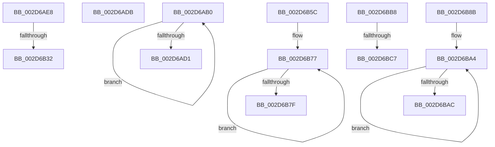

# sub_002D6AB0

- RVA: `0x002D6AB0`–`0x002D6BD6` (길이 `294` bytes)
- VA: `0x00000001402D6AB0`
- 실행 섹션: `.text`
- PDB 이름 있음: `아니요`; PDB Function 태그: `아니요`
- unwind 정보 RVA: `0x0006FE1C`
- 디코드: `67`개 명령, `294/294` bytes 표시
- 미해석 바이트: `0` (있으면 어셈블리에 `.byte`로 보존)

> 이 문서는 커널 이미지의 기계어와 PDB 기호를 분석해 생성했습니다. 4번과 5번은 함수 원형과 자료형을 바이너리 사용 방식에서 추정한 C 해석이며 원본 소스 복구 결과는 아닙니다.

## 1. Dependencies

- 직접 호출 지점: **3**; 고유 호출 대상: **2**
- 직접 호출자로 확인된 함수: **0**
- RIP 상대 이미지 참조: **2**

### Outgoing calls
- `0x002D6B06` → [memset](../6C/memset_function_006C6C40.md) (function, `0x006C6C40`)
- `0x002D6B72` → [memcpy](../6C/memcpy_function_006C6840.md) (function, `0x006C6840`)
- `0x002D6B9F` → [memcpy](../6C/memcpy_function_006C6840.md) (function, `0x006C6840`)

### Direct callers
- 이 함수 시작 RVA로 연결되는 직접 call은 확인되지 않았습니다. 간접 호출은 완전히 역산할 수 없습니다.

### Static image references
- `0x002D6B0B` → RVA `0x00F231B0` (`.data`; read)
- `0x002D6B60` → RVA `0x00FC7128` (`ALMOSTRO`; read)

## 2. Other-region calls and transfers

- 다른 실행 섹션으로 향하는 call: **0**
- call이 아닌 외부 분기/꼬리 이동: **7**
  - `0x002D6AD6` → [sub_002D6584 + 0x18A](Unknown_function_002D6584.md) (`tail-transfer`)
  - `0x002D6B2C` → [sub_002D6C05](Unknown_function_002D6C05.md) (`tail-transfer`)
  - `0x002D6B57` → [sub_002D6584 + 0x4C0](Unknown_function_002D6584.md) (`tail-transfer`)
  - `0x002D6B86` → [sub_002D6584 + 0x85](Unknown_function_002D6584.md) (`tail-transfer`)
  - `0x002D6BB3` → [sub_002D6584 + 0x349](Unknown_function_002D6584.md) (`tail-transfer`)
  - `0x002D6BC1` → [sub_002D6584 + 0x2D3](Unknown_function_002D6584.md) (`tail-transfer`)
  - `0x002D6BD1` → [sub_002D6584 + 0x2BB](Unknown_function_002D6584.md) (`tail-transfer`)

## 3. Assembly (complete function range)

```asm
002D6AB0  0F B7 C8                        movzx ecx, ax
002D6AB3  48 8D 54 24 78                  lea rdx, [rsp + 0x78]
002D6AB8  48 8D 14 CA                     lea rdx, [rdx + rcx*8]
002D6ABC  66 FF C0                        inc ax
002D6ABF  49 8B 8C CE 08 71 F0 00         mov rcx, qword ptr [r14 + rcx*8 + 0xf07108]
002D6AC7  48 21 0A                        and qword ptr [rdx], rcx
002D6ACA  66 3B 44 24 70                  cmp ax, word ptr [rsp + 0x70]
002D6ACF  72 DF                           jb 0x1402d6ab0
002D6AD1  0F B7 5C 24 72                  movzx ebx, word ptr [rsp + 0x72]
002D6AD6  E9 33 FC FF FF                  jmp 0x1402d670e
002D6ADB  41 8B 8C BE E0 6C 2D 00         mov ecx, dword ptr [r14 + rdi*4 + 0x2d6ce0]
002D6AE3  49 03 CE                        add rcx, r14
002D6AE6  FF E1                           jmp rcx
002D6AE8  CC                              int3
002D6AE9  CC                              int3
002D6AEA  CC                              int3
002D6AEB  CC                              int3
002D6AEC  33 D2                           xor edx, edx
002D6AEE  48 C7 85 80 00 00 00 01 00 20 00  mov qword ptr [rbp + 0x80], 0x200001
002D6AF9  41 B8 00 01 00 00               mov r8d, 0x100
002D6AFF  48 8D 8D 88 00 00 00            lea rcx, [rbp + 0x88]
002D6B06  E8 35 01 3F 00                  call 0x1406c6c40
002D6B0B  48 8B 05 9E C6 C4 00            mov rax, qword ptr [rip + 0xc4c69e]
002D6B12  8D 4F FB                        lea ecx, [rdi - 5]
002D6B15  44 8B 04 88                     mov r8d, dword ptr [rax + rcx*4]
002D6B19  41 8B C8                        mov ecx, r8d
002D6B1C  0F B7 85 80 00 00 00            movzx eax, word ptr [rbp + 0x80]
002D6B23  41 83 E0 3F                     and r8d, 0x3f
002D6B27  C1 E9 06                        shr ecx, 6
002D6B2A  3B C1                           cmp eax, ecx
002D6B2C  0F 86 D3 00 00 00               jbe 0x1402d6c05
002D6B32  48 8D 95 88 00 00 00            lea rdx, [rbp + 0x88]
002D6B39  41 8B C0                        mov eax, r8d
002D6B3C  48 8D 14 CA                     lea rdx, [rdx + rcx*8]
002D6B40  48 8B 0A                        mov rcx, qword ptr [rdx]
002D6B43  48 0F AB C1                     bts rcx, rax
002D6B47  48 89 0A                        mov qword ptr [rdx], rcx
002D6B4A  49 8B F4                        mov rsi, r12
002D6B4D  4C 8D BD 80 00 00 00            lea r15, [rbp + 0x80]
002D6B54  4D 8B F4                        mov r14, r12
002D6B57  E9 E8 FE FF FF                  jmp 0x1402d6a44
002D6B5C  44 0F B7 C7                     movzx r8d, di
002D6B60  48 8D 15 C1 05 CF 00            lea rdx, [rip + 0xcf05c1]
002D6B67  49 C1 E0 03                     shl r8, 3
002D6B6B  48 8D 8D A8 02 00 00            lea rcx, [rbp + 0x2a8]
002D6B72  E8 C9 FC 3E 00                  call 0x1406c6840
002D6B77  66 FF C3                        inc bx
002D6B7A  66 3B DF                        cmp bx, di
002D6B7D  72 F8                           jb 0x1402d6b77
002D6B7F  0F B7 8D A2 02 00 00            movzx ecx, word ptr [rbp + 0x2a2]
002D6B86  E9 7E FA FF FF                  jmp 0x1402d6609
002D6B8B  44 0F B7 C6                     movzx r8d, si
002D6B8F  48 8D 54 24 78                  lea rdx, [rsp + 0x78]
002D6B94  49 C1 E0 03                     shl r8, 3
002D6B98  48 8D 8D 98 01 00 00            lea rcx, [rbp + 0x198]
002D6B9F  E8 9C FC 3E 00                  call 0x1406c6840
002D6BA4  66 FF C3                        inc bx
002D6BA7  66 3B DE                        cmp bx, si
002D6BAA  72 F8                           jb 0x1402d6ba4
002D6BAC  0F B7 8D 92 01 00 00            movzx ecx, word ptr [rbp + 0x192]
002D6BB3  E9 15 FD FF FF                  jmp 0x1402d68cd
002D6BB8  0F B7 85 92 01 00 00            movzx eax, word ptr [rbp + 0x192]
002D6BBF  3B C1                           cmp eax, ecx
002D6BC1  0F 86 90 FC FF FF               jbe 0x1402d6857
002D6BC7  8D 41 01                        lea eax, [rcx + 1]
002D6BCA  66 89 85 90 01 00 00            mov word ptr [rbp + 0x190], ax
002D6BD1  E9 69 FC FF FF                  jmp 0x1402d683f
```

## 4. C-style interpretation (structured pseudocode)

```c
__int64 __fastcall sub_002D6AB0(__int64 a1, __int64 a2, __int64 a3, __int64 a4, __int64 a5, __int64 a6, __int64 a7, __int64 a8, __int64 a9, __int64 a10, __int64 a11, __int64 a12, __int64 a13, unsigned __int16 a14, __int64 a15)
{
    __int64 result;
    unsigned __int16 v_stack_p72;
    unsigned __int64 v_stack_p78;

    result = (unsigned __int16)((result) + 1);
    if (((unsigned __int16)(result)) < a14) goto loc_002D6AB0;
}
```

## 5. (Beta) C Style

```c
int64_t sub_002D6AB0(int64_t Arg1, int64_t Arg2, int64_t Arg3, int64_t Arg4, uint64_t Arg5, uint64_t Arg6, uint64_t Arg7, uint64_t Arg8, uint64_t Arg9, uint64_t Arg10, uint64_t Arg11, uint64_t Arg12, uint64_t Arg13, uint16_t Arg14, int64_t Arg15)
{
    int64_t result;
    uint16_t v_stack_p72;
    uint64_t v_stack_p78;

    result = (uint16_t)((result) + 1);
    if (((uint16_t)(result)) < Arg14) goto loc_002D6AB0;
}
```

## 6. Execution-region graph

[열기: 2D/3D 그래프와 함수 탐색 컨트롤 패널](../../../control-panel.html?section=text&rva=0x002D6AB0&view=graph)

- 2D 그래프는 위에서 아래로 흐르고, 3D 그래프는 빈 공간을 드래그해 회전합니다. Shift+드래그는 이동, 휠은 확대·축소, 함수 노드 선택은 대상 보고서 이동입니다.

### Static fallback


