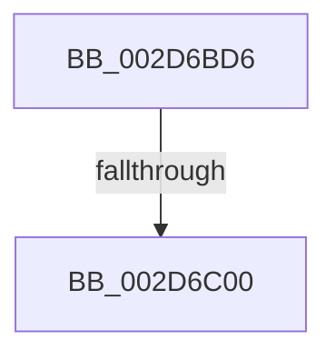

# sub_002D6BD6

- RVA: `0x002D6BD6`–`0x002D6C05` (길이 `47` bytes)
- VA: `0x00000001402D6BD6`
- 실행 섹션: `.text`
- PDB 이름 있음: `아니요`; PDB Function 태그: `아니요`
- unwind 정보 RVA: `0x0006FE44`
- 디코드: `10`개 명령, `47/47` bytes 표시
- 미해석 바이트: `0` (있으면 어셈블리에 `.byte`로 보존)

> 이 문서는 커널 이미지의 기계어와 PDB 기호를 분석해 생성했습니다. 4번과 5번은 함수 원형과 자료형을 바이너리 사용 방식에서 추정한 C 해석이며 원본 소스 복구 결과는 아닙니다.

## 1. Dependencies

- 직접 호출 지점: **2**; 고유 호출 대상: **2**
- 직접 호출자로 확인된 함수: **0**
- RIP 상대 이미지 참조: **1**

### Outgoing calls
- `0x002D6BD6` → [HalQueryMaximumProcessorCount](../4A/HalQueryMaximumProcessorCount_function_004AC9A0.md) (function, `0x004AC9A0`)
- `0x002D6BEB` → [ExAllocatePool2](../../poolcode/B8/ExAllocatePool2_function_00B820F0.md) (function, `0x00B820F0`)

### Direct callers
- 이 함수 시작 RVA로 연결되는 직접 call은 확인되지 않았습니다. 간접 호출은 완전히 역산할 수 없습니다.

### Static image references
- `0x002D6BF0` → RVA `0x00F070F8` (`.data`; write)

## 2. Other-region calls and transfers

- 다른 실행 섹션으로 향하는 call: **1**
  - `0x002D6BEB` → [ExAllocatePool2](../../poolcode/B8/ExAllocatePool2_function_00B820F0.md) (`.text` → `POOLCODE`)
- call이 아닌 외부 분기/꼬리 이동: **2**
  - `0x002D6BFA` → [sub_002D6584](Unknown_function_002D6584.md) (`tail-transfer`)
  - `0x002D6C00` → [sub_002D6A87](Unknown_function_002D6A87.md) (`tail-transfer`)

## 3. Assembly (complete function range)

```asm
002D6BD6  E8 C5 5D 1D 00                  call 0x1404ac9a0
002D6BDB  C1 E0 03                        shl eax, 3
002D6BDE  B9 40 00 00 00                  mov ecx, 0x40
002D6BE3  8B D0                           mov edx, eax
002D6BE5  41 B8 49 54 72 6B               mov r8d, 0x6b725449
002D6BEB  E8 00 B5 8A 00                  call 0x140b820f0
002D6BF0  48 89 05 01 05 C3 00            mov qword ptr [rip + 0xc30501], rax
002D6BF7  48 85 C0                        test rax, rax
002D6BFA  0F 85 84 F9 FF FF               jne 0x1402d6584
002D6C00  E9 82 FE FF FF                  jmp 0x1402d6a87
```

## 4. C-style interpretation (structured pseudocode)

```c
__int64 __fastcall sub_002D6BD6(void)
{
    __int64 result;

    result = HalQueryMaximumProcessorCount(a1, a2, a3, a4);
    result = (unsigned int)((result) << (3));
    result = ExAllocatePool2(64, (unsigned int)((unsigned int)(result)), (unsigned int)(0x6B725449ULL), a4);
    *(unsigned __int64 *)(v_rip + 12780801) = result;
}
```

## 5. (Beta) C Style

```c
void sub_002D6BD6(void)
{
    int64_t result;

    result = HalQueryMaximumProcessorCount(a1, a2, a3, a4);
    result = (uint32_t)((result) << (3));
    result = ExAllocatePool2(64, (uint32_t)((uint32_t)(result)), (uint32_t)(0x6B725449ULL), a4);
    *(uint64_t *)(v_rip + 0xC30501) = result;
}
```

## 6. Execution-region graph

[열기: 2D/3D 그래프와 함수 탐색 컨트롤 패널](../../../control-panel.html?section=text&rva=0x002D6BD6&view=graph)

- 2D 그래프는 위에서 아래로 흐르고, 3D 그래프는 빈 공간을 드래그해 회전합니다. Shift+드래그는 이동, 휠은 확대·축소, 함수 노드 선택은 대상 보고서 이동입니다.

### Static fallback


