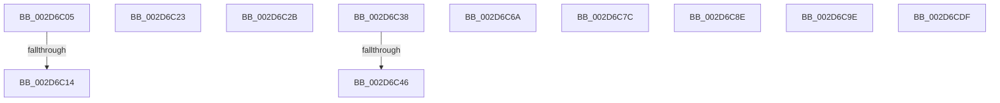

# sub_002D6C05

- RVA: `0x002D6C05`–`0x002D6CFC` (길이 `247` bytes)
- VA: `0x00000001402D6C05`
- 실행 섹션: `.text`
- PDB 이름 있음: `아니요`; PDB Function 태그: `아니요`
- unwind 정보 RVA: `0x0006FE54`
- 디코드: `53`개 명령, `247/247` bytes 표시
- 미해석 바이트: `1` (있으면 어셈블리에 `.byte`로 보존)

> 이 문서는 커널 이미지의 기계어와 PDB 기호를 분석해 생성했습니다. 4번과 5번은 함수 원형과 자료형을 바이너리 사용 방식에서 추정한 C 해석이며 원본 소스 복구 결과는 아닙니다.

## 1. Dependencies

- 직접 호출 지점: **2**; 고유 호출 대상: **2**
- 직접 호출자로 확인된 함수: **0**
- RIP 상대 이미지 참조: **3**

### Outgoing calls
- `0x002D6C5F` → [KiIntPartGetLowestClassProcessorInMask](KiIntPartGetLowestClassProcessorInMask_function_002D89D4.md) (function, `0x002D89D4`)
- `0x002D6CD5` → [guard_dispatch_icall](../6B/guard_dispatch_icall_function_006BAAD0.md) (function, `0x006BAAD0`)

### Direct callers
- 이 함수 시작 RVA로 연결되는 직접 call은 확인되지 않았습니다. 간접 호출은 완전히 역산할 수 없습니다.

### Static image references
- `0x002D6C38` → RVA `0x00F07100` (`.data`; read)
- `0x002D6C46` → RVA `0x00F07108` (`.data`; read)
- `0x002D6C9E` → RVA `0x00F0B260` (`.data`; read)

## 2. Other-region calls and transfers

- 다른 실행 섹션으로 향하는 call: **0**
- call이 아닌 외부 분기/꼬리 이동: **10**
  - `0x002D6C0E` → [sub_002D6AB0 + 0x9A](Unknown_function_002D6AB0.md) (`tail-transfer`)
  - `0x002D6C1E` → [sub_002D6AB0 + 0x82](Unknown_function_002D6AB0.md) (`tail-transfer`)
  - `0x002D6C26` → [sub_002D6584 + 0xE7](Unknown_function_002D6584.md) (`tail-transfer`)
  - `0x002D6C33` → [sub_002D6584 + 0x17C](Unknown_function_002D6584.md) (`tail-transfer`)
  - `0x002D6C40` → [sub_006DDBFA](../6D/Unknown_function_006DDBFA.md) (`tail-transfer`)
  - `0x002D6C65` → [sub_006DDBFA + 0x3](../6D/Unknown_function_006DDBFA.md) (`tail-transfer`)
  - `0x002D6C77` → [sub_002D6584 + 0x4C0](Unknown_function_002D6584.md) (`tail-transfer`)
  - `0x002D6C89` → [sub_002D6584 + 0x4C0](Unknown_function_002D6584.md) (`tail-transfer`)
  - `0x002D6C99` → [sub_002D6584 + 0x4C0](Unknown_function_002D6584.md) (`tail-transfer`)
  - `0x002D6CDA` → [sub_002D6584 + 0x3F0](Unknown_function_002D6584.md) (`tail-transfer`)

## 3. Assembly (complete function range)

```asm
002D6C05  0F B7 85 82 00 00 00            movzx eax, word ptr [rbp + 0x82]
002D6C0C  3B C1                           cmp eax, ecx
002D6C0E  0F 86 36 FF FF FF               jbe 0x1402d6b4a
002D6C14  8D 41 01                        lea eax, [rcx + 1]
002D6C17  66 89 85 80 00 00 00            mov word ptr [rbp + 0x80], ax
002D6C1E  E9 0F FF FF FF                  jmp 0x1402d6b32
002D6C23  0F B7 C7                        movzx eax, di
002D6C26  E9 40 FA FF FF                  jmp 0x1402d666b
002D6C2B  66 89 5C 24 70                  mov word ptr [rsp + 0x70], bx
002D6C30  0F B7 CB                        movzx ecx, bx
002D6C33  E9 C8 FA FF FF                  jmp 0x1402d6700
002D6C38  66 44 39 2D C0 04 C3 00         cmp word ptr [rip + 0xc304c0], r13w
002D6C40  0F 85 B4 6F 40 00               jne 0x1406ddbfa
002D6C46  48 8B 05 BB 04 C3 00            mov rax, qword ptr [rip + 0xc304bb]
002D6C4D  48 8D 4C 24 58                  lea rcx, [rsp + 0x58]
002D6C52  0F 57 C0                        xorps xmm0, xmm0
002D6C55  0F 11 44 24 58                  movups xmmword ptr [rsp + 0x58], xmm0
002D6C5A  48 89 44 24 58                  mov qword ptr [rsp + 0x58], rax
002D6C5F  E8 70 1D 00 00                  call 0x1402d89d4
002D6C64  90                              nop
002D6C65  E9 93 6F 40 00                  jmp 0x1406ddbfd
002D6C6A  49 8B F4                        mov rsi, r12
002D6C6D  4C 8D BD A0 02 00 00            lea r15, [rbp + 0x2a0]
002D6C74  4D 8B F4                        mov r14, r12
002D6C77  E9 C8 FD FF FF                  jmp 0x1402d6a44
002D6C7C  49 8B F4                        mov rsi, r12
002D6C7F  4C 8D BD 90 01 00 00            lea r15, [rbp + 0x190]
002D6C86  4D 8B F4                        mov r14, r12
002D6C89  E9 B6 FD FF FF                  jmp 0x1402d6a44
002D6C8E  49 8B F4                        mov rsi, r12
002D6C91  4C 8D 7C 24 70                  lea r15, [rsp + 0x70]
002D6C96  4D 8B F4                        mov r14, r12
002D6C99  E9 A6 FD FF FF                  jmp 0x1402d6a44
002D6C9E  48 8B 15 BB 45 C3 00            mov rdx, qword ptr [rip + 0xc345bb]
002D6CA5  48 8D 8D 80 00 00 00            lea rcx, [rbp + 0x80]
002D6CAC  48 89 4C 24 38                  mov qword ptr [rsp + 0x38], rcx
002D6CB1  4C 8D 8D 90 01 00 00            lea r9, [rbp + 0x190]
002D6CB8  48 8D 8D C0 04 00 00            lea rcx, [rbp + 0x4c0]
002D6CBF  44 8B C7                        mov r8d, edi
002D6CC2  48 89 4C 24 30                  mov qword ptr [rsp + 0x30], rcx
002D6CC7  41 0F B6 CD                     movzx ecx, r13b
002D6CCB  4C 89 64 24 28                  mov qword ptr [rsp + 0x28], r12
002D6CD0  4C 89 64 24 20                  mov qword ptr [rsp + 0x20], r12
002D6CD5  E8 F6 3D 3E 00                  call 0x1406baad0
002D6CDA  E9 95 FC FF FF                  jmp 0x1402d6974
002D6CDF  90                              nop
002D6CE0  FB                              sti
002D6CE1  68 2D 00 6A 6C                  push 0x6c6a002d
002D6CE6  2D 00 7C 6C 2D                  sub eax, 0x2d6c7c00
002D6CEB  00 8E 6C 2D 00 FB               add byte ptr [rsi - 0x4ffd294], cl
002D6CF1  68 2D 00 EC 6A                  push 0x6aec002d
002D6CF6  2D 00 EC 6A 2D                  sub eax, 0x2d6aec00
002D6CFB  00                              .byte 0x00
```

## 4. C-style interpretation (structured pseudocode)

```c
__int64 __fastcall sub_002D6C05(__int64 a1)
{
    unsigned __int64 v_stack_p20;
    unsigned __int64 v_stack_p28;
    unsigned __int64 v_stack_p30;
    unsigned __int64 v_stack_p38;
    unsigned __int64 v_stack_p58;
    unsigned __int16 v_stack_p70;

    *(unsigned __int16 *)(v_rbp + 128) = (unsigned __int16)(a1 + 1);
}
```

## 5. (Beta) C Style

```c
int64_t sub_002D6C05(void *Arg1)
{
    uint8_t *arg1 = (uint8_t *)Arg1;

    uint64_t v_stack_p20;
    uint64_t v_stack_p28;
    uint64_t v_stack_p30;
    uint64_t v_stack_p38;
    uint64_t v_stack_p58;
    uint16_t v_stack_p70;

    *(uint16_t *)(local_rbp + 0x80) = (uint16_t)(Arg1 + 1);
}
```

### 관측된 메모리 오프셋

구조체 형식이 확인되지 않은 접근은 인자 기준의 오프셋으로만 기록했습니다.

| 기준 인자 | 오프셋 표현 | 폭 (bit) | 접근 |
|---|---:|---:|---|
| `Arg1` | `+ 0x1` | `32` | `R` |

## 6. Execution-region graph

[열기: 2D/3D 그래프와 함수 탐색 컨트롤 패널](../../../control-panel.html?section=text&rva=0x002D6C05&view=graph)

- 2D 그래프는 위에서 아래로 흐르고, 3D 그래프는 빈 공간을 드래그해 회전합니다. Shift+드래그는 이동, 휠은 확대·축소, 함수 노드 선택은 대상 보고서 이동입니다.

### Static fallback


