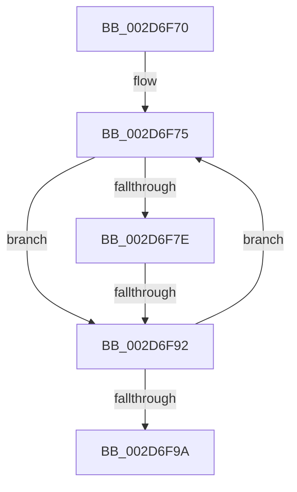

# sub_002D6F70

- RVA: `0x002D6F70`–`0x002D6F9F` (길이 `47` bytes)
- VA: `0x00000001402D6F70`
- 실행 섹션: `.text`
- PDB 이름 있음: `아니요`; PDB Function 태그: `아니요`
- unwind 정보 RVA: `0x0006FEE4`
- 디코드: `10`개 명령, `47/47` bytes 표시
- 미해석 바이트: `0` (있으면 어셈블리에 `.byte`로 보존)

> 이 문서는 커널 이미지의 기계어와 PDB 기호를 분석해 생성했습니다. 4번과 5번은 함수 원형과 자료형을 바이너리 사용 방식에서 추정한 C 해석이며 원본 소스 복구 결과는 아닙니다.

## 1. Dependencies

- 직접 호출 지점: **0**; 고유 호출 대상: **0**
- 직접 호출자로 확인된 함수: **0**
- RIP 상대 이미지 참조: **0**

### Outgoing calls
- 직접 디코드된 call 명령이 없습니다.

### Direct callers
- 이 함수 시작 RVA로 연결되는 직접 call은 확인되지 않았습니다. 간접 호출은 완전히 역산할 수 없습니다.

### Static image references
- 디코드된 RIP-relative 메모리 참조가 없습니다.

## 2. Other-region calls and transfers

- 다른 실행 섹션으로 향하는 call: **0**
- call이 아닌 외부 분기/꼬리 이동: **1**
  - `0x002D6F8C` → [sub_002D702E](Unknown_function_002D702E.md) (`tail-transfer`)

## 3. Assembly (complete function range)

```asm
002D6F70  48 89 6C 24 50                  mov qword ptr [rsp + 0x50], rbp
002D6F75  80 BB 84 00 00 00 00            cmp byte ptr [rbx + 0x84], 0
002D6F7C  74 14                           je 0x1402d6f92
002D6F7E  48 8B 83 A0 00 00 00            mov rax, qword ptr [rbx + 0xa0]
002D6F85  48 39 83 B0 00 00 00            cmp qword ptr [rbx + 0xb0], rax
002D6F8C  0F 85 9C 00 00 00               jne 0x1402d702e
002D6F92  48 8B 1B                        mov rbx, qword ptr [rbx]
002D6F95  49 3B DE                        cmp rbx, r14
002D6F98  75 DB                           jne 0x1402d6f75
002D6F9A  48 8B 6C 24 50                  mov rbp, qword ptr [rsp + 0x50]
```

## 4. C-style interpretation (structured pseudocode)

```c
__int64 __fastcall sub_002D6F70(__int64 a1, __int64 a2, __int64 a3, __int64 a4, __int64 a5, __int64 a6, __int64 a7, __int64 a8, __int64 a9, __int64 a10)
{
    unsigned __int64 v_stack_p50;

    v_stack_p50 = v_rbp;
loc_002D6F75:
    if ((*(unsigned __int8 *)(v_rbx + 132)) == 0) goto loc_002D6F92;
loc_002D6F92:
    if ((*(unsigned __int64 *)(v_rbx)) != v_r14) goto loc_002D6F75;
    return *(unsigned __int64 *)(v_rbx + 160);
}
```

## 5. (Beta) C Style

```c
int64_t sub_002D6F70(int64_t Arg1, int64_t Arg2, int64_t Arg3, int64_t Arg4, uint64_t Arg5, uint64_t Arg6, uint64_t Arg7, uint64_t Arg8, uint64_t Arg9, int64_t Arg10)
{
    uint64_t v_stack_p50;

    v_stack_p50 = local_rbp;
loc_002D6F75:
    if ((*(uint8_t *)(local_rbx + 0x84)) == 0) goto loc_002D6F92;
loc_002D6F92:
    if ((*(uint64_t *)(local_rbx)) != local_r14) goto loc_002D6F75;
    return *(uint64_t *)(local_rbx + 0xA0);
}
```

## 6. Execution-region graph

[열기: 2D/3D 그래프와 함수 탐색 컨트롤 패널](../../../control-panel.html?section=text&rva=0x002D6F70&view=graph)

- 2D 그래프는 위에서 아래로 흐르고, 3D 그래프는 빈 공간을 드래그해 회전합니다. Shift+드래그는 이동, 휠은 확대·축소, 함수 노드 선택은 대상 보고서 이동입니다.

### Static fallback


