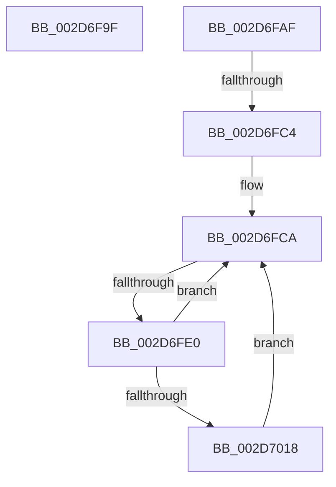

# sub_002D6F9F

- RVA: `0x002D6F9F`–`0x002D702E` (길이 `143` bytes)
- VA: `0x00000001402D6F9F`
- 실행 섹션: `.text`
- PDB 이름 있음: `아니요`; PDB Function 태그: `아니요`
- unwind 정보 RVA: `0x0006FEF8`
- 디코드: `36`개 명령, `143/143` bytes 표시
- 미해석 바이트: `0` (있으면 어셈블리에 `.byte`로 보존)

> 이 문서는 커널 이미지의 기계어와 PDB 기호를 분석해 생성했습니다. 4번과 5번은 함수 원형과 자료형을 바이너리 사용 방식에서 추정한 C 해석이며 원본 소스 복구 결과는 아닙니다.

## 1. Dependencies

- 직접 호출 지점: **1**; 고유 호출 대상: **1**
- 직접 호출자로 확인된 함수: **0**
- RIP 상대 이미지 참조: **1**

### Outgoing calls
- `0x002D7004` → [KeGetPrcb](KeGetPrcb_function_002D85D0.md) (function, `0x002D85D0`)

### Direct callers
- 이 함수 시작 RVA로 연결되는 직접 call은 확인되지 않았습니다. 간접 호출은 완전히 역산할 수 없습니다.

### Static image references
- `0x002D6FFA` → RVA `0x00F231B8` (`.data`; read)

## 2. Other-region calls and transfers

- 다른 실행 섹션으로 향하는 call: **0**
- call이 아닌 외부 분기/꼬리 이동: **2**
  - `0x002D6FBE` → [sub_002D710C](Unknown_function_002D710C.md) (`tail-transfer`)
  - `0x002D6FDA` → [sub_002D70BC](Unknown_function_002D70BC.md) (`tail-transfer`)

## 3. Assembly (complete function range)

```asm
002D6F9F  48 8B 5C 24 58                  mov rbx, qword ptr [rsp + 0x58]
002D6FA4  33 C0                           xor eax, eax
002D6FA6  48 83 C4 20                     add rsp, 0x20
002D6FAA  41 5E                           pop r14
002D6FAC  5F                              pop rdi
002D6FAD  5E                              pop rsi
002D6FAE  C3                              ret
002D6FAF  CC                              int3
002D6FB0  0F B7 B3 B8 00 00 00            movzx esi, word ptr [rbx + 0xb8]
002D6FB7  66 3B B3 A8 00 00 00            cmp si, word ptr [rbx + 0xa8]
002D6FBE  0F 85 48 01 00 00               jne 0x1402d710c
002D6FC4  48 F7 D7                        not rdi
002D6FC7  48 23 F8                        and rdi, rax
002D6FCA  0F B7 CE                        movzx ecx, si
002D6FCD  FF C1                           inc ecx
002D6FCF  C7 44 24 40 00 00 00 00         mov dword ptr [rsp + 0x40], 0
002D6FD7  48 85 FF                        test rdi, rdi
002D6FDA  0F 84 DC 00 00 00               je 0x1402d70bc
002D6FE0  48 0F BC D7                     bsf rdx, rdi
002D6FE4  0F B7 CE                        movzx ecx, si
002D6FE7  0F B6 C2                        movzx eax, dl
002D6FEA  48 0F B3 C7                     btr rdi, rax
002D6FEE  C1 E1 06                        shl ecx, 6
002D6FF1  0F B6 C2                        movzx eax, dl
002D6FF4  03 C8                           add ecx, eax
002D6FF6  89 54 24 40                     mov dword ptr [rsp + 0x40], edx
002D6FFA  48 8B 05 B7 C1 C4 00            mov rax, qword ptr [rip + 0xc4c1b7]
002D7001  8B 0C 88                        mov ecx, dword ptr [rax + rcx*4]
002D7004  E8 C7 15 00 00                  call 0x1402d85d0
002D7009  FF 80 98 2D 00 00               inc dword ptr [rax + 0x2d98]
002D700F  83 B8 98 2D 00 00 01            cmp dword ptr [rax + 0x2d98], 1
002D7016  75 B2                           jne 0x1402d6fca
002D7018  0F B6 88 D1 00 00 00            movzx ecx, byte ptr [rax + 0xd1]
002D701F  48 8B 80 C0 00 00 00            mov rax, qword ptr [rax + 0xc0]
002D7026  F0 48 0F B3 48 70               lock btr qword ptr [rax + 0x70], rcx
002D702C  EB 9C                           jmp 0x1402d6fca
```

## 4. C-style interpretation (structured pseudocode)

```c
__int64 __fastcall sub_002D6F9F(__int64 a1, __int64 a2, __int64 a3, __int64 a4, __int64 a5, __int64 a6, __int64 a7, __int64 a8, __int64 a9, __int64 a10, __int64 a11)
{
    __int64 result;
    __int64 v_rsp;
    unsigned int v_stack_p78;

    result = 0;
    v_rsp = (v_rsp) + (32);
    return result;
}
```

## 5. (Beta) C Style

```c
int64_t sub_002D6F9F(int64_t Arg1, int64_t Arg2, int64_t Arg3, int64_t Arg4, uint64_t Arg5, uint64_t Arg6, uint64_t Arg7, uint64_t Arg8, uint64_t Arg9, uint64_t Arg10, int64_t Arg11)
{
    int64_t result;
    int64_t local_rsp;
    uint32_t v_stack_p78;

    result = 0;
    local_rsp = (local_rsp) + (32);
    return result;
}
```

## 6. Execution-region graph

[열기: 2D/3D 그래프와 함수 탐색 컨트롤 패널](../../../control-panel.html?section=text&rva=0x002D6F9F&view=graph)

- 2D 그래프는 위에서 아래로 흐르고, 3D 그래프는 빈 공간을 드래그해 회전합니다. Shift+드래그는 이동, 휠은 확대·축소, 함수 노드 선택은 대상 보고서 이동입니다.

### Static fallback


