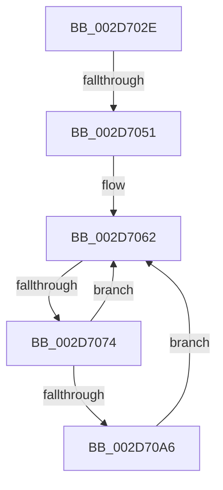

# sub_002D702E

- RVA: `0x002D702E`–`0x002D70BC` (길이 `142` bytes)
- VA: `0x00000001402D702E`
- 실행 섹션: `.text`
- PDB 이름 있음: `아니요`; PDB Function 태그: `아니요`
- unwind 정보 RVA: `0x0006FF0C`
- 디코드: `31`개 명령, `142/142` bytes 표시
- 미해석 바이트: `0` (있으면 어셈블리에 `.byte`로 보존)

> 이 문서는 커널 이미지의 기계어와 PDB 기호를 분석해 생성했습니다. 4번과 5번은 함수 원형과 자료형을 바이너리 사용 방식에서 추정한 C 해석이며 원본 소스 복구 결과는 아닙니다.

## 1. Dependencies

- 직접 호출 지점: **2**; 고유 호출 대상: **2**
- 직접 호출자로 확인된 함수: **0**
- RIP 상대 이미지 참조: **1**

### Outgoing calls
- `0x002D7038` → [KiIntSteerSetDestination](KiIntSteerSetDestination_function_002D581C.md) (function, `0x002D581C`)
- `0x002D7098` → [KeGetPrcb](KeGetPrcb_function_002D85D0.md) (function, `0x002D85D0`)

### Direct callers
- 이 함수 시작 RVA로 연결되는 직접 call은 확인되지 않았습니다. 간접 호출은 완전히 역산할 수 없습니다.

### Static image references
- `0x002D708E` → RVA `0x00F231B8` (`.data`; read)

## 2. Other-region calls and transfers

- 다른 실행 섹션으로 향하는 call: **0**
- call이 아닌 외부 분기/꼬리 이동: **2**
  - `0x002D704B` → [sub_002D7114](Unknown_function_002D7114.md) (`tail-transfer`)
  - `0x002D7072` → [sub_002D70D7](Unknown_function_002D70D7.md) (`tail-transfer`)

## 3. Assembly (complete function range)

```asm
002D702E  48 8D 93 B0 00 00 00            lea rdx, [rbx + 0xb0]
002D7035  48 8B CB                        mov rcx, rbx
002D7038  E8 DF E7 FF FF                  call 0x1402d581c
002D703D  0F B7 AB B8 00 00 00            movzx ebp, word ptr [rbx + 0xb8]
002D7044  66 39 AB A8 00 00 00            cmp word ptr [rbx + 0xa8], bp
002D704B  0F 85 C3 00 00 00               jne 0x1402d7114
002D7051  48 8B B3 B0 00 00 00            mov rsi, qword ptr [rbx + 0xb0]
002D7058  48 F7 D6                        not rsi
002D705B  48 23 B3 A0 00 00 00            and rsi, qword ptr [rbx + 0xa0]
002D7062  0F B7 CD                        movzx ecx, bp
002D7065  FF C1                           inc ecx
002D7067  C7 44 24 48 00 00 00 00         mov dword ptr [rsp + 0x48], 0
002D706F  48 85 F6                        test rsi, rsi
002D7072  74 63                           je 0x1402d70d7
002D7074  48 0F BC D6                     bsf rdx, rsi
002D7078  0F B7 CD                        movzx ecx, bp
002D707B  0F B6 C2                        movzx eax, dl
002D707E  48 0F B3 C6                     btr rsi, rax
002D7082  C1 E1 06                        shl ecx, 6
002D7085  0F B6 C2                        movzx eax, dl
002D7088  03 C8                           add ecx, eax
002D708A  89 54 24 48                     mov dword ptr [rsp + 0x48], edx
002D708E  48 8B 05 23 C1 C4 00            mov rax, qword ptr [rip + 0xc4c123]
002D7095  8B 0C 88                        mov ecx, dword ptr [rax + rcx*4]
002D7098  E8 33 15 00 00                  call 0x1402d85d0
002D709D  83 80 98 2D 00 00 FF            add dword ptr [rax + 0x2d98], -1
002D70A4  75 BC                           jne 0x1402d7062
002D70A6  0F B6 88 D1 00 00 00            movzx ecx, byte ptr [rax + 0xd1]
002D70AD  48 8B 80 C0 00 00 00            mov rax, qword ptr [rax + 0xc0]
002D70B4  F0 48 0F AB 48 70               lock bts qword ptr [rax + 0x70], rcx
002D70BA  EB A6                           jmp 0x1402d7062
```

## 4. C-style interpretation (structured pseudocode)

```c
__int64 __fastcall sub_002D702E(void)
{
    __int64 result;
    __int64 v_rsi;
    unsigned int v_stack_p48;

    result = KiIntSteerSetDestination(v_rbx, v_rbx + 176, a3, a4);
    v_rsi = ~(*(unsigned __int64 *)(v_rbx + 176));
    v_rsi = (v_rsi) & (*(unsigned __int64 *)(v_rbx + 160));
loc_002D7062:
    a1 = (unsigned int)(((unsigned __int16)(*(unsigned __int16 *)(v_rbx + 184))) + 1);
    v_stack_p48 = 0;
    a1 = (unsigned int)(((unsigned __int16)(*(unsigned __int16 *)(v_rbx + 184))) << (6));
    a1 = (unsigned int)((a1) + ((unsigned int)((unsigned __int8)(v_rbx + 176))));
    v_stack_p48 = (unsigned int)(v_rbx + 176);
    result = KeGetPrcb((unsigned int)(*(unsigned int *)(*(unsigned __int64 *)(v_rip + 12894499) + a1 * 4)), v_rbx + 176, a3, a4);
    if (condition_is_not_equal) goto loc_002D7062;
    goto loc_002D7062;
}
```

## 5. (Beta) C Style

```c
void sub_002D702E(void)
{
    int64_t result;
    int64_t local_rsi;
    uint32_t v_stack_p48;

    result = KiIntSteerSetDestination(local_rbx, local_rbx + 176, a3, a4);
    local_rsi = ~(*(uint64_t *)(local_rbx + 0xB0));
    local_rsi = (local_rsi) & (*(uint64_t *)(local_rbx + 0xA0));
loc_002D7062:
    a1 = (uint32_t)(((uint16_t)(*(uint16_t *)(local_rbx + 0xB8))) + 1);
    v_stack_p48 = 0;
    a1 = (uint32_t)(((uint16_t)(*(uint16_t *)(local_rbx + 0xB8))) << (6));
    a1 = (uint32_t)((a1) + ((uint32_t)((uint8_t)(local_rbx + 176))));
    v_stack_p48 = (uint32_t)(local_rbx + 176);
    result = KeGetPrcb((uint32_t)(*(uint32_t *)(*(uint64_t *)(v_rip + 0xC4C123) + a1 * 4)), local_rbx + 176, a3, a4);
    if (condition_is_not_equal) goto loc_002D7062;
    goto loc_002D7062;
}
```

## 6. Execution-region graph

[열기: 2D/3D 그래프와 함수 탐색 컨트롤 패널](../../../control-panel.html?section=text&rva=0x002D702E&view=graph)

- 2D 그래프는 위에서 아래로 흐르고, 3D 그래프는 빈 공간을 드래그해 회전합니다. Shift+드래그는 이동, 휠은 확대·축소, 함수 노드 선택은 대상 보고서 이동입니다.

### Static fallback


